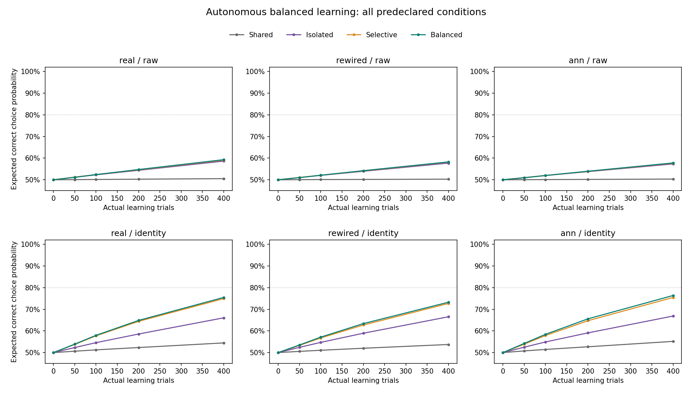
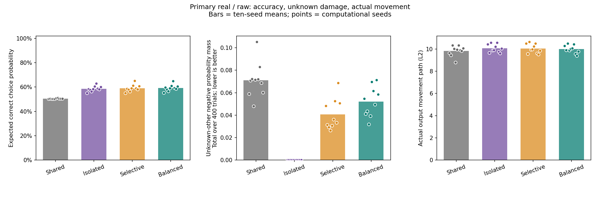
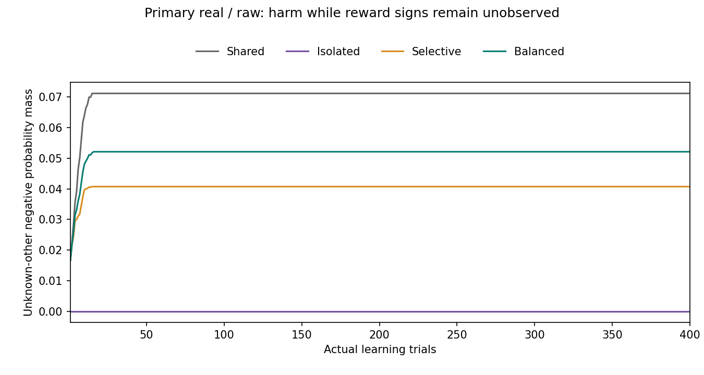

# 균형 방식을 실제 학습에 적용한 결과

같은 수정량 상한에서 균형 방식의 마지막 기대 정답 선택 확률은 **59.28%**였다. 기존 선택 억제는 **59.09%**, 전체 억제는 **58.61%**였다. 사전 실용 개선 가설 H_gain은 **미지지**, 충분한 습득 H_acquisition은 **미지지**, 미관측 방해 비악화 H_unknown은 **미지지**다.

쉽게 말하면, 답을 고칠 방향을 바꾼 뒤 **그 방향으로 실제로 400번씩 공부시켰다.** 이후의 선택과 보상도 달라지므로 저장된 한 번의 수정에 후보 방향만 대입했던 앞선 분석과 다르다. 세 가지 성공 기준을 별개로 판정했으며 실패한 기준을 낮추지 않았다.

## 주 조건에서 확인한 성적

실제 부분 배선(real)·원 입력(raw)이 주 조건이다. 아래 값은 새 계산 시드 10개의 평균이다. 기대 정답 선택 확률은 마지막 모델이 네 연습 입력에서 정답을 선택할 확률의 평균이다. 별도의 새 문제 시험 점수나 무작위로 실제 뽑은 정답 수와는 구분한다.

| 방식 | 마지막 기대 정답 선택 확률 | 충분한 습득 | 실제 출력 수정 경로 길이 |
|---|---:|---:|---:|
| 공유 수정 | 50.52% | 0/10 | 9.8291 |
| 번짐 전체 억제 | 58.61% | 0/10 | 10.0653 |
| 기존 선택 억제 | 59.09% | 0/10 | 10.0373 |
| 균형 방식 | 59.28% | 0/10 | 9.9866 |

균형−기존 선택 억제 차이는 **+0.19%p**, 양수인 시드는 **5/10**이었다. 균형−전체 억제는 **+0.67%p**, 양수인 시드는 **10/10**이었다. H_gain은 두 비교 각각 평균 +5%p 이상 및 양수 시드 8/10 이상을 요구한다. 단지 한 대조보다 수치가 크거나 공유 방식만 넘었다는 이유로 지지하지 않는다.

주 조건의 충분한 습득은 **0/10**이다. 시드별 마지막 평균 80% 이상·처음보다 25%p 이상 향상·정답이 Go인 두 입력과 NoGo인 두 입력 각각 70% 이상을 모두 만족하는 시드가 8개 이상이어야 한다. 이 기준은 성적 차이 기준과 독립이다.

## 아직 답을 모르는 다른 문제에 준 방해

여기서 **미관측 문제는 보상 부호를 아직 얻지 못한 네 연습문제 중 다른 문제**다. 새 문자열이나 새 규칙을 뜻하지 않는다. 현재 Go 보상을 얻으면 그 문제의 부호만 기록한다. NoGo의 0은 숨은 답을 알려주지 않는다. 수정 직전·직후의 같은 상태에서 다른 미관측 문제의 정답 확률이 떨어진 만큼만 합산한다. 도움을 받은 양으로 상쇄하지 않는다.

| 방식 | 400시행당 미관측 확률 방해 합계 | 미관측 다른 문제 노출 수 |
|---|---:|---:|
| 공유 수정 | 0.07107881 | 15.8 |
| 번짐 전체 억제 | 0.00000000 | 16.1 |
| 기존 선택 억제 | 0.04071511 | 15.8 |
| 균형 방식 | 0.05207974 | 15.8 |

균형−기존 선택 억제의 평균 방해 차이는 **+0.01136462**다. 기존 대비 **+27.91%**다. 더 나빠지지 않은 시드는 **0/10**이었다. 평균 차이 1e-8 이하와 비악화 시드 8/10 이상이 동시에 필요하다. 수치 허용 오차를 넘는 작은 피해도 원자료에서 지우지 않는다.

방해 합계 0.01은 여러 시행·다른 문제에서 생긴 **정답 선택 확률 감소 1%p를 합한 양**이다. 마지막 전체 정답률이 1%p 떨어졌다는 뜻은 아니다. 다른 문제에 준 도움·정답 점수(logit) 방해·노출당 방해도 시드별 요약에 별도로 남겼으며 주 확률 합계 지표와 바꿔 쓰지 않는다. 노출 횟수는 방법마다 달라 주 판정의 분모로 사용하지 않았다.

균형 방식과 선택 억제·전체 억제의 **관측된 문제 안전 위반은 허용 오차 안에서 0**이었다. 이 안전 조건은 모르는 답까지 보장하지 않는다. 공유 수정은 안전 제약이 없는 대조이므로 알려진 문제도 방해할 수 있다.

## 같은 제한과 실제로 쓴 양

네 방법 모두 한 시행 출력 계수 이동 0.1 이하, 400시행 경로 길이 40 이하, 이동 제곱합 4 이하를 지켰다. 단위 방향과 학습률 상한은 같지만 선택 확률·보상이 달라 **실제 누적 수정량은 같지 않다.** 따라서 같은 상한 아래의 비교이며 실제 비용을 완전히 맞춘 인과 분리가 아니다. 균형 최적화의 추가 계산 비용도 동일하게 맞추지 않았다.

총 실제 선택은 **96,000회**, 출력 갱신 호출도 **96,000회**다. 그중 비영 출력 이동은 **49,515회**였다. 균형 Go 방향 요청 **12,197회**는 실제 관측 상태별 캐시로 **510개 최적화**를 사용했고, NoGo **11,803회**는 solver를 생략했다. 캐시는 실제 자신의 획득 보상으로만 만들었다. 정답표를 먼저 알려 준 학습자는 없다.

내부 KC→MBON 가중치·인코더·같은 입력의 내부 활성은 고정이다. 바뀐 것은 선택을 결정하는 출력 계수와 별도의 4칸 보상 기록이다. 보상 기록을 직접 조회해 선택하지 않으며, 기록 조회 참고 점수 100%를 실제 선택 성능으로 바꾸지 않는다.

## 모든 사전 조건

다음 24조건을 전부 보존한다. 이름표 표현이나 재배선·ANN의 유리한 결과로 real/raw 주 판정을 대체하지 않는다.

| 배선 | 표현 | 방식 | 마지막 기대 정답 확률 | 습득 | 미관측 방해 합계 |
|---|---|---|---:|---:|---:|
| real | raw | 공유 수정 | 50.52% | 0/10 | 0.07107881 |
| real | raw | 번짐 전체 억제 | 58.61% | 0/10 | 0.00000000 |
| real | raw | 기존 선택 억제 | 59.09% | 0/10 | 0.04071511 |
| real | raw | 균형 방식 | 59.28% | 0/10 | 0.05207974 |
| real | identity | 공유 수정 | 54.46% | 0/10 | 0.06937344 |
| real | identity | 번짐 전체 억제 | 66.04% | 0/10 | 0.00000000 |
| real | identity | 기존 선택 억제 | 74.92% | 1/10 | 0.04471344 |
| real | identity | 균형 방식 | 75.46% | 1/10 | 0.04295419 |
| rewired | raw | 공유 수정 | 50.28% | 0/10 | 0.07149834 |
| rewired | raw | 번짐 전체 억제 | 57.69% | 0/10 | 0.00000000 |
| rewired | raw | 기존 선택 억제 | 58.15% | 0/10 | 0.04055180 |
| rewired | raw | 균형 방식 | 58.24% | 0/10 | 0.05019915 |
| rewired | identity | 공유 수정 | 53.73% | 0/10 | 0.06905782 |
| rewired | identity | 번짐 전체 억제 | 66.52% | 0/10 | 0.00000000 |
| rewired | identity | 기존 선택 억제 | 72.66% | 0/10 | 0.04444150 |
| rewired | identity | 균형 방식 | 73.25% | 0/10 | 0.04241069 |
| ann | raw | 공유 수정 | 50.32% | 0/10 | 0.07158741 |
| ann | raw | 번짐 전체 억제 | 57.32% | 0/10 | 0.00000000 |
| ann | raw | 기존 선택 억제 | 57.66% | 0/10 | 0.03978161 |
| ann | raw | 균형 방식 | 57.78% | 0/10 | 0.05065411 |
| ann | identity | 공유 수정 | 55.17% | 0/10 | 0.06798038 |
| ann | identity | 번짐 전체 억제 | 66.87% | 0/10 | 0.00000000 |
| ann | identity | 기존 선택 억제 | 75.48% | 0/10 | 0.04407623 |
| ann | identity | 균형 방식 | 76.36% | 0/10 | 0.04276569 |

## 주 조건의 시드별 결과

| 시드 | 균형 성적 | 균형−선택 억제 | 균형−전체 억제 | 균형 미관측 방해 | 균형−선택 억제 방해 |
|---|---:|---:|---:|---:|---:|
| 17501 | 55.23% | +0.20%p | +0.21%p | 0.05466163 | +0.00641508 |
| 17502 | 59.63% | +1.16%p | +1.32%p | 0.04109174 | +0.00968317 |
| 17503 | 57.88% | -0.06%p | +0.27%p | 0.04346756 | +0.01427876 |
| 17504 | 56.64% | +0.18%p | +0.32%p | 0.03194479 | +0.00561042 |
| 17505 | 59.03% | -0.05%p | +0.64%p | 0.03921009 | +0.00858035 |
| 17506 | 60.92% | -0.18%p | +0.43%p | 0.06972050 | +0.03365337 |
| 17507 | 65.03% | -0.01%p | +2.08%p | 0.06156380 | +0.00899618 |
| 17508 | 59.24% | +0.24%p | +0.51%p | 0.04946495 | +0.01608674 |
| 17509 | 58.58% | +0.44%p | +0.44%p | 0.07126621 | +0.00246714 |
| 17510 | 60.63% | -0.04%p | +0.52%p | 0.05840609 | +0.00787502 |

## 검산과 해석 범위

실행 전 **새 검사 239개와 기존 관련 84개, 총 323개**가 통과했다. 작은 합성 fixture에서 전체 경로와 집계를 대조한 뒤 실제 시드를 실행했다. 독립 검산기는 새 학습자를 import하지 않고 **190배열·96,000행·4,800정적 평가·510개 실제 균형 상태**를 재구성했다. 최적화 방향은 독립적인 쌍대 상한 계산으로 확인했고, 모든 수치·획득 정보·수정량 게이트가 통과했다. 이 무결성 통과와 세 과학 가설의 지지 여부는 서로 다르다.

이 결과는 네 인공 연습 입력에서의 제한된 출력 학습(Level 2)이다. 새 문제 일반화·실제 시각 수량 인지·내부 생물학적 가소성·인간 학습 유사성이나 공통 신경 기작을 새로 입증하지 않는다. 계산 시드는 동물 개체나 사람 참가자가 아니다. 기존 인간 비교 미지지, 일반화·간섭·학습 순서의 닫힌 선행 게이트와 Phase 5 첫 종합은 그대로 보존한다.

이번 등록은 여기서 완료한다. 추가로 원인을 보려면 우선 저장 기록에서 관측 전후·입력별 자기 수정과 도움의 배분을 분석할 수 있다. 새 방향·목적 가중치·학습 예산을 바꾸는 개입은 별도 사전 계획과 등록이 필요하다. 자동 반복은 PAUSED를 유지한다.

[실행 전 계획](balanced-learning-protocol.md) · [재현 안내](balanced-learning-reproduction.md) · [원 요약](../results/balanced_learning_v1/summary.json) · [독립 검산](../results/balanced_learning_v1/verification.json)
