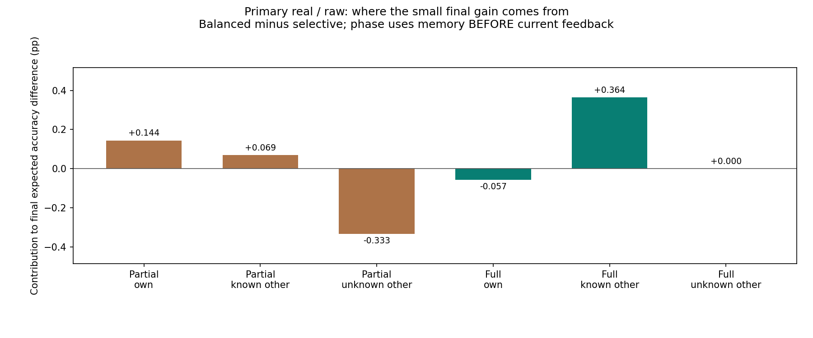
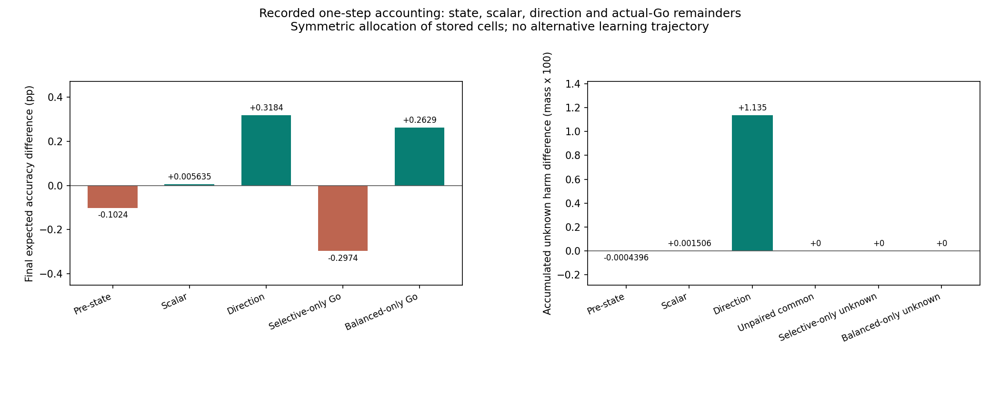
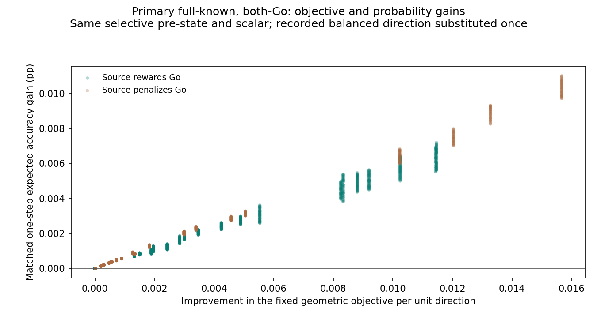

# 균형 방식의 작은 이득과 초반 방해를 나눈 분석

**기록에서 확인한 핵심은 “늦게 알아서 더 많이 다친 것”이 아니라, 같은 초반 노출에서 수정 방향이 미관측 문제에 더 큰 방해를 주었다는 것이다.** 네 답을 확인한 뒤에는 도움이 늘었지만, 초반 손실과 이후 선택·수정 상태의 차이를 합치면 최종 이득은 작았다. 이 결론은 저장된 경로의 수학적 분해이며 유일한 인과 원인을 증명한 새 학습 개입은 아니다.

주 조건(real/raw)의 균형−기존 선택 억제 최종 차이 **+0.187%p**를 독립 검산했다. 시드 간 표본 표준편차는 **0.388%p**다. 앞선 세 가설의 미지지와 주 조건 습득0/10을 그대로 둔다. 기존 결과를 새 시드나 더 긴 학습으로 바꾸지 않았다.

## 쉽게 보면: 초반에 잃고, 뒤에 얻었지만 차이는 작았다

네 답을 다 알기 전과 후를 나누고, 각 수정이 자기 문제·알려진 다른 문제·미관측 다른 문제에 준 실제 정답 확률 변화를 셌다. 알려짐은 **현재 보상을 보기 직전의 기록**으로 정한다. 마지막 답을 처음 확인한 시행도 초반에 포함한다.

| 실제 성적 변화의 장부 | 균형−선택 억제 기여 |
|---|---:|
| 네 답을 알기 전: 자기 문제 | +0.144%p |
| 네 답을 알기 전: 알려진 다른 문제 | +0.069%p |
| 네 답을 알기 전: 미관측 다른 문제 | -0.333%p |
| 네 답을 안 뒤: 자기 문제 | -0.057%p |
| 네 답을 안 뒤: 알려진 다른 문제 | +0.364%p |
| 네 답을 안 뒤: 미관측 다른 문제 | +0.000%p |

초반 합계는 **-0.119%p**, 네 답을 안 뒤 합계는 **+0.306%p**이고, 합치면 **+0.187%p**다. 초반 자기 수정·알려진 다른 문제의 이득 합계 **+0.213%p**보다 미관측 다른 문제의 순손실 **-0.333%p**가 컸다. 도움이 전혀 없었던 것은 아니다. 도움이 생겼지만 손실을 충분히 넘지 못했다.

위 장부는 모든 시행·네 입력의 실제 정답 확률 변화를 더한 뒤 4로 나눈 값이다. 이 항들을 합치면 마지막 평균 성적 차이에 돌아온다. 특정 항만 제거했을 때 새 학습 성적이 그만큼 오르리라는 예측은 아니다.

## 미관측 피해가 커진 것은 노출 시간이 늘어서였나

**아니었다.** 주 조건의 두 방식은 네 답을 모두 확인한 시행이 시드별로 정확히 같았다: `[7, 13, 10, 4, 13, 18, 8, 14, 14, 9]`. 범위는 **4–18시행**, 평균 **11.0시행**이다. 미관측 다른 문제의 노출 수는 두 방식 모두 평균15.8개였고, 같은 시행·목적지에서 미관측 여부가 서로 다른 경우는0개였다. 즉 이 자료에서는 더 오래 모르는 상태로 남았다는 설명이 맞지 않는다.

추가 방해 질량 **0.01136462** 전체가 **두 방식 모두 실제 Go 수정 중이고, 두 방식 모두 그 목적지의 답을 모르는 경우**에 발생했다. 양쪽의 미관측 집합 차이·한쪽만 Go인 초반 시행은 이 추가 방해를 설명하지 않았다.

수정 직전 상태·수정 크기·수정 방향을 바꿔 끼운 8개 단일 수정 계산을 대칭적으로 나누면 다음과 같다. 이는 어느 요인을 먼저 바꾸느냐에 따른 편향을 줄이는 Shapley 장부 배분이다. 실제 미래 선택이나 보상을 새로 만들지 않는다.

| 같은 미관측 목적지의 추가 방해 배분 | 확률 방해 질량 |
|---|---:|
| 수정 직전 상태 | -0.0000043960 |
| 실제 수정 스칼라 | +0.0000150636 |
| 기록된 수정 방향 | +0.0113539548 |

정해 둔 이 배분에서 **방향 항이 순증가의 99.91%**를 차지했다. 균형 규칙은 이미 확인한 답이 나빠지지 않는 방향을 고르지만, 아직 답을 모르는 목적지에는 보호 조건을 걸 수 없다. 같은 수정량 상한 아래에서도 더 큰 해로운 번짐이 생길 수 있는 구조와 기록이 일치한다. **99.91%를 보편적인 원인 비율로 해석하지 않는다.** 초반 교차 방향은 각자의 관측 이력에서 얻은 방향이며, 다른 학습자의 정보 조건에서도 안전한 대체 규칙이라고 주장하지 않는다.

미관측 순손실 차이 -0.333%p에는 추가 음수 방해 -0.284%p와 줄어든 양수 도움 -0.048%p가 함께 있다. 음수 피해와 양수 도움을 각각 보존하고 나중에 순합을 냈다. 누적 방해 27.91% 증가는 최종 정답률27.91%p 하락이 아니다.

## 방향의 이점이 최종 성적까지 그대로 남지 않은 이유

두 방식이 모두 실제 Go로 수정한 시행만 보면 방향 차이의 평균 기여는 양수였다. 하지만 실제 출력 상태가 달라진 효과와, 한쪽만 Go를 선택한 시행의 차이도 함께 남는다.

| 마지막 성적 차이의 두 번째 장부 | 기여 |
|---|---:|
| 양쪽 Go: 수정 직전 상태 | -0.1024%p |
| 양쪽 Go: 수정 스칼라 | +0.0056%p |
| 양쪽 Go: 수정 방향 | +0.3184%p |
| 선택 억제만 Go였던 시행 | -0.2974%p |
| 균형만 Go였던 시행 | +0.2629%p |

다섯 항의 합은 다시 **+0.187%p**다. 수정 방향 항 **+0.318%p**가 그대로 최종 이득이 되지는 않았다. 상태 항이 음수라는 것은 균형 모델의 상태 자체가 더 나쁘다는 뜻이 아니다. 이미 달라진 정답 확률에서는 똑같은 수정의 추가 이득도 달라진다는 뜻이다. 좋은 상태에서 더 개선할 여지가 줄어드는 경우도 이 항에 들어간다. 한쪽 Go 항도 행동을 강제로 바꾼 인과효과가 아니라 이미 벌어진 서로 다른 시행의 실제 기여다.

같은 시드·입력 순서·행동 균등 난수를 썼어도 선택 확률이 달라 실제 행동·수정 횟수·누적 경로는 달라졌다. 기록된 두 방법의 총 수정량을 사후에 같게 만들거나 새로운 정책 경로를 돌리지 않았다.

## “방향 점수만 좋아지고 정답 확률은 나빠졌다”는 설명은 맞았나

주 조건의 완전 관측·양쪽 Go **1,912시행에서는 그 설명이 맞지 않았다.** 같은 정보·안전 조건에서 균형 방향의 기하 목적 점수는 모든 1,912시행에서 커졌고, 선택 억제의 같은 직전 상태·수정 크기를 고정한 단일 수정의 평균 정답 확률도 모든 시행에서 좋아졌다. 목적은 개선됐지만 확률은 개선되지 않은 경우는 **0회**였다. 확인할 수 있는 반대 설명도 이렇게 남긴다.

다만 그 한 번의 추가 확률 이득은 시드별 평균을 다시 평균하면 **0.00260%p/시행**으로 작았다. 단위 방향의 평균 자기 영향 증가 0.002088, 알려진 도움 영향 증가 0.006696, 두 방향의 평균 내적 0.962641도 보존했다. 이 값은 각 시드 안에서 적격 시행 평균을 낸 뒤 시드들을 같은 비중으로 평균한 값이다. 모든 시행을 한데 모은 pooled 평균과 구분한다. 작은 한 번의 이득을 횟수만큼 곱해 미래 학습을 예측하지 않는다.

기하 목표는 자기 수정과 알려진 도움의 평균을 조절하고, 마지막 성적은 네 문제의 확률·선택·보상 이력을 모두 반영한다. 두 목표가 일반적으로 같지는 않지만, 이번 주 조건에서 “목적과 확률의 방향이 반대였다”는 주장은 자료가 지지하지 않는다.

## 다른 배선·표현에서도 같은가

모든24부모 조건을 분석했다. 아래는 여섯 배선·표현 각각의 균형−선택 억제 비교다. 원 입력(raw)에서는 미관측 피해가 늘었지만, 인공 이름표(identity)에서는 오히려 줄었다. 따라서 “균형 방식은 언제나 더 해롭다”거나 “초파리 실제 배선에서만 생기는 특성”이라고 일반화하지 않는다.

| 배선 | 표현 | 최종 차이 | 초반 기여 | 완전 관측 뒤 기여 | 추가 미관측 방해 질량 |
|---|---|---:|---:|---:|---:|
| real | raw | +0.187%p | -0.119%p | +0.306%p | +0.01136462 |
| real | identity | +0.542%p | +0.081%p | +0.460%p | -0.00175925 |
| rewired | raw | +0.093%p | -0.085%p | +0.178%p | +0.00964736 |
| rewired | identity | +0.586%p | +0.084%p | +0.503%p | -0.00203081 |
| ann | raw | +0.115%p | -0.098%p | +0.214%p | +0.01087250 |
| ann | identity | +0.889%p | +0.102%p | +0.787%p | -0.00131054 |

## 모든 부모 조건의 실제 성적 장부

| 배선 | 표현 | 방식 | 마지막 기대 정답 확률 | 초반 실제 상승 | 완전 관측 뒤 실제 상승 |
|---|---|---|---:|---:|---:|
| real | raw | shared | 50.52% | +0.024%p | +0.494%p |
| real | raw | isolated | 58.61% | +0.290%p | +8.318%p |
| real | raw | feedback_selective | 59.09% | +0.237%p | +8.856%p |
| real | raw | balanced | 59.28% | +0.117%p | +9.162%p |
| real | identity | shared | 54.46% | +0.153%p | +4.304%p |
| real | identity | isolated | 66.04% | +0.568%p | +15.475%p |
| real | identity | feedback_selective | 74.92% | +0.625%p | +24.292%p |
| real | identity | balanced | 75.46% | +0.706%p | +24.753%p |
| rewired | raw | shared | 50.28% | +0.011%p | +0.265%p |
| rewired | raw | isolated | 57.69% | +0.263%p | +7.426%p |
| rewired | raw | feedback_selective | 58.15% | +0.210%p | +7.939%p |
| rewired | raw | balanced | 58.24% | +0.125%p | +8.117%p |
| rewired | identity | shared | 53.73% | +0.138%p | +3.591%p |
| rewired | identity | isolated | 66.52% | +0.607%p | +15.915%p |
| rewired | identity | feedback_selective | 72.66% | +0.566%p | +22.097%p |
| rewired | identity | balanced | 73.25% | +0.650%p | +22.600%p |
| ann | raw | shared | 50.32% | +0.011%p | +0.305%p |
| ann | raw | isolated | 57.32% | +0.240%p | +7.075%p |
| ann | raw | feedback_selective | 57.66% | +0.181%p | +7.480%p |
| ann | raw | balanced | 57.78% | +0.082%p | +7.693%p |
| ann | identity | shared | 55.17% | +0.187%p | +4.982%p |
| ann | identity | isolated | 66.87% | +0.618%p | +16.253%p |
| ann | identity | feedback_selective | 75.48% | +0.654%p | +24.821%p |
| ann | identity | balanced | 76.36% | +0.756%p | +25.608%p |

## 검산·기록·다음 질문

부모96,000시행·384,000목적지 효과·19배열·1,440집계행, 실제 양쪽 Go 11,907시행의 8조합 381,024개 목적지 계산을 독립 검산했다. 전체 최종 성적 장부 잔차는 7.77e-16, 허용 오차는1e-8이다. 부모 전체 자율 학습 재현은 동결된 기존 검산 증거를 재사용했다. 새 학습·가중치 갱신·난수·모델/그래프 구성·최적화 호출은 모두0이다.

새181개·기존 관련61개, 총242개의 고유 자동검사가 통과했다. 합성 정수 배열에서 찾은 Shapley 누적 dtype 오류를 실제 집계 전에 고쳤으며 처음 실패한 개발 검사도 보존했다. 부동소수점의 아주 작은 양수·음수 부호를 지우지 않았지만, 그 개수를 허용 오차를 넘는 실제 알려진 문제의 피해로 해석하지 않는다.

후속 후보는 **초반 보호가 부족한 기간에만 수정 방향을 보수적으로 제한하고, 실제 관측 정보가 쌓인 뒤 도움을 허용하는 방식**이다. 현재 기록만으로 효과가 보장되지는 않는다. 새 개입에는 초반/후반 규칙·관측 정보·수정량·미관측 피해·성공/실패 기준을 별도 등록해야 한다. 이번에는 그 새 학습을 실행하지 않았다.

이 결과는 인공 문자열 출력 학습 기록의 설명이다. 실제 시각 수량 회로·내부 KC→MBON/DAN 학습·새 입력 일반화·인간 유사성·공통 신경 기작·교육 효과를 새로 입증하지 않는다. 내부 고정 연결, 별도 보상 기록, 출력 계수의 차이를 유지한다. 계산 시드는 동물이나 사람 개체가 아니다. 이전 세 가설 미지지·닫힌 일반화/간섭/순서 조건·인간 비교 음성 결과·Phase5를 보존하고 자동 이어가기는 PAUSED로 유지한다.

[사전 분석 계획](balanced-pathways-protocol.md) · [재현 안내](balanced-pathways-reproduction.md) · [원 요약](../results/balanced_pathways_v1/summary.json) · [독립 검산](../results/balanced_pathways_v1/verification.json)
