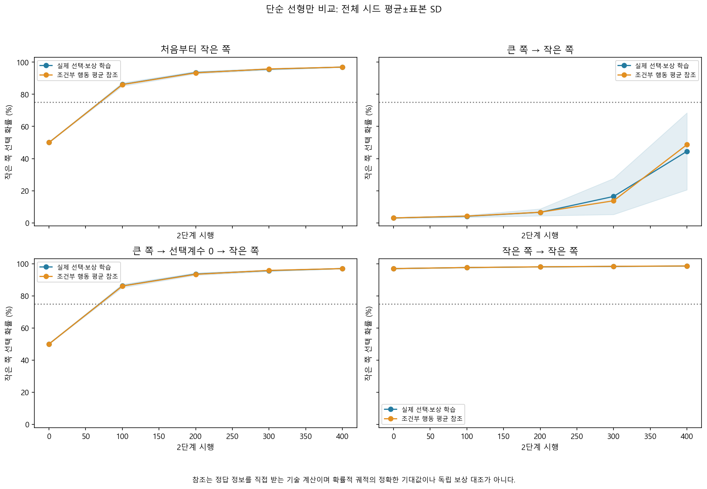
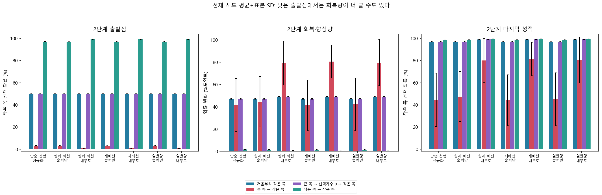

# 단순 학습자의 보상 반전 — 쉬운 결과 설명

2026-10-14, Asia/Seoul. 실행 뒤 작성한 해석 문서다. [사전 계획](bandit-reversal-protocol.md), 시드·입력·학습률·예산·판정 기준은 바꾸지 않았다. [자동 보고서](../results/bandit_reversal_v1/report.md), [모든 시드 판정](../results/bandit_reversal_v1/summary.json), [독립 검산](../results/bandit_reversal_v1/verification.json)을 함께 보존한다.

## 이번 결과의 뜻

**이미 배운 선택 규칙을 반대로 바꾸는 어려움은, 내부 가소성이 없는 단순한 모델에서도 나타났다.** 일곱 계수의 선형 모델이 처음부터 작은 쪽을 배우면 최종 정답 선택 확률은 96.96%였지만, 큰 쪽을 배운 뒤 작은 쪽으로 바꾸면 44.51%였다. 선택 담당 계수만 0으로 되돌리면 96.96%가 됐다.

예를 들어 2개와 4개 중 처음에는 4개를 고르면 보상을 준다. 400번 연습한 뒤 이제 2개를 고를 때 보상을 준다. 두 번째 단계의 연습은 모든 경우 400번이다. 비교 대조는 처음부터 작은 쪽만 배우거나, 작은 쪽을 계속 연습하는 경우다. 이전 연구의 실패를 더 오래 가르쳐 성공으로 바꾸지 않고 새 시드와 별도 계획으로 실행했다.

입력은 물체 그림이 아니라 이미 수량 순서를 나타내는 숫자다. 실제 초파리의 물체 세기, 인간의 수학 개념이나 자연 망각을 재현한 실험은 아니다. 여기서 보는 것은 인공 표현에 대한 보상 선택 반응이다.

## 단순 모델의 네 학습 이력

아래는 모든 10개 계산 시드의 평균이다. ±는 시드 표본 표준편차이며 초파리 개체나 인간 참가자의 변동이 아니다. 수치는 작은 쪽을 고를 **확률**이고, 확률이 높은 쪽만 고르는 정답률과 구분한다.

| 학습 이력 | 새 규칙 단계의 출발 확률 | 400번 뒤 확률 | 기준 통과 |
|---|---:|---:|---:|
| 처음부터 작은 쪽 | 50.00% | 96.96±0.25% | 10/10 |
| 큰 쪽을 배운 뒤 작은 쪽 | 3.03% | 44.51±23.97% | 2/10 |
| 큰 쪽 학습 뒤 선택 계수 0, 작은 쪽 | 50.00% | 96.96±0.25% | 10/10 |
| 작은 쪽을 계속 연습 | 96.94% | 98.54±0.12% | 10/10 |

계수를 0으로 돌리는 것은 컴퓨터 안의 조작이다. 실제 뇌의 기억을 삭제하는 방법을 검증한 것이 아니다. 단순 모델에는 학습할 내부 연결이 없으므로, 같은 두 번째 단계 입력·선택 난수·고정 척도를 쓰면 초기화 대조가 처음부터 배우는 경우와 같아야 한다. 실제 모든 저장 시점의 상태와 시행별 선택·보상이 일치했다. 누적 갱신 횟수는 앞선 연습 때문에 다르며 따로 기록했다.



## 무엇이 통과했고 무엇이 미달했나

주 가설 H-B는 ‘새 규칙 400번 뒤 수정 비용이 나타나는가’였다. 처음부터 작은 쪽을 배운 경우−반전 경우의 끝점 차이는 **52.45±24.08%포인트**였다. 평균 10%포인트 이상, 양수 시드 8/10 이상, 처음부터 작은 쪽과 먼저 큰 쪽의 습득이 각각 8/10 이상이어야 했다. 실제 양수·fresh 습득·high 습득은 모두 10/10으로 H-B가 통과했다.

H-B 통과는 반전 학습에 모두 성공했다는 뜻이 아니다. 반전의 개별 기준은 먼저 큰 쪽을 습득하고, 두 번째 단계 최종 작은 쪽 확률이 75% 이상이어야 한다. 단순 모델은 **2/10**만 통과했다. 전체 시드의 반전 끝점은 **18.26–82.53%**로 변이가 컸고, 좋은 시드만 골라 대표값으로 쓰지 않았다.

확률이 높은 후보만 고르는 방식에서는 단순 반전 모델의 **3/10시드**가 정답 방향을 냈다. 예를 들어 시드 7004는 작은 쪽 선택 확률이 72.81%로 방향은 맞았지만 75% 기준에 미달했다. 이 성적으로 사전 확률 기준을 바꾸지 않았다.

모든 실제 모델 조건에서 첫 규칙과 fresh 습득은 확인됐으며, 자격을 확인한 두 번째 단계 기준 미달 **40건은 전부 반전 조건**이었다. 단순 선형·실제 고정·재배선 고정·일반망 고정에서 각각 8건, 실제 가소성·재배선 가소성에서 각각 3건, 일반망 가소성에서 2건이다. 실패 삭제·시드 교체·추가 연습은 하지 않았다.

## 낮은 출발점과 학습 자체를 구분하기

큰 쪽을 잘 고르던 모델은 규칙이 바뀌자 작은 쪽을 약 3.03%만 고르는 상태에서 시작했다. 400번 뒤 44.51%가 돼 **41.48%포인트 회복**했다. 처음부터 배우는 경우는 50%에서 시작해 **46.96%포인트 향상**했다.

따라서 반전 모델이 아무것도 배우지 않았다는 해석은 틀리다. 마지막 성적이나 학습 곡선의 전체 높이만 보고 ‘학습 능력 자체가 느려졌다’고 결론 내리지 않는다. 주 결과는 이 고정된 새 규칙 연습 예산에서 남은 끝점 비용이다. 출발점·회복량·원시 곡선 면적·출발점을 뺀 곡선 면적은 각각 원자료에 보존했다.

처음부터 배우는 경우의 총 보상 경험은 400번, 나머지 세 이력은 800번이다. 맞춘 것은 새 규칙 단계의 예산이며 총 경험까지 같다고 주장하지 않는다. 처음 관측한 75% 도달은 100번 간격의 저장 시점에서만 확인했으므로 정확한 최초 시행이나 지속 성공을 뜻하지 않는다.



## 참고 계산으로 설명되는 부분과 남는 차이

이 학습 규칙에서는 두 선택을 확률로 평균한 한 시행의 변화 계수가 `p(1−p)`에 비례한다. p가 50%에서 멀어져 한쪽을 강하게 확신하면 이 값이 작아진다. 기존의 잘못된 선택을 확신하는 상태가 수정에 영향을 줄 수 있는 계산적 설명이다. 특징 방향·크기·내부 가소성도 영향을 주므로 이 계수 하나를 전체 원인이라고 선언하지 않는다.

별도 참고 계산은 각 시점의 자기 상태에서 두 행동의 평균 갱신을 적용했다. 정답 쪽을 직접 사용하므로 실제 보상 학습자와 같은 정보의 대조가 아니다. 한 시행의 조건부 평균식을 반복한 경로는 비선형성 때문에 여러 확률적 학습의 정확한 평균 경로도 아니다. 참고 계산에는 별도 성공 판정을 붙이지 않았다.

반전의 참고 계산은 최종 **48.66%**였고 실제 선형 평균 44.51%와 4.15%포인트 차이가 났다. 다섯 저장 시점에서 비교하면 실제와 참고 **평균 곡선의 오차는 1.41%포인트**였다. 그러나 **개별 시드 경로의 평균 절대 오차는 6.29±3.58%포인트**, 가장 큰 개별 저장 시점 차이는 33.87%포인트였다. 평균에서 상쇄된 차이를 숨기거나 참고식이 각 학습 경로를 완전히 설명했다고 주장하지 않는다.

## 내부 학습 모델의 결과

| 모델 | 처음부터 작은 쪽 | 반전 | 출력 계수 초기화 뒤 작은 쪽 | 반전 기준 통과 |
|---|---:|---:|---:|---:|
| 단순 선형 | 96.96% | 44.51% | 96.96% | 2/10 |
| 실제 배선·출력만 학습 | 97.04% | 47.51% | 97.04% | 2/10 |
| 실제 배선·내부도 학습 | 99.03% | 80.12% | 99.15% | 7/10 |

재배선과 일반 신경망도 출력 전용 반전 44.34–45.23%, 내부도 학습하면 80.43–81.33%로 비슷했다. 실제 배선에만 있는 우수성이나 독특한 수량 능력을 입증하지 않았다. 단순 모델은 출력 계수 7개, 네트워크는 48개 슬롯, 내부 가소성은 추가 가중치 1,474개를 사용한다. 같은 전체 학습 자원이나 특징을 가진 우열 실험은 아니다.

가소성 모델의 출력 초기화 뒤 차이는 앞서 바뀐 내부 상태와 새로운 출력 계수가 함께 만든 계산 결과다. 내부 상태가 언제나 학습을 방해한다는 결과도, 생물학적 시냅스 기억을 증명한 결과도 아니다. 기존 연구와 초기화·척도·시드가 다른 별도 진단이며 옛 실패는 그대로 보존한다.

## 검증과 재현

새 시드 7001–7010, 실제 학습자 7조건, 네 이력으로 실제 선택·보상 갱신 **196,000회**와 별도 결정적 참고 계산 **28,000회**를 실행했다. [관련 테스트 401개](../results/test-validation-bandit-reversal.json)가 통과했다. 새 연구와 재사용한 핵심 코드의 검사이며, 과거 심층 검사를 전부 다시 실행한 총합으로 표현하지 않는다.

[독립 검산](../results/bandit_reversal_v1/verification.json)은 학습자·생성기·요약 함수를 호출하지 않고 모든 실제/참조 갱신, 2,880개 checkpoint, 640개 경계 상태 파일, 737,280개 평가 사례 확률과 모든 판정을 재계산해 통과했다. 원자료 해시 3,907개와 소스·문서 동결 36개를 확인했다. 초기화의 허용된 변화, 고정 모델의 reset=fresh, 높은 규칙 학습 이력의 동일성도 검사했다.

소스 commit은 `fceca94dc6e8137085112ad3a5b75a3cf3894e50`, 등록 게시 commit은 `f015d397fbf2d2a0050d5a5144d8afbe9baad4f0`다. 2026-10-14 04:41:19 UTC 등록, 04:41:58 원격 byte 확인, 04:42:00 실행 시작 순서로 보존했다. [동결 증거](../results/bandit_reversal_prefreeze_evidence.json)와 [보존 검증](../results/bandit_reversal_archive_validation.json)을 함께 남겼다. 비공개 Git 보존은 외부 공인 공개 사전등록을 뜻하지 않는다.

자동 보고서의 5열 표에 있던 구분선 4칸을 5칸으로 맞추는 서식 보정만 실행 뒤 적용했다. [보정 기록](../results/bandit_reversal_v1/derived_report_cosmetic_correction.json)에 전후 해시와 재생성 시 필요한 동일 보정을 기록했다. 동결 소스·프로토콜·수치·그림·원자료 해시는 변경하지 않았다.

재현은 `study-bandit-reversal-v1` 태그를 별도 checkout하고 README의 환경 설치 뒤 실행한다.

```powershell
.\.venv\Scripts\python.exe -m drosolearn.bandit_reversal run --config configs/bandit_reversal_diagnostic.json --registration results/registration_bandit_reversal_v1.json --out results/MY_BANDIT_REVERSAL_REPLAY
.\.venv\Scripts\python.exe -m drosolearn.bandit_reversal verify --out results/MY_BANDIT_REVERSAL_REPLAY
```

## 다음 질문과 인간 학습 비교

다음 후보는 **배운 선택 방향을 유지하면서 출력 계수의 크기만 줄였을 때 수정 비용이 어떻게 바뀌는가**다. 이번 0 초기화보다 약한 조작으로 기존 선택의 확신과 규칙 수정의 관계를 더 좁힐 수 있다. 새 조작 수준·시드·예산·평가 기준을 먼저 고정해야 하며 이번 실패를 덮어쓰지 않는다.

이번 결과는 인공 입력의 경험 의존 변화인 Level 2다. 새로운 수량쌍 일반화는 이번에 검사하지 않았다. LC11·실제 DAN 신호·살아 있는 초파리 행동의 재현이나 인간과의 정량적 유사성 Level 4, 관련 신경 기작 Level 5를 주장하지 않는다.

인간의 기초 수량·수학 학습과 비교하려는 장기 목표는 유지한다. 출발 선택 편향, 고정 예산 수정 비용, 회복량과 오류 방향을 비교 후보로 남긴다. 인간의 시행별 선택·피드백 자료와 모델의 선택 확률은 관측 방식부터 달라 대응 지표를 별도로 정의해야 한다. 현재 확보한 인간 자료는 전후 요약이어서 이 반전 곡선과 직접 비교할 수 없다. 동일 신경 메커니즘이나 교육 효과의 결론은 아직 없다.
