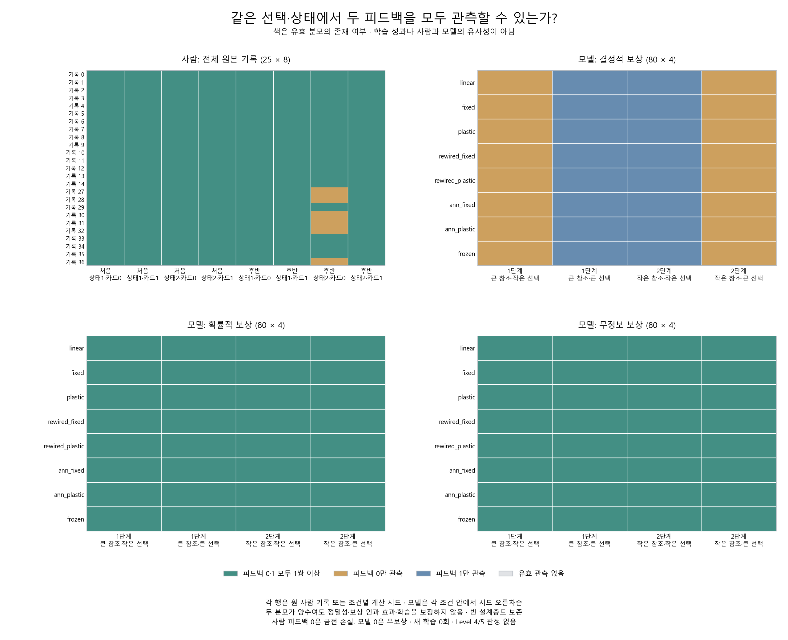

# Phase 4: 같은 선택·상태에서 두 피드백을 비교할 수 있나?

작성일: 2026-10-16 (Asia/Seoul). 연구 ID `conditional_transition_v1`.

## 지금 어느 단계인가?

**지금은 Phase 4의 초기 공통 측정 단계다.** 앞서 인간 공개 자료의 원본·뜻·분모를 확인했고, 직전에는 Phase 2·3의 내부·출력 변화 진단을 보강했다. 모든 수학적 패턴 과제나 일반화 연구가 끝났다는 뜻은 아니다. 사람과 모델이 비슷하게 배운다는 Level 4 검정과 같은 신경 기작이라는 Level 5 검증은 아직 수행하지 않았다.

이번에는 이미 검증된 사람 기록과 세 보상환경 모델의 실제 선택을 같은 수식으로 다시 셌다. 모델을 더 훈련하거나 새로운 인간 실험을 하지 않았다.

## 먼저 쉽게 설명하면

좋은 결과 뒤에 같은 선택을 자주 했다는 숫자만으로는 학습을 판단하기 어렵다. 원래 한쪽을 자주 고르는 성향 때문에도 숫자가 달라질 수 있다. 그래서 **같은 단계·같은 과제 상태·같은 직전 선택끼리 나눠**, 이득/보상 뒤 기록과 손실/무보상 뒤 기록이 둘 다 있는지 확인했다.

각 묶음을 ‘층’이라고 부른다. 두 종류의 기록이 각각 한 쌍 이상 있으면 그 층의 두 유지율 차이를 계산하고, 한쪽이 없으면 **계산 불가(null)**로 남겼다. 0% 차이로 채우지 않았다. 한 번씩 관측됐다는 것은 정확한 비교나 보상의 인과 효과가 확인됐다는 뜻이 아니다.

## 실제 관측 가능성

아래는 성적이나 학습 능력이 아니라 **피드백별 분모가 존재하는 층의 수**다. 각 기록의 층을 세었으며 사람·모델 기록을 독립적인 같은 종류의 표본으로 합치지 않았다.

| 자료 | 기록 경로 | 설계층 | 두 피드백 모두 | 0만 | 1만 | 둘 다 없음 |
|---|---:|---:|---:|---:|---:|---:|
| 사람 기록 | 25 | 200 | 194 | 6 | 0 | 0 |
| 결정적 보상 모델 | 80 | 320 | 0 | 160 | 160 | 0 |
| 확률적 보상 모델 | 80 | 320 | 320 | 0 | 0 | 0 |
| 무정보 보상 모델 | 80 | 320 | 320 | 0 | 0 | 0 |

결정적 보상 모델은 같은 단계·같은 수량을 고르면 결과가 정해지므로, 그 층에서 두 결과를 함께 관측할 수 없다. 따라서 그 층의 차이는 0이 아니라 계산 불가다. 확률적 보상은 같은 선택에서도 다른 결과를 허용하지만, 유한 기록에서 실제로 둘 다 관측됐는지는 위처럼 따로 세어야 한다.



그림의 색은 두 피드백의 관측 여부만 나타낸다. 사람은 카드 정체성, 모델은 작은/큰 수량 정체성을 유지했다. 25개 사람 기록 각각의 8층과 240개 모델 경로 각각의 4층을 전부 표시했다. 층별 유지·전환 횟수와 비율, 두 분모가 있는 층의 차이는 [전체 지표](../results/conditional_transition_v1/metrics.json)에 남겼고, 층 차이를 평균해 새 학습 지수나 종간 효과량으로 만들지 않았다.

## 처리와 검증

| 자료 | 원 시행 | 원 인접 후보 | 유효 쌍 | 제외 쌍 |
|---|---:|---:|---:|---:|
| 사람 원본 25개 | 25,000 | 24,975 | 21,530 | 3,445 |
| 기존 모델 240경로 | 192,000 | 191,760 | 191,520 | 240 |
| 합계 | 217,000 | 216,735 | 213,050 | 3,685 |

정보 요청·결측을 삭제하고 전후 선택을 이어 붙이지 않았다. 단계·상태 경계를 넘는 쌍을 빼되 겹친 제외 사유는 모두 [ledger](../results/conditional_transition_v1/ledger.csv)에 남겼다. 현재 피드백으로 현재와 바로 다음 선택의 유지·전환을 조건화했다. 모델의 원 global/local 시행 번호와 CSV 원행도 보존했다.

사람의 기존 전체 유지·전환 지표는 25개 기록 모두 이전 결과와 정확히 같았다. 그 위에 같은 선택·상태로 나눈 1,160층과 2,320개 피드백 셀을 추가했다. 모든 층의 정수 횟수를 더하면 원 기록의 전체 횟수와 같아야 한다. 이는 산술·처리 검증이며 학습 가설의 성공 판정이 아니다.

처음 고정한 그림 코드에는 원본 행 번호가 연속적이라는 잘못된 가정이 있어 그림 생성 전 검증에서 멈췄다. [실패 기록](../results/conditional_transition_figure_failure_v1.json)과 원 코드를 보존하고, 원래 행 번호를 읽는 [표현 수정판](conditional-transition-figure-correction.md)만 별도로 등록했다. 주 집계·독립 검산·기준·원자료는 변경하거나 다시 실행하지 않았다. [그림 등록](../results/registration_conditional_transition_figure_v2.json)과 [원격 동결](../results/conditional_transition_figure_v2_prefreeze_evidence.json), [표현 시험](../results/test-validation-conditional-transition-figure-v2.json)도 보존한다.

새 주 측정 자동 시험 **135개**와 [독립 검산](../results/conditional_transition_v1/verification.json)이 통과했다. 표현 수정판 시험 **22개**도 별도로 통과했다. 독립 코드는 주 변환·층 집계 함수를 부르지 않고 실제 MAT/CSV와 모든 원 인접 후보·설계층·분자·분모·비율을 따로 확인했다. [시험 기록](../results/test-validation-conditional-transition.json)과 [최종 보존 검증](../results/conditional_transition_archive_validation.json)을 남긴다. 개발 단계의 검사 가드에서 불필요한 학습 모듈 import를 제거하고 같은 시험을 재실행한 [이전 이력](../results/conditional_transition_engineering_attempts_v1.json)도 보존했다. 추가 학습 갱신·학습자 구성·자극 자료 생성·난수 추출은 모두 **0회**다.

소스 커밋 `ed9aa5fbf1128c2b8d502650e26cb6a78aac9589`. 등록 `2026-10-16T04:17:21.289074+00:00` → 원격 동일 바이트 확인 `2026-10-16T04:17:36.117526+00:00` → 집계 `2026-10-16T04:17:40.453128+00:00`–`2026-10-16T04:17:48.961504+00:00` → 독립 검산 `2026-10-16T04:17:52.441440+00:00` 순서다. [사전 계획](conditional-transition-protocol.md), [설계 감사](conditional-transition-design-audit.md), [등록](../results/registration_conditional_transition_v1.json), [원격 확인](../results/conditional_transition_prefreeze_evidence.json)을 함께 보존한다.

## 해석 한계와 다음 연구의 조건

사람은 금전 카드·정보 요청·여러 반전을 경험했고 모델은 인공 수량 두 선택·한 번의 반전을 경험했다. 손실과 무보상, 카드와 수량은 같은 경험이 아니다. 무정보 환경의 큰/작은 수량 상태는 유리한 선택이 아니라 단계 참조 방향이다. 정확한 인간 과거 실행판 미확인·미대응 49행·OpenNeuro 코드 의미 미해결도 그대로 남는다.

현재 선택과 상태를 나눠도 시간·학습 이력·숨은 정책 상태·입력·정보 요청 제외를 모두 통제하지 못한다. 차이의 부호나 크기만으로 학습, 보상 원인, 인간과의 유사성, 커넥톰 우위를 주장하지 않는다. 현재 모델은 수량 순서를 입력으로 이미 받으며 실제 초파리 시각 회로나 DAN을 재현하지 않는다. 계산 시드를 동물 개체로 세지 않는다.

향후 Level 4 후보 검정을 하려면 과제·보상·선택 수·반전 일정·예산을 더 맞추고, 단순 대조 및 실패 조건을 별도 등록해야 한다. 이번 작업은 그 검정에 쓸 측정의 분모를 드러낸 초기 Phase 4 산출물이다. 새 인간 실험·공통 신경 기작·수학교육 효과를 주장하지 않는다.

## 재현과 이번 작업의 종료

완료 태그 `conditional-transition-v1`의 별도 checkout과 Python3.12 고정 의존성을 사용한다. 외부 인간 원본 캐시는 등록의 경로·크기·SHA에 맞아야 하며 저장소에 원 MAT를 새로 재배포하지 않는다. 캐시 복구와 출처·CC BY4 조건은 [공식 원본 프로토콜](human-osf-origin-protocol.md)과 [과제 근거](human-task-structure-sources.md)를 따른다. 원 MATLAB 코드는 실행하지 않는다. 모든 출력 경로는 새 이름으로 바꾼다.

```powershell
python scripts/run_conditional_transition.py register --config configs/conditional_transition_v1.json --human-cache ../MY_HUMAN_CACHE --out results/registration_CONDITIONAL_NEW.json
python scripts/run_conditional_transition.py run --config configs/conditional_transition_v1.json --human-cache ../MY_HUMAN_CACHE --registration results/registration_CONDITIONAL_NEW.json --out results/CONDITIONAL_NEW
python scripts/verify_conditional_transition.py --human-cache ../MY_HUMAN_CACHE --registration results/registration_CONDITIONAL_NEW.json --result-dir results/CONDITIONAL_NEW --out results/CONDITIONAL_NEW/verification.json
python scripts/plot_conditional_transition_v2.py --register --result-dir results/CONDITIONAL_NEW --out results/registration_CONDITIONAL_FIGURE_NEW.json
python scripts/plot_conditional_transition_v2.py --result-dir results/CONDITIONAL_NEW --presentation-registration results/registration_CONDITIONAL_FIGURE_NEW.json --out results/CONDITIONAL_FIGURES_NEW
```

앞서 중지한 작업 뒤 사용자가 새로 요청한 **이 한 작업만 재개해 완료**했다. 자동 이어가기는 PAUSED를 유지하며 다음 연구를 자동으로 시작하지 않는다.
