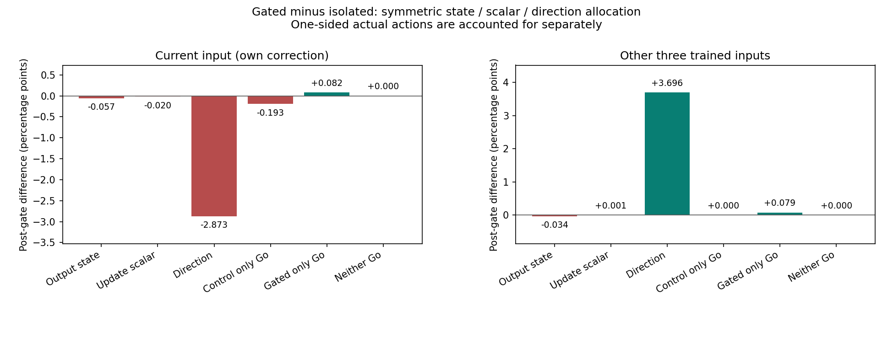
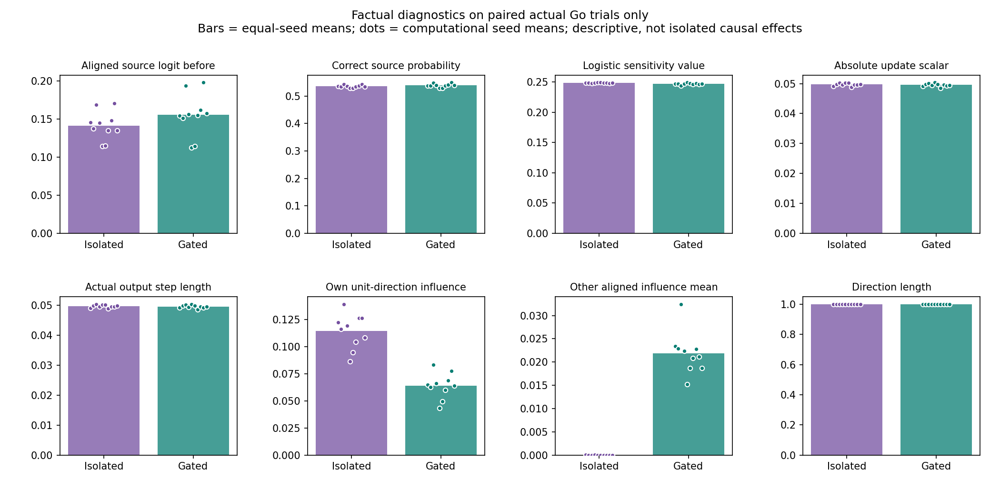
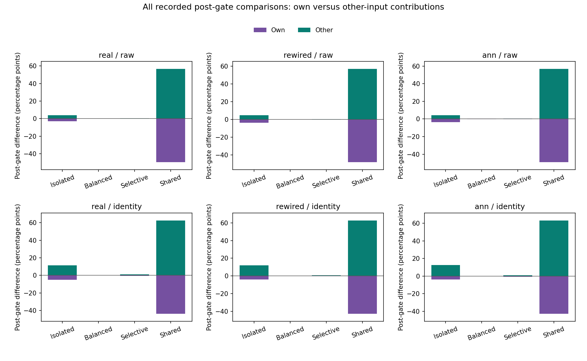

# 전환 후 자기 수정이 약해진 기록을 세 요소로 나누기

**이번 주 비교에서 가장 큰 음수 몫은 수정 방향이었다.** 계속 분리한 방식(isolated)보다 초반 보호 후 균형 방식(gated)은 한 번의 같은 길이 방향에서 자기 문제를 덜 움직이고, 다른 세 문제를 더 돕는 형태였다. 실제 수정 크기와 출력 상태의 몫은 이 비교에서 상대적으로 작았다.

이것은 저장된 후반 경로를 정해 둔 대칭 규칙으로 나눈 결과다. 새로운 학습이나 각 요인의 독립적인 인과효과 검정은 아니다. 기존 성적 개선·충분한 습득의 미지지와 주 조건 습득0/10, 설계상 작동 보호 통과를 유지한다.

## 쉽게 설명하면

전환 후 자기 문제의 정답 확률이 올라간 누적량은 항상 자기 문제에 집중하던 분리 방식보다 작았다. 수정의 길이가 거의 같아도, 움직일 방향이 달라지면 자기 문제와 다른 문제에 나뉘는 영향은 달라질 수 있다.

이번에는 두 방식이 모두 실제로 수정한 시행에서 다음을 따로 바꿔 계산했다.

- **출력 상태:** 고치기 직전 어떤 답을 얼마나 선택하려 했는가.
- **수정 크기:** 그 시행의 방향에 실제로 곱한 계수가 얼마였는가.
- **수정 방향:** 같은 움직임을 어느 입력에 배분하는가.

세 요소를 가져오는 8가지 조합을 모두 계산하고, 어느 요소를 먼저 바꾸느냐의 순서를 대칭적으로 평균했다. 이를 Shapley 장부라고 부른다. 한쪽만 실제로 수정한 시행은 세 요소에 억지로 나누지 않고 별도 기여로 남겼다.

## 자기 문제의 감소 −3.0611%p는 어떻게 나뉘나

주 조건은 실제 배선·원 입력(real/raw)의 **gated−isolated**다. 공통 후반은 gated가 실제 보상 부호 네 칸을 얻은 다음 시행부터이며, 네 번째 발견 시행은 포함하지 않는다. 아래는 마지막 네 입력 평균 정답 선택 확률에 대한 기여 차이를 시드별로 구한 뒤 10시드를 같은 비중으로 평균한 값이다.

| 기여 항 | 자기 문제 | 다른 세 연습 입력 |
|---|---:|---:|
| 양쪽 실제 수정: 출력 상태 | -0.0571%p | -0.0337%p |
| 양쪽 실제 수정: 수정 크기 | -0.0200%p | +0.0007%p |
| 양쪽 실제 수정: 수정 방향 | **-2.8731%p** | **+3.6958%p** |
| 분리 방식만 실제 Go | -0.1930%p | +0.0000%p |
| gated만 실제 Go | +0.0821%p | +0.0791%p |
| 둘 다 NoGo | 0 | 0 |
| **후반 합계** | **-3.0611%p** | **+3.7419%p** |

두 열을 합하면 이전 기록에서 확인한 후반·최종 차이 **+0.6808%p**다. 이 두 방식의 전환 전 기록은 같았다. 방향 몫은 자기 문제에서 음수·다른 문제에서 양수인 경향을 모든10시드에서 보였다. 자기 문제의 방향 몫 표본 표준편차는0.2412%p다. 이 숫자를 보편적인 원인 비율이나 동물 개체 간 변이로 바꾸지 않는다.

주 조건의 공통 후반은10시드 합계3,853시행이다. 그중 양쪽 Go1,839, 분리만 Go46, gated만 Go43, 둘 다 NoGo1,925시행이었다. 한쪽만 Go인 자기 기여 합계는 **-0.1108%p**다. 이 나머지를 빠뜨리면 방향·크기·상태만으로 전체 −3.0611%p를 설명했다고 잘못 결론 내리게 된다.

## 실제 방향과 수정량을 나란히 보면

다음 진단은 **양쪽 실제 Go인 같은 대상**에서 각 시드 평균을 구한 뒤 같은 비중으로 평균했다. 전체 시행의 평균이나 마지막 정답률과는 다르다. 방향 영향은 확률이 아닌 출력 점수의 영향이며, 실제 확률 차이는 비선형 원식으로 계산했다.

| 실제 진단 | 항상 분리 | 초반 보호 후 균형 |
|---|---:|---:|
| 방향 길이 | 1.000000 | 1.000000 |
| 방향 자체의 자기 입력 영향 | **0.114397** | **0.063966** |
| 다른 세 입력의 정답 정렬 방향 영향 평균 | 약0 (−8.06e-18) | **0.021857** |
| 실제 수정 계수 절댓값 | 0.049702 | 0.049544 |
| 실제 한 번 출력 이동 길이 | 0.049702 | 0.049544 |
| 수정 전 현재 입력 정답 선택 확률 | 53.5259% | 53.8419% |
| 수정 전 정답 정렬 출력 점수(logit) | 0.141553 | 0.155650 |
| 로지스틱 민감도 참고 값 | 0.248309 | 0.246804 |

방향 길이는 둘 다1이었지만 자기 입력 영향은 **0.1144→0.0640**으로 작아졌다. 다른 입력으로 가는 정답 정렬 영향은 약0에서0.02186으로 늘었다. 실제 한 번 이동 길이0.04970과0.04954는 비슷했다. 이 진단과 위 장부는, 이번 주 비교의 자기 기여 감소가 주로 방향 배분 차이와 연결된 기록임을 함께 보여준다.

출력 상태는 gated가 약간 더 정답 쪽이었다. 상태 몫이 음수라고 출력 상태가 더 나빴다는 뜻은 아니다. 이미 달라진 확률에서 같은 수정을 더했을 때 늘어나는 확률이 달라지는 효과가 그 항에 들어간다. 참고 민감도는 p(1−p)이고 clipping 밖의 실제 미분이나 변화량의 선형 근사로 쓰지 않았다.

수정 계수 g는 학습률0.1 자체가 아니라 `.1*(실제 행동−선택 확률)*획득 보상`이다. 실제 이동 길이는 `|g|*방향 길이`다. 상태와 g는 실제 학습에서 서로 연관되지만, 혼합 셀에서는 g를 새 상태의 확률로 다시 계산하지 않고 저장 값을 그대로 썼다. 따라서 일부 혼합은 실제 학습 규칙의 상태·행동·보상 관계를 동시에 만족하지 않을 수 있다. 새 규칙의 실행 성적을 예측하는 계산이 아니다.

## ‘도움 증가’와 ‘방해 감소’를 섞지 않았다

네 목적지의 순확률 변화와, 양수 부분·음수 부분 절댓값을 각각 나눈 뒤 대칭 배분했다. 주 비교에서 다른 입력의 순증가 **+3.7419%p**는 양수 도움 차이도 반올림한 같은 값이며, 음수 방해 차이는 약1.31e-13%p의 수치 잔차였다. 이미 확인한 목적지를 크게 해친 효과가 이 도움 증가를 만든 것은 아니었다. 작은 부호는 원자료에서 지우지 않았다.

양수 질량에 대한 **배분 몫**은 음수가 될 수 있다. 예를 들어 다른 입력의 상태 몫−0.0337%p는 그 요소 교체에 배분된 도움 감소분이다. 그 값 자체가 실제 새 피해나 새로운 학습 실패 시행을 뜻하지 않는다. 부호 있는 배분을 먼저 계산한 뒤 양수·음수로 나누어 대신하지 않았다.

공유 대조(shared)처럼 큰 양수 도움과 큰 음수 방해가 함께 있는 경우에는 둘을 더 구분해야 한다. 모든24비교의 양수·음수 몫을 원 요약과 CSV에 별도로 남겼고, 순합만으로 그 현상을 숨기지 않았다. ‘도움’은 기존 네 연습 입력 사이의 변화이며 새 문자열이나 새 규칙으로의 전이가 아니다.

## 비교 대상을 바꾸면 설명도 달라진다

처음부터 균형 방식(balanced)과 비교한 후반의 **양쪽 모두 실제 Go인 시행**에서는 같은 입력·같은 고정 특징에서 두 방식의 실제 균형 방향이 같았고, 방향 몫은 여섯 배선·표현 모두0이었다. 한쪽만 Go인 시행의 방향까지 같다는 뜻은 아니다. 주 real/raw의 그 비교는 다음과 같다.

| gated−처음부터 균형, 후반 | 자기 문제 | 다른 세 입력 |
|---|---:|---:|
| 출력 상태 | +0.0017%p | -0.0001%p |
| 수정 크기 | +0.0489%p | +0.0272%p |
| 방향 | 0 | 0 |
| 한쪽만 Go인 실제 기여 합 | -0.0264%p | -0.0023%p |
| 합계 | +0.0243%p | +0.0248%p |

두 열의 합은 이전 후반 차이 **+0.0491%p**다. 따라서 ‘방향이 자기 수정 감소의 가장 큰 몫’이라는 주 설명을 모든 대조에 적용하지 않는다. 여기서는 분리 방향에서 균형 방향으로 바뀐 비교가 핵심이다. 다른 배선과 인공 이름표 표현에서도 세 몫의 크기·실제 행동 나머지는 달랐다.

## 모든24비교의 장부

아래 값은 %p다. ‘한쪽 Go’는 대조만 Go와 gated만 Go의 실제 기여 합이다. 전체240개 조건·시드 비교는 원 요약에 모두 보존했다. 같은 gated 기록을 여러 대조와 비교하므로 독립적인 계산 시드가240개라는 뜻은 아니다. 평균 몫을 세 요소의 독립적 인과효과나 실제 비용을 맞춘 효율로 읽지 않는다.

**자기 문제**

| 배선 | 표현 | 대조 | 상태 | 크기 | 방향 | 한쪽 Go | 후반 합계 |
|---|---|---|---:|---:|---:|---:|---:|
| real | raw | isolated | -0.0571 | -0.0200 | -2.8731 | -0.1108 | -3.0611 |
| real | raw | balanced | +0.0017 | +0.0489 | +0.0000 | -0.0264 | +0.0243 |
| real | raw | feedback_selective | -0.0391 | +0.0245 | +0.0357 | -0.0440 | -0.0229 |
| real | raw | shared | +0.7942 | -0.8425 | -47.4240 | -2.1771 | -49.6494 |
| real | identity | isolated | -0.7120 | -0.3979 | -3.2728 | -0.5881 | -4.9709 |
| real | identity | balanced | +0.0101 | +0.1437 | +0.0000 | -0.0815 | +0.0723 |
| real | identity | feedback_selective | -0.1314 | +0.0844 | -0.3218 | -0.3020 | -0.6709 |
| real | identity | shared | -1.6195 | -1.6569 | -36.2503 | -4.3698 | -43.8965 |
| rewired | raw | isolated | -0.0673 | -0.0218 | -3.5173 | -0.0987 | -3.7050 |
| rewired | raw | balanced | +0.0018 | +0.0481 | +0.0000 | -0.0637 | -0.0137 |
| rewired | raw | feedback_selective | -0.0352 | +0.0329 | -0.1209 | -0.0407 | -0.1638 |
| rewired | raw | shared | +0.7024 | -1.0442 | -45.7233 | -2.3047 | -48.3698 |
| rewired | identity | isolated | -0.8424 | -0.3464 | -2.2407 | -0.7002 | -4.1297 |
| rewired | identity | balanced | +0.0197 | +0.0979 | +0.0000 | -0.0416 | +0.0760 |
| rewired | identity | feedback_selective | -0.1514 | +0.0093 | -0.0284 | -0.2743 | -0.4447 |
| rewired | identity | shared | -2.0844 | -2.2152 | -34.1496 | -4.4666 | -42.9158 |
| ann | raw | isolated | -0.0680 | -0.0863 | -3.2097 | -0.1122 | -3.4763 |
| ann | raw | balanced | +0.0003 | +0.0377 | +0.0000 | -0.0640 | -0.0261 |
| ann | raw | feedback_selective | -0.0485 | -0.0510 | +0.0028 | -0.0466 | -0.1433 |
| ann | raw | shared | +0.8327 | -1.1553 | -46.3625 | -2.3590 | -49.0441 |
| ann | identity | isolated | -0.9092 | -0.5153 | -1.8654 | -0.6516 | -3.9414 |
| ann | identity | balanced | +0.0402 | +0.1727 | +0.0000 | -0.1876 | +0.0253 |
| ann | identity | feedback_selective | -0.0982 | +0.1319 | -0.3001 | -0.3239 | -0.5902 |
| ann | identity | shared | -2.1920 | -1.9301 | -33.6635 | -5.0663 | -42.8519 |

**다른 세 입력**

| 배선 | 표현 | 대조 | 상태 | 크기 | 방향 | 한쪽 Go | 후반 합계 |
|---|---|---|---:|---:|---:|---:|---:|
| real | raw | isolated | -0.0337 | +0.0007 | +3.6958 | +0.0791 | +3.7419 |
| real | raw | balanced | -0.0001 | +0.0272 | +0.0000 | -0.0023 | +0.0248 |
| real | raw | feedback_selective | -0.0450 | +0.0334 | +0.4953 | -0.0461 | +0.4376 |
| real | raw | shared | -0.9194 | +0.7449 | +53.9138 | +2.9928 | +56.7322 |
| real | identity | isolated | -0.3971 | -0.1937 | +11.5644 | +0.4370 | +11.4105 |
| real | identity | balanced | +0.0074 | +0.1671 | +0.0000 | -0.1020 | +0.0725 |
| real | identity | feedback_selective | -0.2154 | +0.0803 | +1.4006 | -0.1957 | +1.0698 |
| real | identity | shared | +0.3543 | +0.8198 | +55.2886 | +6.1341 | +62.5969 |
| rewired | raw | isolated | -0.0351 | +0.0168 | +4.5308 | +0.0383 | +4.5508 |
| rewired | raw | balanced | +0.0023 | +0.0452 | +0.0000 | -0.0684 | -0.0209 |
| rewired | raw | feedback_selective | -0.0364 | +0.0634 | +0.3553 | -0.0616 | +0.3207 |
| rewired | raw | shared | -0.8883 | +0.8662 | +53.6841 | +3.3562 | +57.0182 |
| rewired | identity | isolated | -0.4202 | -0.1035 | +12.1024 | +0.4430 | +12.0218 |
| rewired | identity | balanced | +0.0162 | +0.0957 | +0.0000 | -0.0444 | +0.0675 |
| rewired | identity | feedback_selective | -0.1747 | +0.0602 | +1.0871 | -0.2419 | +0.7307 |
| rewired | identity | shared | +0.6307 | +1.1068 | +54.5495 | +6.5013 | +62.7884 |
| ann | raw | isolated | -0.0376 | +0.0249 | +4.0880 | +0.0426 | +4.1179 |
| ann | raw | balanced | +0.0020 | +0.0164 | +0.0000 | -0.0485 | -0.0300 |
| ann | raw | feedback_selective | -0.0491 | +0.0440 | +0.4400 | -0.0845 | +0.3504 |
| ann | raw | shared | -0.9841 | +1.0375 | +53.5204 | +3.2894 | +56.8632 |
| ann | identity | isolated | -0.5028 | -0.2485 | +12.7419 | +0.5363 | +12.5268 |
| ann | identity | balanced | +0.0446 | +0.1832 | +0.0000 | -0.1987 | +0.0291 |
| ann | identity | feedback_selective | -0.1862 | +0.1277 | +1.1750 | -0.2337 | +0.8828 |
| ann | identity | shared | +0.6106 | +0.7861 | +54.8788 | +6.9752 | +63.2508 |

## 검증과 다음 연구의 경계

새 소스20·부모12파일을 동결하고 게시 원문 bytes를 확인한 뒤 처음 집계했다. 이전 120,000시행·480,000실제 목적지 효과를 재구성했고, 96,000짝 시행 중 공통 후반92,472·양쪽 Go42,722시행의 **1,367,104개 교차 목적지 계산**을 검산했다. 14배열·2,880행15열·24비교/240짝 경로·전체 요약과 여덟 실제 진단을 독립 재계산했다. 자기/다른 입력의 성분 합계 최대 잔차4.44e-16, 세 요소 배분 항등식 최대 잔차3.47e-18로 허용 오차1e-8 안이다.

새158·기존111의 **269자동검사**가 통과했다. 개발 중 정수 가상 셀과 소수 Shapley 결과의 자료형을 엄격하게 비교하던 검산 도우미 오류1건을 고쳤다. 원 실패8통과/1실패 JUnit과 수정 전 두 파일을 보존했고, 실제 집계 전 수정했다. 그 원 JUnit traceback의 끝 공백 때문에 동결 형식 검사도 한 번 멈췄다. 원문 bytes를 유지하고 해당 증거 파일 하나만 공백 형식 검사에서 제외했으며, 과학 소스·설정·부모 입력은 바꾸지 않았다. 이 처리도 소스 커밋의 별도 기록으로 남겼다.

새 학습·가중치 갱신·난수·모델/그래프·최적화·향후 정책 실행은 각각0회다. 계산된 모서리 수를 새로운 학습 표본이나 동물 개체 수로 세지 않는다. 모든 실제 교차 대상에서 대조도 완전 관측 상태였음을 진단에서 확인했지만 이를 사전에 가정하거나 조건에 맞지 않는 기록을 골라 버리지 않았다.

이번 기록에서 다음에 좁힐 질문은 **같은 방향 길이와 실제 정보 조건 안에서 자기 영향과 도움 영향의 교환을 얼마나 줄일 수 있는가**다. 상태·스칼라가 실제 학습 규칙과 일관되게 함께 바뀌는 후속 개입은 별도 등록과 실제 자원 통제가 필요하다. 이번 결과만으로 더 나은 규칙이 충분한 습득을 만들 것이라 예측하지 않고, 현재 실패의 시드·예산·문턱을 바꾸지 않았다.

입력은 네 인공 전체 문자열이며 내부 투사 가중치와 같은 입력의 내부 활성은 고정이다. 학습된 출력 계수와 별도 획득 보상 기억을 구분한다. 생물학적 내부 가소성·시각 수량/LC11/DAN 회로·새 문제 일반화·인간 유사성·공통 신경 기작·교육 효과를 새로 입증하지 않았다. 기존 음성 결과·닫힌 일반화/간섭/순서 조건·Phase5·모든 완료 원자료와 실패를 보존하고 자동 반복은 PAUSED로 유지한다.

[사전 분석 계획](gated-factors-protocol.md) · [재현 안내](gated-factors-reproduction.md) · [원 요약](../results/gated_factors_v1/summary.json) · [독립 검산](../results/gated_factors_v1/verification.json)
