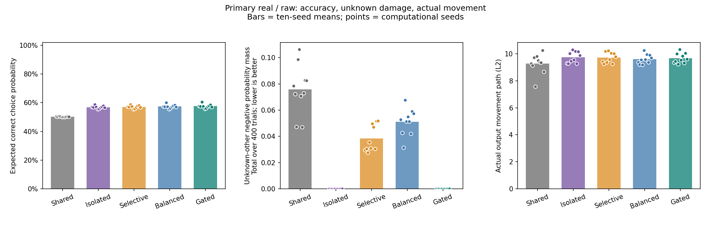
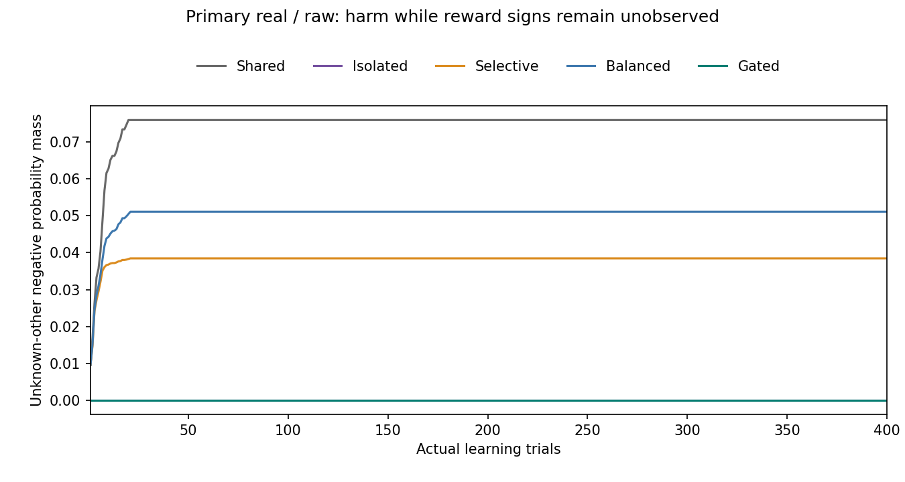
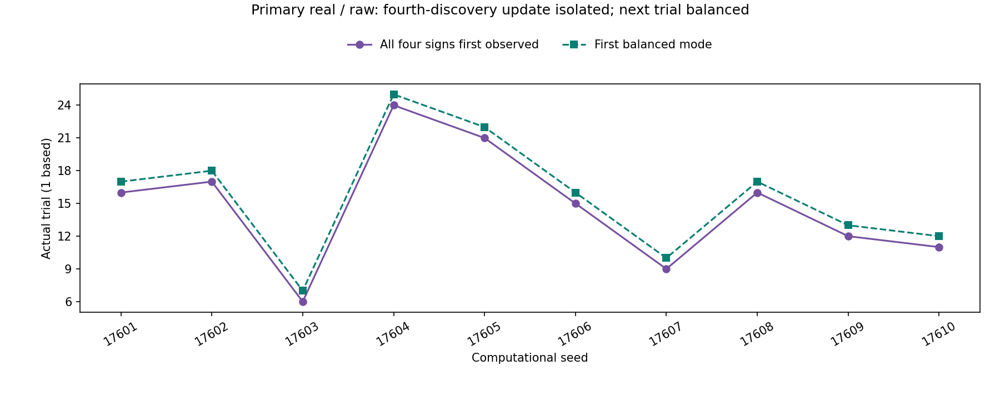
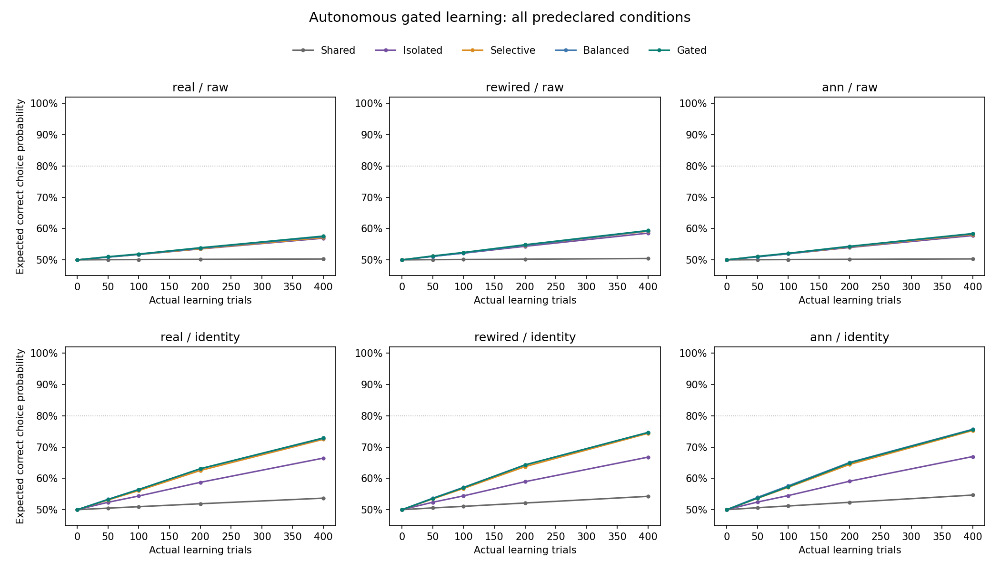

# 초반 보호 뒤 균형 학습을 여는 실험

**아직 답을 모르는 다른 문제에 주는 방해는 막았다. 그러나 마지막 성적을 충분히 높이지는 못했다.** 주 비교 조건인 실제 배선·원 입력(real/raw)에서 새 방식은 57.60%, 처음부터 균형 방식을 쓴 대조는 57.41%였다. 차이는 **+0.19%포인트**로 작았다. 미리 정한 실용 개선 기준과 충분한 습득 기준은 모두 미달했다. 보호 동작 기준은 통과했다.

여기서 성적은 학습 후 네 연습 입력에서 **정답을 선택할 확률의 평균**이다. 400번 중 맞힌 횟수나 새로운 문제의 시험 점수가 아니다. 같은 새 계산 시드 10개에서 다섯 방식을 함께 비교했다. 이전 연구의 다른 시드 성적과 빼서 새 방식의 효과로 삼지 않았다.

## 쉽게 설명하면

처음에는 문제 하나를 고칠 때 다른 세 문제를 움직이지 않게 했다. 모델이 직접 선택해 네 문제의 보상을 모두 확인한 다음부터는, 자기 답을 고치면서 이미 알려진 다른 문제에도 도움을 주는 균형 방식을 허용했다. 네 번째 답을 처음 확인한 시행까지는 보호 방식이고, **그 다음 시행부터** 균형 방식이다.

시험 감독이 정답표를 먼저 알려준 것은 아니다. 실제 Go 선택으로 얻은 +1/−1만 별도 네 칸 기록에 쌓았다. NoGo의 0보상은 숨은 답을 알려주지 않는다. 이 기록으로 전환 시점을 정하지만, 실제 답 선택은 학습한 출력 계수로 계산한 확률을 따른다. 기억표를 직접 조회해서 정답을 내는 방식은 쓰지 않았다.

이번 결과는 “다른 문제를 망가뜨리지 않기”와 “충분히 잘 배우기”가 별개임을 보여준다. 보호가 작동해도, 제한된 수정으로 자기 답을 강하게 바꾸는 문제는 남았다. 초반 보호 때문에 도움이 되는 번짐도 함께 제한된다. 그 제한과 이후 학습이 합쳐진 실제 결과를 보고하며, 무엇이 유일한 원인인지는 이번 비교만으로 확정하지 않는다.

## 같은 새 시드의 다섯 방식

주 조건, 10시드 평균이다. 방해 질량은 400시행 동안 아직 보상을 확인하지 않은 **다른 연습 입력**의 정답 확률 감소분만 합친 값이다. 도움으로 상쇄하지 않는다. 최종 정답률 하락과 단위가 다르다. 실제 경로는 출력 계수 수정 길이를 모두 더한 값이다.

| 방식 | 마지막 기대 정답 확률 | 미관측 다른 문제 방해 질량 | 실제 수정 경로 길이 |
|---|---:|---:|---:|
| 공유: 번짐 허용(shared) | 50.28% | 0.07589102 | 9.265875 |
| 항상 분리(isolated) | 56.91% | 0 | 9.738743 |
| 관측한 방해만 억제(selective) | 57.13% | 0.03846185 | 9.711514 |
| 처음부터 균형(balanced) | 57.41% | 0.05108807 | 9.607127 |
| **모두 확인한 뒤 균형(gated)** | **57.60%** | **0** | **9.663754** |

그래프의 점 하나는 계산 시드 하나다. 초파리나 사람 개체가 아니다. 새 방식 최종 성적의 시드 간 표본 표준편차는 1.34%p다. 이는 짝 비교 차이의 불확실성이나 생물학적 변이가 아니다. 시드별 성적은 아래에 모두 남겼다.

| 계산 시드 | gated 기대 정답 확률 | 네 보상 부호를 처음 모두 확인한 시행 | 처음 균형 모드를 쓴 시행 |
|---|---:|---:|---:|
| 17601 | 57.7253% | 16 | 17 |
| 17602 | 57.5493% | 17 | 18 |
| 17603 | 60.5561% | 6 | 7 |
| 17604 | 57.4878% | 24 | 25 |
| 17605 | 55.6871% | 21 | 22 |
| 17606 | 56.1334% | 15 | 16 |
| 17607 | 57.2748% | 9 | 10 |
| 17608 | 57.8912% | 16 | 17 |
| 17609 | 58.6160% | 12 | 13 |
| 17610 | 57.0311% | 11 | 12 |

## 사전에 정한 세 판정

| 판정 | 실행 전 기준 | 결과 |
|---|---|---|
| 실용적 성적 개선 H_gain | balanced·selective·isolated 각각보다 평균 5%p 이상, 각 비교에서 8/10 이상 양수 | **미지지** |
| 충분한 습득 H_acquisition | 평균 80% 이상·초기 대비 25%p 이상·Go/NoGo 클래스 각각 70% 이상을 모두 만족한 시드가 8/10 이상 | **미지지: 0/10** |
| 작동상 보호 H_protection | 모든 주 조건 gated 시드의 방해 질량이 1e-8 이하, balanced·selective 각각보다 모든 시드에서 허용 오차 내 비악화 | **통과: 10/10 보호, 각 대조보다 10/10 비악화** |

gated의 같은 시드 차이는 balanced 대비 **+0.18647%p(양수 9/10)**, selective 대비 **+0.46038%p(10/10)**, isolated 대비 **+0.68083%p(10/10)**다. 작은 차이가 여러 시드에서 같은 방향이었다는 사실과, 미리 요구한 5%p 크기에는 못 미쳤다는 사실을 함께 보존한다. 이 표본의 양수 개수를 모집단 유의성 검정으로 부르지 않는다.

주 조건 gated의 확률 방해는 평균뿐 아니라 **시드별 최대도 저장 수치에서 0.0**이었다. 닫힌 동안에는 다른 입력을 움직이지 않게 하고, 열린 뒤에는 미관측 입력이 없기 때문에 예상되는 설계 동작이다. 새롭고 독립적인 생물학적 학습 원리를 발견했다는 뜻은 아니다. 정답 방향 점수에는 약 1e-16 수준의 부동소수점 잔차가 남고, rewired/identity의 gated 평균 확률 방해에도 3.33e-17이 있다. 모든 지표·조건에서 정확한 수학적 0을 증명한 것은 아니다. 원래 작은 부호도 지우지 않았다.

## 보호는 단순히 관측 기회가 줄어서 생겼나

주 조건에서 미관측 다른 문제의 노출 수는 gated 평균 **20.9**, balanced 평균 **20.4**였다. 더 적게 측정해서 방해가 작아진 결과가 아니다. 각 수정의 직전·직후 같은 상태에서 확률을 비교했고, source를 뺀 미관측 집합이 전후 일치하는지 검산했다. 양수 도움과 음수 방해를 따로 보존했다.

주 조건에서 네 부호 발견은 평균 **14.7시행**, 첫 균형 모드는 평균 **15.7시행**, 범위 **7–25시행**이었다. 배선·표현·시드 60조합 모두 게이트가 열렸다. gated와 isolated는 네 번째 발견 시행까지 확률·행동·보상·출력 수정·보상 기억 기록이 정확히 일치했다. 이 동일성은 전환 구현이 맞다는 검사이며 전환 후 성적도 같아야 한다는 요구가 아니다.

전환 모드가 열려도 NoGo면 실제 수정은 0이고 균형 최적화 계산을 생략한다. 열린 시행 수·실제 수정 수·균형 계산 요청 수를 구분했다.

## 수정량 제한을 지켰나

모든 방법·시드가 한 번 수정 길이 **0.1 이하**, 400번의 총 경로 **40 이하**, 수정 길이 제곱합 **4 이하**를 지켰다. 최종 출력 계수 길이가 실제 경로 길이 이내인지도 확인했다. 상한이 같아도 실제 사용량은 같지 않다. 주 조건 gated 경로 9.663754는 balanced 9.607127보다 조금 크다. 따라서 +0.19%p를 실제 수정량까지 완전히 맞춘 순수 전환 효과라고 부르지 않는다. 최적화·기억 처리·전환 검사 비용도 동일하게 맞추지 않았다.

전체 실제 출력 수정 호출은 120,000회, 비영 수정은 58,101회다. 균형 방향 요청은 23,059회(항상 균형 11,810·gated 11,249), 독립적인 실제 관측 상태의 최적화 경우는 720개였다. gated의 초기 분리 방향 계산은 882회, 열린 모드 시행은 23,118회, 최초 열림 event는 60회다. 내부 시냅스 및 가치 계수 수정은 **0회**다. 고정 내부 가중치·인코더·같은 입력의 활성 반응과, 학습된 출력 계수·별도 네 칸 보상 기억을 구분했다.

## 배선과 표현이 달라도 같은가

모든 30조건을 보존했다. 원 입력(raw)과 인공 이름표(identity)는 다른 표현이다. 이름표의 높은 성적을 주 조건 대신 쓰지 않는다. 아래 습득은 각 조건의 적격 시드 수이며 어떤 조건도 요구한 8/10에 이르지 않았다. 특히 ann/identity에서는 gated가 항상 균형보다 조금 낮아 “언제나 성적 향상”도 성립하지 않는다.

| 배선 | 표현 | 방식 | 마지막 기대 정답 확률 | 습득 시드 /10 | 미관측 확률 방해 평균 |
|---|---|---|---:|---:|---:|
| real | raw | shared | 50.28% | 0 | 0.07589102 |
| real | raw | isolated | 56.91% | 0 | 0 |
| real | raw | selective | 57.13% | 0 | 0.03846185 |
| real | raw | balanced | 57.41% | 0 | 0.05108807 |
| real | raw | gated | 57.60% | 0 | 0 |
| real | identity | shared | 53.67% | 0 | 0.07282642 |
| real | identity | isolated | 66.47% | 0 | 0 |
| real | identity | selective | 72.47% | 1 | 0.04465791 |
| real | identity | balanced | 72.81% | 1 | 0.04271328 |
| real | identity | gated | 72.91% | 1 | 0 |
| rewired | raw | shared | 50.43% | 0 | 0.07567484 |
| rewired | raw | isolated | 58.53% | 0 | 0 |
| rewired | raw | selective | 59.16% | 0 | 0.03967074 |
| rewired | raw | balanced | 59.25% | 0 | 0.05152418 |
| rewired | raw | gated | 59.38% | 0 | 0 |
| rewired | identity | shared | 54.26% | 0 | 0.07318315 |
| rewired | identity | isolated | 66.78% | 0 | 3.33e-17 |
| rewired | identity | selective | 74.38% | 0 | 0.04634967 |
| rewired | identity | balanced | 74.65% | 0 | 0.04347128 |
| rewired | identity | gated | 74.67% | 0 | 3.33e-17 |
| ann | raw | shared | 50.31% | 0 | 0.07594431 |
| ann | raw | isolated | 57.76% | 0 | 0 |
| ann | raw | selective | 58.14% | 0 | 0.03889773 |
| ann | raw | balanced | 58.30% | 0 | 0.04895817 |
| ann | raw | gated | 58.40% | 0 | 0 |
| ann | identity | shared | 54.66% | 0 | 0.07232577 |
| ann | identity | isolated | 66.96% | 0 | 0 |
| ann | identity | selective | 75.29% | 1 | 0.04378635 |
| ann | identity | balanced | 75.67% | 1 | 0.04112974 |
| ann | identity | gated | 75.55% | 1 | 0 |

## 검증과 한계, 다음에 필요한 근거

설계·평가 문턱·새 시드17601–17610·400시행·소스39파일·선행11·그래프4·입력2파일을 실제 실행 전 동결했다. 총 **120,000 실제 선택·피드백, 6,000 정적 평가, 195배열, CSV84열**을 저장했다. 생성자를 import하지 않는 독립 검산기가 모든 선택·보상·관측 기억·전환·방향·수정·평가와 720개 최적화 상한 증거를 다시 계산해 통과했다. 자동검사 **242개(새181·기존61)**가 통과했다.

개발 마무리에서 동결 보조 작업이 끝나기 전에 첫 소스 커밋이 시작된 경합이 있었다. 최초 등록은 Git과 검산 테스트 파일 bytes 불일치를 감지해 거부했고, 등록이나 실제 학습 결과는 만들지 않았다. 최초 커밋을 유지하고 최종39소스 해시·242검사 결과를 재확인한 뒤 최종 스냅샷을 커밋해 처음 성공한 등록을 게시했다. 그 전 새 코호트 그래프·학습은 0회였고 설정·시드·예산·문턱·모델 소스는 바꾸지 않았다. 이 이력도 별도 finalization 기록에 남겼다.

입력은 네 인공 전체 문자열 ABAB/BABA/ABBA/BAAB다. 모든 입력을 연습했고, 미관측은 **보상 부호가 아직 없는 연습 입력**이다. 새 문자열·새 규칙 일반화가 아니다. 실제 물체의 수량·LC11 시각 회로를 재현하지 않았다. KC→MBON 내부 가소성이나 DAN 기작을 새로 입증하지 않았으며, 인간 유사성·공통 신경 기작·교육 효과도 검정하지 않았다. Level 2의 제한된 출력 학습 결과이며 Level 3·4·5의 근거를 추가하지 않는다.

다음 질문은 보호를 더 늦게 풀거나 예산을 늘려 성공을 찾는 것이 아니라, **같은 제한에서 출력 수정의 크기·방향·입력 표현 중 무엇이 충분한 습득을 막는지**다. 전환 전후의 저장 기록을 먼저 나누면 새 학습 없이 좁힐 수 있다. 새로운 개입은 정보·자원·성공 기준을 별도 등록해야 한다. 이번에는 여기까지 완료했다. 이전 미지지·인간 비교 음성 결과·닫힌 일반화 및 간섭/순서 선행 조건·원래 Phase 5를 보존하고 자동 반복은 PAUSED다.

[사전 계획](gated-learning-protocol.md) · [재현 안내](gated-learning-reproduction.md) · [원 요약](../results/gated_learning_v1/summary.json) · [독립 검산](../results/gated_learning_v1/verification.json) · [동결 경합 보존 기록](../results/gated_learning_prefreeze_finalization.json)
