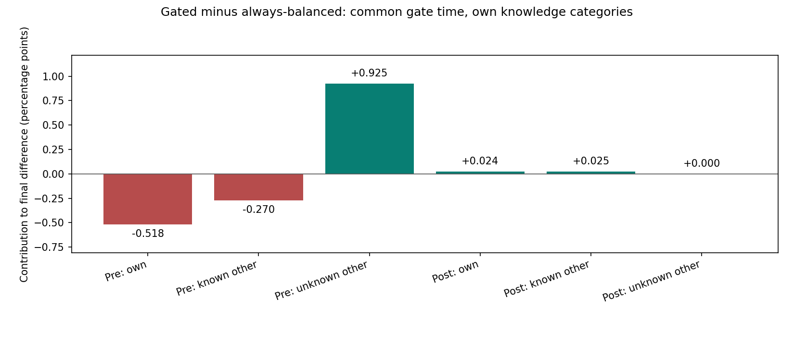
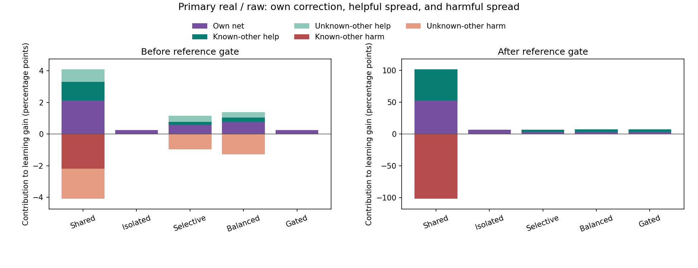
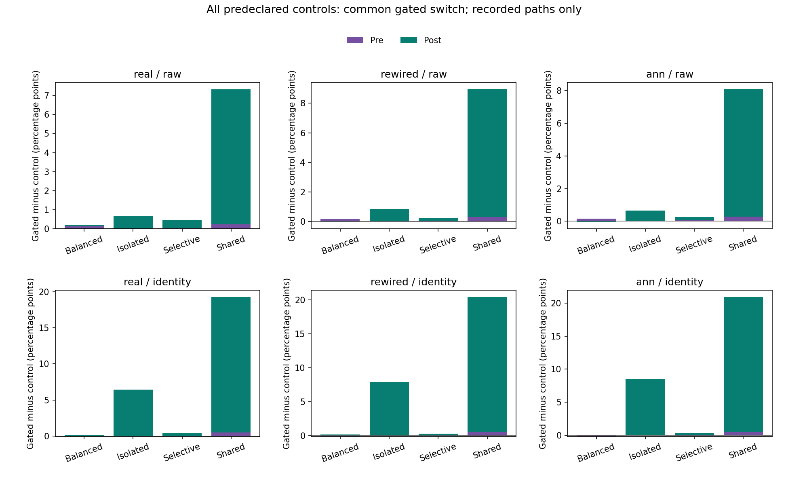

# 초반 보호의 이득이 작은 성적 차이로 남은 이유

**초반 방해를 막으면서 자기 수정과 유익한 번짐도 함께 줄었다. 전환 후에는 도움을 되살렸지만, 계속 분리한 방식보다 자기 수정 기여가 작았다.** 저장 기록의 이 상쇄를 합하면 새 방식(gated)과 처음부터 균형 방식(balanced)의 마지막 차이 **+0.186%포인트**에 돌아온다.

새 학습을 실행하지 않았다. 앞선 120,000시행의 실제 출력 수정이 네 입력에 준 480,000개 효과를 나누고 독립 검산했다. 아래 값은 각 시드를 같은 비중으로 평균한 **마지막 평균 정답 선택 확률에 대한 기여**다. 작은 값이 미리 정한 5%p 개선 기준이나 충분한 습득 기준을 통과했다는 뜻은 아니다. 부모의 성적 개선 미지지·습득0/10·작동상 보호 통과를 유지한다.

## 쉽게 설명하면: 손해를 막는 데도 대가가 있었다

처음부터 균형 방식은 초반에 자기 문제와 다른 문제를 함께 많이 움직였다. 좋은 변화도 있었지만 아직 답을 모르는 문제에는 손해가 더 컸다. 새 방식은 그 번짐을 막았다. 대신 자기 문제를 고친 양도 줄고, 우연히 도움이 되던 번짐도 사라졌다. 그래서 막은 손해 전체가 최종 이득으로 남지 않았다.

네 답을 모두 확인한 다음에는 다른 문제를 돕는 번짐이 다시 생겼다. 다만 ‘항상 분리’ 방식과 비교하면 자기 문제를 고친 기여는 줄었다. 도움의 상당 부분이 이 차이를 메웠고, 최종 성적 향상은 작았다. **도움이 전혀 없었던 것이 아니라, 함께 바뀐 다른 기여와 상쇄됐다.**

이는 이미 일어난 학습의 수지다. 어떤 손실 항만 없애는 새 규칙을 만들면 그만큼 성적이 오를 것이라는 예측이나, 유일한 인과 원인 증명은 아니다.

## 전환 전: 막은 피해와 함께 잃은 이득

주 조건(real/raw), gated−balanced의 실제 기록 차이다. 도움과 피해를 따로 센 뒤 합쳤다. 현재 문제를 제외한 ‘다른 문제’는 각 방식이 당시 실제 보상을 알고 있었는지로 나눈다.

| 전환 전의 장부 | 마지막 성적 차이에 대한 기여 |
|---|---:|
| 미관측 다른 문제의 음수 방해 감소 | **+1.2772%p** |
| 미관측 다른 문제의 양수 도움 감소 | -0.3525%p |
| 자기 문제의 수정 기여 감소 | -0.5175%p |
| 알려진 다른 문제의 도움 기여 감소 | -0.2698%p |
| **전환 전 합계** | **+0.1374%p** |

초반 방해 감소만 보면 +1.2772%p지만, 도움이 되던 변화와 자기 수정의 차이를 함께 더하면 **+0.1374%p**가 남는다. 알려진 목적지의 미세 음수 잔차 차이는 부동소수점 반올림 규모이며 원자료에 그대로 남겼다.

이전 보고서의 미관측 방해 질량 **0.05108807**은 400시행·여러 목적지에서 감소한 확률의 합이다. 여기서는 네 입력 평균 성적에 대한 기여로 바꾸어 **0.05108807÷4×100=1.2772%p**로 표시한다. 이전 최종 정답률이 5.11%p 낮았다는 뜻이 아니며, 피해만 분리한 장부가 가상의 새 학습 효과를 보장하지도 않는다.

## 전환 후: 이미 균형 방식이던 대조와의 차이는 작았다

두 방법 모두 후반에는 관측 기반의 같은 균형 규칙을 사용한다. 초반에 생긴 출력 상태와 이후 선택·보상·실제 수정량은 다를 수 있다. 주 조건의 후반 기록은 다음과 같다.

| 공통 전환 후 기여 | 처음부터 균형 | 초반 보호 후 균형 | 차이 |
|---|---:|---:|---:|
| 자기 문제 수정 | +3.5751%p | +3.5993%p | +0.0243%p |
| 알려진 다른 문제 순도움 | +3.7171%p | +3.7419%p | +0.0248%p |
| 미관측 다른 문제 | 0 | 0 | 0 |
| **후반 합계** | **+7.2921%p** | **+7.3412%p** | **+0.0491%p** |

전환 전 **+0.1374%p**와 후 **+0.0491%p**를 합하면 **+0.1865%p**다. 마지막 기대 정답 선택 확률 **57.5952%−57.4087%**와 일치한다. 시드별 차이는 양수9/10이며, 짝 차이의 표본 표준편차는 **0.1626%p**다. 이 값은 모집단 검정이나 동물 개체의 변이가 아니다.

## 도움을 다시 허용한 것 자체는 쓸모가 있었나

계속 분리한 isolated와 비교하면 전환 전 기록은 정확히 같다. 후반에 gated의 알려진 다른 문제 기여가 **+3.7419%p** 생겼지만, 자기 문제의 기여는 **6.6604→3.5993%p**, 즉 **-3.0611%p**였다. 두 항의 합은 **+0.6808%p**다.

| 전환 후, gated−항상 분리 | 성적 차이에 대한 기여 |
|---|---:|
| 자기 문제 | -3.0611%p |
| 알려진 다른 문제 | +3.7419%p |
| 미관측 다른 문제 | 0 |
| **합계** | **+0.6808%p** |

따라서 “균형 방식으로 바꿔도 도움이 되는 번짐이 생기지 않았다”는 설명은 이 기록에 맞지 않는다. 도움이 생겼다. 그러나 그 기여를 전부 순이득으로 얻지는 못했다. 자기 수정이 줄어든 원인을 방향·수정 크기·이미 달라진 출력 상태·행동 이력 중 하나로 이번 장부만으로 단정하지 않는다. 이 요소를 강제로 맞춘 대체 학습은 실행하지 않았다.

그림의 Shared는 원래 번짐을 허용한 대조다. 한 문제의 개선과 다른 문제의 피해가 반복되므로 누적 양수·음수 성적 기여가 각각 100%p를 넘을 수 있다. 이는 최종 정답률이 100%를 넘는다는 뜻이 아니다. 나머지 방법의 정확한 크기는 표와 원 요약에 남겼다.

## 같은 시계와 같은 지식은 다르다

전후 경계는 각 배선·표현·시드의 **gated가 실제로 네 보상 부호를 다 얻은 다음 시행**이다. 마지막 새 답을 얻는 시행은 전환 전이다. 같은 조합의 다른 네 방법도 이 시각에서 나누었다. 주 조건의 평균 전환 전은14.7시행, 후는385.3시행이다.

하지만 대조 방식의 경험까지 같지는 않았다. 주 조건의 처음부터 균형·선택 억제·공유 방식은 각각 10시드에서 합계 **6시행** 동안, gated의 전환 전 구간에 이미 자체 보상 네 칸을 채운 상태였다. 전환 후에 아직 부분 관측인 경우는 모두0이었다. 항상 분리와 gated의 불일치는0이었다.

전체 배선·표현·시드에서는 앞 세 대조 각각 **36시행**이 ‘공통 전환 전이지만 자체 완전 관측’이었고, ‘공통 전환 후지만 자체 부분 관측’은0이었다. 주 조건 gated와 처음부터 균형의 미관측 다른 목적지 mask 차이는 10시드 합계 **5개 시행·목적지 칸**이었다. 최초 완전 관측 시행 차이는 gated−balanced 평균 **+0.6시행**이었다. 이전 다른 코호트의 관측 시점 동일성을 이번 자료에 그대로 가정하지 않았다.

따라서 위 차이는 같은 시계에서 각자의 실제 장부를 뺀 것이다. 정보 집합·선택·출력 상태를 모두 같게 고정한 인과 비교는 아니다.

## 실제 수정량은 얼마나 달랐나

주 조건의 공통 구간별 10시드 평균이다. Go 횟수와 비영 출력 이동 수는 이 자료에서 같았지만, 개념적으로는 따로 기록했다. 한 번의 상한0.1·총경로40·제곱합4는 부모에서 이미 검증됐으며 실제 사용량을 동일하게 맞추지는 않았다.

| 방식 | 전환 전 Go | 전환 후 Go | 전환 전 경로 | 전환 후 경로 |
|---|---:|---:|---:|---:|
| 공유 | 6.9 | 175.7 | 0.342498 | 8.923377 |
| 항상 분리 | 7.2 | 188.5 | 0.360055 | 9.378689 |
| 선택 억제 | 7.1 | 190.7 | 0.349821 | 9.361693 |
| 처음부터 균형 | 7.1 | 189.8 | 0.350044 | 9.257083 |
| 초반 보호 후 균형 | 7.2 | 188.2 | 0.360055 | 9.303699 |

후반의 성적 기여/실제 경로 길이를 시드별로 구한 뒤 같은 비중으로 평균하면 gated **0.00789394**, balanced **0.00789228**, isolated **0.00711000**이다. 확률 단위/출력 계수 경로이며 %p로 표시한 값이 아니다. 비율이 비슷하다는 사실을 동일 비용의 인과효과나 최적 효율의 증명으로 읽지 않는다. 0분모는 JSON null·CSV 빈칸을 유지하며 CPU·기억·전환 처리 비용은 맞추지 않았다.

## 다른 배선·표현도 보존했다

gated−처음부터 균형의 전후 차이다. 주 조건의 작은 양수 결과를 모든 조건으로 일반화하지 않는다. rewired/raw와 ann/raw의 후반 기여 차이는 음수였고, ann/identity는 마지막 차이도 음수였다. 인공 이름표 표현(identity)의 유리한 비교로 원 입력(raw) 주 조건을 대신하지 않는다.

| 배선 | 표현 | 전환 전 차이 | 전환 후 차이 | 마지막 차이 |
|---|---|---:|---:|---:|
| real | raw | +0.1374%p | +0.0491%p | +0.1865%p |
| real | identity | -0.0425%p | +0.1449%p | +0.1024%p |
| rewired | raw | +0.1638%p | -0.0346%p | +0.1291%p |
| rewired | identity | -0.1284%p | +0.1436%p | +0.0151%p |
| ann | raw | +0.1556%p | -0.0561%p | +0.0995%p |
| ann | identity | -0.1765%p | +0.0544%p | -0.1221%p |

아래는30조건의 전체 장부다. 모든 수치는 % 또는 %p이며 알려진/미관측 다른 문제는 각각 own-method 관측으로 분류한다. tiny 잔차는 표에서0.000으로 반올림되더라도 원 배열에서 지우지 않았다.

| 배선 | 표현 | 방식 | 마지막 기대 정답 확률 | 전 자기 | 전 알려진 다른 | 전 미관측 다른 | 후 자기 | 후 알려진 다른 | 후 미관측 다른 |
|---|---|---|---:|---:|---:|---:|---:|---:|---:|
| real | raw | shared | 50.276% | +2.137 | -1.015 | -1.104 | +53.249 | -52.990 | +0.000 |
| real | raw | isolated | 56.914% | +0.254 | +0.000 | +0.000 | +6.660 | +0.000 | +0.000 |
| real | raw | feedback_selective | 57.135% | +0.608 | +0.173 | -0.572 | +3.622 | +3.304 | +0.000 |
| real | raw | balanced | 57.409% | +0.772 | +0.270 | -0.925 | +3.575 | +3.717 | +0.000 |
| real | raw | gated_balanced | 57.595% | +0.254 | +0.000 | +0.000 | +3.599 | +3.742 | +0.000 |
| real | identity | shared | 53.674% | +2.136 | -0.955 | -1.040 | +54.719 | -51.186 | +0.000 |
| real | identity | isolated | 66.470% | +0.676 | -0.000 | +0.000 | +15.793 | +0.000 | +0.000 |
| real | identity | feedback_selective | 72.470% | +0.921 | +0.360 | -0.646 | +11.493 | +10.341 | +0.000 |
| real | identity | balanced | 72.807% | +0.976 | +0.406 | -0.664 | +10.750 | +11.338 | +0.000 |
| real | identity | gated_balanced | 72.910% | +0.676 | -0.000 | +0.000 | +10.823 | +11.411 | +0.000 |
| rewired | raw | shared | 50.425% | +2.137 | -1.010 | -1.108 | +52.873 | -52.467 | +0.000 |
| rewired | raw | isolated | 58.531% | +0.323 | -0.000 | +0.000 | +8.209 | +0.000 | +0.000 |
| rewired | raw | feedback_selective | 59.156% | +0.656 | +0.192 | -0.588 | +4.667 | +4.230 | +0.000 |
| rewired | raw | balanced | 59.248% | +0.813 | +0.275 | -0.929 | +4.517 | +4.572 | +0.000 |
| rewired | raw | gated_balanced | 59.377% | +0.323 | -0.000 | +0.000 | +4.504 | +4.551 | +0.000 |
| rewired | identity | shared | 54.256% | +2.139 | -0.938 | -1.042 | +54.864 | -50.767 | +0.000 |
| rewired | identity | isolated | 66.776% | +0.698 | +0.000 | -0.000 | +16.078 | +0.000 | +0.000 |
| rewired | identity | feedback_selective | 74.379% | +0.973 | +0.393 | -0.671 | +12.393 | +11.291 | +0.000 |
| rewired | identity | balanced | 74.653% | +1.030 | +0.463 | -0.668 | +11.872 | +11.954 | +0.000 |
| rewired | identity | gated_balanced | 74.668% | +0.698 | +0.000 | -0.000 | +11.948 | +12.022 | +0.000 |
| ann | raw | shared | 50.305% | +2.137 | -1.018 | -1.108 | +53.040 | -52.745 | +0.000 |
| ann | raw | isolated | 57.760% | +0.288 | +0.000 | +0.000 | +7.472 | -0.000 | +0.000 |
| ann | raw | feedback_selective | 58.136% | +0.628 | +0.178 | -0.577 | +4.139 | +3.768 | +0.000 |
| ann | raw | balanced | 58.302% | +0.754 | +0.248 | -0.871 | +4.022 | +4.148 | +0.000 |
| ann | raw | gated_balanced | 58.402% | +0.288 | +0.000 | +0.000 | +3.996 | +4.118 | +0.000 |
| ann | identity | shared | 54.664% | +2.138 | -0.920 | -1.029 | +55.199 | -50.724 | +0.000 |
| ann | identity | isolated | 66.963% | +0.674 | -0.000 | +0.000 | +16.289 | -0.000 | +0.000 |
| ann | identity | feedback_selective | 75.287% | +0.943 | +0.379 | -0.617 | +12.938 | +11.644 | +0.000 |
| ann | identity | balanced | 75.670% | +1.022 | +0.441 | -0.612 | +12.322 | +12.498 | +0.000 |
| ann | identity | gated_balanced | 75.548% | +0.674 | -0.000 | +0.000 | +12.347 | +12.527 | +0.000 |

## 검산·보존·다음 질문

분석 전 소스19·부모11파일과 설정·계획을 동결하고 비공개 원격 등록 bytes를 확인했다. 120,000부모 시행·480,000목적지 효과·60개 기준 경계·24대비/240개 짝 경로·12배열·1,800행24열과 전체 요약을 독립 재구성했다. 최종 성적 장부 최대 잔차8.88e-16, 수정 경로 분할 최대 잔차1.24e-14로 사전 허용 오차1e-8 안이다. 새142·기존114개, 총256자동검사가 통과했다. 새 학습·계수 갱신·난수·모델/그래프·최적화는 각각0회다.

다음에 좁힐 후보는 **완전 관측 뒤 늘어난 도움과 줄어든 자기 수정의 교환을, 실제 수정 크기·상태·방향별로 구분하는 저장 기록 분석**이다. 이번에는 그 추가 교차 계산이나 새 학습을 하지 않았다. 어떤 방법이 충분한 습득을 만들 것이라고 미리 가정하거나, 현재 실패의 예산·시드·문턱을 바꾸지 않는다.

고정 내부 연결·같은 입력의 활성, 학습된 출력 계수, 별도 획득 보상 기억을 구분한다. 이번은 네 인공 전체 문자열의 제한된 출력 학습 기록 설명이다. 실제 시각 수량·LC11/DAN/KC→MBON 생물학적 가소성·새 입력 일반화·인간 유사성·공통 신경 기작·교육 효과의 추가 증거가 아니다. 계산 시드는 동물이나 사람 개체가 아니다. 기존 인간 비교 음성 결과·닫힌 일반화/간섭/순서 조건·원래 Phase5와 모든 완료 소스·실패·원자료를 보존했고 자동화는 PAUSED다.

[고정 분석 계획](gated-pathways-protocol.md) · [재현 안내](gated-pathways-reproduction.md) · [원 요약](../results/gated_pathways_v1/summary.json) · [독립 검산](../results/gated_pathways_v1/verification.json)
