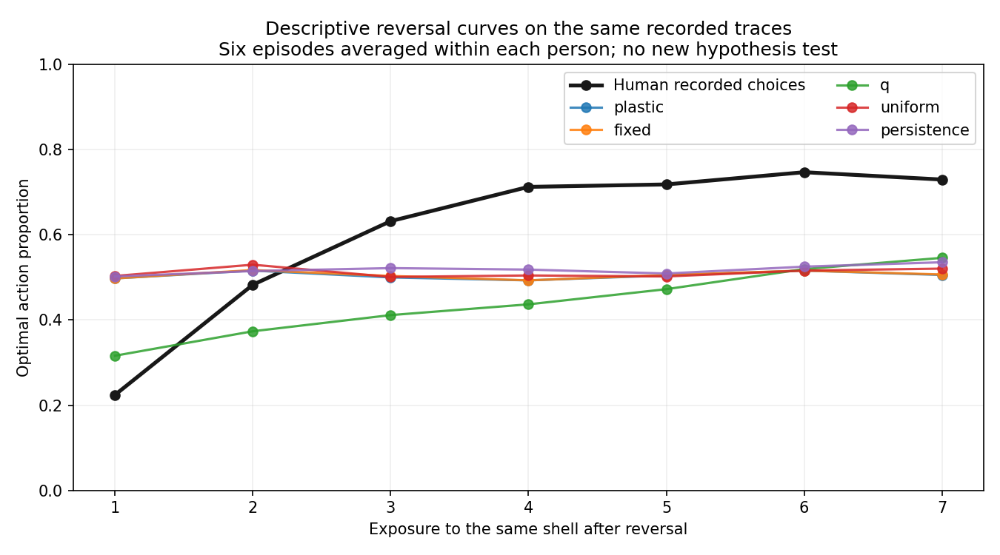
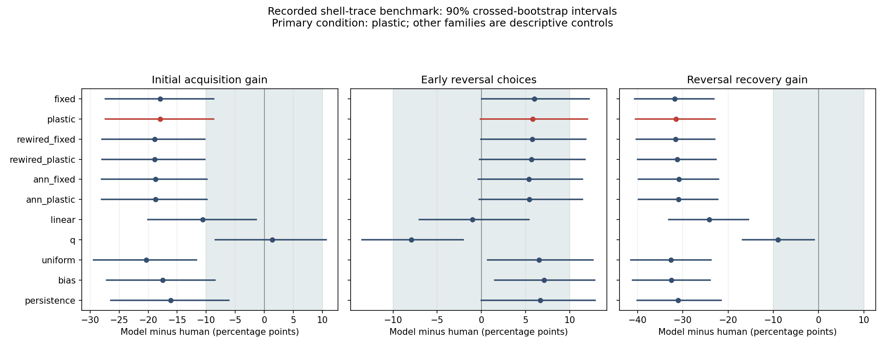

# 인간과 모델의 학습을 실제로 비교한 첫 결과

2026-10-19 (Asia/Seoul). `human_shell_v1` 및 별도 난수 주소 수정 `human_shell_rng_v2`를 실행하고 독립 검산했다. **이번 조개 보상 과제에서는 주 비교 모델의 학습 양상이 인간과 비슷하다는 사전 기준을 충족하지 못했다.** 사람은 보상 규칙이 바뀐 뒤 선택을 개선했지만, 주 모델은 같은 범위에서 거의 개선되지 않았다. 인간 전체와 초파리 전체가 다르다는 결론은 아니다.

## 무엇을 비교했나

사람에게는 여섯 종류의 조개 중 하나가 차례로 제시됐다. 조개를 주우면 좋은 내용으로 점수를 얻거나 나쁜 내용으로 점수를 잃을 수 있고, 지나가면 점수가 0이다. 어떤 조개가 유리한지는 도중에 바뀐다. [TNU 공개 기록](https://zenodo.org/records/10066829)을 이용해 모델에도 같은 조개 순서와 잠재 결과를 제공했다. 모델은 선택 전에 속내용·숨은 상태·미래 반전을 보지 못하고, 자신이 조개를 주운 때에만 그 결과를 관찰했다.

50개 원 기록 중 구조적으로 완전한 49개를 사용했다. A0016은 원 선택 기록이 중간에 잘려 구조 사유로 제외했고, 성적이 나쁜 사람을 제외하지 않았다. ID의 해시만으로 **보정용 20명과 평가용 29명**을 먼저 나눴다. 학습률은 20명에서만 고르고, 29명의 결과에 맞춰 다시 고르지 않았다. 모델 초기화는 고정된 다섯 계산 시드이며 사람이나 초파리 다섯 개체를 뜻하지 않는다.

두 질문을 따로 검사했다. 첫째, 모델이 **스스로 선택하고 자기 보상을 받으며** 사람과 비슷하게 변하는가? 둘째, **그 사람이 지금까지 한 선택과 얻은 보상**을 모델에 차례로 제공하면 다음 선택을 잘 예측하는가? 두 번째의 예측 성공만으로 첫 번째의 자율 학습을 입증할 수 없다.

## 주 결과: 반전 뒤 회복의 큰 차이

주 모델은 원 커넥톰 일부를 쓰고 내부 KC→MBON 계산 가중치와 출력 가중치를 바꾸는 `plastic`이다. 점수상 유리한 행동이 명확한 조개 3/4만 주 행동 지표에 넣었다. 중립 조개에서 지나가기만을 유일한 정답으로 강제하지 않았다.

| 사전에 정한 측정 | 사람 29명 평균 | 주 모델 평균 | 모델−사람 및 90% 구간 | 사전 판정 |
|---|---:|---:|---:|---|
| 처음 배울 때 향상 | +18.39%p | +0.46%p | −17.93%p [−27.36, −8.74] | 동등성 미확인·허용 경계 걸침 |
| 규칙 변경 직후 유리한 선택률 | 44.64% | 50.46% | +5.82%p [−0.11, +12.03] | 동등성 미확인·허용 경계 걸침 |
| 규칙 변경 뒤 회복 | +31.23%p | −0.31%p | −31.53%p [−40.42, −22.87] | 허용폭 밖의 차이 |

처음 향상은 조개별 초기 구간의 마지막 3회 선택률에서 처음 3회를 뺀 값이다. 반전 직후는 조개별 반전 다음 처음 3회의 선택률이고, 회복은 각 반전 구간의 마지막 3회에서 처음 3회를 뺀 값이다. 한 사람의 여섯 반전은 그 사람 안에서 평균하며 독립 참가자로 늘려 세지 않는다. `%p`는 비율의 차이다. 40%에서 70%가 되면 30%포인트 향상이다.

결과를 보기 전에 **세 지표 모두의 차이 구간 전체가 ±10%p 안에 들어와야 비슷하다고 판정**하기로 했다. 세 지표 모두 이 조건에 못 미쳤다. 그중 회복은 구간 전체가 허용폭 밖이다. 나머지 둘은 허용 경계에 걸치므로, 세 지표 모두에서 허용폭 밖의 차이가 확정됐다고 쓰면 안 된다. 이 폭은 이번 연구의 실용적 기준이지 생물학적으로 검증된 보편 경계가 아니다.

또한 사람과 모델 모두 처음 향상의 90% 구간 하한이 +5%p를 넘는지 따로 확인했다. 사람 구간은 [+11.49, +25.29]%p로 통과했고, 모델은 [−5.98, +7.24]%p로 통과하지 못했다. 따라서 **학습으로 생긴 공통 양상이 확인됐다**는 판정도 미지지다. 내부 수치가 바뀌었다는 사실과 과제 수행이 향상했다는 사실은 구분한다.

실제로 주 모델의 145개 자율 경로 모두에서 내부·출력 가중치는 바뀌었다. 각각 31,320회의 갱신 호출 중 0이 아닌 실제 변화는 출력 9,386회·내부 9,241회였다. 고정 encoder에 따른 KC probe 활성은 그대로였고 MBON과 결정 활성은 변했다. [별도 상태 진단](../results/human_shell_state_diagnostics.json)에 이를 구분했다. 서로 차원과 단위가 다른 내부·출력·활성 L2 크기로 행동에 대한 기여도를 비교하지 않는다. **가중치가 바뀌었지만, 이번 행동 기준을 충족하는 향상은 확인하지 못했다.**

그림의 가로축은 실제 시간이나 모든 시행 번호가 아니라 **같은 조개를 반전 후 몇 번째 보았는가**다. 모든 반전에 존재하는 처음 7회만 그렸다. 검은 사람 곡선은 올라가고, 주 모델은 약 50% 부근에 머물렀다. 그림은 기술적 요약이며 위의 처음/마지막 3회 판정을 대신하는 새 검정이 아니다.

## 다음 인간 선택의 예측도 별도로 평가했다

예측 오차 NLL은 실제 선택에 낮은 확률을 줬을수록 커지는 점수이며 작을수록 좋다. 단위는 시행당 nat이고 정답률 퍼센트가 아니다. 주 모델은 0.6660, 매번 50:50인 대조는 0.6931이었다. 그러나 보정 자료의 Go 비율을 계속 쓰는 단순 편향 대조는 0.6435, 같은 조개에서 직전 선택을 반복하기 쉬운 대조는 0.6233이었다.

| 주 모델의 오차 개선량: 대조−주 모델 | 평균 | 90% 구간 | 개선 하한 > .01 기준 |
|---|---:|---:|---|
| 무작위 50:50 대비 | +0.02710 | [+0.01382, +0.03998] | 통과 |
| 일정 선택 편향 대비 | −0.02257 | [−0.04016, −0.00668] | 미달 |
| 직전 같은 조개 선택 반복 대비 | −0.04276 | [−0.08660, +0.00653] | 미달 |

세 대조를 모두 넘어야 하는 예측 가설은 **미지지**다. 반복 대조보다 평균 오차가 크지만 그 차이 구간은 0을 포함하므로, 반복 대조가 확실히 우수하다고 추가 단정하지 않는다. 반복 대조가 사람 선택을 잘 예측하더라도 스스로 보상 학습을 했다는 뜻은 아니다.

## 모든 대조 모델도 남겼다

아래 값은 선택이 끝난 29명·다섯 시드 전체 평균이다. 주 모델을 결과에 따라 다른 모델로 교체하지 않았다. 다른 모델은 기술적 대조이며 여러 조건 중 유리한 하나를 골라 확증 결과로 내세우지 않는다.

| 조건 | 처음 향상 %p | 반전 직후 % | 반전 뒤 회복 %p | 조건부 NLL | 세 행동 지표 동등성 |
|---|---:|---:|---:|---:|---|
| 원 배선·출력만 (`fixed`) | +0.46 | 50.61 | −0.57 | 0.6675 | 미확인 |
| 원 배선·내부/출력 (`plastic`, 주 모델) | +0.46 | 50.46 | −0.31 | 0.6660 | 미확인 |
| 재배선·출력만 | −0.46 | 50.42 | −0.34 | 0.6680 | 미확인 |
| 재배선·내부/출력 | −0.46 | 50.31 | −0.04 | 0.6667 | 미확인 |
| 일반 ANN·출력만 | −0.34 | 50.00 | +0.34 | 0.6721 | 미확인 |
| 일반 ANN·내부/출력 | −0.34 | 50.08 | +0.23 | 0.6707 | 미확인 |
| 선형 학습자 | +7.82 | 43.64 | +7.09 | 0.6536 | 미확인 |
| 조개별 가치표 Q 학습자 | +19.77 | 36.70 | +22.26 | 0.6271 | 미확인 |
| 무작위 | −1.95 | 51.15 | −1.38 | 0.6931 | 미확인 |
| 일정 편향 | +0.92 | 51.72 | −1.30 | 0.6435 | 미확인 |
| 같은 조개의 직전 선택 반복 | +2.30 | 51.30 | +0.15 | 0.6233 | 미확인 |

Q 학습자는 조개마다 두 행동의 가치를 별도로 저장하는 단순 계산이다. 일부 평균은 사람 쪽에 가까워졌지만 세 지표의 구간 전체가 허용폭 안에 들어오지 않아 동등성을 확인하지 못했다. 선형의 반전 직후 한 지표는 동등성 범위 안이지만 나머지 둘은 아니다. 단순 대조의 부분적 근접은 커넥톰 고유성을 입증하지 않는다. 모델 간 배선 우위의 별도 확증 검정도 하지 않았다.

## 첫 실행의 오류를 어떻게 다뤘나

첫 실행의 서로 다른 사람·시드 조합 145개가 합 기반 난수 주소 88개로 겹치는 설계 오류가 있었다. **첫 실행의 성적·선정값·가설 판정을 root가 읽기 전**, 설정 조합만으로 발견해 [오류 기록](../results/human_shell_rng_design_issue_v1.json)을 남겼다. 원 코드·등록·결과·검산을 바꾸지 않고 `human-shell-v1-design-limited` 태그에 보존했다. 원 자율 구간으로 동등성이나 차이를 확정하지 않는다.

별도 등록 v2에서는 난수 주소만 요소별로 분리했다. 원래 사람 분할·초기 모델·학습률·5시드·평가 기준·재표집 2,000회는 그대로다. 기존 보정과 조건부 예측은 재사용하고 자율 선택 344,520회만 새로 실행했다. 145개 주소·초기 난수 상태가 모두 다른지 확인했고, 원 조건부 배열·CSV·witness와 새 자율 모델의 초기 상태가 바이트 그대로 같은지도 검증했다. 성공할 때까지 학습률·시드·예산을 바꿔 재시도하지 않았다.

위 본문의 행동 해석은 **수정한 v2**를 사용한다. 원 v1 요약과 판정은 보존된 역사이며 수정 결과로 덮어쓰지 않았다. 조건부 예측은 난수 주소 수정의 영향을 받지 않아 두 실행에서 정확히 같다. [원 오류와 수정 설계](human-shell-rng-design-note.md), [별도 수정 계획](human-shell-rng-protocol.md)을 함께 남겼다.

## 이번 결과의 범위와 남은 질문

이 비교는 **인공 조개 이름표를 받은 부분 커넥톰 계산 모델**의 제한적 행동 비교다. 시각 회로·LC11·실제 DAN 반응·생물학적 KC→MBON 학습을 재현한 것이 아니다. 수량 추출이나 수학 개념·고등학교 수학 학습의 비교도 아니다. 같은 행동 결과가 나와도 같은 신경 기작을 뜻하지 않는다. 이번에는 주 행동 유사성 자체도 지지되지 않았다.

원 인간 자료에는 약물 개입 집단이 섞여 있고 코드와 농도의 대응에 불확실성이 있다. 구조적으로 완전한 양쪽 기록을 사용했으며 약물 효과·정상인 대표성·연령·임상 효과를 검정하지 않았다. 사람의 사전 연습과 시각·운동 동작, 반응시간·실제 시간 간격을 모델이 재현하지 않았다. 29명과 다섯 계산 시드의 구간은 제한된 초기 비교이며 원인 기작을 식별하지 않는다. [원자료 의미·권한](human-shell-source-review.md), [시행별 파생 자료 저장 설명](human-shell-data-processing-note.md)을 보존한다.

다음에 검증할 만한 질문은 “조개 정체성별 가치 구분, 선택 편향, 이전 선택의 영향 중 무엇이 현재 모델과 사람의 차이를 줄이는가?”이다. Q·반복 대조가 제공한 기술적 단서이며 원인으로 입증한 것이 아니다. 확인하려면 이를 분리한 새 모델·대조·사전 기준이 필요하다. 이번 실패를 같은 등록의 훈련 연장으로 성공으로 바꾸지 않는다. 새로운 수량·규칙 일반화와 간섭·순서 효과도 별도 미검증으로 남는다.

## 보존한 산출물과 단계

첫 실행은 보정 311,040개·평가 조건부 예측 344,520개·자율 선택 344,520개를 계산했다. 수정 실행은 자율 선택 344,520개만 새로 계산했다. 사람 원자료는 완전한 49명·10,584시행이고 평가 사람의 실제 선택은 29명·6,264개다. 모델 조건·시드별 반복, 독립 재계산, 파생 배열을 추가 인간 시행으로 세지 않는다.

첫 독립 검산은 원 실행 전체를, 수정 검산은 새 자율 1,595경로·344,520회 및 원 기록 재사용을 확인했다. 최종 합성 자동검사 **199개 = 첫 연구 106개 + 수정 연구 93개**가 통과했다. 14개 plotting 의존성 폐기 예정 경고는 기록에 남겼다. 테스트 수 집계의 package-prefix 표시 오류도 원 영수증을 보존하고 [별도 정정](../results/human_shell_rng_test_count_correction.json)에 기록했다.

- [원 사전 계획](human-shell-protocol.md), [원 등록](../results/registration_human_shell_v1.json), [원 검산](../results/human_shell_v1/verification.json)
- [수정 등록](../results/registration_human_shell_rng_v2.json), [수정 전체 요약](../results/human_shell_rng_v2/summary.json), [독립 검산](../results/human_shell_rng_v2/verification.json)
- [다음 선택 예측 그림](../results/human_shell_rng_v2_figures/heldout_prediction.png), [환경 버전](../results/human_shell_runtime_environment.json), [재현 명령](human-shell-reproduction.md)

이로써 Phase 4의 **새 공개 과제에서 실제 인간·모델 비교를 실행하는 작업**은 완료했다. 검정 완료와 유사성 지지를 구분해 상태를 기록한다. 이전 Marković 자료의 닫힌 과제 대응 조건과 과거 보고서는 그대로다. Phase 2·3 전체나 Level 5가 완료된 것은 아니며 **Phase 5 전체 연구 종합은 시작하지 않았다.** 자동 이어가기는 PAUSED를 유지한다.
