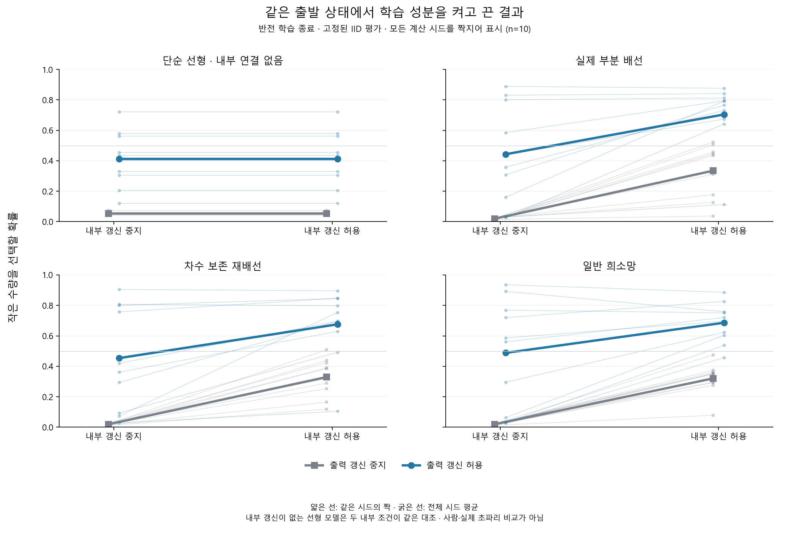
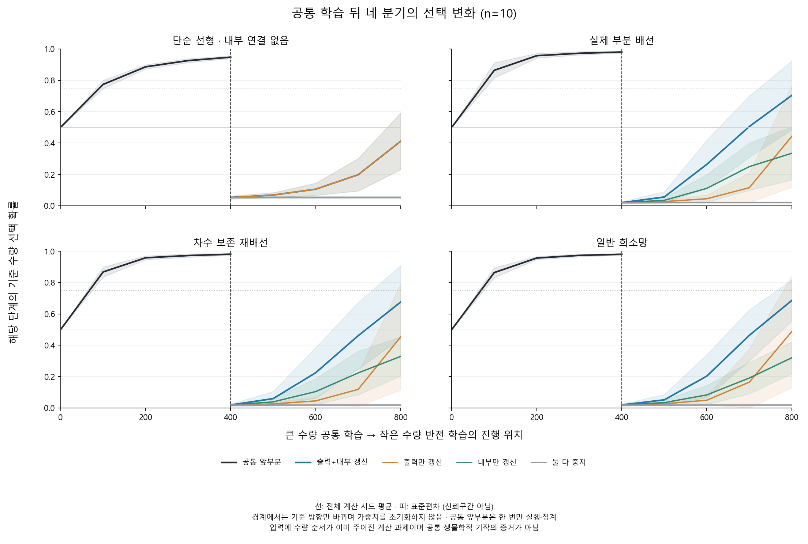

# 같은 상태에서 학습 부분을 켜고 끈 결과

작성일: 2026-10-16 (Asia/Seoul). 연구 ID `learning_ablation_v1`.

## 먼저 쉽게 설명하면

큰 수량을 고르도록 먼저 배운 모델을 네 벌로 복사했다. 규칙을 작은 수량 선택으로 바꾼 다음, 네 벌에서 내부 연결과 출력 부분의 학습을 각각 켜거나 껐다. 한 모델의 네 벌은 출발 상태가 완전히 같았다. ‘출력’은 내부 정보를 최종 선택으로 바꾸는 계수이고, ‘내부’는 모델 안의 KC→MBON 연결 가중치다.

이 대조는 이전 결과에서 섞여 있던 출발 상태의 차이를 통제한다. 학습을 허용한 부분에 따라 그 뒤 실제 선택·보상 경험도 달라질 수 있으므로, 바뀐 계산 경로 전체의 효과를 본 것이다. 모든 분기에 같은 정답이나 보상을 강제로 주지 않았다.

실제 부분 배선에서 반전 후 작은 수량을 고를 확률은 둘 다 학습할 때 평균 70.42%, 출력만 바꾸면 44.30%, 내부만 바꾸면 33.48%, 모두 고정하면 1.97%였다. 둘 다 학습한 분기도 적응 기준은 6/10만 통과했다. 나머지 실행과 내부만으로도 나타난 부분적 변화도 보존했다.

## 미리 정한 질문의 결과

실제 부분 배선에서 첫 질문은 **출력 학습에 내부 학습을 더 허용했을 때**, 둘째는 **내부 학습에 출력 학습을 더 허용했을 때**의 차이다. 각각 전체 10시드 평균 차이가 5%포인트 이상이고 차이가 양수인 시드가 8개 이상이어야 지지다. 두 가설을 별도로 판정했다.

| 가설 | 같은 출발 상태에서 비교 | 최종 선택 확률의 평균 차이 | 양수 시드 | 사전 기준 |
|---|---|---:|---:|---|
| H_I | 둘 다 − 출력만 | 26.12%포인트 | 9/10 | 지지 |
| H_H | 둘 다 − 내부만 | 36.94%포인트 | 10/10 | 지지 |

첫 학습의 습득 여부와 관계없이 모든 시드를 위 평균과 분모에 남겼다. 이번에는 네 모델 모두 첫 규칙을 10/10에서 습득했다. 내부 학습을 추가한 H-I 차이는 한 시드에서는 음수였으므로 모든 실행에서 도움이 됐다는 결과는 아니다. 이 기준은 계산 진단용 실용 기준이며 통계적 유의성이나 생물학적 임계값이 아니다. 미지지는 이 조건·예산에서 정한 수준의 효과를 지지하지 않았다는 뜻이다.

## 모든 모델·분기의 반전 결과

확률은 반전 평가에서 **작은 수량을 고를 확률**이다. 실제 보상률과 다르다. ‘습득 후 적응’은 첫 규칙의 IID 최종 확률≥.75·초기 대비 증가≥.15와 반전 최종 확률≥.75를 함께 만족한 실행 수다.

| 모델 | 반전 중 허용된 학습 | 첫 규칙 습득 | 반전 직후 확률 | 반전 최종 확률 | 습득 후 적응 |
|---|---|---:|---:|---:|---:|
| 단순 선형 | 둘 다 학습 | 10/10 | 5.24% | 41.17% | 0/10 |
| 단순 선형 | 출력만 학습 | 10/10 | 5.24% | 41.17% | 0/10 |
| 단순 선형 | 내부만 학습 | 10/10 | 5.24% | 5.24% | 0/10 |
| 단순 선형 | 모두 고정 | 10/10 | 5.24% | 5.24% | 0/10 |
| 실제 부분 배선 | 둘 다 학습 | 10/10 | 1.97% | 70.42% | 6/10 |
| 실제 부분 배선 | 출력만 학습 | 10/10 | 1.97% | 44.30% | 3/10 |
| 실제 부분 배선 | 내부만 학습 | 10/10 | 1.97% | 33.48% | 0/10 |
| 실제 부분 배선 | 모두 고정 | 10/10 | 1.97% | 1.97% | 0/10 |
| 재배선 | 둘 다 학습 | 10/10 | 1.92% | 67.59% | 5/10 |
| 재배선 | 출력만 학습 | 10/10 | 1.92% | 45.39% | 4/10 |
| 재배선 | 내부만 학습 | 10/10 | 1.92% | 32.92% | 0/10 |
| 재배선 | 모두 고정 | 10/10 | 1.92% | 1.92% | 0/10 |
| 일반 희소망 | 둘 다 학습 | 10/10 | 1.96% | 68.62% | 4/10 |
| 일반 희소망 | 출력만 학습 | 10/10 | 1.96% | 48.81% | 3/10 |
| 일반 희소망 | 내부만 학습 | 10/10 | 1.96% | 32.05% | 0/10 |
| 일반 희소망 | 모두 고정 | 10/10 | 1.96% | 1.96% | 0/10 |



가는 선은 같은 시드에서 복사된 분기들이고 굵은 선은 전체 10시드 평균이다. 한 모델의 네 분기가 독립된 동물 네 마리를 뜻하지 않는다. 선형에는 내부 연결이 없어 내부만 학습과 모두 고정이 같은 경로였고, 둘 다 학습과 출력만 학습도 같은 경로였다. 독립 검산에서 이 동치를 확인했다.



선은 전체 시드 평균, 띠는 표본 표준편차이며 신뢰구간이 아니다. 공통 학습은 한 번만 표시했다. 400회 경계의 확률 하락은 기준 선택이 큰 수량에서 작은 수량으로 바뀌는 데 따른 것으로, 그 순간 가중치를 지운 결과가 아니다.

## 무엇을 얼마나 검증했나?

- 실제 선택·피드백 **80,000회**: 공통 학습 16,000회와 분기 64,000회. 공통 학습을 네 번 세지 않았다.
- 출력 갱신 48,000회, 내부 갱신 36,000회, 정답을 직접 쓰는 갱신 0회. 한 시행에서 두 가중치를 바꾼 것을 두 경험으로 세지 않았다.
- [독립 검산](../results/learning_ablation_v1/verification.json)은 checkpoint 1,000개와 평가 사례 확률 256,000개, 모든 실제 선택·보상·마스크 갱신·분기 초기 상태·counter·곡선·판정을 재계산해 통과했다.
- 새 자동 시험 **166개**가 통과했다. 개발 시드 17/18과 각 phase 8시행만 사용했으며 과학 시드로 사전 연습을 하지 않았다. [시험 기록](../results/test-validation-learning-ablation.json).

내부·출력 가중치 변화와 고정 probe 활성 변화, 시작 대비 변위와 phase 내 변위를 각각 보존했다. native 누적 counter는 앞 학습을 상속하지만 phase-local counter는 새 분기에서 한 갱신만 센다. 갱신을 차단한 부분의 변위와 phase-local 호출 수는 0이어야 한다.

[전체 summary](../results/learning_ablation_v1/summary.json)에 모든 시드·IID/OOD·실패 표시와 2×2 효과를 남겼다. 실패 사유 542건은 같은 경로의 사유와 공통 prefix를 여러 분기에서 다시 표시한 항목이 겹치므로 독립 실패 실험 수가 아니다. [자원](../results/learning_ablation_v1/model_resources.json), [복제 확인](../results/learning_ablation_v1/clone_evidence.json), [시행별 단계](../results/learning_ablation_v1/stages.json)도 보존했다.

## 상호작용과 해석의 한계

모델별 `둘 다−출력만−내부만+모두 고정`과 두 성분의 조건별 효과·평균 효과를 미리 정해 모두 계산했다. 출력과 내부의 기여가 독립적으로 더해진다고 가정하지 않는다. 내부 학습이 도움이 되더라도 추가 갱신 자원, 정책의 확신·포화, 이후 행동·보상 경로의 변화가 포함된다. 같은 상태를 복제한 통제가 이 차이를 없애 주지는 않는다.

이것은 입력에 이미 주어진 수량 순서를 보상과 연결하는 계산 과제다. 실제 점 그림에서 수를 추출한 실험이 아니며 OOD도 새 수량·새 규칙 전이가 아니다. 실제 배선·재배선·일반망의 출발 상태는 모델 사이에서 같지 않고, 배선 우위 가설도 없다. 실제 LC11·DAN·동물 시냅스 학습·인간의 같은 기작·교육 효과를 입증하지 않는다. fresh-low 대조가 없어 순수 학습 속도나 기존 기억의 비용 자체를 추정하지 않는다.

장기 인간 학습 비교에서는 행동 곡선만으로 내부 기작을 단정하지 않기 위해 이런 계산 대조가 필요하다. 이번 결과는 Level4/5 비교가 아니며 이전의 실패를 새 성공으로 교체하지 않는다.

## 동결과 재현

소스 커밋 `ddae9da05f9e7debbc406433912a62eab55aa423`. 등록 `2026-10-16T01:37:18.756105+00:00` → 원격 동일 바이트 확인 `2026-10-16T01:37:55.149963+00:00` → 실행 `2026-10-16T01:38:03.474624+00:00`–`2026-10-16T01:38:51.726415+00:00` → 독립 검산 `2026-10-16T01:39:10.300886+00:00` 순서다. [새 프로토콜](learning-ablation-protocol.md), [설계 감사](learning-ablation-design-audit.md), [등록](../results/registration_learning_ablation_v1.json), [원격 확인](../results/learning_ablation_prefreeze_evidence.json)을 보존한다. private Git 동결이며 공인·눈가림 사전등록이라고 부르지 않는다.

완료 태그 `learning-ablation-v1`의 별도 checkout과 Python3.12 고정 환경에서 새 경로로 재현한다. 기존 결과를 덮어쓰지 않는다.

```powershell
python scripts/run_learning_ablation.py register --config configs/learning_ablation_v1.json --out results/registration_ABLATION_NEW.json
python scripts/run_learning_ablation.py run --config configs/learning_ablation_v1.json --registration results/registration_ABLATION_NEW.json --out results/ABLATION_NEW
python scripts/verify_learning_ablation.py --registration results/registration_ABLATION_NEW.json --result-dir results/ABLATION_NEW --out results/ABLATION_NEW/verification.json
python scripts/plot_learning_ablation.py --result-dir results/ABLATION_NEW --out results/ABLATION_FIGURES_NEW
```

62개 소스·설정·원 투영·환경·시험·문서와 5개 부모 증거의 원 바이트, 실행 순서, 새 그림, 이전 연구 보존은 [최종 아카이브 검증](../results/learning_ablation_archive_validation.json)에 함께 기록한다.

등록 뒤 학습 실행 전, 고정 코드로 입력과 행동·보상 uniform 배열만 준비해 [입력 동결 manifest](../results/learning_ablation_input_freeze_v1.json)에 10시드×16필드=160개의 dtype·shape·NPY 바이트 SHA-256을 기록하고 [원격 동일 바이트](../results/learning_ablation_input_prefreeze_evidence.json)를 확인했다. 이 준비는 학습자 구성·행동 선택·실제 보상 생성·가중치 갱신을 하지 않았다. 최종 아카이브에서 실제 저장된 stimuli.npz의 정확한 16필드를 같은 NPY 직렬화로 전수 대조했다. NPZ zip 컨테이너 해시와 배열별 NPY 해시는 구분한다. 기존 62개 소스와 실험 조건을 바꾸는 절차가 아닌 추가 입력 잠금 증거다.
