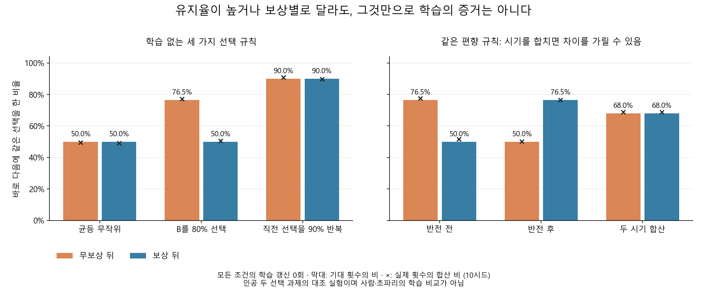

# 학습 없는 선택 규칙으로 지표를 점검한 결과

작성일: 2026-10-16 (Asia/Seoul). 연구 ID `metric_calibration_v1`.

## 먼저 쉽게 설명하면

**같은 선택을 자주 반복하거나 보상별로 다른 유지율을 보인다는 사실만으로 학습을 입증할 수 없다.** 보상을 무시하고 B를80% 확률로 선택하는 고정 규칙만으로도 그런 수치가 나왔다. 직전 선택을90% 반복하게 정해 놓으면 보상과 무관하게 높은 유지율을 만든다. 이때 직전 선택을 기억하는 상태는 달라지지만 규칙·가중치를 학습으로 바꾸지는 않는다.

이 대조는 앞서 사람과 모델에서 계산한 지표가 쓸모없다는 뜻이 아니다. 지표를 해석할 때 **단순 선택 편향과 반복 습관이라는 대안 설명도 확인해야 한다**는 뜻이다. 실제 학습은 경험 때문에 모델의 성능·상태·가중치가 어떻게 달라졌는지와 보상을 없앤 대조를 함께 봐야 한다.



막대는 ‘기대 유지 횟수/기대 분모’이고 ×는 실제 실행의 합산 유지 횟수/합산 분모다. 기대 비율과 실제 난수 비율의 평균을 같은 양으로 취급하지 않는다. 그림은 사전 H1–H3에 해당하는 조건을 표시한 것이며 성공한 시드를 골라낸 그림이 아니다.

## 무엇을 실행했나

- 선택 정책3개: 균등 무작위, B선택 확률80%, 직전 선택 반복확률90%. 모든 정책의 학습 갱신0회.
- 보상 환경4개: 결정적1/0, 확률적.8/.2, 무정보.5/.5, 반대 연결.2/.8.
- 일정2개: 기준 선택지가 같은800시행, 400시행 뒤 기준 선택지가 바뀌는800시행. 두 일정 모두 같은400/400 구획을 사용한다.
- 고정10시드9001–9010, 총240경로·192,000시행. 동일 시드의 선택·보상 난수 배열을 모든 조건에서 재사용했다. 보상이 정책을 바꾸지 않으므로 같은 정책의 선택 경로는 환경·일정과 무관하게 같다.
- 원 인접 후보191,760쌍, 경계를 제외한 유효191,520쌍. 경계240쌍은 삭제하지 않고 이유를 보존했다. 전체와 두 단계의720개 지표 묶음 및72개 요약 조건을 전부 보고했다.

## 미리 정한 반례의 결과

확률적.8/.2 환경의 고정 사례다. 기대값 열은 수학적 계산, 실제 열은10시드의 횟수를 합친 기술 비율이다. 독립적인 사람 모집단 추정이나 신뢰구간이 아니다.

| 규칙·구간 | 기대 보상 뒤 유지 | 기대 무보상 뒤 유지 | 실제 보상 뒤 유지 | 실제 무보상 뒤 유지 |
|---|---:|---:|---:|---:|
| 균등 무작위 | 50.00% | 50.00% | 49.13% | 49.46% |
| B를80% 고정 선택 | 50.00% | 76.47% | 50.64% | 77.13% |
| 직전 선택을90% 반복 | 90.00% | 90.00% | 89.80% | 90.69% |
| 80% 편향 · 반전 전 | 50.00% | 76.47% | 51.62% | 77.58% |
| 80% 편향 · 반전 후 | 76.47% | 50.00% | 76.55% | 50.08% |
| 80% 편향 · 두 시기 합산 | 68.00% | 68.00% | 68.73% | 68.86% |

**H1 통과:** 80% 편향 정책의 기대 유지율 차이(보상 뒤−무보상 뒤)는 `−9/34`, 약−26.47%포인트다. 보상은 어느 선택을 했는지에 대한 단서가 되고, 원래의 선택 빈도가 다르기 때문에 차이가 생긴다. 보상에 맞춰 다음 선택 규칙을 바꾼 결과가 아니다.

**H2 통과:** 반복 정책의 기대 유지율은 모든 환경·일정·단계에서90%다. 높은 유지율이 학습을 필요로 한다는 해석의 반례다.

**H3 통과:** 편향 정책은 반전 전과 후의 기대 차이가 각각−26.47/+26.47%포인트지만 두 시기를 합친 기대 차이는0이다. 전체 평균만 보면 구간별 차이가 가려질 수 있다. 실제 난수 실행이 정확히0이나90%여야 한다는 기준은 사용하지 않았다.

[전체 시드별 결과](../results/metric_calibration_v1/metrics.json)와 [전체 조건 요약](../results/metric_calibration_v1/summary.json)에 분자·분모·비율과 정의된 시드 수를 보존했다. `E[S]/E[D]`는 일반적으로 `E[S/D | D>0]`와 다르며, 독립 합성 검증에3시행 반례도 포함했다. 작은 분모·정의되지 않은 비율을0으로 채우지 않았다.

## 실행 전 고정과 검증

소스 커밋은 `ad89ba72e200757247c69b795e9e85c491623731`다. 등록 UTC `2026-10-16T00:25:11.404618+00:00`, private GitHub 바이트 확인 `2026-10-16T00:25:29.292846+00:00` 뒤 실제 실행 `2026-10-16T00:25:33.254254+00:00` → `2026-10-16T00:25:36.579940+00:00`, 독립 검산 `2026-10-16T00:25:52.496366+00:00` 순서다. [등록](../results/registration_metric_calibration_v1.json)·[원격 동결](../results/metric_calibration_prefreeze_evidence.json)·[실행 메타데이터](../results/metric_calibration_v1/metadata.json)를 보존했다.

[독립 검산](../results/metric_calibration_v1/verification.json)은 주 생성·측정·기대값 함수를 호출하지 않고192,000개 선택·실제 피드백·난수, 모든 원 인접쌍,3구간 지표,72요약조건,6산출물 해시를 재계산했다. 기대값은8가지 이진 경우를 유리수로 전개해 절대 오차1e−12 이내에서 확인했다. 새 합성 자동시험124개도 통과했다. 원 결과와 실패·기존 인간 분석은 변경하지 않았다.

## 재현

완료 태그 `metric-calibration-v1`의 별도 checkout에서 Python3.12와 `requirements-lock.txt`를 사용한다. 모두 저장소 루트에서 실행하며 기존 출력은 덮어쓰지 않는다.

```powershell
python scripts/run_metric_calibration.py register --config configs/metric_calibration_v1.json --out results/registration_CALIBRATION_NEW.json
python scripts/run_metric_calibration.py run --config configs/metric_calibration_v1.json --registration results/registration_CALIBRATION_NEW.json --out results/CALIBRATION_NEW
python scripts/verify_metric_calibration.py --config configs/metric_calibration_v1.json --registration results/registration_CALIBRATION_NEW.json --result-dir results/CALIBRATION_NEW --out results/CALIBRATION_VERIFICATION_NEW.json
python scripts/plot_metric_calibration.py --summary results/CALIBRATION_NEW/summary.json --out results/CALIBRATION_FIGURES_NEW
python -m pytest tests/test_metric_calibration.py tests/test_metric_calibration_run.py tests/test_metric_calibration_verify.py -q
```

그림은 주 분석과 분리된 [표현 메타데이터](../results/metric_calibration_figures_v1/metadata.json)에 입력·그림 코드·PNG 해시를 남겼다. 가중치·연결 구조가 없는 인공 규칙의 반례이며 커넥톰 우위·수량 추출·인간과 초파리의 공통 기작을 검증한 것이 아니다. Level4/5 결과로 해석하지 않는다.

다음 실험은 같은 입력과 학습 예산에서 실제 보상 학습자의 결정적/확률적/무정보 보상을 비교한다. 습득 기준과 보상 없는 정보 대조의 차이를 먼저 통과한 범위에서만 배선·가소성 모델로 확장한다. 유지율을 학습 성공의 정의로 쓰지 않는다.
