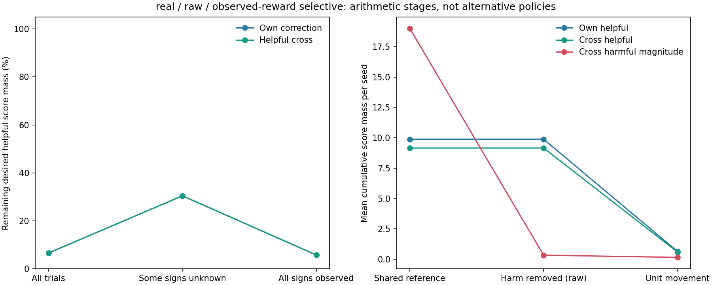
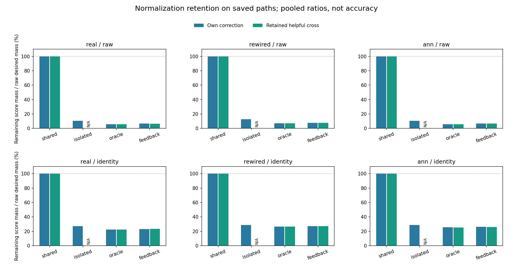

# 방해를 막을 때 자기 수정과 도움이 얼마나 약해졌는가

2026-10-20 · `normalization_loss_v1` · 완료 태그 `normalization-loss-v1`

**실제 배선·원 입력의 보상 기반 선택 억제에서, 정규화 전 자기 수정의 6.61%, 남겨 둔 도움의 6.59%가 실제 점수 변화로 남았다.**
각각 약 93.39%, 93.41% 약해졌다. 아래 값은 저장된 실제 보상 갱신을 고정한 **선택 전 점수(logit)** 회계이며 정답률의 %p 손실이 아니다.

쉽게 말하면, 방해가 다른 문제로 새지 않도록 수정 방향을 잡는 데 큰 움직임이 필요했다.
그 움직임의 길이를 기존과 같게 줄이면서 **방해를 막는 동시에 자기 답을 고치는 힘과 남겨 둔 도움도 크게 줄었다.**
정규화 전의 힘을 100으로 두었을 때 실제로 남은 양을 계산한 것이며, 제한을 풀고 새로 학습시킨 성적은 아니다.

## 주 조건의 세 단계

모든 열은 **같은 실제 저장 스칼라 g**를 사용한다. B는 공유 방향 참고, P는 방해를 지운 뒤 아직 길이를 줄이지 않은 목표,
A는 실제 단위 길이 방향이다. 숫자는 400시행 누적 점수 질량의 10계산 시드 평균이다.

| 영향 종류 | 원래 공유 참고 B | 방해 항 제거 후 P | 단위 이동 제한 후 A |
|---|---:|---:|---:|
| 자기 수정 | 9.882349 | 9.882349 | 0.653273 |
| 다른 문제 도움 | 9.155825 | 9.155825 | 0.603169 |
| 다른 문제 방해의 크기 | 19.001233 | 0.342566 | 0.161141 |

자기 수정과 도움이 B→P에서 유지되고 P→A에서 약해지는 것을 구분했다. 전체 번짐 억제 대조는 도움도 B→P에서
이미 제거하므로, 그것을 정규화 손실로 잘못 부르지 않는다. 방해 열은 음수 부호가 아닌 **음수 영향의 절댓값 합**이다.
아주 작은 수치 잔차는 원자료에 남기고 표시만 반올림했다.

정규화 후/전 비율은 정답 쪽 양수 점수 질량의 비율이다. 본문의 주 수치는 모든 시드의 질량을 합친 pooled 비율이며,
시드별 비율의 단순 평균과 구분한다.

| 항목 | 전체 질량을 합친 비율 | 시드별 비율 평균 ± 표준편차 | 유효 시드 |
|---|---:|---:|---:|
| 자기 수정 | 6.61% | 6.65% ± 2.18% | 10/10 |
| 다른 문제 도움 | 6.59% | 6.64% ± 2.18% | 10/10 |

## 보상을 다 알게 된 뒤에도 남았는가

| 보상 관측 구간 | 시행 수 평균 | 실제 비영 갱신 수 평균 | 자기 수정 남은 비율 | 도움 남은 비율 |
|---|---:|---:|---:|---:|
| 전체 | 400.0 | 194.1 | 6.61% | 6.59% |
| 아직 모르는 부호 있음 | 16.6 | 6.4 | 30.44% | 30.43% |
| 네 부호 모두 관측 | 383.4 | 187.7 | 5.80% | 5.77% |

시행·갱신 수는 시드당 평균이며 비율은 각 구간의 전체 시드 질량 비율이다. **마지막 부호를 처음 얻은 시행부터**
`full`에 포함했다. `known_after`라는 실제 획득 기록을 사용했으며, 정답표 진단도 이 기록은 0에서 시작한다.
구간 전후는 출력 상태·시간·경험도 함께 달라지므로, 네 부호를 안 것만의 인과효과는 아니다.

초반 미관측 다른 문제의 정규화 전 방해 질량은 시드 평균 0.342566, 실제로 남은 방해는 0.161141이었다.
이처럼 정규화는 아직 남아 있던 방해도 줄일 수 있다. 자기 수정·도움의 약화만으로 정규화 전체가 해롭다고 결론 내리지 않는다.

그림 1. 왼쪽은 주 조건의 구간별 남은 비율, 오른쪽은 세 단계의 시드 평균 누적 점수 질량이다.
대체 학습자를 실행한 곡선이나 정답률 변화 곡선이 아니다.

## 모든 배선·표현·방법

각 칸은 **자기 수정 보존율 / 남겨 둔 도움 보존율**이다. 분모는 해당 방법의 정규화 전 목표 P다.
전체 억제의 cross 목표는 이미 0이어서 도움 보존율은 해당 없음(null)이며, 0%로 채우지 않는다.

| 배선 / 입력 | 공유 자기 / 도움 | 전체 억제 자기 / 도움 | 정답표 진단 자기 / 도움 | 실제 보상 자기 / 도움 |
|---|---:|---:|---:|---:|
| 실제 / 원 입력 | 100.00% / 100.00% | 10.50% / 해당 없음 | 5.80% / 5.78% | 6.61% / 6.59% |
| 실제 / 이름표 | 100.00% / 100.00% | 27.20% / 해당 없음 | 22.41% / 22.46% | 23.18% / 23.22% |
| 재배선 / 원 입력 | 100.00% / 100.00% | 12.70% / 해당 없음 | 7.08% / 7.01% | 7.86% / 7.78% |
| 재배선 / 이름표 | 100.00% / 100.00% | 28.82% / 해당 없음 | 26.59% / 26.58% | 27.31% / 27.31% |
| 일반 대조 / 원 입력 | 100.00% / 100.00% | 10.70% / 해당 없음 | 5.84% / 5.84% | 6.64% / 6.63% |
| 일반 대조 / 이름표 | 100.00% / 100.00% | 28.85% / 해당 없음 | 25.50% / 25.27% | 26.22% / 25.98% |

그림 2. 10시드 질량을 합친 비율이다. N/A는 분모 0이다. 시드별 비율·유효 수·모든 구간·범주는 CSV와 요약에 남겼다.
서로 다른 방법은 실제 행동·획득 보상·g가 달라진 저장 경로이므로 통제된 공통 상태 비교가 아니다.
계산 시드는 동물 개체나 인간 참가자가 아니며 표준편차는 계산 시드 간 기술값이다.

## 검산과 보존

- 부모 **96,000시행**, destination 효과 **384,000개**(cross 288,000개)를 분석해 **11배열·6,480행**으로 저장했다.
- 새 학습·행동 추출·난수·출력/내부/가치표 갱신·모델/입력 특징 생성은 모두 **0회**다. 저장 상태의 산술 재구성이다.
- 12종 재구성 잔차와 단계·범주·구간 가산 검사가 통과했다. 최대 잔차는 약 2.89e-15로 허용 오차 1e-8 이하다.
- 독립 검산은 새 분석기를 import하지 않고 저장된 특징·행동·보상·관측·방향·출력·점검 기록을 확인하고, 11배열·6,480행·전체 요약을 다시 계산했다.
- 실행 전 새 검사 **293개**, 관련 기존 **69개**, 총 **362개**가 통과했다. 개발 중 반복된 검사 기록은 중복 집계하지 않는다.
- 이전 **18,779파일·2,093,773,638bytes**를 세 가변 색인 외에는 원문 대조했다. 완료 검사는 별도 시점의 전체 기존 경로 Git 차이와 새 해시를 결합한다.

## 알게 된 점과 남은 질문

**방해를 제거하는 기하학적 방향과 같은 이동 상한이 결합될 때, 유용한 점수 수정도 함께 크게 약해지는 현상**을 저장 경로에서 정량화했다.
이것은 부모의 낮은 습득을 이해할 수 있는 병목 후보이며 유일한 원인을 확정한 결과는 아니다.
제한을 풀면 정답률이 얼마가 되는지, 다른 방향이 더 좋은지, 실제 뇌가 같은 제약을 쓰는지는 검증하지 않았다.

부모의 56.78%·습득0/10과 두 가설 미지지를 그대로 보존했다. 새 성공 문턱·p값·훈련 연장·시드 교체는 없다.
고정 내부 가중치·입력 반응, 출력 가중치, 별도 보상 부호 기억을 구분한다. 네 알려진 인공 전체 문자열의 Level2 분석이며,
새 입력 일반화(Level3)·실제 시각 수량/LC11·내부 시냅스 가소성·인간 유사성(Level4)·공통 신경 기작(Level5)·교육 효과를 새로 주장하지 않는다.
기존 인간 비교 미지지와 맥락별 공동 습득·간섭·순서의 닫힌 선행 자격도 유지한다.

다음 후보는 **원하는 자기·도움 영향과 이동 비용 사이의 수학적 절충을, 정답 정보를 쓰지 않는 제약과 구분해 분석**하는 것이다.
예를 들어 네 문제 각각 확률≥.8의 비용은 기존 평균·종류별 습득보다 강한 충분조건이므로 그 비용으로 기존 습득의 불가능성을 주장할 수 없다.
추가 최적화·새 방향·새 학습 실험은 이번에 실행하지 않았다. 별도 계획·등록이 필요하다. 자동 이어가기는 PAUSED다.

[고정 계획](normalization-loss-protocol.md) · [재현 안내](normalization-loss-reproduction.md) ·
[원 요약](../results/normalization_loss_v1/summary.json) · [독립 검산](../results/normalization_loss_v1/verification.json)
