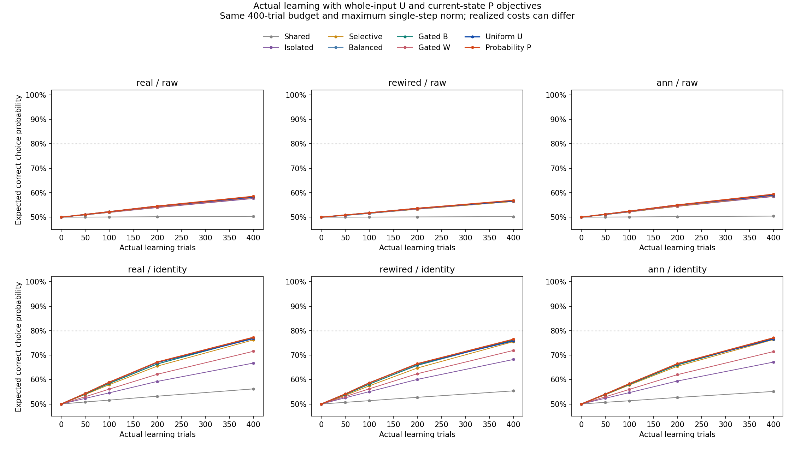
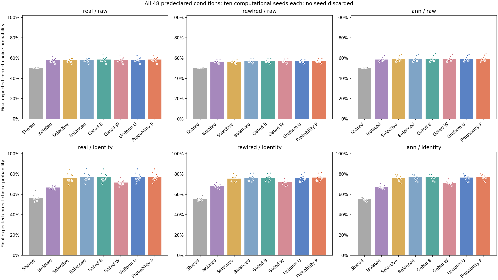
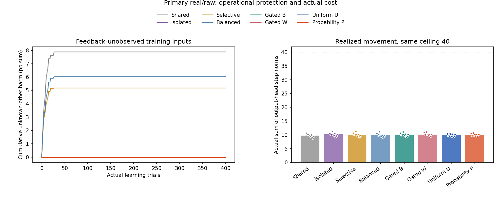

# 전체 목표 U와 현재 확률 P를 실제 학습에 적용한 결과

2026-10-21. 별도 사전 등록 `objective_learning_v1`의 새17801..17810 계산 시드에서 여덟 방법을 실제로 학습시켰다. 이전 저장 상태의 단일 수정 대입과 달리, 각 정책의 실제 현재 상태·선택·보상·기억·수정을 끝까지 실행했다.

주 real/raw의 최종 정답 선택 확률은 U **58.2672%**, P **58.5224%**, 기존 전환형 B **58.4542%**였다. U−B는-0.1871%p, P−B는+0.0682%p, P−U는+0.2552%p다.

## 쉽게 설명하면

U는 네 연습 문제 전체의 점수를 함께 올리도록 고쳤고, P는 현재 정답 확률이 얼마나 잘 변하는지도 고려했다. 처음에는 다른 문제로 수정이 퍼지는 것을 막고, 네 답을 모두 보상으로 확인한 다음 시행부터 새 목표를 썼다.

두 방식 모두 같은400번 연습과 같은 한 번 수정 상한을 사용했다. 실제 선택과 총 수정량은 달라질 수 있다. 아래 성적은 네 **연습 입력**에서 정답 행동을 선택할 확률이며, 새로운 문제의 일반화 성적이나 실제 시험의 정답 개수가 아니다.

같은 상태에서 한 번 고칠 때 유리했던 U가 실제 학습에서도 기존 B를 이긴 것은 아니었다. 현재 확률을 고려한 P는 U보다 나았지만 기존 B와의 차이는 작았다. 따라서 이번 결과는 목표를 바꾸기만 하면 충분한 학습이 된다는 성공 사례가 아니다. 각자의 상태·선택·보상·수정량이 달라지는 실제 경로를 함께 봐야 한다. 그 차이의 원인을 하나로 분리하는 추가 개입은 이번에 수행하지 않았다.

사전 실용 개선 가설은 U **미지지**, P **미지지**다. 충분한 습득은 U 0/10, P 0/10이며 각각 미지지/미지지다. 미관측 보호는 U 통과, P 통과다. 상태 가중의5%p 실용 추가 효과는 미지지다.

## 주 조건 — 모든 대조를 같은 새 시드에서 실행

표는10시드에 같은 비중을 준 평균이다. 미관측은 네 연습 입력 중 **아직 실제 보상 부호를 얻지 못한 다른 입력**이다. 방해 합계는 그런 입력의 정답 선택 확률이 줄어든 양만400시행에서 더한 값으로, 최종 성적의 %p와 구별한다. 표의 방해 합계는0..1 확률 단위를 더한 원값이며, 방해 그림은 이 값에100을 곱한 %p 합계다.

| 방법 | 최종 정답 선택 확률 | 충분한 습득 | 실제 누적 수정 길이 | 미관측 방해 합계 |
|---|---:|---:|---:|---:|
| 공유 | 50.36539% | 0/10 | 9.7229896 | 0.0787905092918 |
| 번짐 차단 I | 57.63331% | 0/10 | 10.1419381 | 0 |
| 관측 방해 선택 차단 | 57.96734% | 0/10 | 10.0211518 | 0.0517859359641 |
| 항상 균형 B | 58.19901% | 0/10 | 9.8891021 | 0.0602341273546 |
| 초반 차단→균형 B | 58.45421% | 0/10 | 10.0584793 | 0 |
| 초반 차단→자기 우선 W | 58.00632% | 0/10 | 10.1260746 | 0 |
| 초반 차단→전체 목표 U | 58.26715% | 0/10 | 9.8976947 | 0 |
| 초반 차단→현재 확률 P | 58.52238% | 0/10 | 9.9457749 | 0 |

실용 개선은 B·I·W 각각보다 평균5%p 이상이고 각 비교에서10시드 중8개 이상이 양수여야 통과한다. 충분한 습득은 최종80%·초기보다25%p 향상·두 클래스 각각70%를 모두 만족하는 시드가8개 이상이어야 한다. 평균 차이가 양수인 것, 실용 개선, 충분한 습득을 같은 판정으로 바꾸지 않는다.

| 새 방법 − 대조 | 평균 차이 | 양수 시드 | 사전 실용 기준 |
|---|---:|---:|---|
| 초반 차단→전체 목표 U − 초반 차단→균형 B | -0.187051%p | 2/10 | 미통과 |
| 초반 차단→전체 목표 U − 번짐 차단 I | +0.633848%p | 10/10 | 미통과 |
| 초반 차단→전체 목표 U − 초반 차단→자기 우선 W | +0.260836%p | 9/10 | 미통과 |
| 초반 차단→현재 확률 P − 초반 차단→균형 B | +0.068172%p | 8/10 | 미통과 |
| 초반 차단→현재 확률 P − 번짐 차단 I | +0.889071%p | 10/10 | 미통과 |
| 초반 차단→현재 확률 P − 초반 차단→자기 우선 W | +0.516059%p | 10/10 | 미통과 |

상태 가중만 추가한 P−U는 평균 **+0.255223%p**, 양수 시드 **10/10**이었다. 별도5%p·8시드 기준은미지지다. 이전 고정 상태의 작은 한 번 수정 이득을 최종 성적에 그대로 더하지 않았다.

## 미관측 문제에 주는 방해

| 새 방법 | 주 조건 시드별 최대 방해 합계 | B 대비 비악화 시드 | I 대비 비악화 시드 | 사전 보호 기준 |
|---|---:|---:|---:|---|
| 초반 차단→전체 목표 U | 0 | 10/10 | 10/10 | 통과 |
| 초반 차단→현재 확률 P | 0 | 10/10 | 10/10 | 통과 |

각 시드 총합≤1e-8이고, B/I보다 방해가 늘지 않는 시드가 각각10개 모두여야 한다. 네 번째 답을 얻는 시행까지I를 유지했으며 전환 전 I/B/W/U/P의 실제 기록이 같은지 bytes로 확인했다.

보호는 초반I가 다른 입력을 움직이지 않고, 완전 관측 후에는 미관측 목적지가 없다는 **설계상 기대를 확인한 운영 검사**다. 새로운 보호 기작이나 충분한 학습의 발견이 아니다. 새 입력을 처음 봐도 안전하다는 실험을 수행한 것은 아니다. 숨은 정답 부호는 이 평가에만 썼고 방향 선택기에 주지 않았다.

## 같은 수정량 제한과 실제 비용

모든480경로에서 한 번 수정≤0.1, 누적 길이≤40, 제곱합≤4, 최종 출력 길이≤누적 길이를 확인했다. 실제 전체 최댓값은 한 번0.091484884, 누적11.323385870, 제곱합0.629947866였다. 같은 상한이며 실제 총 사용량을 같게 맞춘 실험은 아니다.

| 주 조건 방법 | 실제 Go 횟수 합(10시드) | 평균 실제 누적 길이 |
|---|---:|---:|
| 공유 | 1,964 | 9.72298964 |
| 번짐 차단 I | 2,044 | 10.14193809 |
| 관측 방해 선택 차단 | 2,035 | 10.02115178 |
| 항상 균형 B | 2,023 | 9.88910214 |
| 초반 차단→균형 B | 2,043 | 10.05847929 |
| 초반 차단→자기 우선 W | 2,045 | 10.12607463 |
| 초반 차단→전체 목표 U | 2,031 | 9.89769472 |
| 초반 차단→현재 확률 P | 2,034 | 9.94577494 |

원래 B/W 방향 요청35,670회에서 유일한 인증 문제972개, U 요청11,826회에서 캐시 문제240개, P 요청11,777회에서 상태별 문제11,777개였다. 생산 실행의 총 유일 solver 호출은12,989회다. 독립 검산의 재최적화 횟수는verification.json에 별도 기록했다. 처리 비용이 동등하거나 P가 계산상 더 싸다고 주장하지 않는다.

주 조건 U/P의 최초 모드 시행은 각각[5, 17, 17, 14, 7, 5, 13, 11, 29, 23]/[5, 17, 17, 14, 7, 5, 13, 11, 29, 23]다. 모드 첫 시행이NoGo여도 전환은 기록하지만 solver/출력 수정은0회다. 실제 P 적용 상태의 최대 |z|는2.373921797로 사전 미분 영역40미만을 만족했다. P는 자신의 수정 전 확률로 매 실제fullGo마다 목적을 새로 만들었다. U만 source·관측 부호를 캐시했다.

선형 목표의 전역 최적성은 안전한 단위 방향이 해당 점수를 최대화한다는 증거다. P의 실제 한 번 확률 변화나 미래 최종 성적의 전역 최적성을 보장하지 않는다. 학습률·비율·시드를 바꾸어 결과를 고르지 않았다.

## 전체48조건

세 배선×두 입력 표현×여덟 방법을 모두 보존했다. 아래5개 보조 배선·표현의 유리한 결과로 real/raw 주 판정을 바꾸지 않는다.

| 배선 | 표현 | 방법 | 최종 정답 선택 확률 | 습득 시드 | 미관측 방해 합계 | 누적 실제 수정 길이 |
|---|---|---|---:|---:|---:|---:|
| real | raw | 공유 | 50.36539% | 0/10 | 0.07879050929 | 9.7229896 |
| real | raw | 번짐 차단 I | 57.63331% | 0/10 | 0 | 10.1419381 |
| real | raw | 관측 방해 선택 차단 | 57.96734% | 0/10 | 0.05178593596 | 10.0211518 |
| real | raw | 항상 균형 B | 58.19901% | 0/10 | 0.06023412735 | 9.8891021 |
| real | raw | 초반 차단→균형 B | 58.45421% | 0/10 | 0 | 10.0584793 |
| real | raw | 초반 차단→자기 우선 W | 58.00632% | 0/10 | 0 | 10.1260746 |
| real | raw | 초반 차단→전체 목표 U | 58.26715% | 0/10 | 0 | 9.8976947 |
| real | raw | 초반 차단→현재 확률 P | 58.52238% | 0/10 | 0 | 9.9457749 |
| real | identity | 공유 | 56.18639% | 0/10 | 0.0753076895 | 9.8086517 |
| real | identity | 번짐 차단 I | 66.74214% | 0/10 | 0 | 9.6854436 |
| real | identity | 관측 방해 선택 차단 | 76.22574% | 2/10 | 0.05411555184 | 8.8990199 |
| real | identity | 항상 균형 B | 77.03975% | 2/10 | 0.05272110707 | 8.7400306 |
| real | identity | 초반 차단→균형 B | 76.94536% | 2/10 | 0 | 8.7033641 |
| real | identity | 초반 차단→자기 우선 W | 71.55762% | 0/10 | 0 | 9.3679799 |
| real | identity | 초반 차단→전체 목표 U | 76.74803% | 2/10 | 0 | 8.4911411 |
| real | identity | 초반 차단→현재 확률 P | 77.28670% | 2/10 | 0 | 8.5342755 |
| rewired | raw | 공유 | 50.23655% | 0/10 | 0.07808438323 | 9.7781696 |
| rewired | raw | 번짐 차단 I | 56.43398% | 0/10 | 0 | 10.1810403 |
| rewired | raw | 관측 방해 선택 차단 | 56.43042% | 0/10 | 0.05028138305 | 10.0488622 |
| rewired | raw | 항상 균형 B | 56.60326% | 0/10 | 0.06158178153 | 10.0144576 |
| rewired | raw | 초반 차단→균형 B | 56.81729% | 0/10 | 0 | 10.0753682 |
| rewired | raw | 초반 차단→자기 우선 W | 56.60871% | 0/10 | 0 | 10.1522644 |
| rewired | raw | 초반 차단→전체 목표 U | 56.67735% | 0/10 | 0 | 10.0030098 |
| rewired | raw | 초반 차단→현재 확률 P | 56.89226% | 0/10 | 0 | 10.0610197 |
| rewired | identity | 공유 | 55.37487% | 0/10 | 0.07424330104 | 9.8864184 |
| rewired | identity | 번짐 차단 I | 68.21706% | 0/10 | 0 | 9.5095360 |
| rewired | identity | 관측 방해 선택 차단 | 75.49423% | 1/10 | 0.05463970005 | 9.0514401 |
| rewired | identity | 항상 균형 B | 76.21275% | 2/10 | 0.05320637087 | 8.8540683 |
| rewired | identity | 초반 차단→균형 B | 76.23443% | 2/10 | 0 | 8.8657763 |
| rewired | identity | 초반 차단→자기 우선 W | 71.90958% | 0/10 | 0 | 9.2777863 |
| rewired | identity | 초반 차단→전체 목표 U | 75.82593% | 1/10 | 0 | 8.6821614 |
| rewired | identity | 초반 차단→현재 확률 P | 76.49008% | 2/10 | 0 | 8.6867357 |
| ann | raw | 공유 | 50.44832% | 0/10 | 0.07882001416 | 9.8130771 |
| ann | raw | 번짐 차단 I | 58.43652% | 0/10 | 0 | 10.0398847 |
| ann | raw | 관측 방해 선택 차단 | 58.75943% | 0/10 | 0.05201171573 | 9.9606240 |
| ann | raw | 항상 균형 B | 58.96221% | 0/10 | 0.06008859044 | 9.8522286 |
| ann | raw | 초반 차단→균형 B | 59.27922% | 0/10 | 0 | 9.9588276 |
| ann | raw | 초반 차단→자기 우선 W | 58.82799% | 0/10 | 0 | 10.0240867 |
| ann | raw | 초반 차단→전체 목표 U | 59.07281% | 0/10 | 0 | 9.8854747 |
| ann | raw | 초반 차단→현재 확률 P | 59.38698% | 0/10 | 0 | 9.9204610 |
| ann | identity | 공유 | 55.13920% | 0/10 | 0.07610532998 | 9.8379315 |
| ann | identity | 번짐 차단 I | 67.13672% | 0/10 | 0 | 9.6683918 |
| ann | identity | 관측 방해 선택 차단 | 76.35139% | 0/10 | 0.05497567614 | 8.9566367 |
| ann | identity | 항상 균형 B | 76.88631% | 1/10 | 0.0516927289 | 8.8837264 |
| ann | identity | 초반 차단→균형 B | 76.82241% | 0/10 | 0 | 8.8716554 |
| ann | identity | 초반 차단→자기 우선 W | 71.43782% | 0/10 | 0 | 9.3482385 |
| ann | identity | 초반 차단→전체 목표 U | 76.55068% | 1/10 | 0 | 8.7482507 |
| ann | identity | 초반 차단→현재 확률 P | 77.06562% | 1/10 | 0 | 8.7364527 |

## 실행 전 동결과 독립 검산

사전385검사(새255·기존 관련130)를 통과하고, 소스49(기존40·신규9)·부모14·그래프4·입력2파일의 SHA-256을 고정했다. source `adeed238058cfb9fb9d2e186846d310bf1f0c296`, 등록 게시 `6215953da6ed59cbbdabffe63d6c2eebff426c3b`다. 비공개 원격의 등록 bytes를 확인한 뒤 최초 새 그래프/특징/난수/학습을 실행했다.

새480출력 학습 경로·192,000실제 선택·9,600정적 평가·215배열과192,000행96열을 저장했다. 출력 갱신 호출192,000회 중 비영 수정96,929회였고 내부/가치 가중치 갱신은0회였다. 실제 보상 기억 관측96,929회와 첫 부호 발견1,920회를 구분한다. 내부 가중치·인코더·같은 입력 활성의 시작/종료가 동일함을 확인했다.

독립 검산은 새 학습 producer/head를 import하지 않고 원 그래프·입력·공통 난수에서 모든 행동·보상·기억·출력prefix·현재 목적·방향 증거·비용·미관측 피해·체크포인트·전체 요약과 일곱 가설 판정을 재계산했다. 별도 원 공간 최소제곱/쌍대 상한으로 원B/W와 U/P 최적성 증거를 확인했다.

이전 완료19,134파일/2,434,059,223bytes의 Git blob 해시를 확인했으며 세 상태 인덱스 외 완료파일은 바꾸지 않았다. 이번 등록 전 가상 개발 실패는0개 보존 항목이다. 이전 연구의 모든 실패·미지지·개발/봉인 원문은 기존 경로와 부모 게이트로 보존했다.

시행 CSV는 단일파일 게시 한계를 고려해 **실행 전에** `measurements.csv.gz`로 고정했다. 결정적 무손실gzip을 풀면192,000×96의 CRLF·숫자 문자열이 복원된다. 행을 버리거나 값을 반올림하지 않았으며 원래 연구의 CSV는 그대로다. 원 압축 파일의 SHA와 정확한 행/열 검산을 남겼다.

## 그림

## 해석과 다음 연구의 경계

입력은 ABAB/BABA/ABBA/BAAB의 네 인공 전체 문자열이다. 출력 계수와 별도의 보상 부호 기억을 학습했고 내부 KC→MBON 연결과 입력 특징은 고정이다. 실제 초파리의 수량/기호 이해나 내부 생물학적 가소성을 구현했다는 결과가 아니다. 계산 시드는 사람이나 동물이 아니다.

각 방법의 고정된 충분한 습득 판정과 실용 개선·운영상 보호를 구분한다. 새 입력/규칙 일반화와 간섭·순서는 해당 습득 및 과제별 선행조건을 따로 확인하고 새 프로토콜을 등록해야 한다. 이번 반복 연습만으로 그 게이트를 자동 통과시키지 않는다.

기존 인간 비교의 음성 결과·공통 신경 기작/교육 효과 미검증·원래Phase5·DrosoMem과 모든 완료자료를 유지한다. 후속 연구에는 이번 실제 경로를 근거로 새 고정 질문을 정해야 하며, 실패 시드 교체·같은 등록 예산 연장·자동 반복을 수행하지 않는다. 이 단일 요청 완료 뒤 자동화는PAUSED다.
