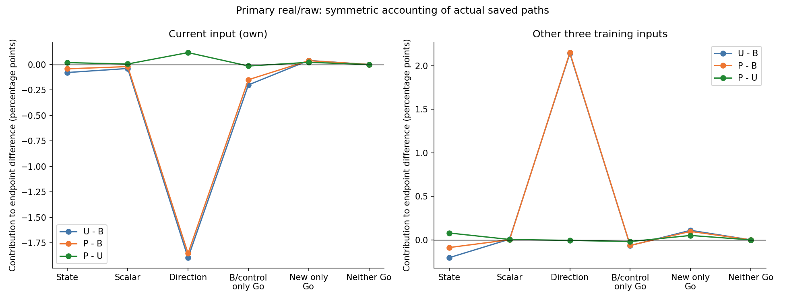
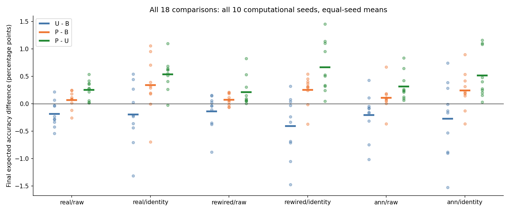
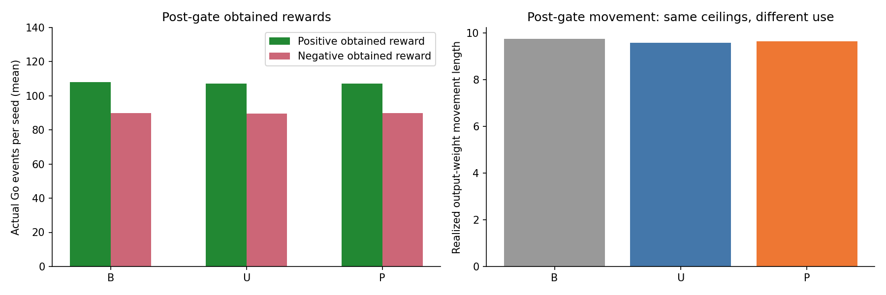

# 전체 목표 U·현재 확률 P의 실제 경로를 나눈 결과

2026-10-21. `objective_pathways_v1`은 이미 알려진 부모 결과의 **후향적 설명 장부**다. 새 학습·선택·난수·그래프·방향 최적화는 각각 0회다. 부모 성공 기준을 바꾸지 않았다.

## 쉽게 설명하면

성적 차이를 세 부분으로 나눴다. **방향**은 어디를 고쳤는지, **크기**는 실제로 얼마나 고쳤는지, **상태**는 고치기 직전에 얼마나 확신했는지를 뜻한다. 두 방식 중 한쪽만 실제로 답해 보상을 받은 순간은 별도 항목이다. 같은 답안지를 같은 위치에서 한 번 고치는 계산과, 실제로 다른 답안지와 다른 선택 경로를 거친 학습을 구분한다.

핵심은 **도움을 다른 문제로 더 돌렸지만 자기 수정이 약해졌고, 작은 순이득이 상태·실제 선택 경로의 차이로 상쇄됐다**는 것이다. U는 자기 기여 −2.1749%p와 다른 입력 +1.9878%p가 합쳐져 −0.1871%p였다. P는 자기 −2.0287%p·다른 입력 +2.0969%p로 +0.0682%p만 남았다. 이는 아래의 정확한 장부를 쉬운 말로 읽은 설명이다.

방향을 바꾼 전체 순몫은 U **+0.2447%p**, P **+0.2957%p**로 둘 다 양수였다. 자기 수정을 덜 하는 대신 다른 문제를 더 도운 교환 뒤 작은 이득은 남았다. U는 상태 −0.2831%p·크기 −0.0317%p·한쪽 실제 선택 경로 −0.1170%p가 이를 상쇄했고, P는 그 감소분이 각각 −0.1304%p·−0.0192%p·−0.0780%p로 작아 약간의 이득이 남았다.

서로 다른 실제 기록에서 세 재료를 교차해 만든 8개 단일 수정 셀을 대칭적으로 배분했다. 이 배분은 정해진 장부 규칙이며, 유일한 인과 원인이나 그 요소를 바꾼 새 학습 성적이 아니다. 특히 상태와 실제 수정 계수는 원래 서로 연결돼 있다.

## 최종 차이를 빠짐없이 복원한 장부

표의 단위는 최종 네 연습 입력 평균 정답 선택 확률에 대한 **%p 기여**다. 상태·크기·방향은 공통 후반 양쪽 실제 Go의 대칭 배분이고, 한쪽 Go는 해당 실제 확률 변화 전체를 그대로 남긴 값이다.

| 비교 | 상태 | 크기 | 방향 | 대조만 Go | 새 방식만 Go | 합계/최종 차이 |
|---|---:|---:|---:|---:|---:|---:|
| 전체 목표 U − 기존 B | -0.283071 | -0.031703 | +0.244700 | -0.265928 | +0.148950 | -0.187051 |
| 현재 확률 P − 기존 B | -0.130429 | -0.019151 | +0.295749 | -0.212480 | +0.134483 | +0.068172 |
| 현재 확률 P − 전체 목표 U | +0.097190 | +0.009694 | +0.110653 | -0.034288 | +0.071974 | +0.255223 |

둘 다 NoGo인 항목은 실제 수정이 없어서 0이며 삭제하지 않았다. 세 방식의 전환 전 실제 선택·기억·수정은 같고, 위 공통 후반 차이에 전환 전 0을 더하면 부모 최종 차이로 돌아온다.

## 자기 수정과 다른 세 문제의 도움·방해

| 비교 | 목적지 | 상태 | 크기 | 방향 | 한쪽 Go 순합 | 실제 순차이 | 도움 질량 차이 | 방해 질량 차이 |
|---|---|---:|---:|---:|---:|---:|---:|---:|
| 전체 목표 U − 기존 B | 자기 | -0.078640 | -0.039295 | -1.895876 | -0.161087 | -2.174898 | -2.174898 | -0.000000 |
| 전체 목표 U − 기존 B | 다른 세 입력 | -0.204431 | +0.007592 | +2.140577 | +0.044109 | +1.987847 | +1.987847 | -0.000000 |
| 현재 확률 P − 기존 B | 자기 | -0.042444 | -0.020572 | -1.853775 | -0.111919 | -2.028710 | -2.028710 | -0.000000 |
| 현재 확률 P − 기존 B | 다른 세 입력 | -0.087985 | +0.001420 | +2.149524 | +0.033922 | +2.096881 | +2.096881 | -0.000000 |
| 현재 확률 P − 전체 목표 U | 자기 | +0.018208 | +0.004938 | +0.116726 | +0.006316 | +0.146189 | +0.146189 | +0.000000 |
| 현재 확률 P − 전체 목표 U | 다른 세 입력 | +0.078983 | +0.004755 | -0.006073 | +0.031370 | +0.109034 | +0.109034 | +0.000000 |

도움 질량은 실제 단일 수정에서 정답 선택 확률이 증가한 양의 합, 방해 질량은 감소한 양의 절댓값 합이다. 순차이=도움 차이−방해 차이이며, 양수 질량의 **배분**이 음수면 그 요소에 배분된 도움 감소다. 누적 변화 합과 마지막 확률 수준은 다른 양이며 새 문제 전이의 증거가 아니다. 방해 차이의 약 1e-13%p 수준은 부동소수점 산술 잔차로 보존했고 생물학적 피해로 해석하지 않는다.

## 같은 실제 Go 순간의 상태·크기·방향 진단

다음은 동일한 양쪽 실제 Go 시행에서 각각의 재료를 요약한 값이다. 시행 수가 다른 전체 경로 평균과 섞지 않는다. 각 시드 평균을 같은 비중으로 평균했다.

| 비교 | 경로 | 정답 선택 확률 | Go 확률 p | 실제 abs(g) | 실제 이동 길이 | 자기 방향 영향 | 다른 입력 정렬 방향 영향 | 방향 길이 |
|---|---|---:|---:|---:|---:|---:|---:|---:|
| 전체 목표 U − 기존 B | 기존 B | 0.542556864 | 0.509092161 | 0.049090784 | 0.049090784 | 0.066842136 | 0.023721127 | 1.000000000 |
| 전체 목표 U − 기존 B | 전체 목표 U | 0.542016289 | 0.511084090 | 0.048891591 | 0.048891591 | 0.034205835 | 0.036972891 | 1.000000000 |
| 현재 확률 P − 기존 B | 기존 B | 0.543044803 | 0.508672488 | 0.049132751 | 0.049132751 | 0.067271895 | 0.023586874 | 1.000000000 |
| 현재 확률 P − 기존 B | 현재 확률 P | 0.543897019 | 0.510458802 | 0.048954120 | 0.048954120 | 0.034977202 | 0.036093712 | 1.000000000 |
| 현재 확률 P − 전체 목표 U | 전체 목표 U | 0.542246509 | 0.511475780 | 0.048852422 | 0.048852422 | 0.034215428 | 0.036969693 | 1.000000000 |
| 현재 확률 P − 전체 목표 U | 현재 확률 P | 0.543532164 | 0.511391383 | 0.048860862 | 0.048860862 | 0.035000386 | 0.036087816 | 1.000000000 |

양쪽 Go에서는 선택이 1이고 같은 입력의 실제 보상 부호도 같다. 따라서 `g=0.1*(1-p)*실제보상`, 두 g의 차이는 `−0.1*실제보상*(p_새−p_대조)`다. 이 항등식을 모든 해당 시행에서 확인했다. 크기 몫을 독립적인 학습률 변경으로 읽지 않는다. `p`는 Go 행동 확률이며, 부정 보상 입력의 정답 확률은 `1-p`다. 평균 재료를 곱해 평균 효과라고 부르지 않는다.

양쪽 Go의 실제 한 번 이동은 B 약0.0491, U/P 약0.0489로 비슷했다. 자기 방향 영향은 B 약0.067에서 U/P 약0.034~0.035로 줄었고 다른 입력의 정답 정렬 영향은 커졌다. 따라서 단순히 펜을 훨씬 적게 움직여서 생긴 차이로 설명되지 않는다. 음수 **상태 몫**은 당시 정답 확률이나 상태가 더 나빴다는 뜻이 아니다. 같은 수정을 더했을 때 확률로 변환되는 정도가 달라진 몫도 포함한다.

## 선택과 보상 경로

| 비교 | 둘 다 NoGo | 대조만 Go | 새 방식만 Go | 둘 다 Go | 첫 행동 불일치(시드별) |
|---|---:|---:|---:|---:|---|
| 전체 목표 U − 기존 B | 1847 | 55 | 43 | 1924 | [128, 148, 78, 129, 159, 39, 90, 144, 141, 147] |
| 현재 확률 P − 기존 B | 1855 | 44 | 35 | 1935 | [128, 148, 78, 129, 159, 39, 90, 144, 141, 147] |
| 현재 확률 P − 전체 목표 U | 1888 | 11 | 14 | 1956 | [260, 194, None, 271, 322, 177, None, None, 347, 239] |

경우 수는 **공통 후반의 10시드 합계**이고, 이후 표는 **시드당 평균**이다. 공통 저장 난수와 각자의 실제 Go 확률을 대조해 행동이 달라진 순간을 확인했다. 같은 난수를 썼어도 확률이 다르면 선택은 달라진다. 선택 불일치 항은 관측된 경로의 기여이며 선택만 강제로 바꾼 인과효과가 아니다.

첫 행동 불일치 표의 `None`은 400시행 동안 두 경로의 실제 행동이 한 번도 달라지지 않았다는 뜻이다. 그래도 출력 확률과 수정 방향까지 같다는 뜻은 아니다.

| 경로 | 후반 Go | 후반 양 보상 | 후반 음 보상 | 후반 실제 보상 합 | 후반 이동 길이 | 전체 이동 길이 | 미관측 다른 입력 방해 |
|---|---:|---:|---:|---:|---:|---:|---:|
| 기존 B | 197.900000000 | 107.900000000 | 90.000000000 | 17.900000000 | 9.738537632 | 10.058479287 | 0.000000000 |
| 전체 목표 U | 196.700000000 | 107.200000000 | 89.500000000 | 17.700000000 | 9.577753061 | 9.897694717 | 0.000000000 |
| 현재 확률 P | 197.000000000 | 107.100000000 | 89.900000000 | 17.200000000 | 9.625833285 | 9.945774941 | 0.000000000 |

실제 Go는 해당 입력의 보상 부호를 얻고, NoGo는 보상 0·출력 수정 0이다. 기존 일부 방법은 NoGo에도 저장한 방향 진단이 있지만 이는 실제 이동이 아니다. 추가 잠재 Go 방향이나 잠재 보상을 만들지 않았다. 요약 파일의 기대 보상 합은 평가 정답과 실제 확률로 계산한 참고 값이며 학습자가 획득한 보상이나 새 학습 정보가 아니다.

## 어느 연습 입력에 차이가 모였는가

| 경로 | ABAB | BABA | ABBA | BAAB | 네 입력 평균 |
|---|---:|---:|---:|---:|---:|
| 기존 B | 58.344697% | 58.644728% | 58.044074% | 58.783323% | 58.454206% |
| 전체 목표 U | 57.519201% | 58.862724% | 56.760111% | 59.926582% | 58.267154% |
| 현재 확률 P | 58.524636% | 58.916793% | 57.238106% | 59.409975% | 58.522377% |

각 입력×실제 선택×실제 보상의 모든 조합을 all/pre/post로 나눈 34,560개 칸도 저장했다. 불가능하거나 관측 0인 칸을 제거하지 않고 수 0·정의되지 않은 평균 null로 남겼다. 이 반복 연습 네 문자열의 결과를 다른 문제나 수학 규칙 일반화 성적으로 읽지 않는다.

## 전체 배선·표현 결과

| 배선 | 표현 | 비교 | 최종 차이 | 상태 총몫 | 크기 총몫 | 방향 총몫 | 한쪽 Go 총몫 |
|---|---|---|---:|---:|---:|---:|---:|
| real | raw | 전체 목표 U − 기존 B | -0.187051 | -0.283071 | -0.031703 | +0.244700 | -0.116978 |
| real | raw | 현재 확률 P − 기존 B | +0.068172 | -0.130429 | -0.019151 | +0.295749 | -0.077997 |
| real | raw | 현재 확률 P − 전체 목표 U | +0.255223 | +0.097190 | +0.009694 | +0.110653 | +0.037686 |
| real | identity | 전체 목표 U − 기존 B | -0.197336 | -0.845420 | -0.306883 | +1.275908 | -0.320941 |
| real | identity | 현재 확률 P − 기존 B | +0.341338 | -0.630945 | -0.427168 | +1.436450 | -0.037000 |
| real | identity | 현재 확률 P − 전체 목표 U | +0.538673 | +0.162657 | -0.123707 | +0.208494 | +0.291230 |
| rewired | raw | 전체 목표 U − 기존 B | -0.139941 | -0.217738 | +0.070118 | +0.138868 | -0.131188 |
| rewired | raw | 현재 확률 P − 기존 B | +0.074977 | -0.085499 | +0.082345 | +0.173425 | -0.095294 |
| rewired | raw | 현재 확률 P − 전체 목표 U | +0.214917 | +0.077953 | +0.009619 | +0.092340 | +0.035006 |
| rewired | identity | 전체 목표 U − 기존 B | -0.408508 | -1.062168 | -0.342117 | +1.182506 | -0.186729 |
| rewired | identity | 현재 확률 P − 기존 B | +0.255650 | -0.693851 | -0.360855 | +1.446225 | -0.135868 |
| rewired | identity | 현재 확률 P − 전체 목표 U | +0.664158 | +0.312556 | +0.004073 | +0.323888 | +0.023642 |
| ann | raw | 전체 목표 U − 기존 B | -0.206404 | -0.312039 | +0.065552 | +0.191895 | -0.151811 |
| ann | raw | 현재 확률 P − 기존 B | +0.107760 | -0.114956 | -0.036735 | +0.279654 | -0.020203 |
| ann | raw | 현재 확률 P − 전체 목표 U | +0.314164 | +0.137021 | -0.102638 | +0.151563 | +0.128218 |
| ann | identity | 전체 목표 U − 기존 B | -0.271734 | -0.800585 | -1.222509 | +0.872412 | +0.878949 |
| ann | identity | 현재 확률 P − 기존 B | +0.243205 | -0.451822 | -0.327373 | +1.049028 | -0.026628 |
| ann | identity | 현재 확률 P − 전체 목표 U | +0.514939 | +0.273178 | +0.933317 | +0.241472 | -0.933028 |

보조 조건으로 주 real/raw 판정이나 부모의 실패 기준을 교체하지 않았다. 같은 경로를 여러 비교에 쓰므로 180짝 경로는 독립적인 동물이나 사람 180명이 아니다.

## 그림

## 검증과 해석 한계

소스 25개·부모 16개를 사전 동결했다. 소스 commit `3783491b82f61f1d956756b356e09cbae1dcbd58`, 등록 게시 `0d2bead26dc838200bca0cbf4dede2f2c0b15765`의 비공개 원격 bytes를 확인한 뒤 최초 새 집계를 시작했다. 291검사(새176·관련기존115)가 통과했고, 부모 원 192,000기록·768,000목적지 효과, 16배열·2,160행15열·18비교·480실제 경로·34,560선택보상 칸을 독립 검산했다. 교차 대상은 34,573시행·1,106,336목적지 셀이다.

부모의 U/P 실용 개선·충분한 습득·P−U 실용 상태 효과는 미지지, 미관측 다른 연습 입력의 보호는 설계상 기대한 통과다. 이번 장부가 그 판정을 뒤집거나 새 학습 성공을 입증하지 않는다. 같은 수정 상한과 실제 누적 길이/처리 비용의 동일성을 구별한다.

출력 계수와 획득 보상 부호 기억은 학습된 상태이며, 내부 KC→MBON 가중치와 같은 입력의 활성은 부모에서 고정이었다. 이번에는 그것도 새로 학습하지 않았다. 실제 초파리의 시각 수량·LC11/DAN 구현, 인간 학습의 양성 유사성, 공통 신경 기작, 교육 효과를 추가 입증하지 않는다.

첫 보상 그림의 범례가 P 막대 꼭대기를 일부 가려 세로 여백만 늘렸다. 처음의 그림 폴더5파일과 렌더러 원문은 `results/objective_pathways_presentation_attempt01.zip`의 여섯 원문과 별도 해시 목록에 보존했다. 과학 소스25개·입력·설정·결과·검산·판정은 바꾸지 않았으며 과학 집계와 독립 검산도 재실행하지 않았다.

최종 표시 검사 초안에서는 올바른 문서 링크와 기존 게시 증거의 필드 형식을 잘못 요구한 소비자 오류를 수정했다. 원 검사 스크립트와 진단은 `results/objective_pathways_presentation_consumer_attempt01.zip`과 별도 설명 파일에 보존했다. 그 앞의 전체 수치 검사는 통과했으며 과학 결과나 문서 링크를 그 잘못된 조건에 맞춰 바꾸지 않았다.

## 프로젝트는 얼마나 남았는가

원래 승인한 Phase 5 첫 종합은 2026-10-19에 이미 완료됐다. 지금은 그 뒤에 발견한 표현·갱신·번짐의 약점을 조사한 별도 후속 묶음이다. 이번 요청은 이 저장 분석과 검산·보존으로 완료한다.

현재 후속 묶음의 완결본을 만들려면 **추가 결과 전체의 2차 종합, 주장/한계 갱신, 재현·보존 최종 감사**를 하나의 마무리 작업으로 할 수 있다. 새 학습 성공까지 무한히 실험할 필요는 없으며, 기존 Phase 5를 덮어쓰지 않는 별도 후속 종합이어야 한다. 이 한 묶음 뒤 현재 범위를 종료하는 것이 가능하다. 실행 환경과 검토량에 따라 달라지므로 날짜·시간을 확정하거나 근거 없는 완료 백분율을 제시하지 않는다. 이번 요청에 그 다음 작업 실행까지 포함시키지 않았다.

장기 목표인 일반화·간섭/순서의 유효 검정은 해당 과제의 충분한 습득이 먼저 필요하다. 시각 회로/LC11 입력과 생리학적 가소성, 독립 커넥톰 반복, 대응 인간 공개 과제와 공통 기작은 별도 연구이며 필요한 자원·결과를 미리 보장할 수 없다. 미해결 질문을 정직하게 남긴 보고서도 연구 완료의 형태다. 기존 실패·인간 비교 음성 결과·DrosoMem·Phase 5를 보존하며 자동 반복은 PAUSED다.

