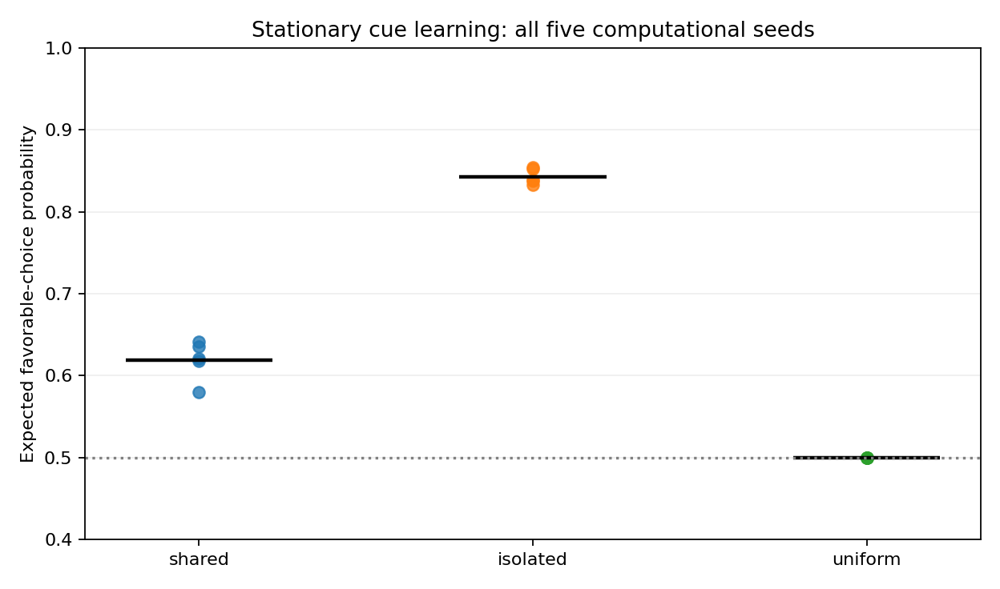
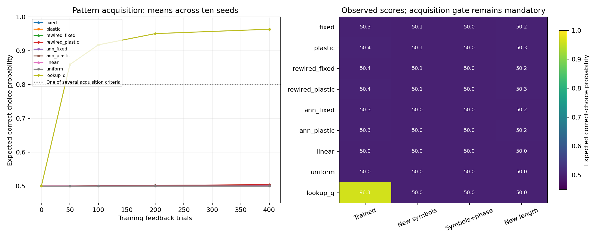
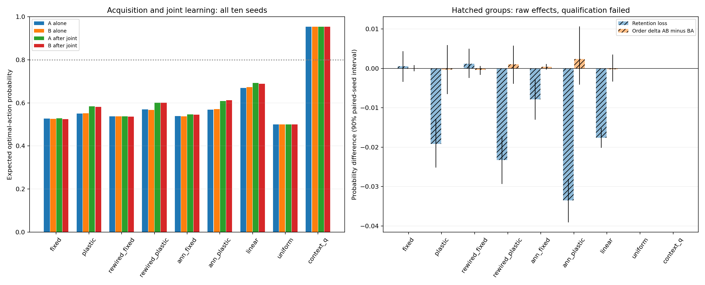

# DrosoLearn — 첫 연구 종합

**Exploring the Foundations of Mathematical Learning Through a Drosophila Connectome**
2026-10-19, Asia/Seoul. 승인한 추가 연구 네 개와 기존 연구를 종합한 Phase 5 보고서다.

## 먼저 쉬운 설명

이번 연구는 모델이 문제를 배우는 데 **입력을 어떤 모양으로 주는지, 한 문제의 학습이 다른 문제의 판단을 얼마나 바꾸는지, 무엇을 성공으로 세는지**가 큰 영향을 준다는 것을 보여 줬다. 인공적으로 수량의 순서를 알려 주면 단순한 모델도 학습과 제한적인 새 수량 적용을 할 수 있었다. 별도 보상 과제에서는 한 문제의 수정이 다른 문제로 번지는 효과를 줄이자 성적이 높아졌다.

반복 패턴 과제의 주 신경망은 연습 문제부터 충분히 익히지 못했다. 간섭·순서 연구도 주 모델의 개별·공동학습 기준이 미달해 효과를 판정할 수 없었다. 사람과 모델을 실제 공개 과제에서 직접 비교했지만, 정한 인간 학습 유사성 기준은 지지되지 않았다. 이 성공·미달·판단 보류를 모두 남기는 것이 이번 종합의 결과다.

**사람과 초파리가 같은 방식으로 수학을 배운다는 증거는 확보하지 못했다.** 앞으로 검정할 계산적 가설과, 그 가설을 오해 없이 시험할 기준을 얻었다. 인간 학습 실패, 모든 공통 원리의 부재, 초파리의 수학적 능력 한계를 입증한 연구는 아니다.

## 처음의 다섯 질문에 대한 답

| 원 연구 질문 | 현재 답 | 근거와 범위 |
|---|---|---|
| 수량·단순 규칙을 경험으로 배우는가? | 과제·표현에 따라 다르다. | 인공 수량 입력에서는 학습했다. 새 기호 패턴의 주 모델 습득은 0/10이다. 시각적 수량 추출은 구현하지 않았다. |
| 학습 중 무엇이 바뀌는가? | 내부·출력·활성의 변화를 분리하고 계산 개입의 효과를 확인했다. | 동일 상태의 갱신 허용/차단, 저장 상태 분해, 출력 축소, 조개별 갱신 방향을 따로 검증했다. 실제 DAN·시냅스 생화학의 재현은 아니다. |
| 처음 보는 사례에 적용하는가? | 순서가 제공된 수량 표현의 제한적 전이는 확인했다. | 단순 선형 대조도 통과했다. 패턴 주 모델은 습득 미달로 일반화 판정을 보류한다. 새 규칙 계열의 이해는 미검증이다. |
| 반복·반전·간섭·순서는 어떤 영향을 주는가? | 반복과 반전의 이력 효과는 확인했다. 새 A/B 간섭·순서의 주 모델 판정은 보류다. | 첫 과제를 배웠는지와 두 과제를 동시에 풀 수 있는지를 먼저 요구했다. 실제 시간 망각은 미검증이다. |
| 인간 기초 학습과 비교할 수 있는가? | 공개 기록으로 직접 정량 비교했으며 이번 유사성 가설은 미지지다. | 사람 29명과 11모델 조건·5계산 시드의 비교에서 세 지표 모두의 동등성을 통과한 조건은 0/11이다. 동일 신경 기작·교육 효과는 검증하지 않았다. |

전체 28개 완료 연구, 25개 주장, 원 JSON의 60개 관측값과 다섯 질문의 연결은 [증거 부록](phase5-evidence-appendix.md), [기계 판독 장부](../results/phase5_synthesis_v1/summary.json)에 있다. 장부의 Level은 **검토한 주장의 수준**이다. 음성 Level 3/4 항목을 해당 수준의 양성 성과를 달성했다는 뜻으로 읽지 않는다. 출처·측정 감사용 Level 0은 별도 장부 표시다.

## 이번에 추가한 네 연구

### 1. 한 문제의 수정이 다른 문제에 번지는가?

보상 규칙이 고정된 여섯 이름표 과제에서 같은 원 특징을 사용하되 갱신 방향을 달리했다. 기존 공유 갱신의 최종 유리한 선택 확률은 **61.90%**, 다른 이름표의 점수로 번지는 영향을 계산적으로 분리한 갱신은 **84.29%**였다. 다섯 계산 시드 모두 차이가 양수였고 사전 가설을 통과했다. 내부 시냅스는 고정했고 출력만 학습했다.

분리 조건에는 288개의 추가 고정 계수와 행렬 풀이가 필요하다. 자기 문제의 동일 상태 수정 폭은 맞췄지만 전체 자원·갱신 L2·이후 보상 경로까지 같지는 않다. 원 인간 216시행과 다른 별도 720시행 과제이며, 원 인간 비교의 실패 전체를 설명하거나 생물학적 학습법을 입증한 결과가 아니다. [상세 결과](shell-credit-findings.md).

각 점은 계산 시드, 검은 선은 평균이다. 사람·동물 개체의 분포가 아니다.

### 2. 같은 점수가 같은 학습법을 뜻하는가?

기존 사람·모델 기록의 다음 같은 조개 반응을 311,808쌍으로 집계했다. 선택하지 않아 내용을 모르는 경우, 선택했지만 빈 경우, 이득, 손실을 구분했다. 보상 규칙 경계와 분모가 없는 층도 보존했다. 이 조건부 비율을 보상 인과 효과로 해석하지 않는다.

합성 보상 학습기와 그 학습기가 만든 답안만 재생하는 장치는 세 점수가 정확히 같았다. 재생 장치는 실행 중 학습을 하지 않았고, 미래 답안을 받은 장치이므로 공정한 학습 경쟁자가 아니다. 보상 부호를 바꾼 합성 개입에서는 학습기의 선택 36.32%가 바뀌었고 재생 장치는 그대로였다. 계획된 구성적 반례로 **세 점수만으로 학습 기작을 유일하게 알아낼 수 없다는 한계**를 확인했다. 새 인간 전략·기작을 발견한 결과가 아니다. [상세 결과](shell-behavior-findings.md).

### 3. 연습한 패턴 습득과 미학습 패턴 적용

ABAB 계열과 ABBA 계열을 구별하게 했다. 종류별 기호 빈도·첫 기호·마지막 기호 분포를 맞추고, 첫/끝 비교와 복사 같은 지름길도 따로 검사했다. 전체 문자열을 인공 7차원 입력으로 주었으므로 시각 인식·순차 기억·문자 이해의 생물학적 재현은 아니다.

주 가소성 모델의 연습 기대 정답률은 **50.38%, 습득 0/10**이었다. 실제/재배선/일반망의 고정·가소성 여섯 조건 모두 습득 0/10이었다. 네 입력을 따로 보상으로 외우는 Q는 **96.34%, 습득 10/10**이었지만 완전히 새 기호·배치·길이 입력은 각각 50%였다. Q의 새 입력 반응은 설계상 .5이다.

주 모델의 일반화는 습득 미달로 `not_assessable_without_acquisition`, Q의 습득 후 전이는 `not_supported`다. 익숙한 사례와 새 단일 종류를 섞은 배치 진단의 74.10%를 일반화 성공으로 바꾸지 않았다. 예산·시드를 늘려 성공 사례를 찾지 않았다. [상세 결과](pattern-rule-findings.md).

왼쪽은 모든 조건의 10계산 시드 평균 학습 곡선이다. 오른쪽은 관측 점수이며, 주 모델의 새 입력 점수에는 습득 조건이 충족되지 않았다. 20평가 슬롯은 고유 문자열 16개다.

### 4. A→B와 B→A, 반복과 간섭

같은 여섯 ID 중 두 개의 좋은/나쁜 결과가 A/B 맥락에서 바뀌는 과제다. 상황 신호를 입력으로 주어 두 과제를 동시에 해결할 수 있게 했다. A→B/B→A/AA/BB/교대 공동학습을 비교하고 공유 첫 학습은 한 번씩만 실행했다.

주 모델의 처음 A/B 학습 평균은 **55.10%**, 교대 공동학습 뒤는 **58.28%**였다. 두 개별 습득과 두 공동학습·충돌 문제 조건을 함께 통과한 시드는 **0/10**으로, 일차 간섭·순서 가설 모두 `not_assessable`이다. 다른 신경망·선형 조건도 자격 미달이다. 맥락별 Q는 약 **95.34%, 자격 10/10**이었다.

주 모델의 다른 과제 뒤 성적 57.02%와 같은 과제 반복 뒤 66.57% 사이 차이 9.54%포인트를 전부 기억 파괴로 읽지 않았다. 유지 손실 −1.92%포인트와 추가 연습 이득 +11.46%포인트를 나눠 검산했다. Q의 손실·순서 차이 0은 별도 칸의 값과 같은 과제별 난수를 공유한 구조적 항등성이다. idle은 상태 복사로 시간의 자연 망각을 검정하지 않는다. [상세 결과](interference-order-findings.md).

줄무늬 조건은 자격이 없어 기술적 수치만 표시한다. 구간은 등록된 계산 시드 paired bootstrap 90% 구간이며 인간·동물 집단의 구간이 아니다.

## 인간 학습과 무엇을 비교했는가?

TNU 공개 조개 과제의 구조상 완전한 49명 중 20명으로 학습률을 보정하고 29명을 평가했다. 사람과 같은 조개·잠재 결과 흐름에서 모델이 스스로 선택하는 실행과 다음 인간 선택의 조건부 예측을 분리했다. 사람은 시각·운동·사전 연습을 거쳤고 자료는 혼합 코호트여서 약물·하위 집단·임상 효과를 추정하지 않았다.

사람의 초기 향상은 +18.39%포인트, 주 모델은 +0.46%포인트였다. 반전 회복은 사람 +31.23%포인트, 주 모델 −0.31%포인트이며 모델−사람 차이의 90% 구간 [−40.42,−22.87]%포인트는 사전 ±10%포인트 허용폭 밖이었다. 다른 두 지표의 구간이 모두 허용폭 밖인 것처럼 확대하지 않는다. 세 지표 모두의 동등성은 0/11조건이고 주 종합 예측 가설도 미지지다.

첫 자율 실행의 일부 사람·시드가 난수 주소를 공유한 오류는 별도 설계 한계로 남겼다. 새 주소 수정판은 학습률·분할·성공 기준을 바꾸지 않고 자율 실행만 새로 계산했다. 조건부 기록은 바이트 그대로 재사용했다. 이 둘을 독립된 두 인간 증거로 합치지 않는다. [원 비교·그림](human-shell-findings.md), [설계 오류와 수정](human-shell-rng-design-note.md), [파생 기록의 저장 범위](human-shell-data-processing-note.md).

다른 공개 카드 자료의 원본 25개 변환 검증, 미검증 49행, 정확한 역사적 실행판의 미확인은 그대로다. 수량 그림 자료의 집계 점수를 시행별 학습 곡선으로 바꾸지 않는다. 자료·과제·보상·시간·관측 단위가 다른 비교의 한계는 [Phase 4 종합](phase4-synthesis.md)과 [비교 체계](human-learning-comparison.md)에 있다.

## 남긴 계산적 원리와 다음 반증 가능한 가설

현재 근거는 입력 표현과 갱신 간 공유가 학습 행동을 바꿀 수 있음을 지지한다. 인간에게도 같은 효과가 있다는 결론은 아직 없다. 다음은 새로운 별도 등록이 필요한 가설이다.

1. **입력의 겹침이 학습의 분리와 간섭을 좌우한다.** 입력 정보량·정답·자기 문제 수정 크기를 맞추고 겹침을 조작한다. 개별·공동학습이 모두 성립한 뒤 유지 손실과 순서 효과가 달라지는지 검사한다. 차이가 사라지면 겹침 중심 설명이 약해진다. 이번 두 새 신경망 과제는 습득이 미달했으므로 이 가설 전체를 확인한 결과가 아니다.
2. **학습 지표 여러 개가 서로 다른 정책을 구분하는 데 필요하다.** 향상·반전·보상별 반응·편향·반복·새 보상 개입을 함께 사전에 정한다. 서로 다른 학습기가 모든 관측을 계속 같게 만들면 행동만으로 기작을 식별하는 범위가 제한된다. 재생 반례를 실제 인간 전략으로 가정하지 않는다.
3. **같은 습득 수준에서 내부/출력 갱신의 역할을 분리할 수 있다.** 정답 정보·노출·시작 상태·자원을 맞춘 별도 계산 개입을 검정한다. 재배선·단순망에서도 같은 효과면 커넥톰 고유 설명이 약해진다. 현재 추가 파라미터·갱신과 후속 행동 경로의 차이를 숨기지 않는다.
4. **인간 비교는 대응 과제·자료부터 확보해야 한다.** 사전 연습, 보상/무보상/손실의 의미와 규칙 전환을 맞춘 공개 자료에서 독립 평가를 설계한다. 이미 본 49명을 다시 나눠 새로운 눈가림 평가라고 부르지 않는다. 새 인간 실험·교육 효과 검정은 이번 범위에 포함하지 않았다.

실제 점 그림의 크기·면적·밀도·배치·시야 통제와 시각 회로 검증, 다른 커넥톰 부분집합/개체에서의 반복, 생리학 응답·DAN compartment 검증, 더 넓은 규칙 계열은 남은 연구다. 소수 계산 시드의 성공을 종 전체의 원리로 확대하지 않는다. 다음 시도에서 현재 실패의 시드·예산만 바꾸어 같은 등록을 성공으로 만들지 않는다.

## 근거·한계·재현

독립 프로젝트 DrosoMem의 고정 커밋·라이선스·M11 원 요약 해시와 습득/전이 미달을 [원 저장소 감사](drosomem-audit.md)에 보존했다. 과거 입력 읽기 가능성, 실제 배선이 모든 대조보다 우수하다는 근거 부재, 출력층 위주의 학습 한계를 유지한다. DrosoLearn의 주 경로는 512 KC/48 MBON·1,474연결이며 실제 연결 참여는 489 KC/29 MBON이다. 이 모델의 보상 스칼라는 실제 DAN 발화가 아니다.

문헌의 직접 관찰과 모델 가정은 [문헌 검토](literature-review.md)와 [해석 한계](../LIMITATIONS.md)를 따른다. Bengochea의 실제 초파리·LC11 수량 구별, Huang의 후각·기억 동역학, Chen & Li의 인간 수량 수행/수학 수행 상관을 현재 모델의 생물학적 재현·인과·교육 효과로 사용하지 않는다. 이전 검토에서 본문/초록/접근 제한을 나눈 사실도 보존했다. 이번 종합은 새로운 체계적 최신 고찰이 아니다.

네 추가 연구의 새 계산 선택은 총 506,448회이며 저장 기록의 재집계와 답안 재생 읽기는 여기에 더하지 않았다. 이는 다양한 정책의 계산 실행 수이고 사람·초파리 개체 수가 아니다. Phase 5 자체는 새 학습·난수·인간 실험·효과 검정 각각 0회다.

최종 자동검사 **643개(기존 인간 비교 회귀검사 199개 + 신규 고유 444개)**가 통과했고, 전후 65개 소스 파일의 해시는 같았다. 공유 시험을 연구별로 중복 합산하지 않았다.

각 연구의 새 설정·사전 계획·입력·소스/부모/그래프 해시를 실행 전에 고정하고 비공개 Git에 등록 바이트를 게시·확인했다. 과학 기준 미달과 무결성 문제를 구분했다. 개발 경합의 실행 전 원 바이트 복구, CRLF 공백 검사 오탐, 원 NPZ의 [무손실 Git 분할 저장](result-storage.md)도 감사 이력에 남긴다. 원 결과를 삭제하거나 다시 압축하지 않았다.

[재현 명령·환경·자료 권한](phase5-reproduction.md), [종합 계획](phase5-report-protocol.md), [등록](../results/registration_phase5_synthesis_v1.json), [독립 검산](../results/phase5_synthesis_v1/verification.json), [최종 자동검사](../results/prephase5_final_test_validation.json), [최종 보존 감사 재실행](phase5-archive-reproduction.md)을 함께 제공한다. 전체 보존 감사 경로는 `results/phase5_synthesis_archive_validation.json`이다. 완료 태그는 `phase5-synthesis-v1`이다. 이번 승인 범위의 종합을 마쳤으며 자동 이어가기는 PAUSED로 유지한다. 원 로드맵의 추가 가능한 생물학·시각·인간·규칙 연구는 남은 질문으로 보존한다.
