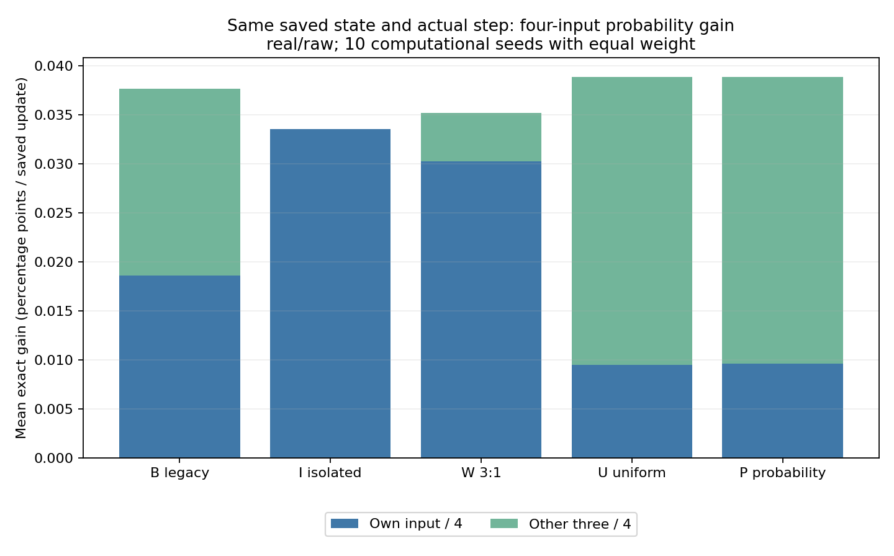
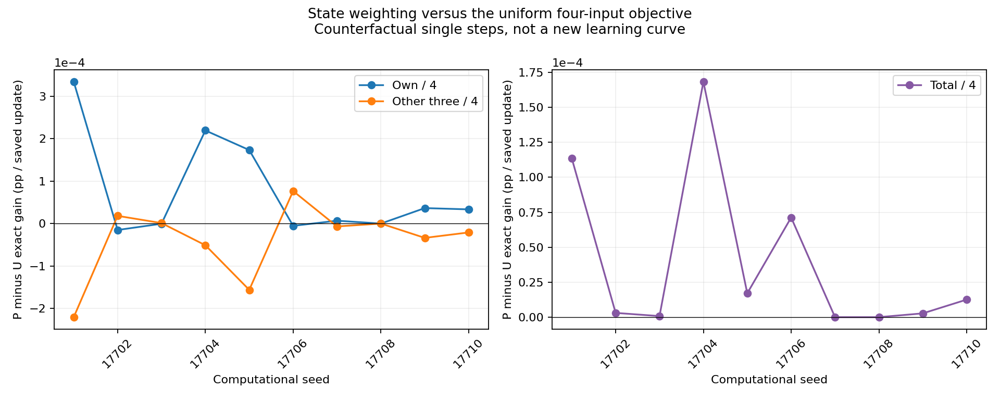
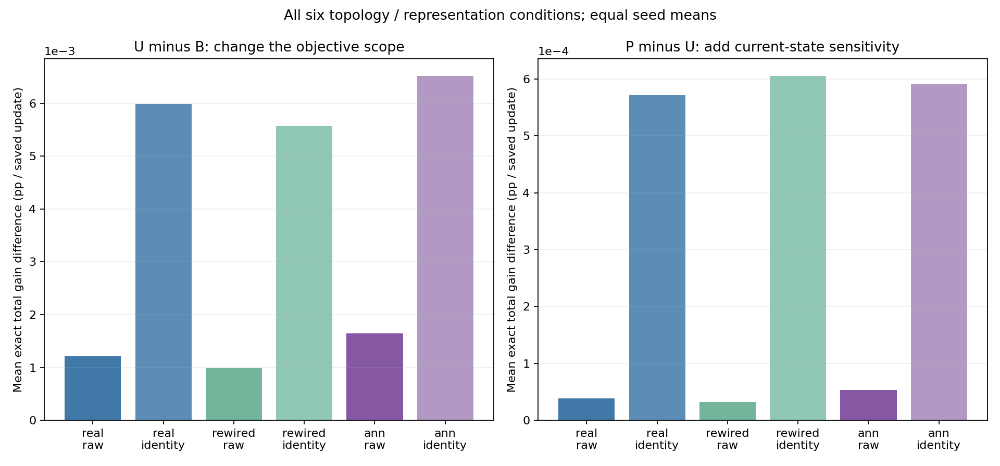

# 수정 목표를 실제 정답 확률과 맞춰 보니

2026-10-21, 별도 후향 기술 분석 `probability_alignment_v1`. 과거의 같은 학습 순간에서 방향만 바꿔 본 단일 수정 계산이다. 새 방향으로 학습을 이어 실행한 결과가 아니다.

주 real/raw에서 U는 B보다 한 번 수정의 네 입력 평균 정답 확률을 **+0.00120739%p** 더 높였고, 현재 확률을 반영한 P의 U 대비 추가 차이는 **+0.0000389332%p**였다. 시드10개에 같은 비중을 준 평균이다. 실제 새 학습의 최종 성적 개선으로 해석하지 않는다.

## 쉽게 설명하면

전에 쓰던 균형 방식은 자기 문제와 일부 이웃 문제의 점수를 함께 올리도록 만들었다. 그런데 성적표는 네 문제 전체의 정답 확률을 평균했다. 이번에는 먼저 성적표가 보는 네 문제를 모두 목표에 넣고(U), 이어 현재 확률이 얼마나 잘 변하는지도 반영했다(P).

이 비교는 같은 순간의 수정 크기와 알고 있는 답을 맞춘 상태에서 진행했다. 수정 방향을 바꾸면 그 뒤 학습 과정도 달라지기 때문에, 여기서 얻은 차이를 최종 성적에 그대로 더할 수는 없다.

## 주 비교 — 전체 평가 목표와 현재 상태를 나누기

모든 값은 **고정 상태의 한 번 수정당 %p**다. 자기 기여는 해당 입력의 확률 증분을4로, 다른 기여는 나머지 세 입력의 증분 합을4로 나눴다. 둘을 더하면 네 입력 평균 증분이다. 시드별 대상 수로 먼저 평균한 뒤 시드10개에 같은 비중을 주었다.

| 같은 상태의 방향 | 자기 입력 / 4 | 다른 세 입력 / 4 | 전체 / 4 |
|---|---:|---:|---:|
| B 기존 균형 | +0.018567444 | +0.019050440 | +0.037617884 |
| I 자기 집중 | +0.033517649 | -1.22e-17 | +0.033517649 |
| W 자기 우선3:1 | +0.030252014 | +0.004893949 | +0.035145963 |
| U 네 입력 균등 점수 | +0.009508534 | +0.029316744 | +0.038825278 |
| P 현재 정답 확률 | +0.009586783 | +0.029277429 | +0.038864211 |

| 비교 | 자기 기여 차이 | 다른 기여 차이 | 전체 차이 |
|---|---:|---:|---:|
| U−B: 네 입력 전체로 목표 변경 | -0.0090589099 | +0.0102663037 | +0.0012073939 |
| P−U: 현재 확률 민감도 반영 | +0.0000782482 | -0.0000393150 | +0.0000389332 |
| P−B: 두 변경의 합 | -0.0089806617 | +0.0102269887 | +0.0012463270 |

U−B는 기존의 선택된 도움 집합과 전체 네 입력 목표 사이의 차이를 포함한다. P−U가 사전에 고정한 주 비교이며, 현재 상태에 따라 정답 확률이 더 잘 변하는 입력에 비중을 준 추가 차이다.

이번 주 조건에서 전체 목표 U의 평균 이득은 **자기 기여를0.00905891%p 줄이는 대신 다른 세 기여를0.01026630%p 늘린 절충**이었다. 자기 수정과 도움을 함께 보존하는 해답을 찾은 것은 아니다. P는 U보다 자기 기여를0.0000782482%p 회복하고 다른 기여를0.0000393150%p 줄였으며, 두 효과의 합은 작은 양수였다. 주 이득은 현재 상태 가중보다 전체 평가 대상으로 목표를 맞춘 변경에서 컸다.

## 선형 최적성과 실제 확률 변화는 다르다

P는 현재점에서 아주 조금 움직일 때의 일차 변화가 가장 큰 방향이다. 현재 확률 p의 민감도 p(1−p)를 사용한다. 이 선형 목적에서의 최적성은 수학적 검사 항목이며 새로운 학습 성공 판정이 아니다. 실제 한 번 수정의 비선형 sigmoid 증분을 별도로 계산했다.

주 P−U 실제 전체 증분 차이의 시드별 평균이 양수인 것은 **9/10**이다. 대상 시행을 합쳐 세면 양수1,548, 음수72, 정확히0인 값345개다. 음수 중 -0.000001%p(확률 단위 -1e-8)보다 더 낮은 것은0개이며, 최솟값은-1.48143594614e-08%p다. 아주 작은 값의 부호도0으로 지우지 않았다. 풀링한 시행 수를 독립 개체 수로 취급하지 않는다.

P의 일차 최적성만으로 유한한 한 번의 실제 확률 변화가 언제나 U보다 크다거나, 비선형 확률 변화의 전역 최적이라고 주장하지 않는다. 일차 예측과 실제 증분의 잔차도 모든 시드·후보에 남겼다.

## 같은 수정량에서의 비교 범위

B/I/W/U/P는 같은 원래 출력 상태·실제 행동·획득 보상·signed scalar g를 사용했고 방향 길이는 각각1이다. 실제 단일 수정 길이 차이의 최대 잔차는2.78e-17였다. 공통 한 번 상한은0.1이다. 최적화 처리 비용이나 새로운 학습의 누적 수정량을 같게 맞춘 실험은 아니다.

B는 저장된 부모 균형 방향, I는 다른 세 입력을 거의 움직이지 않는 자기 집중 방향, W는 같은 B/I를3:1로 섞고 길이를 맞춘 참고 방향이다. U는 정답 정렬 점수의 네 입력 평균을, P는 현재 정답 확률의 일차 변화를 최대화한다. I가 가능한 모든 안전 방향 중 자기 수정의 최대값이라고 주장하지 않는다.

대상은 기존 gated 부모 자신의 보상 기억 네 칸이 **피드백 전에** 채워져 있고 실제 Go한11,709시행이다. 네 번째 답을 막 얻은 순간·부분 관측·NoGo에는 새 최적화를 호출하지 않았다. 실제 g=0 대상도 지우지 않는 계약이며 실제 기록에서는0개였다. 모든 대상의 수정 전 |z| 최댓값은2.06671463로 미분 유효 조건40미만을 만족했다.

관측한 네 부호만 목적/안전 제약에 넣었다. 숨은 정답은 평가 검산용이며 선택기에 새로 제공하지 않았다. 후보별 후속 상태·새 행동·추가 보상은 만들지 않았다. 기존 B의 자기/선택된 도움 목적이 이미 최적인 사실도 유지하며, 다른 목적의 개선을 그 두 목적의 동시 개선으로 부르지 않는다.

## 양수 도움과 음수 방해

아래는 후보별 모든 대상의 양수 부분과 음수 부분을 각각 먼저 더한 후, 시드별 합계에 같은 비중을 준 값이다. 단위는 고정 상태 단일 수정의 누적 참고 %p이며 **최종 정확도 변화가 아니다**.

| 후보 | 양수 부분의 합 | 음수 부분의 합 |
|---|---:|---:|
| B 기존 균형 | +7.477944851 | -2.11081153e-13 |
| I 자기 집중 | +6.657199069 | -9.02056208e-15 |
| W 자기 우선3:1 | +6.982998073 | -4.14945855e-14 |
| U 네 입력 균등 점수 | +7.724214770 | -2.77555756e-15 |
| P 현재 정답 확률 | +7.732006066 | -2.35922393e-15 |

모든 후보가 관측한 네 입력의 정답 정렬 점수를 해치지 않는 같은 안전 영역 안에 있다. 음수 잔차와 실제 큰 방해를 구분한다. 아직 답을 모르는 입력에 적용해 안전하다는 새 실험은 수행하지 않았다.

## 전체 배선·입력 표현 결과

30후보 조건을 모두 보존했다. 아래는 한 번 수정의 전체 평균 증분 및 B/U와의 차이, 단위 %p다. 같은 입력 표현·같은 배선·같은 시드 안에서 비교하며 조건별 학습 상태 차이는 남아 있다.

| 배선 | 표현 | 후보 | 전체 증분 | B 대비 | U 대비 |
|---|---|---|---:|---:|---:|
| real | raw | B 기존 균형 | +0.0376178843 | +0.0000000000 | -0.0012073939 |
| real | raw | I 자기 집중 | +0.0335176488 | -0.0041002355 | -0.0053076294 |
| real | raw | W 자기 우선3:1 | +0.0351459633 | -0.0024719210 | -0.0036793149 |
| real | raw | U 네 입력 균등 점수 | +0.0388252782 | +0.0012073939 | +0.0000000000 |
| real | raw | P 현재 정답 확률 | +0.0388642113 | +0.0012463270 | +0.0000389332 |
| real | identity | B 기존 균형 | +0.1275637789 | +0.0000000000 | -0.0059881009 |
| real | identity | I 자기 집중 | +0.0712789868 | -0.0562847921 | -0.0622728930 |
| real | identity | W 자기 우선3:1 | +0.0930419174 | -0.0345218615 | -0.0405099624 |
| real | identity | U 네 입력 균등 점수 | +0.1335518798 | +0.0059881009 | +0.0000000000 |
| real | identity | P 현재 정답 확률 | +0.1341238801 | +0.0065601012 | +0.0005720003 |
| rewired | raw | B 기존 균형 | +0.0327500823 | +0.0000000000 | -0.0009855656 |
| rewired | raw | I 자기 집중 | +0.0303133515 | -0.0024367308 | -0.0034222964 |
| rewired | raw | W 자기 우선3:1 | +0.0313107654 | -0.0014393169 | -0.0024248825 |
| rewired | raw | U 네 입력 균등 점수 | +0.0337356479 | +0.0009855656 | +0.0000000000 |
| rewired | raw | P 현재 정답 확률 | +0.0337675603 | +0.0010174780 | +0.0000319124 |
| rewired | identity | B 기존 균형 | +0.1222144574 | +0.0000000000 | -0.0055777174 |
| rewired | identity | I 자기 집중 | +0.0698267408 | -0.0523877167 | -0.0579654340 |
| rewired | identity | W 자기 우선3:1 | +0.0902891217 | -0.0319253357 | -0.0375030531 |
| rewired | identity | U 네 입력 균등 점수 | +0.1277921748 | +0.0055777174 | +0.0000000000 |
| rewired | identity | P 현재 정답 확률 | +0.1283979233 | +0.0061834659 | +0.0006057486 |
| ann | raw | B 기존 균형 | +0.0435986839 | +0.0000000000 | -0.0016467538 |
| ann | raw | I 자기 집중 | +0.0375581357 | -0.0060405482 | -0.0076873019 |
| ann | raw | W 자기 우선3:1 | +0.0399804414 | -0.0036182425 | -0.0052649962 |
| ann | raw | U 네 입력 균등 점수 | +0.0452454376 | +0.0016467538 | +0.0000000000 |
| ann | raw | P 현재 정답 확률 | +0.0452988640 | +0.0017001802 | +0.0000534264 |
| ann | identity | B 기존 균형 | +0.1303027286 | +0.0000000000 | -0.0065218029 |
| ann | identity | I 자기 집중 | +0.0688987775 | -0.0614039511 | -0.0679257539 |
| ann | identity | W 자기 우선3:1 | +0.0926905944 | -0.0376121341 | -0.0441339370 |
| ann | identity | U 네 입력 균등 점수 | +0.1368245314 | +0.0065218029 | +0.0000000000 |
| ann | identity | P 현재 정답 확률 | +0.1374154944 | +0.0071127658 | +0.0005909629 |

## 검증·출처·실패 보존

실제 자료 계산 전에 소스24·부모17파일과 설정/프로토콜을 고정했다. 사전 검사261개(새169·기존 관련92)가 통과했고, 비공개 원격 등록의 실제 bytes를 확인한 뒤 최초 새 최적화를 수행했다. 과학 소스 `104d4a2038ae33cea0ae774d896380353af8b7dc`, 등록 게시 `82273c65a6ea3102190cbeae24a7da191e68e483`.

원 gated 참조24,000기록/96,000목적지 효과를 복원했다. 새 U 유일 문제240회와 P 상태별11,709회, 총 **11,949최적화**를 수행했다. 새 학습·출력/내부/가치 갱신·난수·그래프/특징 구성은 각각0회다. 후보 단일 수정 평가는58,545회이며 동일한 참조를5번 쓰므로 새로운 독립 실험5개가 아니다.

독립 검산은 새 producer/solver를 불러 같은 답을 다시 내는 방식이 아니라, 원래 저장된 prefix·g·D에서 전체27배열·900행17열·30조건300시드기록을 재계산했다. 각 U/P 증거를 별도의 ambient least-squares/쌍대 상한 계산으로 확인했다. producer 검사 최대 잔차는1.73e-14로1e-8 이하다. 원학습201배열의 전체 학습 재생은 동결된 이전 독립 영수증/bytes를 재사용했다.

이전 완료19,095파일/2,411,077,072bytes의 Git blob 해시를 비교했다. 세 상태 인덱스 외의 완료 파일은 보존했다. 개발 중 합성 검사 fixture의 폴더 누락으로 발생한2실패의 원문 검사·JUnit 및 설명을 별도 ZIP/JSON으로 보존했고, 실제 자료 계산 전에 가상 fixture만 고쳤다. 과학 입력·성공 문턱·시드는 바꾸지 않았다.

과학 소스24 밖의 archive 도구 초안에서는 파일 전용 경로검사에 폴더를 넘긴 문제와 Windows ZIP 구분자 차이를 수정했다. 초안·허구 검사·실패 재현 stderr·6항목 통과 bytes를 별도 `results/probability_alignment_archive_development` ZIP/manifest로 보존했다. 원래 stderr가 파일로 남지 않았던 중간 진단 설명과, 보존된 초안을 다시 실행해 얻은 재현 stderr를 구분한다. 실제 연구 기준이나 동결한 과학 코드를 바꾼 것은 아니다.

## 그림

## 다음 연구가 답해야 할 것

이번 차이는 실제 학습 개입의 후보 근거다. U/P를 실제 학습에 넣으면 상태·행동·보상·Go 횟수도 달라진다. 별도 사전 등록에서 관측 정보, 최적화 계산 비용, 같은 시행 예산과 단일 수정 상한, 습득/보호 기준을 고정하고 실제 경로 전체를 비교해야 한다. 이번 저장값만으로 어느 방식이 최종 성적을 높인다고 결론내리지 않는다.

입력은 ABAB/BABA/ABBA/BAAB의 네 인공 전체 문자열이다. 출력 계수와 별도의 획득 보상 기억이 학습된 원래 모델이며, 내부 KC→MBON 연결·특징·같은 입력의 활성은 고정이다. 계산 시드는 사람이나 초파리가 아니다. 수량 인지·새 수학 규칙 이해·내부 생물학적 가소성·인간 유사성·공통 신경 기작·교육 효과를 새로 입증하지 않았다.

부모의 개선/충분한 습득 미지지와 설계상 미관측 보호 통과, 인간 비교 음성 결과·원래 Phase5·닫힌 새 입력/규칙 일반화·간섭·순서 문턱을 보존한다. DrosoMem과 완료한 코드·원자료·설정·실패는 수정하지 않았다. 이번 단일 분석 뒤 자동 반복은 PAUSED다.
