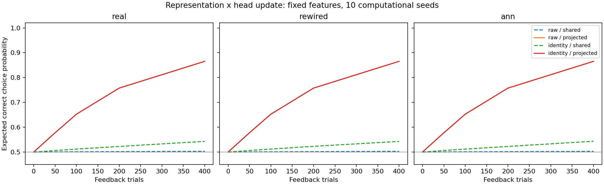
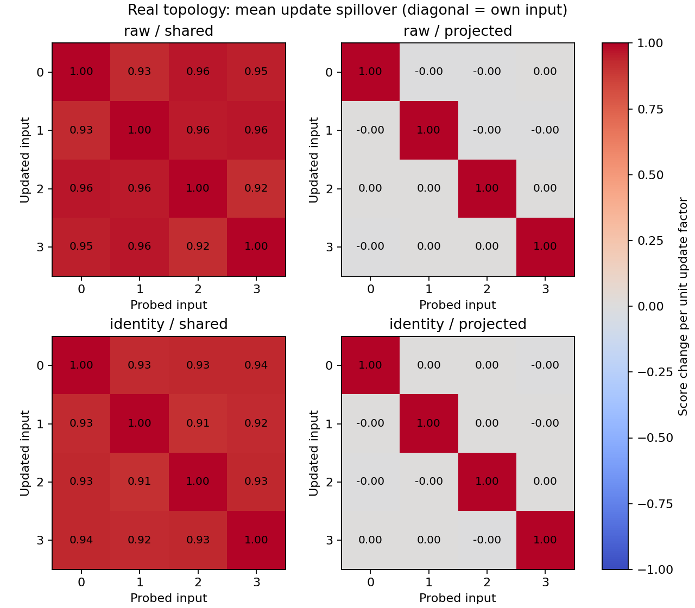

# 입력을 구별하는 것과 답을 배우는 것은 달랐다

2026-10-19. 별도 후속 연구 `representation_update_v1`을 실행하고 독립 검산했다.
기존 Phase 5 종합과 과거 실패 결과는 그대로 보존한다.

## 쉬운 설명

네 연습문제에 서로 다른 이름표를 붙이는 것만으로는 학습이 충분히 좋아지지 않았다.
반면 **한 문제의 답을 고칠 때 다른 문제의 답까지 흔들리는 영향을 막자** 성적이 크게 높아졌다.
원래 입력을 그대로 사용한 조건에서도 정답 선택 확률은 50.29%에서 86.54%로 높아졌고,
서로 다른 초기 조건 10개 모두 사전에 정한 학습 기준을 통과했다.

노트에 네 문제의 답을 적는다고 생각해 보자. 한 답을 고칠 때 다른 세 답까지 거의 같은 방향으로
바뀌면 서로 다른 정답을 익히기 어렵다. 이번 계산 대조는 고치려는 문제의 수정 폭은 맞추면서,
다른 답으로 번지는 영향을 줄였다. 이 비유는 계산상의 간섭을 설명하는 것이며 사람 뇌의 원리를
확인했다는 뜻은 아니다.

## 실제로 비교한 결과

같은 실제 부분 배선에서 입력 표현 두 종류와 출력 갱신 두 종류를 교차했다.
처음 정답 선택 확률은 모든 조건에서 50%였다.

| 입력 표현 | 답을 고치는 방식 | 마지막 정답 선택 기대 확률 | 습득 기준 통과 |
|---|---|---:|---:|
| 원래 문자열 표현 | 다른 입력과 공유되는 수정 | 50.29% | 0/10 |
| 원래 문자열 표현 | 다른 입력으로 번지는 수정 억제 | **86.54%** | **10/10** |
| 문제별 이름표 표현 | 다른 입력과 공유되는 수정 | 54.30% | 0/10 |
| 문제별 이름표 표현 | 다른 입력으로 번지는 수정 억제 | **86.54%** | **10/10** |

표는 **각 문제에서 정답을 선택할 모델 확률을 평균**한 값이다. 실제로 추출한 선택의 정답률과
같은 지표가 아니다. 원 시행별 확률·행동·보상은 모두 보존했다. 10개는 계산 초기 조건이며 동물 수가 아니다.

사전 습득 기준은 최종 평균 80% 이상, 처음보다 25%p 이상 증가, 두 정답 종류 각각 70% 이상이다.
조건 단위 지지는 8/10 이상 통과를 요구했다. 결과를 본 뒤 기준을 바꾸지 않았다.

일차 갱신 가설 H_update는 **지지됐다**. 원 입력의 최종 차이는 평균 **+36.25%p**,
양의 차이는 10/10이며, 투영 갱신의 습득도 10/10이다. 자기 문제의 수정 폭 일치와
다른 문제로 번지는 제곱 영향의 감소 기준도 통과했다.

표현 가설 H_representation은 **미지지**다. 이름표만 바꾼 효과는 **+4.01%p**로 10개 모두
양수였지만, 사전에 정한 +10%p와 습득 8/10 기준에 미달했다. 이것은 표현 효과가 0이라는 판정이 아니다.

## 정보가 사라졌던 것인가

원 네 입력은 서로 다르지만, 양의 종류 두 점과 음의 종류 두 점의 중간 지점이 같다.
따라서 원 입력에 직선적인 점수 하나만 붙이는 단순 판독은 네 문제를 모두 엄격히 나눌 수 없다.
이 제약은 실행 전에 정수 대수로 확인했다. 입력 자체의 정체성이 사라진 것은 아니다.

신경망의 고정 비선형 변환을 거친 뒤에는 달랐다. **60개 배선·표현·초기 조건 전부**에서
네 특징의 유지 rank가 4였고, 정답을 나누는 분석용 출력 계수를 찾았다. 실제 투영 갱신도
60/60에서 사전 지정한 정확한 분리 수치 자격을 통과했다.
분석용 계수는 정답을 알고 계산한 용량 진단이며 보상으로 학습한 계수와 별도로 기록했다.

따라서 이번 고정 특징 조건에서 “문제를 구별할 정보가 완전히 없어 학습하지 못했다”는 설명은
맞지 않는다. 정보가 있어도 기존 공유 갱신은 습득하지 못했고, 갱신 방향을 바꾼 계산 대조는 습득했다.
입력의 기하와 학습 규칙을 함께 따져야 한다는 제한된 근거다.

## 배선 대조와 계산 비용

| 배선 | 원 입력·공유 수정 | 이름표·공유 수정 | 원 입력·투영 수정 | 이름표·투영 수정 |
|---|---:|---:|---:|---:|
| 실제 부분 배선 | 50.29% | 54.30% | 86.54% | 86.54% |
| 차수를 통제한 재배선 | 50.28% | 54.30% | 86.54% | 86.54% |
| 일반 희소 무작위 신경망 | 50.27% | 54.35% | 86.54% | 86.54% |

투영 조건의 일치는 충분한 rank에서 각 문제의 점수 갱신을 독립시키고 같은 문제 순서·행동 난수를
쓴 구성으로 예상된다. 이를 서로 독립적인 생물학적 반복이나 실제 커넥톰의 우수성으로 세지 않는다.

출력 좌표는 두 방식 모두 48개지만 투영 방식은 추가 고정 계수 192개와 행렬 계산을 사용한다.
모든 방향·기하·분석 진단을 합친 producer SVD 호출은 1,110회다.
실제 부분 배선·원 입력의 시행당 출력 계수 L2 이동은 공유 평균 **0.02350**, 투영 평균 **0.19692**였다.
무갱신 시행을 포함한 값이며, 투영 조건에서 더 크게 움직였다. 최대 투영 방향 길이는 약 20.66이다.

즉, **자기 문제의 점수 수정 폭을 맞춘 비교**다. 전체 가중치 이동량이나 계산 비용까지 같은
비교가 아니다. 성적 차이를 오직 간섭 하나만의 유일한 원인으로 단정하지 않는다.

## 그림 읽는 법

세 그래프는 배선 종류이고 가로축은 받은 피드백 횟수다. 공유 수정의 파랑·초록 점선은 낮게
남았고, 투영 수정의 두 실선은 겹쳐 올라갔다. 빨강 선 아래 주황 선이 겹친 것은 누락이 아니다.
각 점은 10개 계산 조건의 평균이며, 실제 추출 행동 정답률이 아니라 정답 선택 확률이다.

행은 고친 문제, 열은 검사한 문제다. 대각선 1은 자기 문제의 수정 폭이 같음을 뜻한다.
왼쪽은 다른 문제 점수도 거의 함께 바뀌고, 오른쪽은 다른 문제에 대한 영향이 수치상 0에 가깝다.
`-0.00` 표시는 부동소수점 반올림이며 의미 있는 음의 효과가 아니다.
행렬에는 매 시행의 확률·행동·보상에 따른 공통 배율을 곱하기 전의 영향이 표시된다.

## 검증과 해석의 범위

- 실행 전 새 코드·설정·프로토콜 20파일, 부모 증거 11파일, 그래프 4파일, 입력 2파일을 동결했다.
- 등록 원문이 비공개 GitHub에 게시된 것을 계산 시작 전에 바이트 단위로 확인했다.
- 12조건×10초기 조건×400회 = **48,000회 선택·피드백**, 정적 평가는 **2,400개**다.
- 출력 갱신 호출은 48,000회, 실제 비영 출력 변화는 23,425회다. 내부·가치표 갱신은 0회다.
- 독립 코드가 새 producer·기하 모듈을 불러오지 않고 559개 배열, 모든 선택과 보상,
  출력 변화·checkpoint·기하·분석 후보·판정을 다시 계산해 일치했다.
- 새 자동검사 **162개**, 관련 기존 회귀검사 **103개**가 통과했다. 반복 실행한 검사를 합산하지 않았다.

이번에는 **네 연습문제를 익히는 출력 학습(Level 2)**을 확인했다. 입력은 전체 문자열을 인공적으로
제공한 것이며, 시각 수량 회로나 생물학적 순차 기억을 재현하지 않았다. 신경망 내부 가중치는 고정됐다.
이름표와 투영 방향은 알려진 네 입력 전체를 이용한 계산 대조다.

과거 패턴 연구의 전역 RMS 정규화와 내부 가소성 조건을 그대로 반복한 실험도 아니다.
이전 0/10 실패를 성공으로 바꾸거나 그 실패 원인 전체를 설명하지 않는다.
새 문자열 일반화(Level 3), 인간과의 행동 유사성(Level 4), 공통 신경 기작(Level 5), 교육 효과는 검사하지 않았다.
기존 인간 비교의 미지지와 맥락별 공동 습득·간섭·순서 연구의 닫힌 판정 조건도 그대로다.

## 다음에 무엇을 검사할 것인가

다음 후보는 **“가중치를 움직이는 비용을 제한해도 개선이 남는가?”**다.
자기 문제의 수정 폭을 같게 하는 기준과 전체 L2 이동량을 같게 하는 기준은 일반적으로 동시에
만족시킬 수 없다. 새 등록에서는 두 자원 기준을 별도 조건으로 정의해야 한다.
이번 결과의 시드·학습률·시행 수를 늘리는 방식으로 대체하지 않는다.

그다음에야 학습된 새 계산 조건이 다른 규칙이나 새 사례로 옮겨 가는지, 맥락별 개별·공동 습득을
통과하는지를 별도로 설계할 수 있다. 현재 등록에서 일반화·간섭 실험을 추가하지 않았다.

[실행 전 계획](representation-update-protocol.md) · [수치 요약](../results/representation_update_v1/summary.json) ·
[독립 검산](../results/representation_update_v1/verification.json) · [재현 안내](representation-update-reproduction.md).
완료 태그는 `representation-update-v1`이다.
