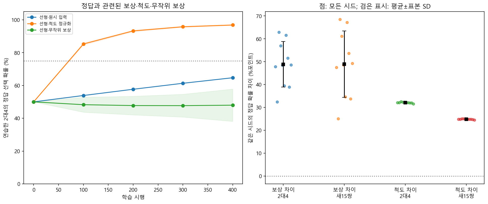
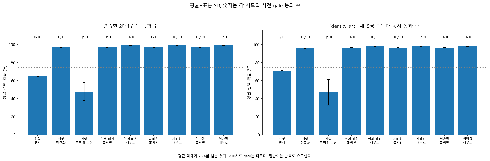

# 독립 보상 선형 학습 — 쉬운 결과 설명

2026-10-14, Asia/Seoul. 실행 뒤 작성한 문서다. [사전 계획](reward-linear-protocol.md), 입력·시드·학습률·예산·판정 기준을 변경하지 않았다. [자동 보고서](../results/reward_linear_v1/report.md), [모든 시드 판정](../results/reward_linear_v1/summary.json), [독립 검산](../results/reward_linear_v1/verification.json)을 함께 보존한다.

## 이번 결과의 뜻

**복잡한 모델의 점수를 받지 않아도, 일곱 계수를 가진 단순한 모델이 선택·보상 경험으로 이 추상 수량 과제를 배울 수 있었다.** 입력의 척도를 맞춘 단순 모델은 연습 문제의 정답 선택 확률이 50%에서 96.85%로, 완전히 새로운 수량쌍에서는 50%에서 96.01%로 높아졌다. 사전에 정한 보상 의존 습득과 습득 후 일반화 기준을 각각 통과했다.

지난 설명식은 원래 모델이 내는 점수를 받아 만들었다. 이번에는 그 점수나 학습한 가중치 없이 모든 계수를 0에서 시작했다. 2개와 4개 중 한쪽을 고르면 맞았을 때 보상 1, 틀렸을 때 0을 받는 연습을 400번 했다. 연습하지 않은 수량을 검사하는 동안에는 더 가르치지 않았다.

다만 ‘물체 그림을 보고 개수를 알아냈다’는 뜻은 아니다. 모델은 물체 그림 대신 이미 수량 순서를 나타내는 숫자를 받았다. 일곱 입력 중 하나가 수량 숫자이고 나머지 여섯 개는 수량과 관계없는 인공 특징이다. 배운 것은 이 표현 안에서의 선택 반응이다.

## 단순 모델의 세 조건

같은 입력이라도 계산에 사용하는 값의 크기에 따라 한 번의 학습 변화가 달라진다. 그래서 연습 입력만 보고 초기 특징 차이의 전체 크기를 맞추는 규칙을 먼저 정했다. 학습 결과를 본 뒤 유리한 크기를 골라 바꾼 것이 아니다. 원래 척도의 단순 모델도 그대로 함께 실행했다.

| 단순 모델 조건 | 연습한 2대4 | 완전 새 수량 15쌍 | 연습 습득 | 습득과 새 입력 기준 동시 통과 |
|---|---:|---:|---:|---:|
| 척도를 맞추고 정답 선택에 보상 | 96.85±0.29% | 96.01±0.22% | 10/10 | 10/10 |
| 원래 척도에서 같은 보상 | 64.71±0.13% | 71.16±0.15% | 0/10 | 0/10 |
| 척도를 맞추고 선택과 무관한 무작위 보상 | 47.98±9.84% | 47.07±14.42% | 0/10 | 0/10 |

숫자는 전체 10개 계산 시드의 평균이며 ±는 시드 표본 표준편차다. 계산 시드는 초파리 개체나 인간 참가자가 아니다. 새 수량 15쌍은 두 수량 모두 연습의 2·4에 포함되지 않는 모든 조합이다. 표는 원래 순서 코드의 평가이며 다른 세 간격도 별도 기록했다.

무작위 보상 대조도 같은 입력·초기 상태·척도와 시행 예산을 사용했다. 선택 확률이 달라지면 실제 선택은 서로 달라질 수 있다. 유한한 무작위 보상 경험에서 우연 편향이 나타날 수 있으므로 성적을 정확히 50%로 강제하지 않았다. 정답 선택 보상과 무작위 보상의 연습 성적 차이는 전체 시드 평균 **48.87±9.94%포인트**였고 10시드 모두 양수였다.



## ‘선택 방향’과 ‘선택 확률’은 다르다

64.71%라는 수치는 확률에 따라 선택을 뽑으면 평균적으로 그만큼 정답을 고른다는 뜻이다. 확률이 더 높은 후보만 매번 고르는 평가는 별도로 계산했다.

**원래 척도의 단순 모델도 최종 새 수량 검사에서는 확률이 높은 쪽만 고를 때 모든 시드·27쌍·네 입력 코드에서 정답률 100%였다.** 척도를 맞춘 단순 모델도 같은 범위에서 100%였다. 원래 척도의 모델이 아무것도 배우지 않았다고 말할 수 없다. 선택 방향은 맞게 바뀌었지만 사전 확률 기준에 미달한 것이다. 이 제한된 평가의 100%를 모든 수학 문제에 대한 성적으로 확대하지 않는다.

연습 습득 기준은 최종 2대4 정답 선택 확률 75% 이상과 초기 대비 15%포인트 이상 향상을 모두 요구했다. 원래 척도에서는 평균 향상이 약 14.71%포인트였고 최종 확률도 75%에 못 미쳤다. 높은 확률의 쪽을 고르는 성적을 대신 넣어 이 실패를 성공으로 바꾸지 않았다. 원래 척도와 무작위 보상의 **습득 미달 총 20건**은 전체 결과와 평균에 그대로 남겼다.

## 미리 정한 두 질문의 판정

H-R은 척도를 맞춘 단순 모델의 습득 통과가 8/10 이상이고, 정답 선택 보상−무작위 보상의 최종 연습 확률 차이가 전체 평균 15%포인트 이상이며, 양수 차이가 8/10 이상이어야 했다. 실제 결과는 **습득 10/10, 차이 48.87%포인트, 양수 10/10**으로 통과했다.

H-G는 시드마다 연습 습득과 완전 새 15쌍의 평균 정답 선택 확률 75% 이상을 동시에 충족해야 하며, 그런 시드가 8/10 이상이어야 했다. 실제 **10/10**이 통과했다. 새 문제의 성적만 높고 연습 습득은 미달한 경우를 습득 후 일반화로 세지 않았다.

처음 관측한 습득 통과 checkpoint는 이 단순 모델과 정답 보상을 받는 여섯 네트워크 모두 시행 100이었다. 중간 1–99시행을 평가하지 않았으므로 ‘정확히 100번 만에 배웠다’는 뜻은 아니다. 75%, 15%포인트, 8/10은 실행 전에 정한 연구용 기준이며 유의성 검정이나 생물학적 임계값이 아니다.

## 초파리 배선 모델과 비교하면

| 조건 | 최종 연습 확률 | 완전 새 15쌍 확률 | 습득과 새 입력 기준 동시 통과 |
|---|---:|---:|---:|
| 단순 선형·척도 정규화 | 96.85% | 96.01% | 10/10 |
| 실제 배선·출력만 학습 | 96.97% | 96.43% | 10/10 |
| 실제 배선·내부도 학습 | 99.08% | 98.14% | 10/10 |
| 재배선·출력만 학습 | 96.97% | 96.42% | 10/10 |
| 재배선·내부도 학습 | 99.12% | 98.18% | 10/10 |
| 일반 신경망·출력만 학습 | 96.94% | 96.41% | 10/10 |
| 일반 신경망·내부도 학습 | 99.17% | 98.25% | 10/10 |

모두 초기 출력은 50%이고 초기 특징 차이의 크기를 훈련 입력만으로 맞췄다. 하지만 단순 모델은 출력 계수 7개, 네트워크는 48개 슬롯을 사용한다. 내부도 학습하는 조건은 추가로 1,474개 가중치를 바꾼다. 모든 학습 자원·특징 방향이 같은 우열 실험은 아니다. 실제 배선이 재배선·일반 신경망보다 특별한 능력을 가졌다는 근거도 확보하지 못했다.

이번 네트워크는 이전 연구와 초기 출력 가중치·특징 척도가 다르다. 위 성적을 과거 결과보다 좋아진 동일 실험으로 해석하지 않는다. 새 질문을 위한 별도 시드·설정으로 수행했으며 옛 결과와 실패는 수정하지 않았다.



## 간격과 보상 정보의 한계

새 5대7에서 척도를 맞춘 단순 모델의 정답 선택 확률은 기존 간격 **96.85%**, 절반 간격 **84.74%**, 1/4 간격 **70.21%**였다. 순서와 두 입력의 중간값은 같지만 확률은 달라졌다. 1/4 간격의 75% 보조 기준 통과는 **0/10**이었다. 결정적 선택 방향은 유지됐어도 이 확률 기준 미달은 남겼다. 주 H-G는 사전에 정한 기존 간격의 새 15쌍 기준이며 이 보조 실패를 대체하지 않는다.

두 선택지에서 ‘맞으면 1, 틀리면 0’을 곧바로 받으면 선택과 보상으로 정답 쪽을 알아낼 수 있다. 학습 함수에 정답 라벨을 직접 주지는 않았지만 보상에는 그에 해당하는 정보가 들어 있다. 드물거나 지연된 보상 속에서 수량 개념을 스스로 발견한 어려운 탐색으로 해석하지 않는다.

초기 척도 계산에는 전체 연습 입력을 미리 관찰하는 무보상 전처리를 허용했다. 평가 입력·평가 정답·원래 모델의 점수는 사용하지 않았고 학습 중 척도를 다시 계산하지 않았다. 이 설정은 미래 연습 입력을 전혀 보지 못하는 순수한 온라인 학습과도 다르다.

## 재현과 연구의 다음 질문

실제 학습은 새 시드 6001–6010, 9조건, 400시행으로 총 **36,000번**이다. [전체 테스트 724개](../results/test-validation-reward-linear.json)가 통과했다. 시행별 선택·보상·확률·가중치 변화, 내부와 출력 가중치, KC·MBON·선택 특징 활성, 별도 데이터 분할과 평가 원자료를 남겼다. 단순 모델에는 KC·MBON이 없어 해당 배열을 비워 저장했다.

[독립 검산](../results/reward_linear_v1/verification.json)은 학습 코드·정규화 함수·요약 함수를 호출하지 않고 모든 갱신, 450개 checkpoint, 180개 전이 평가 파일, 2,488,320개 시행별 평가 확률과 17,418,240개 후보 점수를 재계산해 통과했다. 고정된 훈련 척도, 선택·보상 난수, 내부/출력 갱신, 습득·일반화·보상 차이 판정도 확인했다. 원자료 파일 해시 688개와 소스·문서 동결 33개를 검사했다.

소스 commit은 `cc836c61055ca32a5205f8685a5a4171c43b77e7`, 등록 게시 commit은 `6bd4fd0e8180b2800eda2b6f3ab51e124d7d1764`다. 등록은 2026-10-14 04:06:20 UTC, 원격 byte 확인은 04:06:32 UTC, 실행 시작은 04:06:35 UTC였다. [동결 증거](../results/reward_linear_prefreeze_evidence.json)와 [보존 검증](../results/reward_linear_archive_validation.json)을 함께 남겼다. 비공개 Git 보존이며 외부 공인 공개 사전등록을 뜻하지 않는다. 이전 연구의 코드·자료·프로토콜·설정·결과는 변경하지 않았다.

재현은 `study-reward-linear-v1` 태그를 별도 checkout하고 README의 환경 설치 뒤 새 결과 경로로 실행한다.

```powershell
.\.venv\Scripts\python.exe -m drosolearn.reward_linear run --config configs/reward_linear_diagnostic.json --registration results/registration_reward_linear_v1.json --out results/MY_REWARD_LINEAR_REPLAY
.\.venv\Scripts\python.exe -m drosolearn.reward_linear verify --out results/MY_REWARD_LINEAR_REPLAY
```

다음 후보는 **이 단순 학습자도 이미 배운 보상 규칙을 바꿀 때 어려움을 겪는지**다. 새 규칙을 처음부터 배우는 경우와 기존 규칙을 바꾸는 경우를 같은 새 사전 계획 안에서 비교하고, 출발점의 낮은 성적과 학습 속도를 구분해야 한다. 기존 보상 반전 실패를 더 오래 훈련해 성공으로 바꾸는 것이 아니라, 그 현상이 단순 선택 함수에서도 나타나는지 묻는 후속 연구다.

이번 경험 의존 변화는 Level 2, 습득 확인 뒤 인공 입력의 새 사례 반응은 제한된 Level 3이다. LC11 시각 경로·실제 DAN 신호·살아 있는 초파리의 수량 행동을 재현하지 않았다. 인간 학습과 정량 비교하는 Level 4와 관련 신경 기작의 Level 5는 아직 검증하지 않았다.

인간 수학 학습과 비교할 장기 목표는 유지한다. 이번 결과는 향상과 실패를 설명할 때 보상 정보, 입력 척도, 확률 지표와 학습 자원을 함께 확인해야 한다는 후속 비교 질문을 남긴다. 확보한 인간 공개 자료에는 이번과 같은 시행별 보상·입력 조작 기록이 없어 곡선을 직접 비교할 수 없다. 인간 교육 효과나 동일한 신경 메커니즘에 관한 결론은 아니다.
