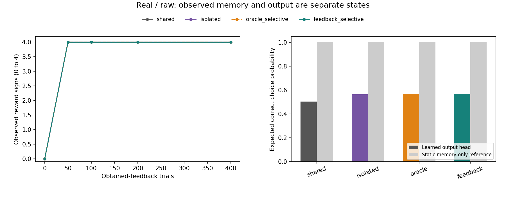
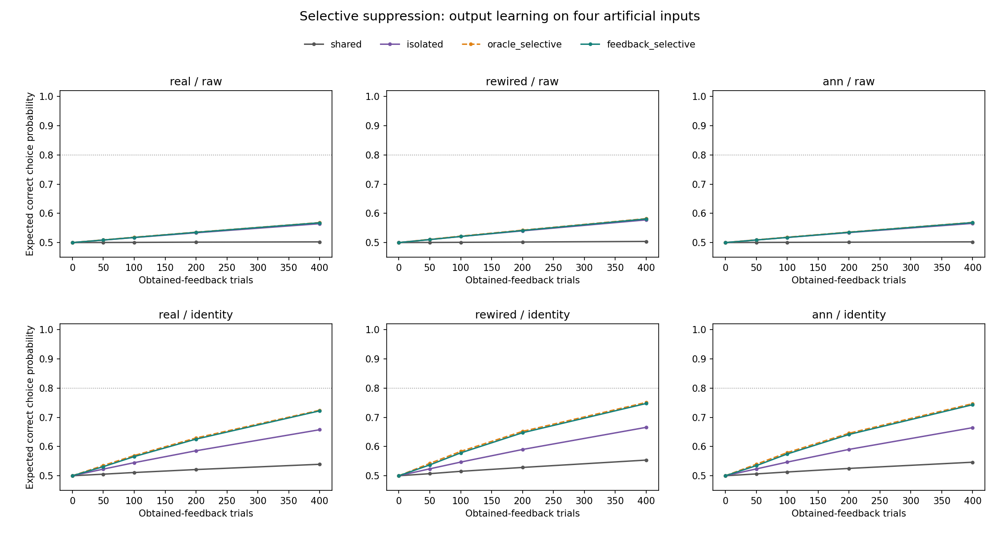

# 관측한 보상으로 방해되는 번짐만 줄인 실험 결과

2026-10-19 · `selective_spillover_v1` · 완료 태그 `selective-spillover-v1`

**보상 기록으로 방해만 줄인 방식은 기존 공유 방식보다 좋아졌지만, 번짐을 모두 막은 방식과의 차이는 작았다.**
사전에 정한 선택적 억제 우위와 충분한 습득 가설은 모두 미지지다. 실제 실행·정보 제한·수치 검사와 전체 독립 검산은 통과했다.

쉽게 말하면, 한 답을 고칠 때 다른 답까지 흔들리는 상황에서 “좋은 방향은 남기고 나쁜 방향만 막자”를
검사했다. 실제 보상으로 알게 된 문제만 판단에 사용했다. 방해를 막는 계산은 작동했지만, 같은 이동
길이로 맞추는 과정에서 자기 답을 고치는 힘과 남겨 둔 도움도 작아질 수 있다. 이번 조건에서는
전체 번짐 억제를 크게 넘어서는 학습 이득을 확인하지 못했다.

## 주 결과: 실제 부분 배선과 원 입력

숫자는 학습 후 네 연습문제에서 **정답 행동을 고를 기대 확률의 평균**이다. 실제 추출 행동의 정답률과 구분한다.

| 방식 | 마지막 기대 정답 확률 | 습득 통과 | 실제 누적 출력 이동 길이 평균 |
|---|---:|---:|---:|
| 기존 공유 | 50.23% | 0/10 | 9.62 |
| 전체 번짐 억제 | 56.46% | 0/10 | 9.91 |
| 정답표를 처음부터 준 선택 억제 진단 | 56.84% | 0/10 | 9.89 |
| **실제 보상 기록으로 선택 억제 — 주 조건** | **56.78%** | **0/10** | **9.88** |

주 조건은 공유보다 **+6.55%p**, 전체 억제보다 **+0.32%p**였다. 차이가 양수인 시드는 각각
10/10과 9/10이다. 모든 수치·정보 제한 검사는 통과했지만, 다음의 사전 기준은 넘지 못했다.

| 별도 사전 가설 | 판정 | 이유 |
|---|---|---|
| H_selective: 공유·전체 억제 각각보다 평균 5%p 이상 높고 각 비교에서 8/10 이상 시드가 개선 | **미지지** | 전체 억제 대비 +0.32%p로 5%p 미달 |
| H_acquisition: 충분히 습득한 시드가 8/10 이상 | **미지지** | 0/10 |

시드별 습득은 마지막 평균 ≥80%, 처음보다 ≥25%p 증가, Go 정답 두 문제와 NoGo 정답 두 문제 각각
≥70%를 모두 만족해야 한다. 두 가설은 독립적으로 판정했다. 5%p·8/10은 결과 전에 정한 실용적 기준이며
통계적 유의성이나 생물학적 경계가 아니다. 미지지가 효과 0이나 모든 선택 억제 방법의 불가능성을 뜻하지 않는다.

## 정답을 몰래 준 것은 아닌가

주 학습자는 처음에 네 보상 부호를 모두 모른다. 현재 입력에서 **실제 Go 선택으로 얻은 +1 또는 −1**만
그 입력의 관측 기록에 저장했다. NoGo의 보상 0으로는 모르는 정답을 알아내지 않았다.
같은 시행의 Go 보상을 먼저 기록한 뒤 그 기록으로 갱신 방향을 정했다. 아직 모르는 다른 입력의 영향은 원래대로 뒀다.

관측한 두 문제 사이에서 정답 쪽 점수에 해로운 항만 0으로 만드는 방향을 계산했다. 자기 영향·도움·
미관측 항은 정규화 전에는 보존되지만, 방향 길이를 1로 줄이면 남은 항도 같은 비율로 작아진다.
따라서 “도움의 방향을 남겼다”와 “도움의 크기를 그대로 유지했다”를 구분한다.

모든 조건은 실제 관측 기록 네 칸을 남겼다. 공유·전체 억제는 그 기록을 방향에 쓰지 않았고,
주 조건만 관측 기록으로 선택 억제했다. 이 기록은 **출력 가중치와 별도의 추가 학습 상태**다.
기록 활용과 추가 행렬 계산의 처리 비용까지 같게 맞췄다고 주장하지 않는다.

정답표 진단 조건은 처음부터 전체 정답 정보를 방향 계산에 사용했다. 주 조건에 이 정답표를
전달하지 않았다. 이 진단의 평균은 56.84%로 주 조건보다 +0.06%p였다. 현재 규칙·예산에서
초기 정보 차이의 최종 평균 차이가 작았다는 기술적 관찰이며, 통계적 동등성이나 정보가 불필요하다는 결론은 아니다.

## 보상 기록과 실제 답 선택은 다른 상태였다

주 조건의 10시드는 네 보상 부호를 모두 관측하는 데 8~32시행, 평균 17.6시행이 걸렸다.
마지막에는 24조건의 모든 240개 실행에서 네 부호가 기록돼 있었다. 그 기록을 직접 읽어
Go 또는 NoGo를 정하는 **정적 조회 참고**의 마지막 기대 정답 확률은 모두 100%였다.

실제 학습 정책은 이 조회표를 직접 답으로 사용하지 않고 고정 특징과 학습한 출력 계수로 선택했다.
조회 참고는 같은 시점에 쌓인 기록을 읽은 계산이며, 별도 조회 정책이 처음부터 행동·보상을 받으며
실행한 성적은 아니다. 출력 학습의 성공·새 문제 일반화로 대체하지 않는다.

그림 1. 왼쪽은 실제 부분 배선·원 입력의 관측된 보상 부호 수다. 네 조건의 평균선이 겹친다.
oracle의 실제 관측 기록도 0에서 시작하며 별도로 처음부터 받은 정답표는 이 선에 포함하지 않았다.
오른쪽 회색 막대는 정적 조회 참고, 색 막대는 실제 출력층의 마지막 성능이다.
이 차이는 필요한 보상을 끝까지 못 봤다는 설명만으로는 결과를 설명하기 어렵게 한다.
보상 기록을 출력 선택에 옮기는 과정과 방향·이동 제약이 추가 병목 후보지만, 유일한 원인을 확정하지 않는다.

## 전체 조건과 학습 과정

각 칸은 마지막 기대 정답 확률 평균과 습득 통과 시드 수다. 10개는 계산 시드이며 초파리 개체나 인간 참가자 수가 아니다.

| 배선 / 입력 | 공유 | 전체 억제 | 정답표 선택 억제 | 실제 보상 선택 억제 |
|---|---:|---:|---:|---:|
| 실제 / 원 입력 | 50.23% (0/10) | 56.46% (0/10) | 56.84% (0/10) | 56.78% (0/10) |
| 실제 / 이름표 | 53.93% (0/10) | 65.76% (0/10) | 72.43% (1/10) | 72.21% (1/10) |
| 재배선 / 원 입력 | 50.39% (0/10) | 57.77% (0/10) | 58.20% (0/10) | 58.08% (0/10) |
| 재배선 / 이름표 | 55.36% (0/10) | 66.56% (0/10) | 75.10% (2/10) | 74.73% (2/10) |
| 일반 대조 / 원 입력 | 50.24% (0/10) | 56.56% (0/10) | 56.91% (0/10) | 56.83% (0/10) |
| 일반 대조 / 이름표 | 54.63% (0/10) | 66.46% (0/10) | 74.69% (2/10) | 74.31% (1/10) |

이름표 표현에서 보상 기반 선택 억제는 실제 배선 72.21%·1/10, 재배선 74.73%·2/10,
일반 대조 74.31%·1/10이었다. 이 조건들은 기술적 대조이며 원 입력 주 조건의 실패를 대신하지 않는다.
어느 조건도 8/10 습득 기준에 도달하지 않았다. 실제 배선의 우수성을 입증하지 않았다.

그림 2. 0·50·100·200·400시행의 정적 평가를 연결한 10시드 평균이다. 점선 80%는 습득 기준 중 하나이며,
선만 넘는다고 전체 습득이 성립하지 않는다. oracle는 추가 정답 정보를 가진 진단 대조다.
표준편차·모든 시드·비용·보상 관측 시점은 원 요약과 CSV에 남겼다. 평균선은 신뢰구간이나 동물 개체 간 변이가 아니다.

## 실행·검산·보존

- 24조건·새 시드17401..17410·각400회로 **96,000회** 선택·획득 피드백을 한 번 실행했다.
- 출력층 정적 평가 4,800개와 보상 기록의 정적 조회 참고 4,800개를 구분했다. 조회 정책의 자율 학습 시행은 0회다.
- 60개 특징 그룹의 유지 rank4 및 수치 자격, 정답표 없이 가능한 81부호 상태×4source의 **19,440개** 방향 검사를 행동 난수 전에 마쳤다.
- 출력 갱신 호출 96,000회·실제 비영 출력 변화 47,260회, 보조 기억의 Go 관측 47,260회·새 부호 발견 960회를 별개로 기록했다. 내부·가치표 갱신은 0회다.
- 동적 방향 잔차 최대 약 2.25×10⁻¹⁴, 실제 출력 이동과 스칼라×단위 방향의 길이 잔차 최대 약 5.13×10⁻¹⁶으로 허용 오차1e-8 이하였다.
- 시행당 출력 L2 ≤.1·누적 ≤40·제곱 이동량 합 ≤4·최종 출력 길이 ≤누적 길이 검사를 통과했다. 실제 총 이동량과 계산 비용까지 같게 맞추지는 않았다.
- 독립 검산은 새 producer·선택 기하 helper를 import하지 않고 **175개 수치 배열·96,000개 행동/보상/방향/기억 기록·모든 checkpoint·두 가설**을 다시 계산했다.
- 실행 전 새 검사250개·관련 기존82개를 통과했다. EOF 빈 줄만 수정한 새 파일은 AST 동일성과 재검사를 기록했고 이전 초안도 보존했다.
- 이전18,742파일·2,039,126,449bytes를 세 가변 색인 외에는 원문 대조했다. 이후 완료 검사는 기존 경로 Git 차이와 새 해시를 결합하며 같은 시점의 두 번째 전수 대조로 설명하지 않는다.

원자료: [요약과 모든 시드](../results/selective_spillover_v1/summary.json), [독립 검산](../results/selective_spillover_v1/verification.json),
[실행 전 등록](../results/registration_selective_spillover_v1.json), [고정 계획](selective-spillover-protocol.md),
[재현 안내](selective-spillover-reproduction.md).

이전의 56.92% 등과 이번 56.46%는 서로 다른 고정 시드 집단의 결과다. 이전 관측값을 이번 값으로 바꾸지 않았다.
기존 성공·실패·원자료·소스·Phase5 첫 종합과 인간 유사성 미지지도 그대로다.

## 해석 범위와 다음 후보

알려진 네 인공 문자열의 출력 학습과 보조 보상 기억(Level2)에 한정한다. 전체 문자열과 입력 식별자를
제공했으며, 네 문제를 기억하는 단순 조회로 풀 수 있다. 수학 규칙 이해·새 문자열 일반화(Level3),
실제 LC11 시각 수량 회로·내부 시냅스 가소성, 인간 유사성(Level4)·공통 신경 기작(Level5)·교육 효과를
새로 입증하지 않았다. 기존 맥락별 공동 습득·간섭·순서의 닫힌 선행 조건도 그대로다.

다음 후보는 **저장한 정규화 비율과 영향만으로, 방해를 막는 대가로 자기 수정과 남겨 둔 도움이 얼마나
약해졌는지 나누는 분석**이다. 네 보상 부호를 모두 관측한 전후를 구분할 수 있다. 이번에는 실행하지 않았고
별도 분석 계획·등록이 필요하다. 원 입력과 이름표의 차이를 기하학적 지표와 연결하더라도 유일 원인을 확정하지 않는다.
새 seed·예산 연장·더 큰 모델로 같은 등록의 미지지를 성공으로 바꾸지 않는다. 이번 단일 요청을 마쳤으며 자동 이어가기는 PAUSED다.
