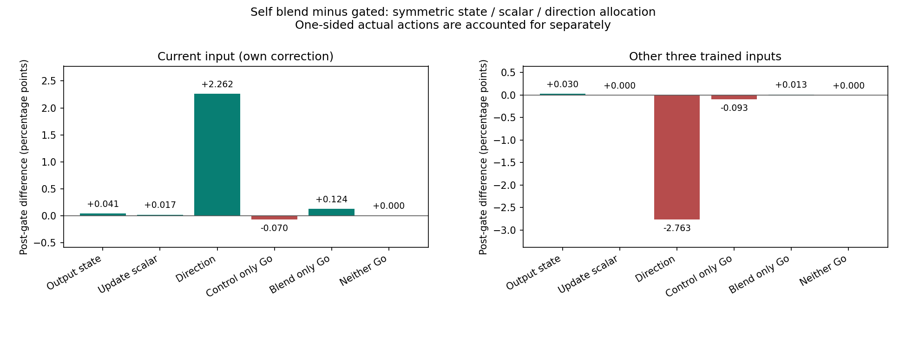
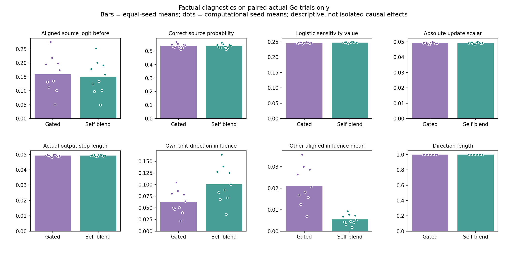
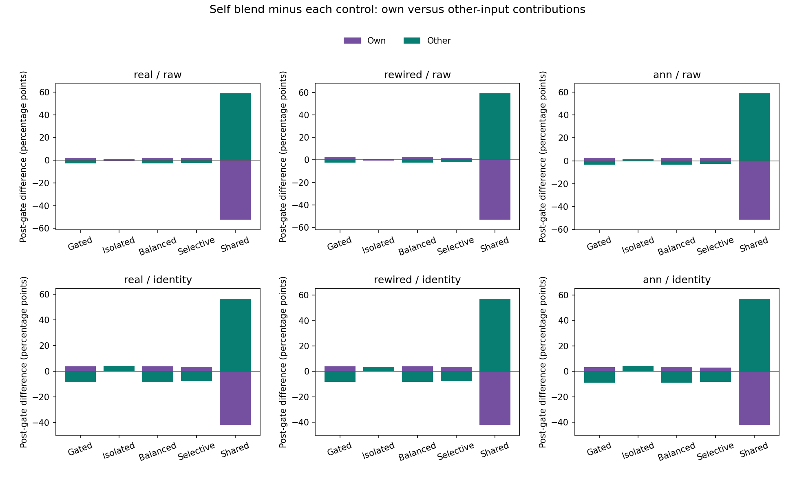

# 자기 수정은 회복됐는데 도움은 왜 더 크게 줄었나

저장된 `self_blend_learning_v1` 기록을 사용한 별도 후향 기술 분석 `self_blend_factors_v1`이다. 새 학습·새 비율 탐색·난수·그래프·방향 최적화는 모두0회다. 부모 결과를 이미 알고 분석을 정했으므로 새로운 독립 효과 가설 검정이라고 부르지 않는다.

주 real/raw의 새 혼합−기존 전환형 균형 차이를 나누면 자기 기여 **+2.3741%p**, 다른 문제 기여 **-2.8127%p**, 합계 **-0.4386%p**다. 독립 검산을 통과했다.

## 쉽게 설명하면

이번 3:1 규칙은 자기 문제에 집중하는 방향을 많이 넣었다. 그 방향은 다른 문제를 거의 움직이지 않으므로, 다른 문제를 돕는 일은 남겨 둔 균형 방향에 주로 의존한다. 전체 수정 길이를 다시 맞춰도 다른 문제로 향하는 성분이 크게 줄었다.

장부에서 방향 몫은 자기 문제 **+2.2619%p**, 다른 문제 **-2.7632%p**였다. 자기 쪽에서 얻은 양보다 다른 문제에서 잃은 양이 컸다. **이번 분해에서 수정 크기는 도움 손실의 큰 몫으로 나타나지 않았다.** 양쪽 모두 실제로 고친 같은 시행에서 새 방식의 한 번 수정 길이는 오히려 조금 컸다.

이것은 고정한 대칭 계산법으로 실제 기록의 차이를 나눈 결과다. 방향만 독립적으로 바꾸면 다음 학습의 성적이 이만큼 변한다는 실험적 인과 증명은 아니다.

## 세 요소와 실제 선택을 나눈 장부

고치기 직전의 출력 상태, 실제 수정 스칼라, 수정 방향을 두 실제 경로에서 하나씩 가져와8개의 단일 수정 값을 계산했다. 교체 순서를 모두 평균해 세 요소의 몫을 나눴다. 참조 새 방식의 보상 기억이 피드백 전에 네 칸 모두 채워진 후반에서, 양쪽 모두 실제 Go인 시행만 교차했다. 한쪽만 Go는 그 실제 효과를 별도 나머지로 보존했다.

비교는 **새 혼합 − 기존 전환형 균형**, 단위는 최종 네 연습 입력 평균에 대한 기여 %p다. 합계는 같은 시드10개에 같은 비중을 준 평균이다.

| 배분 항목 | 자기 문제 기여 차이 | 다른 세 문제 기여 차이 |
|---|---:|---:|
| 수정 전 출력 상태 | +0.040985%p | +0.029761%p |
| 실제 수정 크기 계수 | +0.016613%p | +0.000161%p |
| 수정 방향 | +2.261946%p | -2.763195%p |
| 기존 방식만 실제 Go | -0.069504%p | -0.092553%p |
| 새 방식만 실제 Go | +0.124073%p | +0.013140%p |
| 둘 다 NoGo | +0.000000%p | +0.000000%p |
| **후반 전체** | **+2.374113%p** | **-2.812686%p** |

주 비교의 후반 실제 시행은3,873개다. 양쪽 Go 1,921, 기존만 Go 44, 새 방식만 Go 33, 둘 다 NoGo 1,875를 모두 남겼다. 한쪽만 Go인 차이를 방향의0벡터 비교로 바꾸지 않았다. 양쪽 Go의 차이는 세 요소 합으로, 전체 후반은 세 요소와 실제 나머지 합으로 돌아온다.

## 1. 방향 — 다른 문제를 향하는 성분이 약4분의1로 줄었다

같은 후반·양쪽 실제 Go 시행에서 새 방식에 넣은 B 재료와 기존 gated의 실제 방향이 같음을 확인했다. 이 범위에서만 다음 식이 성립한다. I는 자기 집중 방향, B는 기존 균형 방향이며 n은 혼합 전 길이다.

```text
w = (0.75 I + 0.25 B) / n
다른 문제에 주는 단위 점수 영향 ≈ (0.25/n) × B의 다른 문제 영향
자기 영향 = (0.75×I 자기 영향 + 0.25×B 자기 영향) / n
```

주 조건에서 시드별 평균을 같은 비중으로 평균한 n은 **0.98458452**, 각 시행의 `0.25/n` 배율 평균은 **0.25399124 (약25.40%)**였다. 전체 대상의 배율 범위는0.25000000..0.26875127다. `평균 배율`을 `평균 영향의 비`나 `0.25/평균 n`으로 대신 계산하지 않았다.

| 양쪽 Go의 조건부 진단 | 기존 전환형 균형 | 새 혼합 |
|---|---:|---:|
| 자기 입력의 단위 방향 점수 영향 | 0.06255431 | 0.10066952 |
| 다른 입력의 정답 정렬 단위 영향 평균 | 0.02115474 | 0.00543317 |
| 방향 길이 | 1.00000000 | 1.00000000 |

길이는 두 방향 모두1이지만 어디를 향하느냐가 달랐다. I의 다른 입력 영향은 수치 오차 안에서0이므로 그 입력들은 B 성분이 줄어든 만큼 도움 방향을 잃는다. 자기 입력은 I 성분이 더해져 회복된다. B 재료 일치·다른 영향식·자기 혼합식·n·전체 w의 다섯 항등식을60배선/표현/시드에서 모두 확인했다.

이 약25%는 **같은 조건의 단위 점수 영향에 곱하는 배율**이다. 실제 도움 확률·최종 성적25% 보존을 뜻하지 않는다. 방향 영향 평균의 비와 각 시행 배율의 평균도 일반적으로 다르다. 다른 실제 선택·다른 대조·전환 전까지 B가 같다는 주장으로 확대하지 않는다.

## 2. 수정 크기 — 두 방식이 함께 고친 시행에서는 새 방식이 조금 더 움직였다

양쪽 실제 Go에서 한 번 수정 길이의 시드별 평균은 기존 **0.04921811**, 새 방식 **0.04932462**였다. 실제 스칼라 절댓값도 각각0.04921811/0.04932462이고 방향 길이는1이다. 새 방식이 약간 더 크게 고쳤다. 크기 몫은 자기+0.016613%p·다른 문제+0.000161%p로, 방향의 도움 손실을 설명할 만큼 크지 않았다.

실제 g는 학습률0.1 자체가 아니라 `0.1*(실제 행동−현재 Go확률)*획득 보상`이다. 공통 수정량 **상한**은 같지만 실제 누적 길이·Go 횟수·계산 비용을 같게 맞춘 실험은 아니다. 조건부 단일 수정 평균으로 전체 자원이 동일하다고 주장하지 않는다.

## 3. 출력 상태 — 주 손실의 몫이 작았다

수정 직전 현재 입력의 정답 선택 확률은 기존53.9287%/새53.6924%, 정답 정렬 logit는0.15906871/0.14856458였다. 로지스틱 민감도 참고 값은0.24676696/0.24785042다. 상태 몫은 자기+0.040985%p·다른 문제+0.029761%p로, 이번 주 비교에서는 도움 감소를 상쇄하는 작은 양수였다.

출력 포화 때문에 도움이 크게 사라졌다는 설명이 이번 고정 장부의 주 손실 몫은 아니었다. 이는 조건부 평균과 대칭 배분의 결론이며 모든 입력의 상태가 같다는 뜻은 아니다. 민감도 참고 값이나 평균 크기·평균 방향을 곱해 실제 평균 확률 변화를 대신하지 않았다.

## 도움이 줄었나, 새로운 방해가 생겼나

다른 입력의 양수 도움 질량 차이는-2.812686%p이고, 음수 방해 질량 차이는-1.33e-13%p였다. 후자는 수치 잔차 규모다. 따라서 주 비교의 후반 손실은 새 방해가 크게 증가했다기보다 **기존에 얻던 도움이 줄어든 모습**이었다. tiny 부호를0으로 지우지 않았고 원값을 저장했다.

양수·음수 부분은8셀 각각에서 먼저 구한 뒤 따로 배분했다. 양수 질량 배분이 음수인 것은 해당 요소에 도움 감소분이 배정됐다는 뜻이다. 배분의 음수를 실제 새로운 피해 시행과 동일시하지 않는다. 전환 전·미관측 보호에 대한 부모 판정도 바꾸지 않았다.

## 모든 배선·표현·대조의 장부

주 설명은 real/raw의 기존 gated와의 비교다. 다른 대조에도 같은 설명을 억지로 옮기지 않도록30비교 전체를 보존했다. 아래 값은 %p이며, 한쪽 Go는 두 실제 나머지의 합이다. 누적 기여는 최종 정답률 자체가 아니다.

### 자기 문제

| 배선 | 표현 | 대조 | 상태 | 크기 | 방향 | 한쪽 Go | 후반 합계 |
|---|---|---|---:|---:|---:|---:|---:|
| real | raw | 기존 전환형 균형 | +0.0410 | +0.0166 | +2.2619 | +0.0546 | +2.3741 |
| real | raw | 번짐 차단 | -0.0115 | -0.0054 | -0.6388 | -0.0235 | -0.6792 |
| real | raw | 항상 균형 | +0.0402 | +0.0107 | +2.2416 | +0.0977 | +2.3902 |
| real | raw | 관측 방해 선택 차단 | +0.0002 | -0.0029 | +2.2754 | +0.0685 | +2.3412 |
| real | raw | 공유 | +0.3704 | +2.1252 | -50.0550 | -4.8139 | -52.3733 |
| real | identity | 기존 전환형 균형 | +0.7363 | +0.4208 | +2.2227 | +0.5148 | +3.8946 |
| real | identity | 번짐 차단 | -0.4608 | -0.2545 | +1.0511 | -0.1620 | +0.1738 |
| real | identity | 항상 균형 | +0.7678 | +0.4825 | +2.2050 | +0.5145 | +3.9697 |
| real | identity | 관측 방해 선택 차단 | +0.6034 | +0.3927 | +2.0342 | +0.4457 | +3.4760 |
| real | identity | 공유 | -1.6892 | +0.2403 | -34.2741 | -6.1163 | -41.8392 |
| rewired | raw | 기존 전환형 균형 | +0.0211 | +0.0367 | +2.1114 | +0.0321 | +2.2013 |
| rewired | raw | 번짐 차단 | -0.0051 | -0.0091 | -0.6257 | +0.0142 | -0.6256 |
| rewired | raw | 항상 균형 | +0.0212 | +0.0327 | +2.0999 | +0.0423 | +2.1961 |
| rewired | raw | 관측 방해 선택 차단 | +0.0027 | +0.0022 | +2.0645 | +0.0294 | +2.0987 |
| rewired | raw | 공유 | +0.3755 | +2.4014 | -51.2265 | -4.7313 | -53.1809 |
| rewired | identity | 기존 전환형 균형 | +0.6178 | +0.4057 | +2.4261 | +0.4119 | +3.8616 |
| rewired | identity | 번짐 차단 | -0.3809 | -0.2942 | +0.8504 | -0.1441 | +0.0311 |
| rewired | identity | 항상 균형 | +0.6383 | +0.4746 | +2.4168 | +0.3880 | +3.9177 |
| rewired | identity | 관측 방해 선택 차단 | +0.4690 | +0.3351 | +2.4305 | +0.3901 | +3.6246 |
| rewired | identity | 공유 | -1.4489 | +0.6290 | -35.4748 | -5.9414 | -42.2360 |
| ann | raw | 기존 전환형 균형 | +0.0468 | +0.0080 | +2.4934 | +0.1072 | +2.6554 |
| ann | raw | 번짐 차단 | -0.0179 | -0.0044 | -0.6431 | +0.0368 | -0.6285 |
| ann | raw | 항상 균형 | +0.0429 | +0.0017 | +2.4564 | +0.1397 | +2.6406 |
| ann | raw | 관측 방해 선택 차단 | +0.0061 | +0.0193 | +2.4901 | +0.0566 | +2.5721 |
| ann | raw | 공유 | +0.2746 | +2.2179 | -49.0750 | -4.9090 | -51.4915 |
| ann | identity | 기존 전환형 균형 | +0.6935 | +0.4184 | +1.8716 | +0.4865 | +3.4700 |
| ann | identity | 번짐 차단 | -0.4354 | -0.2558 | +1.2729 | -0.1701 | +0.4115 |
| ann | identity | 항상 균형 | +0.7289 | +0.4776 | +1.8749 | +0.4459 | +3.5273 |
| ann | identity | 관측 방해 선택 차단 | +0.5943 | +0.3924 | +1.8330 | +0.3084 | +3.1281 |
| ann | identity | 공유 | -1.6077 | +0.4346 | -34.8782 | -6.1539 | -42.2053 |

### 다른 세 입력

| 배선 | 표현 | 대조 | 상태 | 크기 | 방향 | 한쪽 Go | 후반 합계 |
|---|---|---|---:|---:|---:|---:|---:|
| real | raw | 기존 전환형 균형 | +0.0298 | +0.0002 | -2.7632 | -0.0794 | -2.8127 |
| real | raw | 번짐 차단 | -0.0017 | -0.0002 | +0.9748 | +0.0017 | +0.9746 |
| real | raw | 항상 균형 | +0.0298 | -0.0111 | -2.7371 | -0.0765 | -2.7948 |
| real | raw | 관측 방해 선택 차단 | -0.0009 | -0.0043 | -2.3685 | -0.0242 | -2.3980 |
| real | raw | 공유 | -0.4813 | -1.8844 | +56.3858 | +4.9765 | +58.9966 |
| real | identity | 기존 전환형 균형 | +0.4734 | +0.2289 | -9.2109 | -0.0820 | -8.5906 |
| real | identity | 번짐 차단 | -0.0648 | -0.0338 | +3.8906 | +0.0773 | +3.8692 |
| real | identity | 항상 균형 | +0.4956 | +0.2526 | -9.1183 | -0.1403 | -8.5104 |
| real | identity | 관측 방해 선택 차단 | +0.3626 | +0.2294 | -8.2432 | -0.0695 | -7.7208 |
| real | identity | 공유 | +0.7285 | -0.1839 | +49.8504 | +6.0987 | +56.4937 |
| rewired | raw | 기존 전환형 균형 | +0.0144 | -0.0155 | -2.3982 | -0.0159 | -2.4152 |
| rewired | raw | 번짐 차단 | -0.0008 | +0.0009 | +0.8263 | +0.0047 | +0.8311 |
| rewired | raw | 항상 균형 | +0.0137 | -0.0104 | -2.3853 | -0.0411 | -2.4231 |
| rewired | raw | 관측 방해 선택 차단 | +0.0005 | +0.0058 | -2.1367 | -0.0389 | -2.1693 |
| rewired | raw | 공유 | -0.4857 | -2.1945 | +57.0285 | +4.8624 | +59.2107 |
| rewired | identity | 기존 전환형 균형 | +0.3956 | +0.2266 | -8.8605 | -0.1002 | -8.3386 |
| rewired | identity | 번짐 차단 | -0.0510 | -0.0359 | +3.6482 | +0.0872 | +3.6485 |
| rewired | identity | 항상 균형 | +0.4106 | +0.2562 | -8.7842 | -0.1415 | -8.2590 |
| rewired | identity | 관측 방해 선택 차단 | +0.2646 | +0.1841 | -7.8715 | -0.1186 | -7.5414 |
| rewired | identity | 공유 | +0.6410 | -0.3408 | +51.0170 | +5.9076 | +57.2249 |
| ann | raw | 기존 전환형 균형 | +0.0344 | +0.0164 | -3.2167 | -0.0620 | -3.2279 |
| ann | raw | 번짐 차단 | -0.0024 | -0.0015 | +1.1319 | +0.0106 | +1.1385 |
| ann | raw | 항상 균형 | +0.0305 | +0.0191 | -3.1735 | -0.0934 | -3.2173 |
| ann | raw | 관측 방해 선택 차단 | +0.0013 | +0.0034 | -2.7669 | -0.0428 | -2.8051 |
| ann | raw | 공유 | -0.4090 | -1.9298 | +56.2929 | +5.0758 | +59.0299 |
| ann | identity | 기존 전환형 균형 | +0.4382 | +0.2308 | -9.3298 | -0.1376 | -8.7984 |
| ann | identity | 번짐 차단 | -0.0574 | -0.0304 | +3.9238 | +0.0808 | +3.9167 |
| ann | identity | 항상 균형 | +0.4612 | +0.2743 | -9.2845 | -0.1993 | -8.7483 |
| ann | identity | 관측 방해 선택 차단 | +0.3396 | +0.2264 | -8.4869 | -0.1728 | -8.0936 |
| ann | identity | 공유 | +0.7510 | -0.2245 | +50.6777 | +5.9745 | +57.1787 |

## 검증과 보존

사전 검사295개(새203·관련 기존92)와 전수 독립 검산을 통과했다. 소스22·부모13파일을 고정하고 비공개 원격 등록 bytes를 확인한 뒤 집계했다. 과학 소스는`a050fda72e31683961872c8d6c2c7d197d4face3`, 게시 커밋은`64f5bca3a889da56c2244c958cc842c5b90c55a4`다.

원144,000시행·576,000목적지 효과,후반 짝시행116,190개 중 양쪽Go56,889개에 대한1,820,448교차 목적지 계산,14배열·3,600행15열·300짝 경로를 검산했다. 같은 참조 경로를 대조마다 재사용하므로 독립 실험300개가 아니다.

원래 그림의 여섯 방법 후반 장부와 새 q 합계의 최대 잔차는 9.30e-16이었다. 전체 회계·혼합 항등식의 최대 잔차는 1.94e-15로 문턱 1e-8보다 작았다. 원래 201배열·943최적화의 독립 검산은 원문 영수증과 Git/원자료 해시로 재사용했다. 새 학습·가중치 갱신·난수·모델/그래프·최적화는 0회다.

이전19,060완료 파일/2,387,949,515bytes의 Git blob 해시를 확인했다. 세 상태 인덱스 외에 과거 완료파일을 바꾸지 않았다. 사전 마감 형식검사에서 신규 검사 파일의 끝 빈 LF두바이트를 정리했고, 원본295통과JUnit·검사·옛 영수증을 ZIP으로 보존했다. 최초 note의 ‘한 줄’이라는 설명보다 원문 bytes를 우선하며, 최종 봉인에 실제 제거량2와 나머지21소스 불변을 명시한다. 과학 기준·입력·원래 실패 판정은 바꾸지 않았다.

## 그림







## 해석 한계

고정8셀의 대칭 Shapley 배분은 순서를 평균한 장부이며 유일한 원인 비율이 아니다. 혼합 상태에서g를 새로 계산하지 않으므로 일부 셀은 실제 보상 학습 규칙을 동시에 만족하지 않는 수학적 대입이다. 이후 선택·보상·기억을 실행한 새 정책의 성적 예측이 아니다.

학습된 출력 계수와 별도 획득 보상 기억, 고정 내부 KC→MBON 가중치·인코더·같은 입력의 활성을 구분한다. 네 인공 전체 문자열을 연습한 계산 모델이며 계산 시드는 동물/사람이 아니다. 새 수량 인지·내부 생물학적 학습·미학습 입력/규칙 일반화·인간 유사성·공통 신경 기작·교육 효과를 입증하지 않았다.

부모의 실용 개선·충분한 습득 미지지와 설계상 미관측 보호 통과, 기존 인간 비교 음성 결과·Phase5·닫힌 일반화/간섭/순서 문턱을 유지한다. 다른 비율이나 더 나은 학습 규칙은 이번 분석으로 검증하지 않았다. 후속 실제 개입에는 별도 고정 계획·자원 통제·관측 정보·습득/보호 기준과 실행 전 등록이 필요하다. 이번 단일 분석 뒤 자동 반복은 PAUSED다.
