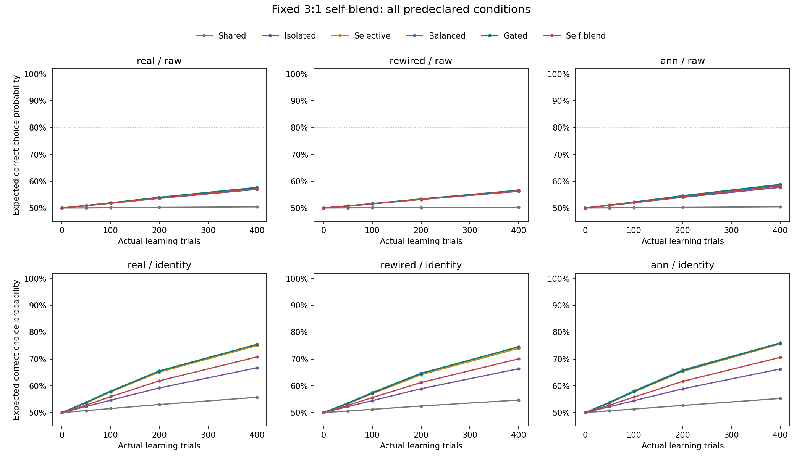
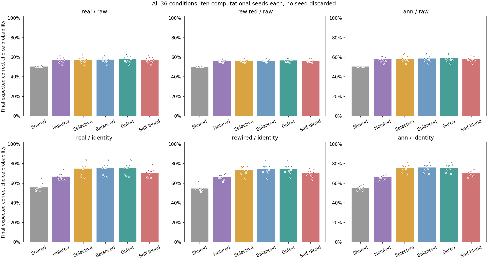
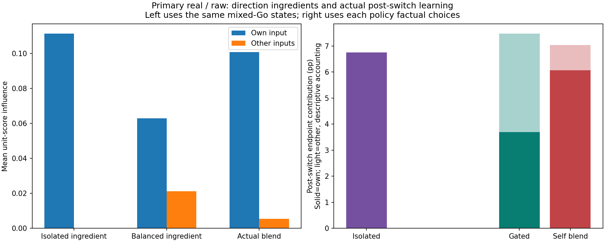

# 자기 수정 우선 혼합 방식의 실제 학습 결과

새 연구 `self_blend_learning_v1`를 사전 등록한 규칙 그대로 끝까지 실행하고 독립 검산했다. 새 계산 시드10개에서 여섯 방법을 함께 비교했다. 이전 연구의 결과나 실패는 바꾸지 않았다.

주 real/raw 조건의 새 방식 최종 정답 선택 확률은 **57.2487%**다. 기존 초반 차단→균형 대비 **-0.4386%p**, 번짐 차단 대비 **+0.2954%p**다. 사전 5%p 개선 가설은 **미지지**, 충분한 습득 가설은 **미지지**, 미관측 입력 보호는 **통과**다.

## 쉽게 설명하면

자기 문제를 고쳐 얻은 성적 기여는 기존 전환형 균형 방식보다 **2.3741%p 늘었지만**, 다른 문제를 도와 얻던 기여는 **2.8127%p 줄었다**. 합계는 약 **−0.4386%p**다. 자기 수정은 회복됐고 도움이 되는 번짐도 일부 남았으나, 이번 3:1 비율에서는 잃은 도움이 더 컸다. 이는 실제 선택 경로를 나눈 보조 장부이며 유일한 원인 분해는 아니다.

한 문제를 고칠 때 다른 문제에 영향이 퍼지는 것을 ‘번짐’이라고 불러 왔다. 이번에는 답의 보상 부호를 네 종류 모두 직접 얻기 전까지 번짐을 막았다. 그 뒤에는 자기 문제에 집중하는 방향3과 기존 균형 방향1을 섞고, 전체 방향 길이를1로 맞췄다. 비율은 실행 전에 한 번 정했으며 다른 비율을 찾아 돌리지 않았다.

아래 성적은 네 **연습 입력**에서 모델이 정답 행동을 선택할 확률이다. 실제 시험 정답 개수나 새로운 문제의 일반화 성적을 뜻하지 않는다. 미관측은 ‘처음 보는 입력’이 아니라 ‘아직 실제 Go 보상 부호를 얻지 못한 연습 입력’이다.

## 사전 기준과 주 조건

H_gain은 새 방식이 기존 gated·항상 균형·번짐 차단 각각보다 평균5%p 이상 높고 각 비교에서10개 중8개 이상의 시드가 개선돼야 통과한다. H_acquisition은 최종80%·초기 대비25%p 향상·두 클래스 각각70%를 모두 만족하는 시드가8개 이상이어야 한다. 두 가설은 별개다.

| 방법 | 최종 정답 선택 확률 | 충분한 습득 시드 | 누적 실제 수정 길이 | 미관측 다른 입력 방해 합계 |
|---|---:|---:|---:|---:|
| 공유 | 50.4177% | 0/10 | 9.875070 | 0.0753997341025 |
| 번짐 차단 | 56.9532% | 0/10 | 9.974229 | 0 |
| 관측한 방해만 차단 | 57.2477% | 0/10 | 9.910666 | 0.0382310602693 |
| 항상 균형 | 57.5135% | 0/10 | 9.912973 | 0.0466409978924 |
| 초반 차단→균형 | 57.6872% | 0/10 | 9.962099 | 0 |
| 초반 차단→자기 우선 혼합 | 57.2487% | 0/10 | 9.953637 | 0 |

| 새 방식과 대조의 차이 | 평균 차이 | 양수인 시드 | 5%p·8시드 동시 통과 |
|---|---:|---:|---|
| 새 방식 − 초반 차단→균형 | -0.4386%p | 1/10 | 아니오 |
| 새 방식 − 항상 균형 | -0.2648%p | 3/10 | 아니오 |
| 새 방식 − 번짐 차단 | +0.2954%p | 10/10 | 아니오 |

미관측 방해는 시행마다 해당 목적지의 정답 선택 확률이 줄어든 양만 모아400시행 전체에서 합한 값이다. 최종 성적의 %p 차이나 노출당 평균으로 바꾸지 않았다. 새 방식의 주 조건 최대 시드 방해 합계는 0로 사전 허용 오차1e-8과 비교했다. 기존 gated와 번짐 차단 각각에 대해 모든10시드의 비악화를 별도로 확인했다. 초반 번짐0·완전 관측 뒤 미관측 목적지0이라는 설계상 예상이므로 새로운 학습 기작의 발견은 아니다.

## 자기 수정과 도움은 실제로 어떻게 달라졌나

단위 방향의 효과와 실제 학습 성적을 나눠 확인했다. 아래 첫 표는 **새 방식이 실제 혼합을 한 동일한 Go 시행**에서 I·B·혼합을 나란히 계산한 기술 지표다. 먼저 시드별 평균을 구한 뒤10시드를 같은 비중으로 평균했다. 다른 경로끼리의 인과 효과나 별도 학습 정책의 성적 비교가 아니다.

| 같은 혼합 Go 시행의 방향 재료 | 자기 입력 점수 영향 | 다른 입력의 정답 방향 점수 영향 평균 |
|---|---:|---:|
| 자기 집중 I | 0.11141977 | ≈0 (수치 허용 오차 안) |
| 기존 균형 B | 0.06280721 | 0.02108089 |
| 실제 혼합 | 0.10082173 | 0.00541386 |

새 방식은 실제 혼합 Go 1954시행에서 자기 영향≥0.75I·각 도움이 되는 다른 목적지 영향≥0.25B의 **단위 점수 하한**을 검산했다. 다섯 잔차 전체 최대는4.8e-15다. 원 B의 안전/최적성 인증과 실제 혼합 방향을 별도 보존했다. 이 하한을 ‘실제 성적75%·도움25% 보존’으로 읽을 수 없다. 실제 수정 스칼라, 행동과 확률은 학습 경로마다 달라진다.

실제 후반 학습은 새 방식의 전환 시점을 공통 시간 경계로 삼아 자기 입력/다른 입력의 정답 선택 확률 변화로 나눴다. 아래 값은 시행별 변화의 합을 네 입력으로 나눈 최종 평균 기여다. 같은 prefix를 가진 세 방법의 비교이며, 정답 선택 확률의 변화에 대한 장부로 해석한다. NoGo와 서로 다른 실제 선택을 버리지 않았다.

| 실제 후반 경로 | 자기 입력 기여 | 다른 입력 기여 | 합계 |
|---|---:|---:|---:|
| 번짐 차단 | +6.7439%p | -0.0000%p | +6.7439%p |
| 초반 차단→균형 | +3.6907%p | +3.7873%p | +7.4779%p |
| 초반 차단→자기 우선 혼합 | +6.0648%p | +0.9746%p | +7.0394%p |

기존 gated 대비 후반 자기 기여 차이는 +2.3741%p, 다른 입력 기여 차이는 -2.8127%p다. 자기 방향을 더 남기는 규칙이 실제 경로에서 어떤 교환을 만들었는지는 이 두 값을 함께 봐야 한다. 이 표는 상태·스칼라·방향을 독립 원인으로 분리한 추가 실험이 아니며 유일한 인과 설명도 아니다.

## 수정량과 실제 비용

모든 방법의 한 번 수정 길이≤0.1,400시행 누적 길이≤40,제곱합≤4 및 최종 길이≤누적 길이를 확인했다. 누적 수정 길이와 실제 Go 횟수까지 같게 맞춘 실험은 아니다. 혼합 계산·관측 기억·최적화 처리 비용도 동일하지 않다. 위 표에 실제 경로 길이를 함께 적었다.

새 방법의 최초 혼합 모드 시행은 주 조건에서 [8, 20, 8, 15, 12, 12, 13, 22, 13, 14]다. 네 번째 부호를 얻는 시행은 여전히 분리 방향이며 그 다음 시행부터 전환한다. 모든60특징 조건의 새 방식과 기존 gated는 번짐 차단 경로와 네 번째 발견 시행까지 기록 bytes가 같다. 최초 전환이 NoGo면 모드 사건만 기록하고 수정/solver는0이다.

## 모든 사전 조건

real/raw만 주 가설을 판정한다. 나머지 조건은 유리하다는 이유로 주 조건을 대신하지 않는다. 아래는 같은 새 시드 집단의 최종 평균이다. identity는 네 전체 문자열의 신원을 공급한 인공 표현이다.

| 배선 | 표현 | 공유 | 번짐 차단 | 선택 차단 | 항상 균형 | 초반 차단→균형 | 새 혼합 |
|---|---|---:|---:|---:|---:|---:|---:|
| real | raw | 50.4177% | 56.9532% | 57.2477% | 57.5135% | 57.6872% | 57.2487% |
| real | identity | 55.6910% | 66.7041% | 75.0010% | 75.4257% | 75.4432% | 70.7471% |
| rewired | raw | 50.2025% | 56.2154% | 56.4378% | 56.5026% | 56.6348% | 56.4209% |
| rewired | identity | 54.6642% | 66.3607% | 73.9769% | 74.5325% | 74.5173% | 70.0403% |
| ann | raw | 50.4459% | 57.7114% | 58.3996% | 58.6504% | 58.7940% | 58.2214% |
| ann | identity | 55.2565% | 66.2753% | 75.6155% | 76.0166% | 75.9319% | 70.6035% |

## 검증과 보존

- 사전 자동검사342개 통과: 새234개+관련 기존108개. 실제 코호트 전 가상 개발 오류 두 실행의 원본 소스·검사·JUnit을 ZIP과 SHA로 보존했다.
- 소스44·부모11·그래프4·입력2파일 해시 및 실행 전 비공개 원격 게시 bytes를 확인했다. 소스 `7507ba8321b556652d3f2fd33b0b4dc7d3798e6a`, 게시 `7eb5e4d35216ed3cf6245196f01cc27e3760f771`.
- 144,000실제 선택/획득 보상,360출력 경로,60고정 특징,7,200정적 평가를201배열·144,000행87열로 저장했다. 독립 검산이 모든 선택·관측·머리 계수·B 인증·혼합·방해·요약을 재계산했다.
- 실제 관측 상태의 유일 B 최적화 인증943개,전체 균형 방향 요청35,523건,새 혼합 실행11,693건을 구별한다.
- 내부 KC→MBON 가중치·인코더·bias·같은 입력의 내부 활성은 시작/종료가 동일하다. 학습된 것은 출력 계수와 별도 획득 보상 부호 기억이다.
- 이전 완료파일19,023개(2,287,582,857bytes)의 Git blob 해시를 확인했고 세 상태 인덱스만 갱신했다. 이전 DrosoMem과 모든 실패·결과를 보존한다.

## 그림과 해석 경계

네 인공 전체 문자열을 반복 연습한 출력 학습이다. 새 수량 인지·새 규칙/입력 일반화·내부 생물학적 가소성·인간 유사성·공통 신경 기작·교육 효과를 입증하지 않았다. 계산 시드는 동물이나 사람이 아니다. 사전 기준을 넘지 못했다면 닫힌 일반화·간섭·순서 연구 문턱을 그대로 유지한다.

다음으로 유용한 작업은 이 새 기록에서 자기 기여가 얼마나 회복되고 어떤 도움을 잃었는지, 실제 선택·출력 상태·단위 방향을 나눠 기술하는 것이다. 새 비율 탐색이나 후속 학습은 이번에 실행하지 않았다. 자동 반복은 PAUSED로 유지한다.
