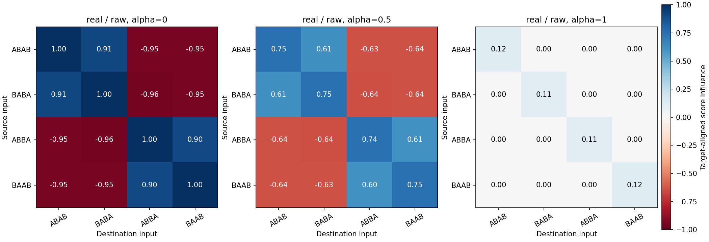
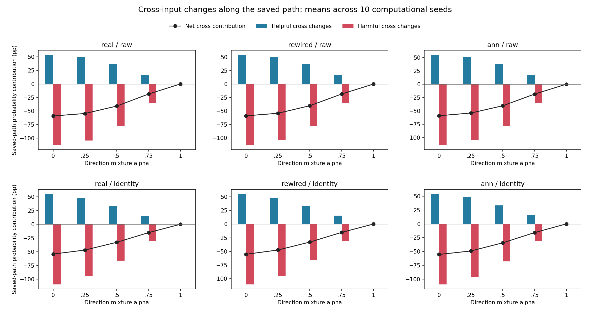

# 도움이 된 번짐과 방해가 된 번짐: 저장 결과 분석

2026-10-19 · `signed_spillover_v1` · 완료 태그 `signed-spillover-v1`

**번짐에는 도움과 방해가 모두 있었다. 이번 저장 경로에서는 방해의 합이 더 컸고, 자기 답을 고친 이득을 크게 상쇄했다.**
새로 학습하지 않고 이전 12만 회 기록을 분석했으며, 전체 독립 검산을 통과했다.

쉽게 말하면, 답안을 고칠 때 서로 연결된 다른 답안도 움직이는 상황이다. 두 문제 모두 Go가 정답이면
같이 Go 쪽으로 움직이는 것이 도움이 될 수 있다. 그러나 다른 문제의 정답이 NoGo라면 같은 움직임이
방해가 될 수 있다. 이번 계산에서는 각 움직임이 **영향을 받은 문제의 정답 쪽인지 오답 쪽인지**를 직접 확인했다.

## 가운데 절충 방식에서 무슨 일이 있었나

실제 부분 배선·원 입력의 alpha=.5 조건에서, 저장된 400회 연습의 확률 변화를 다음처럼 나눴다.

| 변화의 출처 | 네 문제 평균에 대한 누적 기여 |
|---|---:|
| 자기 문제의 답 수정 | +45.627%p |
| 같은 정답인 다른 문제로 번진 변화 | +37.214%p |
| 반대 정답인 문제로 번진 변화 | −77.996%p |
| **순변화** | **+4.845%p** |

따라서 시작 50%에서 마지막 **54.85%**가 됐다. 자기 문제를 고친 변화는 컸지만, 다른 문제에서 생긴
방해도 컸다. 반올림 전 수치로 합하면 부모의 저장 결과와 일치한다.

이 표는 **실제로 지나간 경로의 변화 장부**다. 방해 항만 지우면 성적이 그만큼 올라간다는 예측은 아니다.
어떤 갱신을 없애면 뒤의 선택 확률·행동·획득 보상도 달라질 수 있기 때문이다.

## 다섯 방향을 모두 보면

아래 값은 10개 기존 계산 시드의 평균이다. 새 동물이나 사람 표본이 아니다. alpha는 방향 혼합 계수이며
번짐 제거 비율이 아니다. 누적 기여는 각 시행에서 네 문제의 정답 선택 확률이 오르내린 양을 모두 더한 값이다.

| alpha | 자기 수정 | 같은 정답의 다른 문제 | 반대 정답 문제 | 순상승 | 마지막 기대 정답 확률 |
|---|---:|---:|---:|---:|---:|
| 0 | +59.357%p | +53.802%p | −112.852%p | +0.307%p | 50.31% |
| ¼ | +56.868%p | +49.689%p | −104.192%p | +2.364%p | 52.36% |
| ½ | +45.627%p | +37.214%p | −77.996%p | +4.845%p | 54.85% |
| ¾ | +24.975%p | +16.931%p | −35.493%p | +6.413%p | 56.41% |
| 1 | +6.919%p | 수치 오차 수준 | 수치 오차 수준 | +6.919%p | 56.92% |

**−112.852%p는 정답률이 음수가 됐다는 뜻이 아니다.** 같은 확률이 연습 중 여러 번 오르고 내린 양의
누계여서 도움·방해 각각은 100%p를 넘을 수 있다. 서로 상쇄한 순변화만 시작과 끝의 차이와 같다.

번짐을 막아 갈수록 자기 문제를 고치는 힘도 약해졌지만, 다른 문제의 방해가 더 많이 줄었다.
이 설명은 관측한 다섯 방향의 저장 경로에 한정한다. 모든 절충 방식의 불가능성이나 alpha=1의 전역 최적성을 뜻하지 않는다.
이전 절충 우위·습득 가설의 미지지와 모든 30조건의 습득 0/10은 그대로다.

## 같은 정답과 반대 정답을 나눈 이유

번짐이 남는 alpha<1의 24조건에서 같은 정답의 다른 문제에 대한 정적 영향은 모두 도움 방향,
반대 정답 문제에 대한 영향은 모두 방해 방향이었다. 실제 저장 갱신의 점수·확률에서도
수치 분류 문턱을 넘는 반대 양상은 없었다. NoGo의 무갱신은 중립이다.
alpha=1의 다른 문제 영향은 분류 문턱 1e-8 안의 수치 오차 수준이었다. 미세한 항은 원자료에서 0으로 지우지 않았다.

다만 문제 하나를 고칠 때 **같은 정답인 다른 문제는 1개, 반대 정답 문제는 2개**다. 따라서 방해 합계가
약 두 배라고 해서 반대 문제 하나당 영향이 두 배라는 뜻은 아니다. 예를 들어 공유 방향의 정적 항당
평균은 같은 정답 쪽 +.907, 반대 정답 쪽 −.951이었다. 이는 보상 스칼라를 곱하기 전의 단위 점수 영향이며 확률이 아니다.

그림 1. 행은 답을 고친 문제, 열은 영향을 받은 문제다. 파랑은 정답 쪽, 빨강은 오답 쪽으로 움직이는
단위 점수 영향의 10시드 평균이다. 오른쪽 끝 방식에서는 다른 문제의 영향이 거의 사라지지만 자기 영향도 작다.
표시된 0.00은 반올림이며 정확히 0이라고 주장하지 않는다.

## 대조 배선과 다른 입력에서도 보였나

번짐이 남는 24조건 모두에서 평균 cross 순기여는 음수였다. 같은 양상은 재배선·일반 희소 무작위
대조에서도 관찰돼, 실제 초파리 배선만의 특성으로 볼 수 없다. 아래 표는 다른 문제로 번진 도움·방해·
순기여의 누계다. 분모는 항상 네 목적 문제이며, 범주별 항 개수에 따라 바꾸지 않았다.

| 배선 / 입력 | alpha | 다른 문제 도움 | 다른 문제 방해 | 다른 문제 순기여 |
|---|---:|---:|---:|---:|
| 실제 / 원 입력 | 0 | +53.802%p | -112.852%p | -59.050%p |
| 실제 / 원 입력 | 0.25 | +49.689%p | -104.192%p | -54.504%p |
| 실제 / 원 입력 | 0.5 | +37.214%p | -77.996%p | -40.782%p |
| 실제 / 원 입력 | 0.75 | +16.931%p | -35.493%p | -18.562%p |
| 실제 / 원 입력 | 1 | 수치 오차 수준 | 수치 오차 수준 | 수치 오차 수준 |
| 실제 / 이름표 | 0 | +55.125%p | -109.384%p | -54.259%p |
| 실제 / 이름표 | 0.25 | +47.686%p | -94.620%p | -46.934%p |
| 실제 / 이름표 | 0.5 | +33.228%p | -66.023%p | -32.794%p |
| 실제 / 이름표 | 0.75 | +15.392%p | -30.580%p | -15.188%p |
| 실제 / 이름표 | 1 | 수치 오차 수준 | 수치 오차 수준 | 수치 오차 수준 |
| 재배선 / 원 입력 | 0 | +54.478%p | -113.518%p | -59.039%p |
| 재배선 / 원 입력 | 0.25 | +50.073%p | -104.337%p | -54.264%p |
| 재배선 / 원 입력 | 0.5 | +37.159%p | -77.427%p | -40.267%p |
| 재배선 / 원 입력 | 0.75 | +17.076%p | -35.585%p | -18.509%p |
| 재배선 / 원 입력 | 1 | 수치 오차 수준 | 수치 오차 수준 | 수치 오차 수준 |
| 재배선 / 이름표 | 0 | +54.919%p | -110.143%p | -55.224%p |
| 재배선 / 이름표 | 0.25 | +47.175%p | -94.584%p | -47.409%p |
| 재배선 / 이름표 | 0.5 | +32.748%p | -65.722%p | -32.974%p |
| 재배선 / 이름표 | 0.75 | +15.159%p | -30.421%p | -15.261%p |
| 재배선 / 이름표 | 1 | 수치 오차 수준 | 수치 오차 수준 | 수치 오차 수준 |
| 일반 대조 / 원 입력 | 0 | +55.058%p | -114.129%p | -59.072%p |
| 일반 대조 / 원 입력 | 0.25 | +50.349%p | -104.354%p | -54.005%p |
| 일반 대조 / 원 입력 | 0.5 | +37.703%p | -78.121%p | -40.417%p |
| 일반 대조 / 원 입력 | 0.75 | +17.325%p | -35.899%p | -18.574%p |
| 일반 대조 / 원 입력 | 1 | 수치 오차 수준 | 수치 오차 수준 | 수치 오차 수준 |
| 일반 대조 / 이름표 | 0 | +54.144%p | -109.494%p | -55.350%p |
| 일반 대조 / 이름표 | 0.25 | +47.953%p | -97.008%p | -49.056%p |
| 일반 대조 / 이름표 | 0.5 | +33.552%p | -67.886%p | -34.335%p |
| 일반 대조 / 이름표 | 0.75 | +15.409%p | -31.187%p | -15.778%p |
| 일반 대조 / 이름표 | 1 | 수치 오차 수준 | 수치 오차 수준 | 수치 오차 수준 |

그림 2. 파란 막대는 다른 문제에서 생긴 도움, 빨간 막대는 방해를 음수로 표시한 값, 검은 선은 둘의 순기여다.
10개 계산 시드의 평균이며 신뢰구간이나 동물 개체 간 변이를 뜻하지 않는다. 자기 문제의 변화는 제외했다.
시드별 수치·표준편차·분류 개수는 원 CSV와 요약에 있다. 원 그림의 제목·범례 겹침은 새 파일명으로
배치만 고쳤고, 원 그림·고정 분석 코드·수치는 보존했다.

## 점검 시점에서 다음 한 번의 기대 변화

저장 상태에서 네 문제를 똑같은 확률로 고르고, Go·NoGo 가능성을 확률대로 합산한 한 번의 기대값도 계산했다.
새 행동을 뽑거나 새 보상을 받은 것은 아니다. 실제 다음 문제는 원 일정의 남은 순서에 따라 달라질 수 있다.

| alpha | 시작 상태의 한 번 기대 확률 증가 | 400회 후 저장 상태의 한 번 기대 확률 증가 |
|---|---:|---:|
| 0 | +0.000857%p | +0.000748%p |
| ½ | +0.012519%p | +0.011493%p |
| 1 | +0.017946%p | +0.017076%p |

전체 점검 시점 0·50·100·200·400과 30조건을 모두 저장했다. 확률 변화는 가능한 행동별 확률 변화를
먼저 계산해 평균했다. 평균 점수 변화에 sigmoid를 한 번 적용한 값으로 대신하지 않았다.
각 방향의 저장 상태도 서로 다르므로 이 표만으로 방향 효과와 상태 효과를 분리하거나 이후 긴 학습을 예측하지 않는다.

## 무엇을 확인했고 무엇은 남았나

- 저장된 120,000시행의 480,000개 목적 문제 효과 중 360,000개가 다른 문제로 번진 효과다.
- 4,800개 정적 입력 쌍, 24,000개 점검 시점의 source·destination 기대 기여, 1,500개 범주 집계행을 분석했다.
- 새 학습·출력/내부/가치표 갱신·난수·신경망 생성은 모두 0회다. 저장 스칼라의 선형 합으로 경로를 재구성했다.
- 독립 검산기는 새 producer·새 helper를 import하지 않고 모든 배열·CSV·요약을 다시 계산했다.
- 점수·확률의 시작과 끝, 범주별 합계, 도움−방해=순변화, 중립을 포함한 개수 검사가 통과했다. 11개 재구성 잔차의 최대는 약 2.78×10⁻¹⁵로 사전 허용 오차 1e-8 이하였다.
- 새 자동검사 228개와 관련 기존 검사 42개가 통과했다. 이전 18,703파일·2,032,301,687bytes를 세 가변 색인 외에는 원문 대조했다.

원자료: [분석 요약](../results/signed_spillover_v1/summary.json), [범주별 전체 CSV](../results/signed_spillover_v1/measurements.csv),
[독립 검산](../results/signed_spillover_v1/verification.json), [실행 전 고정 계획](signed-spillover-protocol.md),
[재현 안내](signed-spillover-reproduction.md).

부모 성적을 이미 알고 시작한 **후향 기술 분석**이다. 새 행동 가설의 확인 검정이나 독립 표본의 재현으로
부르지 않는다. 도움·방해는 출력 점수와 정답 선택 확률에 대한 계산상 방향이며, 실제 내부 시냅스의
흥분·억제나 인간 학습 간섭과 동일한 개념이라고 가정하지 않는다.
새 문자열 일반화, 인간 유사성, 공통 신경 기작, 교육 효과와 기존 간섭·순서의 선행 조건도 그대로 미충족이다.

다음 후보는 **고정된 입력 특징에서 각 문제를 일정 수준으로 확신하려면 출력 계수가 얼마나 커야 하는지**를
별도 계획으로 계산하는 것이다. 이번에는 실행하지 않았다. 각 문제 확률을 모두 80% 이상으로 만드는 조건은
기존 평균·종류별 습득 기준보다 강하므로, 그 비용만으로 기존 습득 기준의 불가능성을 단정할 수 없다.
이번 단일 분석 요청을 마쳤으며 자동 이어가기는 PAUSED다.
