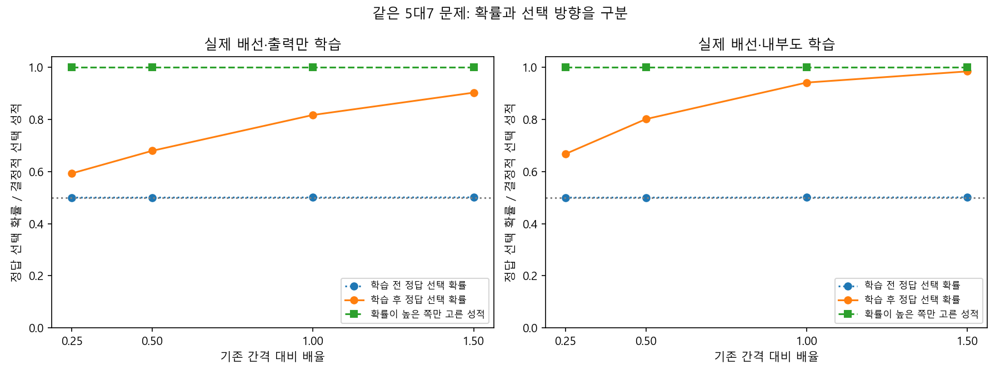

# 입력 간격 진단 — 쉬운 결과 설명

2026-10-14, Asia/Seoul. 실행 뒤 작성한 해석 문서다. [사전 프로토콜](spacing-protocol.md)·설정·학습 규칙·판정 기준은 변경하지 않았다. [자동 보고서](../results/spacing_v1/report.md), [모든 시드 판정](../results/spacing_v1/summary.json), [독립 검산](../results/spacing_v1/verification.json)을 함께 보존한다.

## 이번 결과의 뜻

**같은 문제에서도 모델에 전달하는 숫자 사이의 간격을 바꾸면 정답 선택 확률이 달라졌다. 하지만 확률이 큰 쪽만 고르는 방식에서는 정답 방향이 유지됐다.** 따라서 확률 성적의 차이를 곧바로 규칙 이해의 차이나 선택 오류로 해석하면 안 된다.

모델은 먼저 2개와 4개 중 큰 쪽을 고르는 연습을 400번 했다. 그 뒤 연습하지 않은 5개와 7개를 검사했다. 기존 입력은 0.625와 0.875, 간격은 0.25였다. 간격을 1/4로 줄이면 두 값은 0.71875와 0.78125가 된다. 여전히 7개의 입력이 더 크고, 중간 지점은 0.75로 같다. 실제 개수와 비율 5/7, 보상 경험, 모델 가중치, 수량 이외의 입력은 그대로다. 검사 중에는 새로 가르치지 않았다.

아래는 실제 배선 일부를 사용한 계산 모델의 학습 후 결과다. 각 숫자는 10개 계산 시드를 모두 포함한 평균이다.

| 학습 방식 | 1/4 간격 | 1/2 간격 | 기존 간격 | 1.5배 간격 |
|---|---:|---:|---:|---:|
| 마지막 선택 부분만 학습 | 59.3% | 68.0% | 81.7% | 90.3% |
| 내부 연결도 함께 학습 | 66.8% | 80.1% | 94.2% | 98.5% |

이 숫자는 정답을 고를 **확률**이다. 예를 들어 59.3%라는 확률에 따라 선택을 무작위로 뽑으면 평균적으로 그만큼 정답이 나온다는 뜻이다. 평가 때 실제 선택을 100번 뽑아 센 점수가 아니다. 반면 매번 확률이 더 높은 후보만 고르는 평가에서는 **두 모델뿐 아니라 여섯 조건의 모든 시드·네 간격에서 5대7 정답률이 100%**였다. 이 100%는 이번 주 수량쌍의 결정적 선택 성적이며, 모든 수학 과제나 모든 새 수량쌍에서 100%라는 뜻이 아니다.

## 미리 정한 기준으로 판정한 결과

학습 전에는 실제 배선 두 모델의 5대7 확률이 네 간격 모두 약 50%였다. 주 지표는 학습 후의 ‘기존 간격−1/4 간격’ 차이에서 학습 전 같은 차이를 뺀 값이다. 처음부터 있던 차이를 보정했다.

그 값은 실제 출력 전용 모델 **22.35±1.74%포인트**, 내부 학습 모델 **27.33±0.17%포인트**였다. 재배선·일반 신경망도 21.57–27.38%포인트로 비슷했다. 평균 10%포인트 이상 및 양수 시드 8/10 이상이라는 사전 H-S 기준은 여섯 모델 모두 통과했고, 각 모델의 10시드 모두 양수였다. ±는 계산 시드 표본 표준편차이며 인간·초파리 표본의 신뢰구간이나 유의성 검정이 아니다.

1/4 간격에서는 여섯 조건 모두 5대7의 사전 **정답 확률 75% 전이 기준을 통과한 시드가 0/10**이었다. 그러나 높은 확률의 쪽을 고르는 성적은 모두 100%였다. 두 판정은 서로 다른 측정을 하므로 모순이 아니다. 정답 확률 기준을 사후에 결정적 선택 기준으로 바꿔 실패를 성공으로 만들지 않았다. 15개의 완전 새 수량쌍 평균 기준도 별도 보고했으며, 그 평균으로 주 쌍의 실패를 대체하지 않았다.

연습 습득은 실제 출력 전용 모델 9/10, 일반 신경망 출력 전용 모델 9/10, 나머지 네 모델 10/10이었다. 실패한 시드는 실제 배선의 4005와 일반 신경망의 4007이며, 연습 성적은 각각 74.8468%, 74.9558%였다. 75%에 가까워도 정한 기준을 그대로 적용했다. 두 시드는 주 효과 평균에 포함하고, 습득 후 전이·선택 견고함 통과 수에서는 제외했다. 추가 연습이나 시드 교체는 하지 않았다.

## 무엇을 배웠다고 말할 수 있는가

보상 경험으로 선택 함수가 변했고, 그 함수는 순서를 제공받은 새 입력에도 반응했다. 이번에는 특히 **확률 지표가 인공 입력의 거리와 선택 함수에 민감하다**는 범위를 좁혔다. 동일한 모델·같은 수량 문제에서 코드만 바꿨으므로, 네 코드가 서로 다른 원리를 새로 학습한 것이 아니다.

현재 모델은 후보별 점수 차이를 sigmoid라는 함수로 선택 확률로 바꾼다. 단순한 직선 점수도 입력 간격이 좁아지면 점수 차이가 줄고, 확률이 50%에 가까워지면서 선택 방향은 유지될 수 있다. 이번 결과는 그런 단순한 설명과 양립한다. 이 설명이 전체 곡선을 얼마나 정확히 예측하는지는 아직 별도 참조 모형으로 검증하지 않았다.

재배선과 일반 신경망에서도 같은 현상이 나타나 초파리 원래 배선에만 있는 특별한 능력이라는 근거는 없다. 내부 학습 모델에는 추가로 학습 가능한 가중치 1,474개가 있으므로 출력만 배우는 모델과 학습 자원이 같다고 주장하지 않는다. 순서를 이미 제공한 입력에서는 ‘큰 입력값을 고른다’는 분석적 기준도 모든 네 코드의 모든 수량쌍에서 100%다. 높은 결정적 선택 성적을 물체 세기나 수학 의미 발견으로 해석하지 않는다.

주 쌍 5대7에서는 코드의 중간값까지 고정했다. 다른 수량쌍에는 입력 간격과 중간값이 함께 바뀔 수 있으므로, [27쌍별 결과](../results/spacing_v1/pair_summary.csv)를 같은 인과 해석으로 확대하지 않는다. 5·7은 훈련 2·4의 입력 구간 밖이며, 이번 일반화는 그 인공 표현 안에서의 제한된 외삽 반응이다.

## 검증과 보존

실제 학습은 6모델×10새시드×400시행, 총 24,000번이다. 네 간격은 같은 모델 상태의 평가이며 추가 학습이나 독립 생물학적 개체가 아니다. 자동 테스트 330개가 통과했다. [독립 검산](../results/spacing_v1/verification.json)은 모든 갱신, 300개 checkpoint, 120개 평가 파일, 1,658,880개 시행별 평가 확률, 12,960개 코드·쌍 평균과 11,612,160개 후보별 점수를 재계산해 통과했다.

각 checkpoint에서 네 코드의 훈련 수량 2대4 입력·출력이 완전히 같은지 직접 확인했다. 내부 가중치·마지막 선택 가중치·같은 입력의 신경 활성 변화는 서로 구분해 기록했다. [상태 변화 그림](../results/spacing_v1/changes.png)의 거리 값이 크다고 더 좋은 기억이나 특정 생물학적 기억 기작을 뜻하지 않는다.

[실행 전 원격 동결 확인](../results/spacing_prefreeze_evidence.json)은 비공개 Git 기록이며 공인된 공개 사전등록이 아니다. [보존 검증](../results/spacing_archive_validation.json)에서 동결 파일 27개와 주요 결과 477개의 해시, 앞선 연구 파일 4,408개의 바이트가 그대로임을 확인했다. README·현재 상태·로드맵은 새 진행 상황을 반영했다. 기존 DrosoMem과 앞선 연구 결과·기준·실패는 변경하지 않았다. 현재 주장은 Level 2 및 인공 표현 안의 제한된 Level 3이며 실제 시각 수량 지각, LC11/DAN, 인간과의 정량적 유사성(Level 4), 같은 신경 기작(Level 5)은 검증하지 않았다.

## 다음으로 남기는 질문

다음 후보는 **연습한 2·4의 점수만으로 만든 단순 선형 참조 함수가 새 수량과 네 간격의 반응을 얼마나 정확히 예측하는가**다. 새 문제 성적을 보고 참조 함수를 맞추지 않고, 새로운 프로토콜·시드·오차 기준을 먼저 정한다. 복잡한 배선에서 나타난 현상을 간단한 계산으로 어디까지 설명할 수 있는지 확인하는 질문이다.

인간 학습과의 연결에서는 문제 표현, 정답 선택 확률, 실제 선택 정확도와 학습 전후 변화 중 무엇이 비교 가능한 측정인지 구분해야 한다. 모델 확률을 사람의 주관적 확신과 같은 값으로 취급하지 않는다. 이미 확보한 [아동 공개자료](human-data-readiness.md)에는 이번 코드 조작과 시행별 반응이 없어 현재 곡선과 직접 비교하지 않았다. 인간 비교는 장기 핵심 목표로 유지하며 학교 수학교육의 효과나 수량 비율 법칙을 주장하지 않는다.
