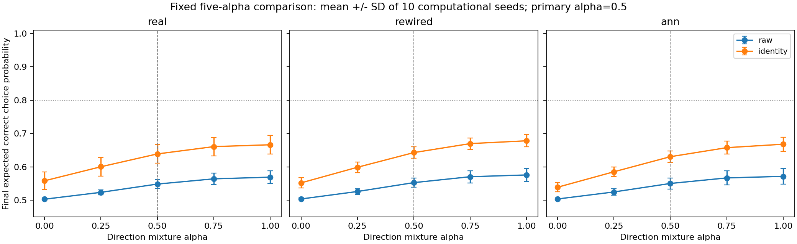
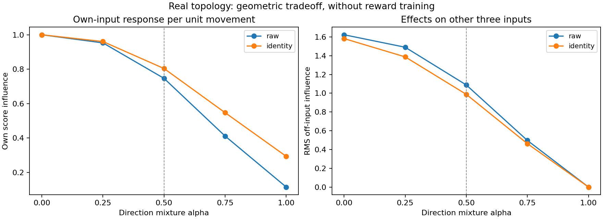

# 조금 번지게 허용하는 절충 실험 결과

2026-10-19 · `spillover_tradeoff_v1` · 완료 태그 `spillover-tradeoff-v1`

**가운데 절충 방식은 공유 방식보다 좋아졌지만, 번짐을 억제한 끝 방식보다 나아지지 않았다.**
미리 정한 절충 우위 가설과 충분한 습득 가설은 모두 미지지다. 실행·무결성 검사와 독립 산술 검산은 통과했다.

쉽게 말하면, 한 문제의 답을 고칠 때 다른 문제의 답도 함께 흔들릴 수 있다. 흔들림을 강하게 막으면
자기 답을 고치는 힘도 약해진다. 이번에는 그 사이에서 적당히 타협하면 더 잘 배울지 검사했다.
자기 답을 고치는 힘은 되찾았지만, 다른 답까지 흔드는 영향도 돌아왔다. 이번에 미리 정한 다섯
방향과 400회 연습에서는 두 끝을 넘어서는 절충 효과를 확인하지 못했다.

## 무엇을 비교했나

네 인공 문자열 ABAB·BABA·ABBA·BAAB에 대해 Go 또는 NoGo를 선택한다. 실제 선택으로 얻은
보상만 사용해 마지막 선택 계수 48개를 학습했다. 내부 KC→MBON 가중치·입력 인코더·고정 활성 반응은
바꾸지 않았다. 이는 알려진 네 문제의 출력 학습이며, 실제 초파리의 문자 이해나 새 문제 일반화 검사가 아니다.

혼합 계수 alpha는 결과를 보기 전에 0·¼·½·¾·1로 정했다. 0은 공유 방향, 1은 다른 문제의 점수에
거의 영향을 주지 않는 단위 길이 투영 방향이다. **alpha는 방향을 섞는 비중이며, 번짐을 제거한 비율이 아니다.**
가운데 ½을 주 비교로 정했다. 조건별 출력 이동 방향은 모두 길이가 1이고, 시행당 이동 상한은 .1이다.
실제 선택과 보상이 달라지므로 실제 누적 이동량까지 같게 맞춘 실험은 아니다.

실제 부분 배선·차수 통제 재배선·일반 희소 무작위 대조, 두 입력 표현, 다섯 방향으로 총 30조건을
실행했다. 10개 계산 시드 각각 조건당 400회 연습했다. 계산 시드는 동물 개체가 아니다.

## 주 비교: 실제 부분 배선과 원 입력

점수는 학습 후 네 연습문제에서 **정답 행동을 선택할 기대 확률의 평균**이다. 추출한 행동의 정답률과 구분한다.

| 방향 혼합 계수 | 기대 정답 확률 | 습득 통과 시드 | 실제 누적 출력 이동 길이 평균 |
|---|---:|---:|---:|
| 0 — 공유 | 50.31% | 0/10 | 9.71 |
| ¼ | 52.36% | 0/10 | 9.73 |
| **½ — 사전 지정 주 조건** | **54.85%** | **0/10** | **9.90** |
| ¾ | 56.41% | 0/10 | 9.84 |
| 1 — 번짐 억제 | 56.92% | 0/10 | 9.83 |

가운데와 공유의 차이는 **+4.54%p**, 가운데와 번짐 억제의 차이는 **−2.07%p**였다.
공유보다 높은 시드는 10/10, 번짐 억제보다 높은 시드는 0/10이었다.

| 사전 가설 | 결과 | 이유 |
|---|---|---|
| H_tradeoff: 가운데가 양 끝 각각보다 평균 5%p 이상 높고, 각 비교에서 8/10 이상 시드가 개선 | **미지지** | 공유 대비 +4.54%p로 5%p 미달, 억제 대비 −2.07%p |
| H_acquisition: 가운데에서 충분히 습득한 시드가 8/10 이상 | **미지지** | 0/10 |

습득의 시드별 기준은 평균 기대 정답 확률 ≥80%, 시작 대비 증가 ≥25%p, 두 정답 종류 각각 ≥70%를
모두 만족하는 것이다. 두 가설은 별개로 판정했고, 모든 수치·이동 상한 검사는 통과했다.
5%p·8/10은 사전의 실용적 기준이며 통계적 유의성이나 생물학적 경계가 아니다.
미지지는 효과가 정확히 0이거나 모든 절충 방식이 불가능하다는 뜻이 아니다.

## 모든 조건을 함께 보면

아래는 10시드의 마지막 기대 정답 확률 평균이다. 주 비교 외 조건은 기술적 결과이며, 가장 좋은
조건을 골라 원 가설의 성공으로 바꾸지 않았다. **30조건 모두 습득 통과는 0/10**이었다.

| 배선 / 입력 | alpha=0 | ¼ | ½ | ¾ | 1 |
|---|---:|---:|---:|---:|---:|
| 실제 / 원 입력 | 50.31% | 52.36% | 54.85% | 56.41% | 56.92% |
| 실제 / 이름표 | 55.83% | 60.04% | 63.89% | 66.08% | 66.64% |
| 재배선 / 원 입력 | 50.37% | 52.62% | 55.28% | 57.05% | 57.58% |
| 재배선 / 이름표 | 55.20% | 59.88% | 64.29% | 66.99% | 67.83% |
| 일반 대조 / 원 입력 | 50.37% | 52.48% | 55.03% | 56.70% | 57.16% |
| 일반 대조 / 이름표 | 53.89% | 58.53% | 63.06% | 65.77% | 66.80% |

그림 1. 점은 평균, 오차 막대는 **10개 계산 시드 간 표준편차**다. 신뢰구간이나 동물 개체 간 변이가
아니다. 수평선 80%는 습득 기준의 한 요소이고, 그 선만 넘는다고 전체 습득이 성립하지 않는다.
여섯 개의 관측 평균 곡선은 alpha가 클수록 높아졌다. 모든 개별 시드의 단조 증가나 alpha=1의
전역 최적성을 뜻하지 않는다. 실제 배선의 우수성도 확인하지 않았다.

## 왜 자기 답을 더 세게 고쳐도 충분하지 않았을까

학습 전 고정된 점수 영향 행렬에서 실제 배선·원 입력의 자기 영향 평균은 공유 1.000,
가운데 .747, 억제 .115였다. 가운데는 억제보다 자기 점수를 바꾸는 효율이 약 6.5배 컸다.
그러나 다른 세 문제로 번지는 영향의 집계 크기는 각각 1.623, 1.088, 수치 오차 수준이었다.
이 집계는 세 점수 영향의 제곱합을 문제·시드에 걸쳐 평균한 뒤 제곱근을 취한 값이므로 1보다 클 수 있다.

그림 2. 고정 방향의 **점수 영향**이며 확률 변화·학습 곡선·뇌의 에너지 소비가 아니다. 실제 시행의
변화에는 보상과 현재 선택 확률에 따른 스칼라가 추가로 곱해진다. 크기만 집계하면 같은 정답·다른
정답 문제에서 점수 번짐이 정답 방향을 돕는지 방해하는지 구분되지 않는다. 같은 정답 문제에
항상 도움이 되거나 반대 정답 문제에 항상 해롭다고 가정하지 않는다.

현재 결과는 자기 입력에 대한 큰 점수 영향만으로 최종 학습 성능을 설명할 수 없음을 보여준다.
어떤 번짐이 실제로 도움이 되거나 방해했는지는 별도 분석이 필요하다. 이번 결과만으로 단일 원인을 확정하지 않는다.

## 자원·무결성·보존

- 120,000회 실제 선택·획득 피드백, 6,000개 정적 평가, 300개 출력 학습 실행을 완료했다.
- 출력 갱신 호출은 120,000회, 실제 비영 변화는 58,054회다. 내부·가치표 갱신은 0회다.
- 독립 검산기는 새 과학 producer·새 기하 helper를 import하지 않고 698개 수치 배열, 모든 행동·보상·출력 상태·비용·판정을 다시 계산했다.
- 60개 고정 특징 구성의 필수 수치 검사가 통과했고, 모두 rank 4 및 정확한 끝 방향 분리 자격을 갖췄다.
- 시행당 L2 ≤.1, 누적 L2 ≤40, 제곱 이동량 합 ≤4, 최종 출력 길이 ≤누적 길이와 보수적 확률 상한을 검사했다. 실제 이동과 스칼라×방향의 최대 길이 잔차는 약 4.65×10⁻¹⁶이었다.
- 실행 전 새 자동검사 194개와 관련 기존 검사 82개가 통과했다. 개발 중 반복 실행은 중복 집계하지 않았다.
- 추가 SVD 계산은 총 180회다. 고정된 다섯 방향의 저장 계수는 그룹당 960개이며, 이는 전체 버퍼·저장량의 합계가 아니다. 추가 계산 비용이나 실제 누적 이동 비용을 같게 맞췄다고 주장하지 않는다.
- 이전 기준선의 18,668파일·1,993,639,689bytes를 세 가변 색인 외에는 원문 대조했다. 이후 완료 검사는 기존 경로 Git 차이와 새 연구 해시를 결합한다. 두 검사를 같은 시점의 두 번째 원문 대조로 설명하지 않는다.

원자료는 [요약](../results/spillover_tradeoff_v1/summary.json), [전체 독립 검산](../results/spillover_tradeoff_v1/verification.json),
[실행 전 등록](../results/registration_spillover_tradeoff_v1.json), [실행 전 계획](spillover-tradeoff-protocol.md),
[재현 방법](spillover-tradeoff-reproduction.md)에 있다. 실행은 등록 게시와 원격 bytes 확인 후 한 번 진행했다.
부모 연구의 57.47%와 이번 56.92%는 서로 다른 고정 시드 집단의 결과이며 같은 관측치로 교체하지 않는다.

## 이 결과의 범위와 다음 후보

이번 범위는 네 인공 연습문제의 출력 학습(Level 2)과 점수 영향·이동 상한의 관계다.
내부 시냅스 가소성, 시각적 수량 인지·LC11 경로, 새 문제 일반화(Level 3), 인간 행동 유사성(Level 4),
공통 신경 기작(Level 5), 교육 효과를 새로 검사하지 않았다. 이전 인간 비교 미지지와 맥락별
개별·공동 습득 실패, 간섭·순서 해석의 닫힌 선행 조건을 보존한다. Phase 5의 첫 종합도 그대로다.

다음 후보는 **저장한 결과만 사용해, 도움이 되는 번짐과 해로운 번짐을 나누는 분석**이다.
새 학습·시드·alpha 탐색 없이 정답 방향을 분석에만 사용해 점수 영향의 부호를 구분하고, 저장한
출력 상태에서 기대 한 시행 변화와 목표 확률에 필요한 출력 크기를 따로 계산할 수 있다.
이 분석도 별도 계획·등록이 필요하며 아직 실행하지 않았다. 기대 점수 변화를 기대 정답 확률과
동일시하거나, 문제별 확률 제약의 비용을 기존 평균·종류별 습득 기준의 불가능성 증명으로 확대하지 않는다.

이번 단일 요청의 실험·검산·정리를 완료했고 자동 이어가기는 PAUSED로 유지한다.
