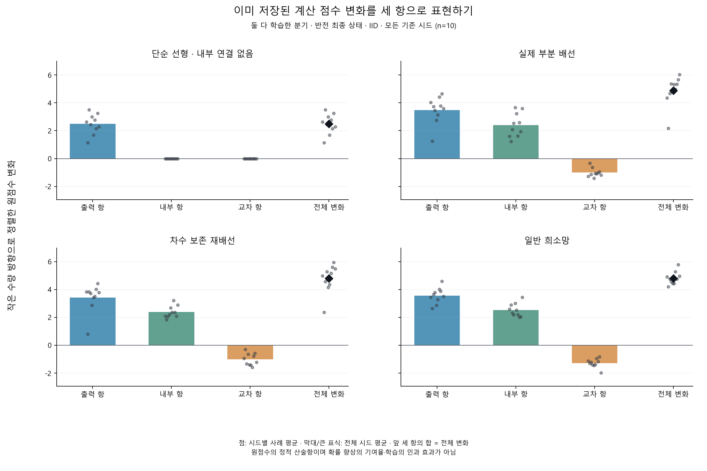
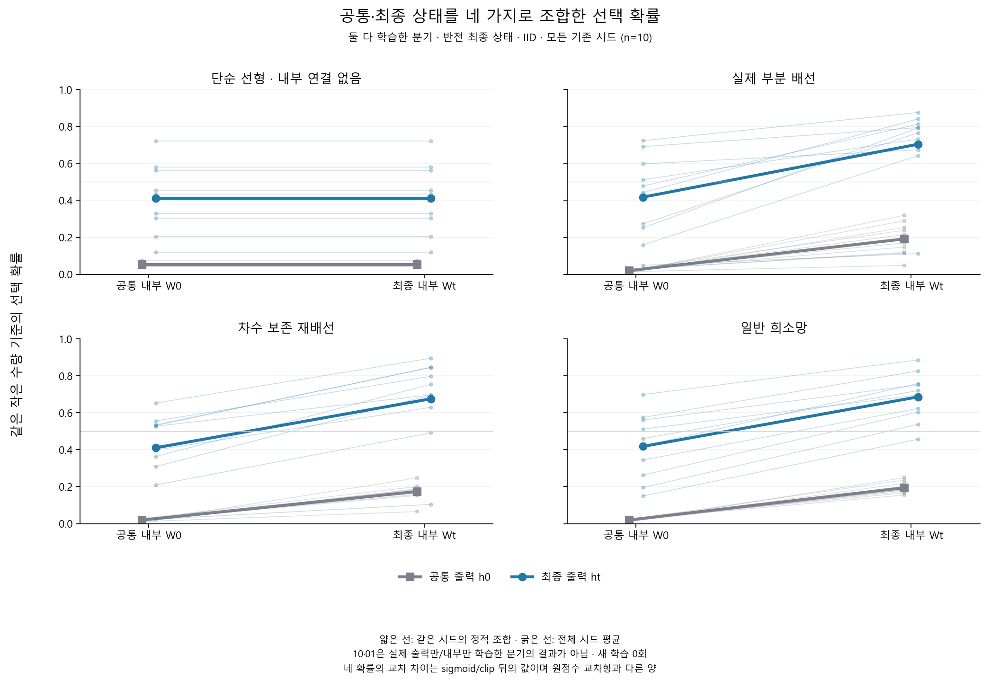

# 저장 상태를 분해해 본 선택 변화

작성일: 2026-10-16 (Asia/Seoul). 연구 ID `state_decomposition_v1`.

## 먼저 쉽게 설명하면

앞 실험은 같은 모델을 복사한 뒤 실제로 학습 부분을 켜고 끈 연구였다. 이번에는 **이미 저장된 두 상태의 부품을 교차 조합해 계산만 다시 했다.** 새 문제를 가르치거나 새 보상을 주지 않았다.

선택의 원점수(확률로 바꾸기 전 중간 점수) 변화는 ‘출력 계수의 변화’, ‘내부 특징의 변화’, ‘둘이 함께 달라져 생긴 교차항’으로 수치 오차 범위 안에서 맞았다. 가장 큰 항등식 잔차는 6.13e-15, 별도 교차항 잔차는 8.47e-15로 고정 허용치 1e-10 이하였다. 잔차는 세 항의 합과 전체 변화가 얼마나 어긋났는지를 뜻한다. 이것은 현재 계산식의 산술 확인이며 **새 수학 학습의 성공 결과가 아니다.**

세 항을 실제 학습의 기여율로 읽을 수는 없다. 교차 조합은 그 모델이 실제로 학습하며 지나온 상태가 아닐 수 있기 때문이다. 확률로 바꾸는 sigmoid도 비선형이므로 원점수의 항과 확률 변화는 따로 봐야 한다.

## 어떤 상태를 조합했나?

기준은 큰 수량 학습을 마친 출력·내부 가중치이고, 현재는 각 반전 분기의 checkpoint다. 네 조합은 기준/현재 출력과 기준/현재 내부를 조합한 `00/10/01/11`이다. **full에서 얻은 현재 출력과 기준 내부를 조합한 10은 실제 head_only 학습 결과가 아니다.** 01도 실제 internal_only 분기와 동일시하지 않는다.

00도 원래의 큰 수량 기준이 아니라 모든 조합에 공통인 작은 수량 선택 기준으로 평가했다. 화면 좌우 때문에 변화가 상쇄되지 않도록 원점수와 세 항을 같은 작은 수량 방향으로 정렬했다. 기존 반전 성공·실패로 분기나 시드를 제외하지 않았다.

## 원점수 세 항과 총변화

아래는 사전에 고정한 모든 모델·full 분기·최종 checkpoint·IID·전체 10시드의 사례 평균을 시드 간 평균한 값이다. 단위는 계산 원점수이며 확률이나 %포인트가 아니다.

| 모델 | 출력 변화 항 | 내부 특징 변화 항 | 교차항 | 총 원점수 변화 |
|---|---:|---:|---:|---:|
| 단순 선형 | 2.4870 | 0.0000 | 0.0000 | 2.4870 |
| 실제 부분 배선 | 3.4842 | 2.4093 | -1.0042 | 4.8893 |
| 재배선 | 3.4290 | 2.3812 | -1.0161 | 4.7941 |
| 일반 희소망 | 3.5676 | 2.5246 | -1.2817 | 4.8104 |

표는 반올림했으므로 표시된 세 항의 합이 총변화와 마지막 자릿수에서 다를 수 있다.

실제 부분 배선·재배선·일반 희소망의 이 평균에서는 출력 변화 항과 내부 특징 변화 항이 모두 새 목표 방향으로 양수였지만, 교차항은 음수였다. 쉽게 말해 두 부품의 변화를 함께 넣었을 때 점수 증가는 두 개별 항의 단순 합보다 작았다. 이는 저장 상태의 계산상 상쇄이며, 한 학습 방식이 해롭다는 인과 결론은 아니다.

음수 항도 그대로 보존했다. 이는 억제성 뉴런·생물학적 망각·신경학적 손상을 입증하지 않는다. 음수나 양수인 항을 전체 확률 향상의 몇 퍼센트로 환산하지 않았다.



## 네 정적 조합의 선택 확률

아래는 같은 사례·같은 작은 수량 목표의 선택 확률이다. 점수 평균을 sigmoid에 한 번 넣은 값이 아니라 **사례별 확률을 계산한 뒤 평균한 값**이다. 실제로 받은 보상률과 다르다.

| 모델 | 기준 출력·기준 내부 00 | 현재 출력·기준 내부 10 | 기준 출력·현재 내부 01 | 현재 출력·현재 내부 11 |
|---|---:|---:|---:|---:|
| 단순 선형 | 5.24% | 41.17% | 5.24% | 41.17% |
| 실제 부분 배선 | 1.97% | 41.75% | 19.15% | 70.42% |
| 재배선 | 1.92% | 41.06% | 17.37% | 67.59% |
| 일반 희소망 | 1.96% | 41.79% | 19.47% | 68.62% |



작은 점은 각 계산 시드의 사례 평균, 굵은 표시는 전체 시드 평균이다. 독립 동물 표본이나 인간 모집단의 신뢰구간이 아니다. 그림에 쓰지 않은 모든 분기·시간·OOD도 전체 CSV와 summary에 남겼다. 확률의 네 값 차이 `P11−P10−P01+P00`는 sigmoid와 clipping을 지난 값이며 원점수 교차항과 다른 양이다.

## 실행·검산·재현

- 기존 시드 10개·모델 4개·분기 4개·반전 시점 5개·IID/OOD 2개·사례 128개를 모두 포함했다. 사례 좌표 **204,800개**, 교차 정책 값 **819,200개**다. 기존 시드를 새 독립 반복으로 세지 않았다.
- 추가 학습 갱신·학습자 구성·데이터 생성·난수 추출은 모두 **0회**다. 새로운 행동 가설·통계 검정도 0개다.
- 원 자료의 선택 NPZ **850개**를 분석 전에 경로·바이트 수·SHA-256으로 고정했고, 원 부모 primary artifact 1,058개와 연결했다.
- clipping 표시는 전체 교차 정책 값 중 **0개**였다. `abs(raw_gap)>40`만 clipping이며 정확히 ±40은 표시하지 않는다. 확률의 비선형성은 clipping이 없어도 존재한다.
- 개발 도중 검사 파일이 바뀐 시도는 소스 안정성 검사에서 걸러졌으며, 그 기록도 [별도로 보존](../results/state_decomposition_engineering_attempts_v1.json)했다. 최종 고정 파일로 다시 실행한 새 자동 시험 **134개**와 [독립 검산](../results/state_decomposition_v1/verification.json)이 통과했다. 개발에는 이전에 완료된 시드 17/18의 작은 자료 복사본과 수작업 산술 fixture를 사용했으며 새 학습을 실행하지 않았다.

[전체 summary](../results/state_decomposition_v1/summary.json), [대조 검사](../results/state_decomposition_v1/controls.json), 시드별 `cases.csv`, [시험 기록](../results/test-validation-state-decomposition.json)을 보존했다. 개별 사례의 큰 잔차를 평균으로 가리지 않았고, frozen/t0/선형/비활성 성분 대조 및 저장된 00/11 확률 일치를 확인했다. 원 입력·코드·이전 실패·설명 정정판을 소급 수정하지 않았다.

소스 커밋 `afdfe3dcb3e6fd18a659cc7e5ca13b8926d759f3`. 등록 `2026-10-16T02:12:55.554601+00:00` → 원격 동일 바이트 확인 `2026-10-16T02:13:18.723513+00:00` → 정적 분석 `2026-10-16T02:13:22.745917+00:00`–`2026-10-16T02:14:02.964802+00:00` → 독립 검산 `2026-10-16T02:14:08.605329+00:00` 순서다. [사전 계획](state-decomposition-protocol.md), [설계 감사](state-decomposition-design-audit.md), [등록](../results/registration_state_decomposition_v1.json), [원격 확인](../results/state_decomposition_prefreeze_evidence.json), [최종 보존 검증](../results/state_decomposition_archive_validation.json)을 남긴다.

완료 태그 `state-decomposition-v1`의 별도 checkout과 Python3.12 고정 환경에서 새 경로로 재현한다. 부모 자료도 같은 checkout에 필요하다. 기존 결과를 덮어쓰지 않는다.

```powershell
python scripts/run_state_decomposition.py register --config configs/state_decomposition_v1.json --out results/registration_STATIC_NEW.json
python scripts/run_state_decomposition.py run --config configs/state_decomposition_v1.json --registration results/registration_STATIC_NEW.json --out results/STATIC_NEW
python scripts/verify_state_decomposition.py --registration results/registration_STATIC_NEW.json --result-dir results/STATIC_NEW --out results/STATIC_NEW/verification.json
python scripts/plot_state_decomposition.py --result-dir results/STATIC_NEW --out results/STATIC_FIGURES_NEW
```

## 해석과 이번 작업의 종료

이 진단은 현재 모델의 저장 상태를 설명하는 계산 도구다. 수량 순서는 인공 입력에 이미 주어지며 새 수량·수학 규칙 습득이나 일반화, 실제 시각적 수량 인지·LC11/DAN·동물 시냅스 학습을 검사하지 않았다. 인간 학습 비교라는 장기 목표를 유지하지만 Level4 유사성·Level5 공통 기작·수학교육 효과를 주장하지 않는다. 정적 세 항을 실제 학습 개입의 인과 효과와 혼동하지 않는다.

사용자의 “일단 이번 작업까지만 해” 요청에 따라 **이번 진단으로 작업을 마무리하고 자동 이어가기는 PAUSED로 중지했다.** 후속 연구는 시작하지 않는다.
