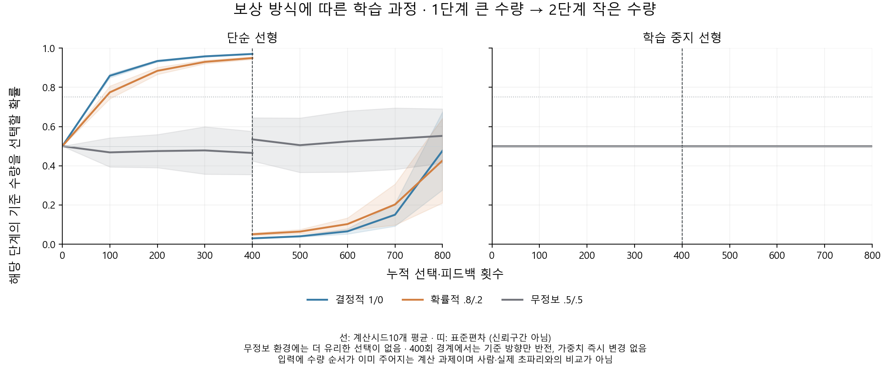

# 단순 모델의 확률적 보상 학습 결과

작성일: 2026-10-16 (Asia/Seoul). 연구 ID `stochastic_feedback_linear_v1`.

## 먼저 쉽게 설명하면

좋은 선택을 해도 가끔 보상을 못 받는 상황에서 경험으로 선택이 달라지는지 확인했다. ‘항상 맞으면 보상’과 ‘유리한 선택에80%/다른 선택에20% 보상’, ‘어느 선택이든50% 보상’을 같은 연습 횟수로 비교했다. 선형 단계의 H-L은 통과다. 확률적 보상 습득10/10과 전체 시드의 무정보 대비 끝점 차이48.40%포인트를 함께 판정했다.

첫400시행은 큰 수량, 다음400시행은 작은 수량이 기준이다. 첫 규칙의 습득과 바뀐 규칙에 대한 적응은 별도 판정했다. **습득을 확인했다고 반전 성공으로 부르지 않는다.** 기준 미달 결과를 오래 훈련하거나 다른 시드로 교체하지 않았다.



선은10계산시드 평균, 띠는 표준편차다. 사람 모집단의 신뢰구간이 아니다. 400회 경계의 y값 변화는 비교하는 기준 선택이 큰 쪽에서 작은 쪽으로 바뀐 결과이며 그 순간 가중치를 지우거나 바꾼 것이 아니다. 두 단계는 같은 모델 상태를 이어 사용한다.

## 확률적 보상에서의 모든 모델 결과

값은 보상을 더 자주 받을 수 있는 **해당 단계의 기준 수량을 고를 확률**이다. 실제로 받은 보상률이나 결정적 정답률이 아니다. 매시행 입력에2와4의 수량 순서가 직접 제공돼 있으며 점 그림에서 개수를 추출한 결과가 아니다.

| 조건 | 첫 규칙 최종 확률 | 습득 기준 | 반전 직후 새 기준 확률 | 반전 최종 확률 | 습득 후 적응 기준 |
|---|---:|---:|---:|---:|---:|
| 단순 선형 | 94.93% | 10/10 | 5.07% | 42.67% | 0/10 |
| 학습 중지 선형 | 50.00% | 0/10 | 50.00% | 50.00% | 0/10 |

첫 습득은 IID 최종≥.75와 초기 대비 증가≥.15를 모두 요구했다. 습득 후 적응은 첫 습득과 반전 후 최종≥.75를 함께 요구했다. 확률적 환경의 IID에서 첫 습득을 한 뒤 적응에 미달한 경로10개를 보존했다. frozen의 미습득을 통과 사례로 제외하지 않았다. 전체 환경·IID/OOD의 미달 사유 표시는156건이며 같은 경로의 여러 사유가 겹치므로 독립 실패 실험 수가 아니다.

## 단순 선형 모델의 보상 환경 대조

| 환경 | phase1 끝의 기준 선택 확률 | phase2 시작 | phase2 끝 |
|---|---:|---:|---:|
| 결정적1/0 | 97.02% | 2.98% | 47.68% |
| 확률적.8/.2 | 94.93% | 5.07% | 42.67% |
| 무정보.5/.5 | 46.53% | 53.47% | 55.23% |

무정보 환경에는 더 유리한 선택이 없다. 그 열의 값은 정해 둔 방향에 대한 우연한 선택 편향이며 규칙 습득 성적이 아니다. 가중치가 변한다는 사실만으로 정보 있는 규칙을 배웠다고 결론 내리지 않는다. 학습 중지 대조는 모든 환경에서 출력 가중치0·선택 확률.5·학습 갱신0회를 유지했다.

확률적 환경의 평가 기대 보상은 `.2+.6*p_rule`이다. 기준 수량 선택 확률100%여도 기대 보상률은80%다. 반전 시작점·끝점·증가량·곡선 아래 면적과 시작점 보정 면적을 모두 남겼다. fresh low 대조가 없어 반전 끝점 차이를 순수 학습 속도나 이전 기억의 인과적 비용으로 해석하지 않는다.

## 실행과 검산 범위

- 고정10시드·2조건·3환경·단계당400시행. 실제 선택·피드백48,000회.
- 출력 갱신 호출24,000회, 내부 갱신 호출0회, 정답을 직접 쓰는 학습 갱신0회. 두 가중치를 함께 갱신한 시행을 두 선택 경험으로 세지 않았다.
- [독립 검산](../results/stochastic_feedback_linear_v1/verification.json): 실제 선택·보상·출력/내부 갱신 전부, checkpoint600개, 사례별 평가 확률153,600개, 모든 곡선·습득/적응·실패 판정을 재계산해 통과했다.
- 소스·시험·원 투영·출처·환경·두 설정52파일과 단계별 부모 증거를 실행 전에 고정했다. 새 공유 자동 시험202개는 개발 시드17/18만 사용해 두 단계의 작은 실제 파이프라인과 재해시 후 의미 변조까지 확인했다. [시험 기록](../results/test-validation-stochastic-feedback.json).

내부 연결·출력 가중치·고정 probe 활성의 변화를 별도로 저장했다. 내부 update 호출은 실제 변위와 다르며, 가소성 모델의 첫 내부 step은 초기 출력0 때문에0일 수 있다. 전체 상태는 `seed_N/조건/환경/phase_시행.npz`, 실제 선택은 `seed_N/trials.csv`, 자원은 [model_resources](../results/stochastic_feedback_linear_v1/model_resources.json), 미달과 모든 개별 시드·환경 차이는 [summary](../results/stochastic_feedback_linear_v1/summary.json)에 있다. OOD는 인공 비수량 좌표의 변화이며 새 수량이나 새 수학 규칙의 전이가 아니다.

## 동결과 재현

소스 커밋 `c342a742055df27004ec60cfc8dcd3b75cd401a5`. 등록 UTC `2026-10-16T00:39:00.763336+00:00`, 원격 동일 바이트 확인 `2026-10-16T00:39:20.129879+00:00` 후 실행 `2026-10-16T00:39:24.784792+00:00` → `2026-10-16T00:39:30.863606+00:00`, 독립 검산 `2026-10-16T00:39:37.280705+00:00` 순서다. [등록](../results/registration_stochastic_feedback_linear_v1.json)과 [원격 동결](../results/stochastic_feedback_linear_prefreeze_evidence.json)을 보존했다. private Git 동결이며 공인·눈가림 사전등록이라고 표시하지 않는다.

완료 태그 `stochastic-feedback-linear-v1`의 별도 checkout에서 Python3.12 고정 환경을 사용한다. 기존 출력은 덮어쓰지 않는다.

```powershell
python scripts/run_stochastic_feedback.py register --config configs/stochastic_feedback_linear_v1.json --out results/registration_LINEAR_NEW.json
python scripts/run_stochastic_feedback.py run --config configs/stochastic_feedback_linear_v1.json --registration results/registration_LINEAR_NEW.json --out results/LINEAR_NEW
python scripts/verify_stochastic_feedback.py --registration results/registration_LINEAR_NEW.json --result-dir results/LINEAR_NEW --out results/LINEAR_NEW/verification.json
python scripts/plot_stochastic_feedback.py --result-dir results/LINEAR_NEW --out results/LINEAR_FIGURES_NEW
```

부모 gate의 원 등록·검산 파일도 같은 checkout에 필요하다. 네트워크 단계는 소스만 준비됐다는 이유로 gate 없이 실행하지 않는다. 그림은 sibling 결과 폴더에서 원 곡선·검산·그림 코드의 해시를 따로 보존한다.

## 해석 한계

이 결과는 경험과 계산 가중치 변화에 의한 **추상 수량 보상 연합**이다. 모델은 수량 순서를 이미 받는다. 이번 선형 단계는 커넥톰을 사용하지 않았다. 단순한 출력 계수와 보상 갱신의 계산 대조다. 실제 시각적 수량 인지·LC11/DAN 회로·생물학적 시냅스 학습을 재현했다고 주장하지 않는다.

배선 단계에서 출력 계수7개인 선형과48개인 망, 내부 가소성 파라미터1,474개가 있는 조건의 학습 자원은 같지 않다. 재배선과 일반망의 연결 보존 범위도 다르다. 실제 배선이 우수해야 한다는 기준은 없으며 조건별·시드별 차이를 기술한다. 사람의 확률적 카드·정보 요청 과제와도 같은 경험이 아니다. Level4 인간 유사성·Level5 공통 기작·수학교육 효과의 근거로 확대하지 않는다. 이전 연구의 실패·원본·설정·등록·코드와 DrosoMem은 보존한다.
