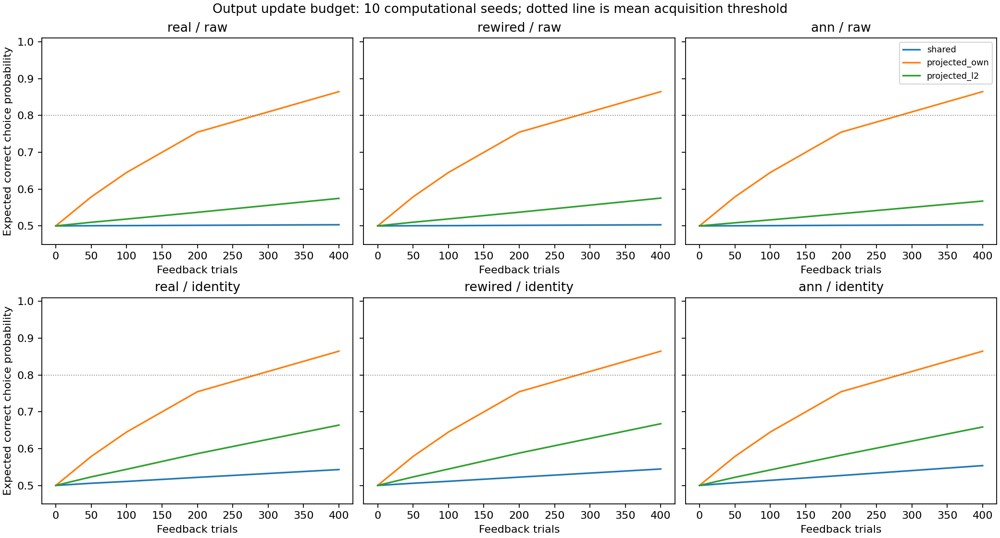
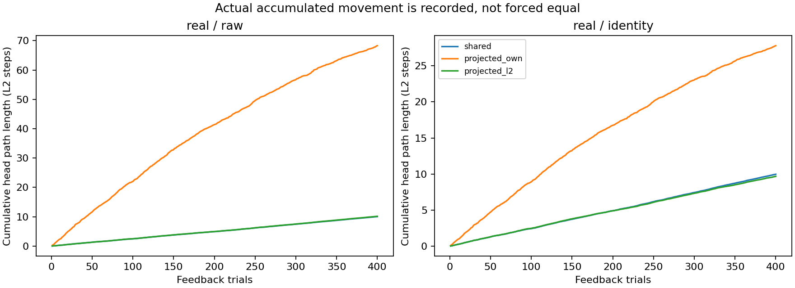

# 적은 이동으로 다른 답까지 덜 흔들 수 있을까

2026-10-19. 별도 등록 `update_budget_v1`의 실행과 독립 검산을 마쳤다.
**같은 시행당 가중치 이동 상한에서도 충분한 습득이 유지된다는 일차 가설은 미지지다.**
실험 실행과 수치 검증은 정상 완료했으며 과거 성공·실패는 그대로 보존했다.

## 쉽게 설명하면

앞선 연구에서는 한 문제의 답을 고칠 때 다른 답까지 흔들리는 영향을 막자 학습이 좋아졌다.
그러나 답을 적는 가중치를 더 크게 움직였다. 이번에는 **한 번에 움직일 수 있는 길이의 상한을
공유 수정 방식과 같게** 제한했다.

원 입력의 정답 선택 기대 확률은 **50.31%→57.47%**로 개선됐지만, 학습 기준 통과는 **0/10**이었다.
자기 문제의 수정 폭을 유지하며 큰 이동을 허용한 비교 조건은 **86.46%·10/10**이었다.
번짐을 줄이는 이득이 일부 남았지만, 이번 방향과 예산에서는 충분한 습득을 유지하지 못했다.

노트에서 한 답을 고칠 때 옆 답을 건드리지 않으려고 멀리 돌아가는 상황으로 생각할 수 있다.
한 번에 쓸 수 있는 잉크 길이까지 제한하면, 옆 답은 덜 흔들어도 자기 답을 고치는 진도도 느려진다.
이 비유는 계산상의 길이를 설명하며 생물학적 에너지 소비를 뜻하지 않는다.

## 실제 부분 배선·원 입력의 일차 결과

| 답을 고치는 방식 | 정답 선택 기대 확률 | 습득 기준 통과 | 실제 누적 가중치 이동 평균 |
|---|---:|---:|---:|
| 공유 수정 `shared` | 50.31% | 0/10 | 10.03 |
| 번짐 억제·자기 수정 폭 유지 `projected_own` | 86.46% | 10/10 | 68.28 |
| 번짐 억제·이동 길이 제한 `projected_l2` | 57.47% | 0/10 | 10.13 |

마지막 열은 각 시행에서 실제 출력 가중치가 움직인 L2 길이를 합한 뒤 10개 초기 조건을 평균한 값이다.
출력 가중치 끝점의 길이, 제곱 이동량 합, 실제 신경 에너지와 구분한다.
같은 상한을 적용한 두 조건의 실제 합은 **10.03과 10.13으로 서로 다르다**.
여기서 성적은 실제로 뽑은 행동의 정답률이 아니라 네 문제의 정답 선택 확률 평균이다.
10개는 계산 초기 조건이며 동물이나 사람의 수가 아니다.

학습 기준은 마지막 평균 ≥80%, 처음보다 ≥25%p 증가, 두 정답 종류 각각 ≥70%다.
조건 단위 습득 지지는 8/10 이상을 요구했다. 결과를 읽은 뒤 기준을 바꾸지 않았다.

일차 H_budget의 개선 폭은 **+7.16%p**, 양의 차이는 **10/10**이다.
그러나 사전 문턱 +10%p와 습득 8/10에 모두 미달했다. **H_budget은 미지지**다.
개선이 0이라는 결론이나 모든 저비용 학습의 불가능 판정으로 바꾸지 않는다.
큰 이동 비교 조건의 성공으로 일차 실패를 대신하지 않는다.

## 무엇을 같게 제한했는가

단위 길이의 원 특징 방향 d와 번짐을 억제한 방향 u를 비교했다.
앞선 방식은 자기 문제 점수의 변화를 맞췄지만 u의 길이가 더 컸다.
새 방식은 u를 자신의 길이로 나눈 v=u/||u||를 사용한다.

같은 현재 확률·행동·획득 보상에서 공유 방향과 v는 같은 가중치 이동 길이를 가진다.
두 방식의 시행당 실제 이동 상한은 **0.1**, 400회 누적 경로 길이 상한은 **40**이다.
모든 해당 실행이 이 상한을 통과했다. 실제 누적 합을 강제로 같게 만들거나 다른 모델의 보상을 복사하지 않았다.

대신 같은 길이로 자기 답을 고치는 효과가 작아졌다. 실제 부분 배선·원 입력에서 v의 자기 문제
점수 효과는 공유 방향의 평균 약 **11.92%**였다. 다른 문제로 번지는 영향은 여전히 수치상 0에 가까웠다.
60개 배선·표현·초기 조건 모두 정확한 분리 수치 자격을 통과했다.

자기 답의 수정 폭과 전체 가중치 이동 길이를 일반적으로 동시에 맞출 수 없는 이유는 실행 전
Cauchy–Schwarz 부등식으로 설명했다. 이는 의도한 자원 기준의 교환관계다.
큰 이동량 하나가 앞선 성공의 유일한 원인이라고 단정하지 않는다.
방향 정규화는 자기 문제의 수정 효율과 이후 선택·보상 경로도 함께 바꾼다.

## 실행 전에 정한 상한 진단

각 문제는 100회 나오고 한 갱신의 공통 스칼라 크기는 0.1 이하이다.
정적 영향 행렬에서 모든 입력이 한 문제에 미치는 절대 영향을 합해, 마지막 점수와 정답 확률의
보수적인 상한을 실행 전에 명세했다. 다른 입력의 작은 잔여 영향도 포함하며 정답을 사용하지 않는다.

원 입력·제한 갱신에서 이 낙관적인 평균 정답 확률 상한은 계산 조건 전체 평균 **76.25%**,
초기 조건별 범위 **64.56~83.56%**였다. **7/10**은 상한조차 80% 미만이었다.
이 등록 산술 아래에서는 최대 3개만 평균 습득 문턱에 도달할 여지가 있어, 8/10 습득 목표는 제약됐다.
실제 마지막 확률은 모두 등록 상한 이하임을 독립 확인했다.

이는 해당 입력·갱신 방향·학습률·400회 예산의 보수적인 수치 진단이다.
형식 검증이나 모든 저비용 규칙의 불가능 증명이 아니다.
이름표 입력의 상한은 더 높았는데도 실제 습득은 실패했으므로, 상한 하나로 모든 실패를 설명하지 않는다.
상한이 낮은 초기 조건을 빼거나 시행 수를 늘리지 않았다.

## 나머지 조건도 함께 보존했다

| 배선 | 입력 | 공유 수정 | 자기 수정 폭 유지 | 이동 길이 제한 |
|---|---|---:|---:|---:|
| 실제 부분 배선 | 원 문자열 | 50.31% | 86.46% | 57.47% |
| 실제 부분 배선 | 이름표 | 54.31% | 86.46% | 66.39% |
| 차수 통제 재배선 | 원 문자열 | 50.30% | 86.46% | 57.55% |
| 차수 통제 재배선 | 이름표 | 54.47% | 86.46% | 66.76% |
| 일반 희소 무작위 신경망 | 원 문자열 | 50.29% | 86.46% | 56.74% |
| 일반 희소 무작위 신경망 | 이름표 | 55.38% | 86.46% | 65.88% |

자기 수정 폭을 유지한 6조건은 모두 10/10 습득했고, 공유·이동 제한의 12조건은 모두 0/10이었다.
배선과 이름표 비교는 사전 지정한 기술적 대조다. 유리한 이름표 결과로 일차 가설을 바꾸지 않았다.
자기 수정 폭 유지 조건의 배선별 일치는 충분한 rank·분리 갱신·공통 난수로 예상되는 구성상 결과다.
이를 독립적인 생물학적 반복이나 커넥톰의 우수성으로 해석하지 않는다.

파랑은 공유 수정, 주황은 자기 수정 폭 유지, 초록은 이동 길이 제한이다.
점선은 평균 80% 문턱만 표시한다. 전체 습득 판정에는 증가 폭과 두 종류별 기준도 필요하다.
각 점은 10개 계산 조건의 평균이며 샘플 행동 정답률이 아니다.

실제 부분 배선에서 주황 조건의 실제 누적 이동이 더 컸다. 파랑과 초록은 가깝게 겹치지만 정확히 같지는 않다.
좌우 패널은 세로축 범위가 다르므로 축의 숫자를 읽어 비교한다.

## 검증·재현·해석 범위

- 소스 24·부모 증거 6·그래프 4·입력 2파일을 실행 전에 SHA-256과 source commit으로 동결했다.
- 원격 비공개 저장소의 등록 원문 bytes를 계산 시작 전에 확인했다.
- 18조건×10초기 조건×400회 = **72,000회 선택·피드백**, 정적 평가 **3,600개**를 실행했다.
- 출력 갱신 호출 72,000회, 실제 비영 출력 변화 36,877회다. 내부·가치표 갱신은 0회다.
- 독립 코드가 새 producer·helper를 불러오지 않고 **535개 배열과 모든 선택·보상·출력 변화·비용·판정**을 재계산했다.
- 새 검사 **153개**, 관련 기존 검사 **101개**가 통과했다. 중복 실행은 합산하지 않았다.
- 기준선의 기존 파일 **18,633개·1,967,008,484bytes**를 세 가변 색인 외에 원문 대조하고,
  이후 기존 경로의 변경이 그 색인에만 한정되는지 확인했다.

투영 조건에는 192개 추가 고정 계수와 행렬 계산이 남는다. 전체 producer SVD는 180회다.
이 비용은 이동 길이를 줄였다는 이유로 같아지지 않는다. 선택한 출력 좌표에서의 L2는 계산상 지표이며
표현이나 가중치의 매개변수화를 바꾸어도 동일한 생리 비용이라고 가정하지 않는다.

이번은 네 인공 연습문제의 고정 특징·출력 학습(Level 2)에 관한 후속 진단이다.
신경망 내부 가중치·encoder·bias와 고정 입력의 KC/MBON 활성은 변하지 않았다.
전체 문자열을 인공적으로 제공하며 생물학적 시각 수량·순차 기억이나 내부 시냅스 학습을 재현하지 않았다.
새 문제 일반화·인간 유사성·공통 신경 기작·교육 효과는 검사하지 않았다.
이전 연구의 실패, 인간 비교 미지지, 맥락별 개별·공동 습득과 간섭·순서의 닫힌 게이트는 그대로다.

다음 후보는 **일부 번짐을 허용하면서 자기 문제의 수정 효율을 높이는 절충 방향의 비용·성능 관계**다.
완전 공유와 완전 분리 사이의 소수 조건을 별도 등록하고 모두 보고해야 한다.
이번 등록의 학습률·시드·400회 예산을 바꾸어 실패를 성공으로 만드는 후속은 하지 않았다.

[실행 전 계획](update-budget-protocol.md) · [수치 요약](../results/update_budget_v1/summary.json) ·
[독립 검산](../results/update_budget_v1/verification.json) · [재현 안내](update-budget-reproduction.md).
완료 태그는 `update-budget-v1`이다.
