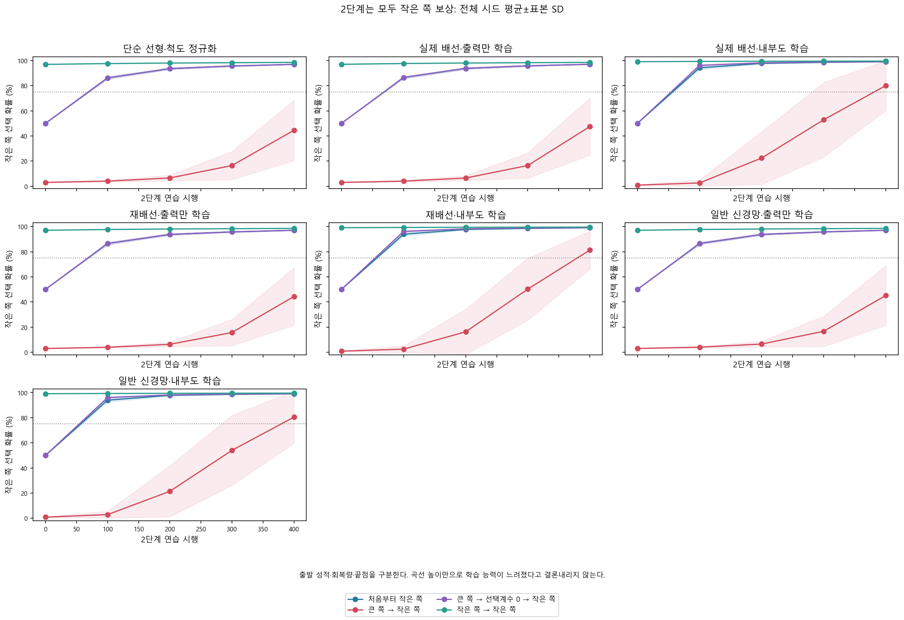
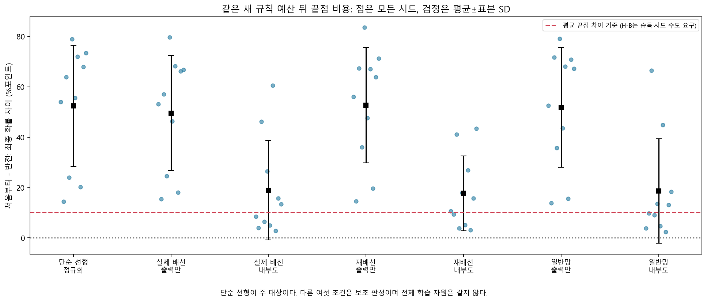
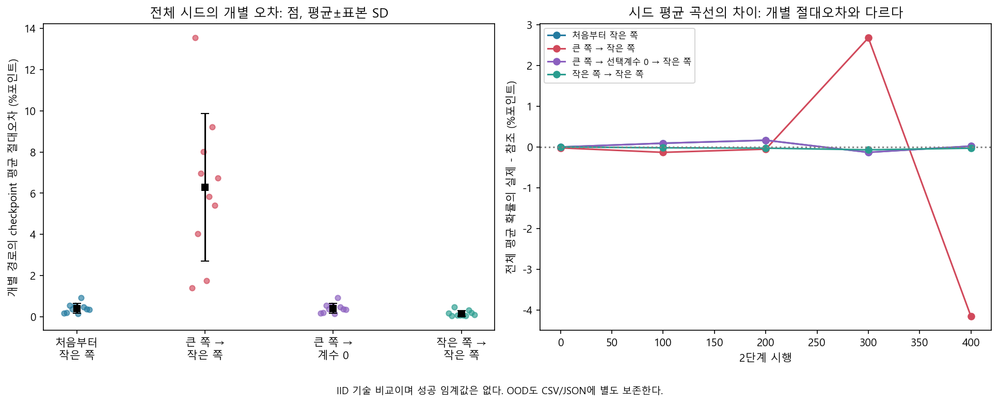
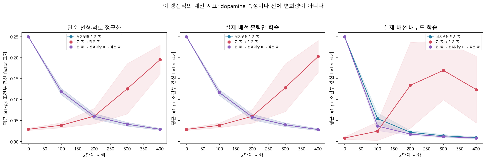
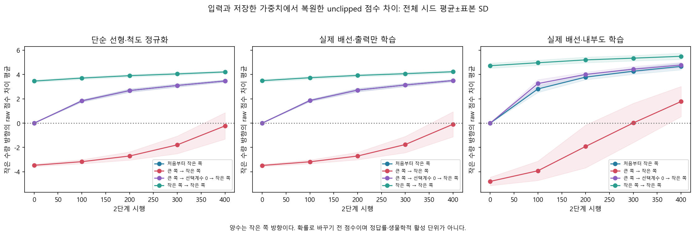
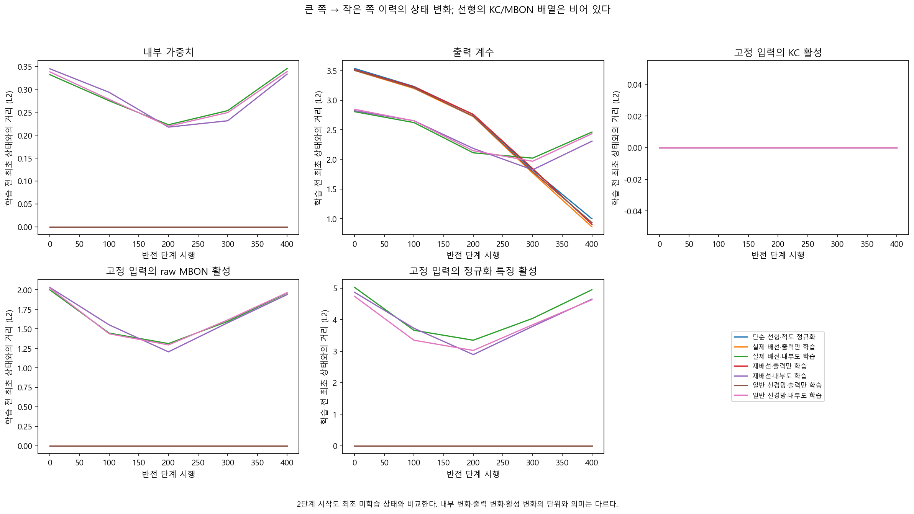

# 독립 보상 학습자의 반전 — 결과

처음부터 작은 수량을 선택하도록 배우는 경우와 큰 수량을 배운 뒤 작은 수량으로 바꾸는 경우를 같은 새 규칙 400시행으로 비교했다. 선택 담당 계수만0으로 돌린 경우와 작은 수량을 계속 연습한 경우도 함께 실행했다. 수량의 순서는 숫자 입력이 이미 제공한다. 실제 그림에서 수량을 알아내는 실험이나 인간의 수학 이해를 시험한 것이 아니다.

## 주 H-B 판정

**단순 선형의 H-B: 통과.** 모든 시드의 처음부터−반전 끝점 차이는 평균 52.454%포인트, 양수 10/10, fresh 습득 10/10, 먼저 high 습득 10/10였다. 사전 주 기준은 전체 평균10%포인트 이상, 양수·fresh 습득·high 습득이 각각8/10 이상인 네 조건을 모두 요구한다. 유의성 검정이나 생물학적 임계값이 아니다. fixture는 시드 분율과 작은 예산의 구현 검사이며 연구용10시드 판정을 대신하지 않는다.

| 모델 | 끝점 비용 평균±표본SD (%포인트) | 양수 시드 | fresh 습득 | high 습득 | 사전 비용 기준 |
|---|---:|---:|---:|---:|---|
| 단순 선형·척도 정규화 | 52.45±24.08 | 10/10 | 10/10 | 10/10 | 통과 |
| 실제 배선·출력만 학습 | 49.53±22.82 | 10/10 | 10/10 | 10/10 | 통과 |
| 실제 배선·내부도 학습 | 18.91±19.77 | 10/10 | 10/10 | 10/10 | 통과 |
| 재배선·출력만 학습 | 52.69±22.88 | 10/10 | 10/10 | 10/10 | 통과 |
| 재배선·내부도 학습 | 17.72±14.85 | 10/10 | 10/10 | 10/10 | 통과 |
| 일반 신경망·출력만 학습 | 51.81±23.77 | 10/10 | 10/10 | 10/10 | 통과 |
| 일반 신경망·내부도 학습 | 18.60±20.74 | 10/10 | 10/10 | 10/10 | 통과 |

단순 선형만 주 대상이고 나머지 여섯 조건은 사전 보조 판정이다. 습득 미달 시드를 제외하지 않았다. 작은 모델 차이로 실제 배선의 우수성·동등성을 주장하지 않는다.

## 마지막 성적과 성공 기준을 구분한다

전체 시드 평균±표본 표준편차다. 성적은 평가 사례에서 작은 쪽을 선택할 확률의 평균이며, 확률이 높은 쪽만 고르는 greedy 성적과 다르다.

| 모델 | 처음부터 작은 쪽 | 큰 쪽→작은 쪽 | 큰 쪽→선택계수0→작은 쪽 | 작은 쪽→작은 쪽 |
|---|---:|---:|---:|---:|
| 단순 선형·척도 정규화 | 96.96±0.25% | 44.51±23.97% | 96.96±0.25% | 98.54±0.12% |
| 실제 배선·출력만 학습 | 97.04±0.25% | 47.51±22.72% | 97.04±0.25% | 98.54±0.15% |
| 실제 배선·내부도 학습 | 99.03±0.24% | 80.12±19.80% | 99.15±0.17% | 99.58±0.10% |
| 재배선·출력만 학습 | 97.03±0.27% | 44.34±22.83% | 97.03±0.27% | 98.55±0.14% |
| 재배선·내부도 학습 | 99.04±0.18% | 81.33±14.89% | 99.14±0.16% | 99.56±0.08% |
| 일반 신경망·출력만 학습 | 97.04±0.23% | 45.23±23.71% | 97.04±0.23% | 98.57±0.12% |
| 일반 신경망·내부도 학습 | 99.04±0.20% | 80.43±20.81% | 99.13±0.17% | 99.55±0.12% |

아래 숫자는 전체 평균 막대가75%를 넘는지가 아니라 각 시드의 사전 gate를 통과한 수다. 사전 학습이 있는 이력은 1단계 습득(75%와15%포인트 gain) 및 2단계 최종 작은 쪽 확률75%를 함께 요구한다. fresh는2단계75%와 시작 대비15%포인트 gain을 요구한다. 같은 규칙을 계속 연습한 경우에 추가15%포인트 gain을 요구하지 않는다.

| 모델 | fresh 습득 | 습득 후 반전 | 습득 후 reset 수정 | 습득 후 같은 규칙 유지 |
|---|---:|---:|---:|---:|
| 단순 선형·척도 정규화 | 10/10 | 2/10 | 10/10 | 10/10 |
| 실제 배선·출력만 학습 | 10/10 | 2/10 | 10/10 | 10/10 |
| 실제 배선·내부도 학습 | 10/10 | 7/10 | 10/10 | 10/10 |
| 재배선·출력만 학습 | 10/10 | 2/10 | 10/10 | 10/10 |
| 재배선·내부도 학습 | 10/10 | 7/10 | 10/10 | 10/10 |
| 일반 신경망·출력만 학습 | 10/10 | 2/10 | 10/10 | 10/10 |
| 일반 신경망·내부도 학습 | 10/10 | 8/10 | 10/10 | 10/10 |

## 출발점·회복량·곡선 높이

| 모델 | 이력 | 2단계 시작 확률 | 2단계 gain 평균 (%포인트) | raw AUC 평균×100 |
|---|---|---:|---:|---:|
| 단순 선형·척도 정규화 | 처음부터 작은 쪽 | 50.00±0.00% | 46.96 | 87.21 |
| 단순 선형·척도 정규화 | 큰 쪽 → 작은 쪽 | 3.03±0.29% | 41.48 | 12.70 |
| 단순 선형·척도 정규화 | 큰 쪽 → 선택계수 0 → 작은 쪽 | 50.00±0.00% | 46.96 | 87.21 |
| 단순 선형·척도 정규화 | 작은 쪽 → 작은 쪽 | 96.94±0.28% | 1.59 | 97.90 |
| 실제 배선·출력만 학습 | 처음부터 작은 쪽 | 50.00±0.00% | 47.04 | 87.38 |
| 실제 배선·출력만 학습 | 큰 쪽 → 작은 쪽 | 3.02±0.26% | 44.49 | 13.07 |
| 실제 배선·출력만 학습 | 큰 쪽 → 선택계수 0 → 작은 쪽 | 50.00±0.00% | 47.04 | 87.38 |
| 실제 배선·출력만 학습 | 작은 쪽 → 작은 쪽 | 97.02±0.32% | 1.52 | 97.93 |
| 실제 배선·내부도 학습 | 처음부터 작은 쪽 | 50.00±0.00% | 49.03 | 91.24 |
| 실제 배선·내부도 학습 | 큰 쪽 → 작은 쪽 | 0.87±0.29% | 79.25 | 29.61 |
| 실제 배선·내부도 학습 | 큰 쪽 → 선택계수 0 → 작은 쪽 | 50.00±0.00% | 49.15 | 91.92 |
| 실제 배선·내부도 학습 | 작은 쪽 → 작은 쪽 | 99.10±0.19% | 0.48 | 99.39 |
| 재배선·출력만 학습 | 처음부터 작은 쪽 | 50.00±0.00% | 47.03 | 87.37 |
| 재배선·출력만 학습 | 큰 쪽 → 작은 쪽 | 2.97±0.26% | 41.37 | 12.37 |
| 재배선·출력만 학습 | 큰 쪽 → 선택계수 0 → 작은 쪽 | 50.00±0.00% | 47.03 | 87.37 |
| 재배선·출력만 학습 | 작은 쪽 → 작은 쪽 | 97.03±0.25% | 1.52 | 97.96 |
| 재배선·내부도 학습 | 처음부터 작은 쪽 | 50.00±0.00% | 49.04 | 91.16 |
| 재배선·내부도 학습 | 큰 쪽 → 작은 쪽 | 0.85±0.18% | 80.48 | 27.50 |
| 재배선·내부도 학습 | 큰 쪽 → 선택계수 0 → 작은 쪽 | 50.00±0.00% | 49.14 | 91.93 |
| 재배선·내부도 학습 | 작은 쪽 → 작은 쪽 | 99.10±0.11% | 0.47 | 99.38 |
| 일반 신경망·출력만 학습 | 처음부터 작은 쪽 | 50.00±0.00% | 47.04 | 87.38 |
| 일반 신경망·출력만 학습 | 큰 쪽 → 작은 쪽 | 2.99±0.26% | 42.24 | 12.83 |
| 일반 신경망·출력만 학습 | 큰 쪽 → 선택계수 0 → 작은 쪽 | 50.00±0.00% | 47.04 | 87.38 |
| 일반 신경망·출력만 학습 | 작은 쪽 → 작은 쪽 | 97.03±0.24% | 1.54 | 97.96 |
| 일반 신경망·내부도 학습 | 처음부터 작은 쪽 | 50.00±0.00% | 49.04 | 91.19 |
| 일반 신경망·내부도 학습 | 큰 쪽 → 작은 쪽 | 0.87±0.20% | 79.56 | 29.72 |
| 일반 신경망·내부도 학습 | 큰 쪽 → 선택계수 0 → 작은 쪽 | 50.00±0.00% | 49.13 | 91.88 |
| 일반 신경망·내부도 학습 | 작은 쪽 → 작은 쪽 | 99.07±0.12% | 0.47 | 99.36 |

반전 직후에는 기존에 잘하던 답이 새 규칙에서 틀린 답이 된다. 낮은 출발점 때문에 raw AUC가 낮아질 수 있고, 같은 이유로 회복량이 클 수도 있다. AUC는 저장 checkpoint를 사다리꼴 적분하여 새 규칙 예산으로 나눈 요약이다. 이 표의 지표 한 개로 학습 능력 자체가 느려졌거나 내부 간섭이 독립적으로 증명됐다고 해석하지 않는다. 최초75% 도달은 저장 checkpoint에서만 관측하며 정확한 최초 시행·지속 성공으로 부르지 않는다.

## 조건부 행동 평균 참조

별도 참조는 현재 참조 상태에서 행동을 평균낸 factor `(2y−1)p(1−p)`로 일곱 선형 계수를 갱신한다. 정답쪽 정보를 직접 받는 기술 계산이며 실제 보상 학습자와 같은 정보·자원을 갖는 독립 대조가 아니다. 비선형 확률 때문에 이 식을 반복한 참조는 확률적 학습 궤적의 정확한 전체 기대값도 아니다. 별도 성공 기준은 없다.

| 이력 | IID 개별경로 MAE 평균±SD (%포인트) | IID 평균곡선 MAE (%포인트) | OOD 개별경로 MAE 평균 (%포인트) | 참조 IID 마지막 확률 |
|---|---:|---:|---:|---:|
| 처음부터 작은 쪽 | 0.402±0.232 | 0.082 | 0.402 | 96.94±0.01% |
| 큰 쪽 → 작은 쪽 | 6.288±3.583 | 1.407 | 6.288 | 48.66±0.01% |
| 큰 쪽 → 선택계수 0 → 작은 쪽 | 0.402±0.232 | 0.082 | 0.402 | 96.94±0.01% |
| 작은 쪽 → 작은 쪽 | 0.150±0.139 | 0.029 | 0.150 | 98.56±0.00% |

개별경로 MAE는 각 시드의 phase2 저장 checkpoint에서 실제−참조 차이의 절댓값을 먼저 평균한다. 평균곡선 MAE는 같은 checkpoint의 전체 시드 평균을 먼저 구한 뒤 차이의 절댓값을 평균한다. 서로 다른 지표이며 상쇄가 생길 수 있다. 단위는 확률의 %포인트이고 정답률 손실이나 독립 보상 학습 성적이 아니다. [시행별 비교 CSV](reference_comparison.csv)에 IID/OOD를 따로 남겼다. 시드마다 입력과 척도도 달라 동일 입력에서 행동만 반복한 ensemble가 아니다.

## 변화의 기록과 reset

선형과 고정 내부 모델에서 head를0으로 돌리면 같은 새 입력·행동 uniform·척도 아래 fresh와 같은 선택·보상 경로여야 한다. 이것은 구현 무결성 검사이며 새 과학적 성공이 아니다. 누적 갱신 counter는 앞서 학습한400회를 포함하므로 다를 수 있다. 가소성의 reset 뒤 차이는 바뀐 내부와0head의 상호작용이며 뇌의 기억 삭제나 시냅스 기억 기작의 증명이 아니다.

아래 상태 변화는2단계 시작도 **최초 미학습 상태**와 비교한다. 내부 가중치·출력 계수·고정 입력 활성 변화는 서로 다른 기록이다. 단순 선형에는 KC·MBON이 없어 해당 배열이 비어 있으며 활성 변화0을 그 회로의 측정값으로 부르지 않는다. `p(1−p)`는 이 알고리즘의 조건부 factor이지 실제 dopamine 측정이나 전체 가중치 변화량이 아니다.

raw margin은 primary checkpoint의 내부·출력 가중치·encoder·척도와 전체 IID/OOD 입력에서 학습 없이 복원했다. primary case 파일의 확률과 일치하는지 확인한 파생 기술값이다. [raw margin CSV](raw_margin_summary.csv)에 방향 있는 평균, RMS, 최대 절댓값과 clipping 비율을 남겼다. raw 점수를 직접 저장한 독립 primary field로 오해하지 않는다.

## 미달 기록

실제 조건의 사전 자격을 확인한2단계 기준 미달은 40건,1단계 습득 미달은 0건,fresh 습득 미달은 0건,2단계 끝점75% 자체 미달은 40건이다. 이 집계는 같은 행이 여러 종류에 포함될 수 있으며 합쳐 독립 실패 수로 부풀리지 않는다. 기술 참조는 성공·실패 gate를 적용하지 않고 이 집계에서 제외한다.

| 자격을 확인한 수정·유지 기준 미달 모델 | 이력 | 시드 | 1단계 습득 | 2단계 최종 IID 확률 |
|---|---|---:|---|---:|
| 단순 선형·척도 정규화 | 큰 쪽 → 작은 쪽 | 7001 | True | 42.7709% |
| 실제 배선·출력만 학습 | 큰 쪽 → 작은 쪽 | 7001 | True | 43.6906% |
| 재배선·출력만 학습 | 큰 쪽 → 작은 쪽 | 7001 | True | 40.6375% |
| 일반 신경망·출력만 학습 | 큰 쪽 → 작은 쪽 | 7001 | True | 44.4803% |
| 단순 선형·척도 정규화 | 큰 쪽 → 작은 쪽 | 7003 | True | 32.8548% |
| 실제 배선·출력만 학습 | 큰 쪽 → 작은 쪽 | 7003 | True | 39.7477% |
| 실제 배선·내부도 학습 | 큰 쪽 → 작은 쪽 | 7003 | True | 52.6203% |
| 재배선·출력만 학습 | 큰 쪽 → 작은 쪽 | 7003 | True | 29.3516% |
| 재배선·내부도 학습 | 큰 쪽 → 작은 쪽 | 7003 | True | 57.6331% |
| 일반 신경망·출력만 학습 | 큰 쪽 → 작은 쪽 | 7003 | True | 25.0952% |
| 일반 신경망·내부도 학습 | 큰 쪽 → 작은 쪽 | 7003 | True | 32.3739% |
| 단순 선형·척도 정규화 | 큰 쪽 → 작은 쪽 | 7004 | True | 72.8095% |
| 실제 배선·출력만 학습 | 큰 쪽 → 작은 쪽 | 7004 | True | 72.1577% |
| 재배선·출력만 학습 | 큰 쪽 → 작은 쪽 | 7004 | True | 60.7728% |
| 일반 신경망·출력만 학습 | 큰 쪽 → 작은 쪽 | 7004 | True | 61.0302% |
| 단순 선형·척도 정규화 | 큰 쪽 → 작은 쪽 | 7005 | True | 18.2600% |
| 실제 배선·출력만 학습 | 큰 쪽 → 작은 쪽 | 7005 | True | 17.7731% |
| 실제 배선·내부도 학습 | 큰 쪽 → 작은 쪽 | 7005 | True | 72.6966% |
| 재배선·출력만 학습 | 큰 쪽 → 작은 쪽 | 7005 | True | 13.7071% |
| 일반 신경망·출력만 학습 | 큰 쪽 → 작은 쪽 | 7005 | True | 18.1863% |
| 단순 선형·척도 정규화 | 큰 쪽 → 작은 쪽 | 7006 | True | 41.4703% |
| 실제 배선·출력만 학습 | 큰 쪽 → 작은 쪽 | 7006 | True | 50.7734% |
| 재배선·출력만 학습 | 큰 쪽 → 작은 쪽 | 7006 | True | 49.5369% |
| 일반 신경망·출력만 학습 | 큰 쪽 → 작은 쪽 | 7006 | True | 53.4395% |
| 단순 선형·척도 정규화 | 큰 쪽 → 작은 쪽 | 7007 | True | 25.3397% |
| 실제 배선·출력만 학습 | 큰 쪽 → 작은 쪽 | 7007 | True | 29.2287% |
| 실제 배선·내부도 학습 | 큰 쪽 → 작은 쪽 | 7007 | True | 38.4804% |
| 재배선·출력만 학습 | 큰 쪽 → 작은 쪽 | 7007 | True | 30.4170% |
| 재배선·내부도 학습 | 큰 쪽 → 작은 쪽 | 7007 | True | 72.1467% |
| 일반 신경망·출력만 학습 | 큰 쪽 → 작은 쪽 | 7007 | True | 29.3923% |
| 일반 신경망·내부도 학습 | 큰 쪽 → 작은 쪽 | 7007 | True | 54.2725% |
| 단순 선형·척도 정규화 | 큰 쪽 → 작은 쪽 | 7009 | True | 28.6744% |
| 실제 배선·출력만 학습 | 큰 쪽 → 작은 쪽 | 7009 | True | 30.6814% |
| 재배선·출력만 학습 | 큰 쪽 → 작은 쪽 | 7009 | True | 32.9360% |
| 일반 신경망·출력만 학습 | 큰 쪽 → 작은 쪽 | 7009 | True | 26.0093% |
| 단순 선형·척도 정규화 | 큰 쪽 → 작은 쪽 | 7010 | True | 23.6844% |
| 실제 배선·출력만 학습 | 큰 쪽 → 작은 쪽 | 7010 | True | 30.3765% |
| 재배선·출력만 학습 | 큰 쪽 → 작은 쪽 | 7010 | True | 26.0046% |
| 재배선·내부도 학습 | 큰 쪽 → 작은 쪽 | 7010 | True | 55.6500% |
| 일반 신경망·출력만 학습 | 큰 쪽 → 작은 쪽 | 7010 | True | 30.0050% |

## 기록·재현과 인간 비교

실제 선택·보상 학습은 196,000번, 별도 결정적 기술 참조는 28,000번이다. 평가·척도 전처리·reset은 실제 보상 갱신 수에 더하지 않았다. fresh는 총400회, 나머지는총800회(주 과학 설정)의 보상 경험으로 전체 경험까지 같지 않다. 출력 계수7개와 네트워크48개 슬롯·내부 추가1474개 연결 역시 같은 자원이라고 주장하지 않는다. 단순 시드는 생물학적 개체나 인간 참가자가 아니다.

[사전 계획](../../docs/bandit-reversal-protocol.md) · [계산적 배경](../../docs/bandit-reversal-background.md) · [모든 원값과 판정](summary.json) · [실행 정보](metadata.json) · [전향적 동결](registration.json) · [독립 검산](verification.json) · [파생 기술 통계](analysis_summary.json)

이번 결과는 인공 입력의 경험 의존 변화 Level2 범위다. 실제 시각 수량 인지·LC11 경로·DAN 구획·자연 망각·수학 규칙 발견을 재현하지 않았다. 새 수량 일반화는이번에실행하지않았다. 사람의 기초 수량·수학 학습과 비교할 장기 목표에서 출발 편향·고정 예산 끝점 비용·회복량·기준 도달·오류 방향이 후보 지표로 남는다. 대응하는 인간 시행별 피드백 원자료가 아직 없어 정량적 인간 유사성 Level4나 공통 신경 기작 Level5를 주장하지 않는다. 새 인간 실험·수학교육 효과도 현재 범위 밖이다. 같은 행동 형태는 같은 신경 원인의 증거가 아니다.

재현은 `study-bandit-reversal-v1` 태그의 별도 checkout과 잠금 환경에서 존재하지 않는 새 결과 경로로 실행한다. 이전 실패나 등록 해시를 최신 소스에 맞춰 고치지 않는다. 모든 그림 band와errorbar는 계산 시드의 표본SD이며 신뢰구간이 아니다.
