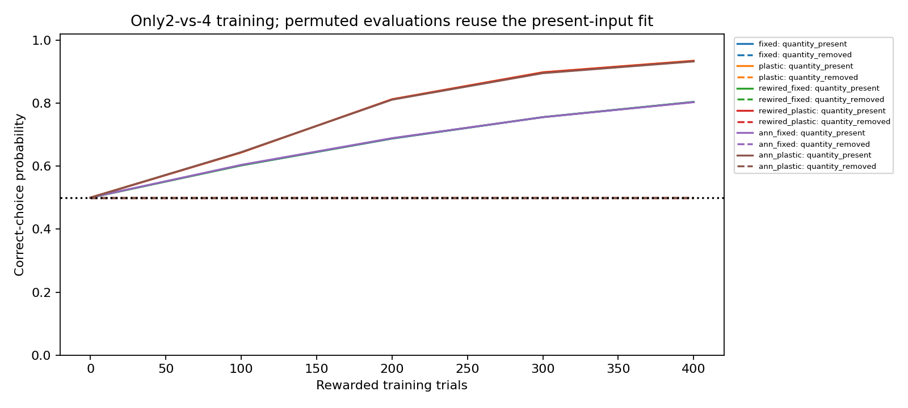
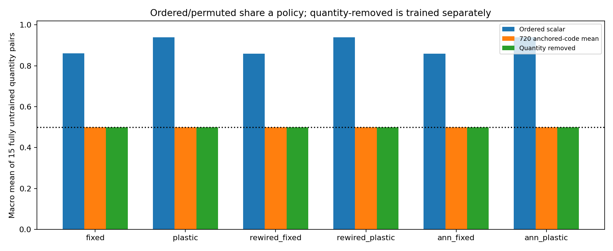
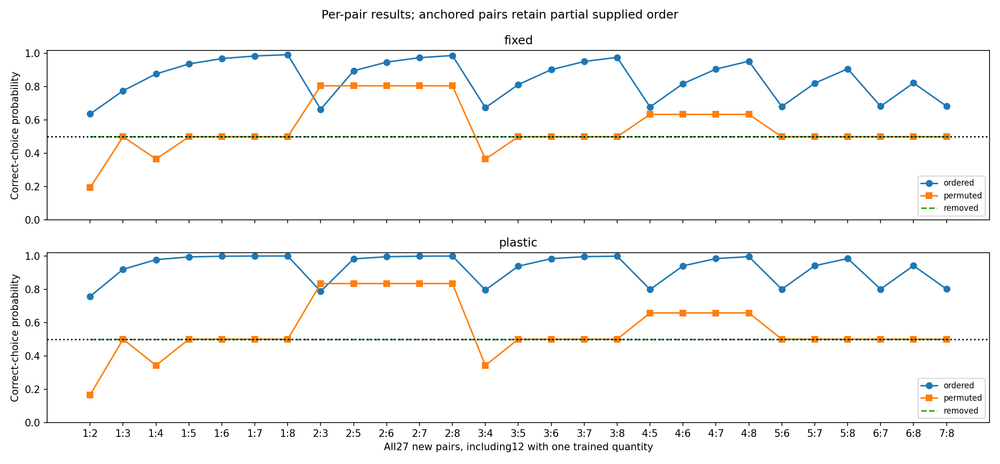
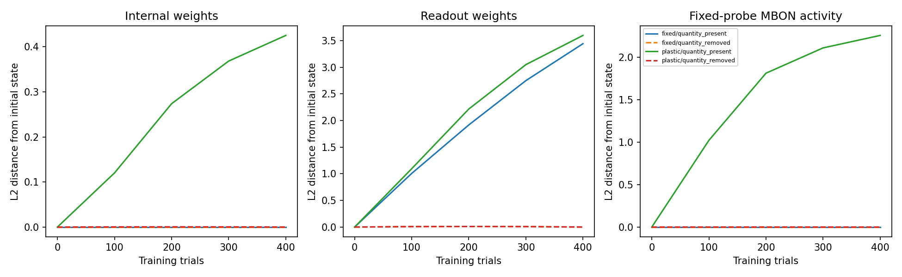

# 수량 입력이 제공한 순서의 영향

## 먼저 쉬운 설명

지금까지 모델에는2보다4가 크다는 순서를 입력으로 제공했습니다. 이번에는 연습에 쓰는2와4는 그대로 두고, 처음 보는 수량의 코드만 임의 이름표처럼 바꿨습니다. 예를 들어 어떤 이름표의 숫자가 크다고 실제 물체 수가 많은 것은 아닐 수 있습니다. 배운 모델은 그대로이며 평가 때 추가로 가르치지 않습니다.

가능한 이름표 배치720가지를 모두 평가했습니다. **두 수량 모두 연습하지 않은15쌍에서 그 평균이50%가 되는 것은 이 실험의 대칭으로 미리 증명되는 성질**입니다. 모델의 새로운 실패나 실제 초파리의 한계를 발견했다는 뜻이 아닙니다. 핵심은 기존 순서 코드에서 나타나는 전이가 얼마나 입력으로 알려준 순서에 의존하는지 보는 것입니다.

## 결과

성적은 정답을 고를 확률의 평균이며 아래는10개 계산 시드 평균입니다. 새 수량15쌍은1·3·5·6·7·8 사이 모든 조합입니다. 습득과 전이는 별도로 판정했습니다.

| 모델 | 연습한2대4 성적·습득 | 새로운 수량: 순서 코드 학습 전→후 | 새로운 수량: 임의 코드 평균 | 수량 정보 제거 | 습득 후 순서 코드 전이 기준 |
|---|---:|---:|---:|---:|---:|
| 실제 배선·출력만 학습 | 80.4% (10/10) | 50.1%→86.1% | 50.0% | 50.0% | 10/10 |
| 실제 배선·내부도 학습 | 93.5% (10/10) | 50.1%→94.0% | 50.0% | 50.0% | 10/10 |
| 재배선·출력만 학습 | 80.4% (10/10) | 50.0%→86.0% | 50.0% | 50.0% | 10/10 |
| 재배선·내부도 학습 | 93.4% (10/10) | 50.0%→93.9% | 50.0% | 50.0% | 10/10 |
| 일반 신경망·출력만 학습 | 80.3% (8/10) | 50.0%→85.8% | 50.0% | 50.0% | 8/10 |
| 일반 신경망·내부도 학습 | 93.2% (10/10) | 50.0%→93.9% | 50.0% | 50.0% | 10/10 |

순서 코드와 임의 코드의 평균 차이≥10%포인트이고 양수 시드 비율≥80%인 사전 기준은6/6모델이 통과했습니다. 이는 같은 함수에 주는 정보 방식의 효과이며, 학습 중 서로 다른 원리가 형성됐다는 결론이 아닙니다. 습득 후 절대 전이 기준≥75%는 별도 열에 보고했습니다. 실패 시드를 제외하지 않았습니다.

## 무엇을 맞췄고 무엇은 다른가

- 2대4의 연습 입력은 순서 코드와 모든 임의 코드에서 정확히 같습니다. 따라서 한 번 학습한 모델을720회 고정 평가하며 추가 보상·업데이트는 없습니다.
- 수량 정보를 없앤 대조만 별도로 학습했습니다. 그 대조의 고정 평가50%도 단서 교차 균형에서 보장됩니다. 가중치가 바뀌어도 수량 정보가 생겼다는 뜻은 아닙니다.
- 실제 학습은48,000시행입니다. 720은 이름표 배치 수이며 독립 개체 수나 추가 학습 횟수가 아닙니다.
- 모두 같은7차원 입력·고정 encoder·뉴런·가중치 제한·학습률·400시행 예산을 사용했습니다. 임의 코드도 수량의 정체성과 인공1차원 거리는 남습니다.

## 새 수량쌍을 나누는 이유

전체 새27쌍 중12쌍은2나4 중 하나를 이미 연습에서 본 경우입니다. 두 고정점을 남겼으므로 이들 임의 코드에도 일부 순서 단서가 남습니다. 단순히 코드가 큰 쪽을 고르는 기준 모델은15개의 완전 새 쌍에서는50%, 한 수량을 본12쌍에서는63.89%, 전체27쌍에서는56.17%입니다. 따라서 전체27쌍 평균만 보고 임의 코드에서도 규칙을 배웠다고 해석하면 안 됩니다. [모든 쌍의 결과](pair_summary.csv)에 두 범주를 구분했습니다.

이름표와 진짜 수량의 대응표를 모두 아는 특권적 기준 모델은 임의 코드에서도100%를 낼 수 있습니다. 그러나 실제 모델은 연습한2와4 밖의 수량에 대해 그런 정보를 받지 않았습니다. 순서 코드의 성공도 물체를 세거나 수학적 순서를 스스로 발견했다는 증거가 아닙니다. 차이·비율에 따른 반응 역시 제공한 scalar 간격의 영향과 구분해야 합니다.

## 재현과 검산

[사전 프로토콜](../../docs/encoding-protocol.md) · [미리 증명한 설계 성질](../../docs/encoding-background.md) · [모든 시드 판정](summary.json) · [실행 정보](metadata.json) · [독립 검산](verification.json)

각 seed에는 입력·난수·배선·시행별 기록과 모든 checkpoint가 있습니다. 전이 cache는 모든 후보의 입력 코드별 출력 점수를 저장하며720배치를 동일한 고정 함수에서 계산합니다. 별도 검증기는 그 점수와 모든 map별 지표를 재계산합니다. 인간 데이터와 생물학적 회로 비교는 이번에 수행하지 않았습니다. Level4/5·시각 수량 인지·수학 규칙 발견은 주장하지 않습니다.

