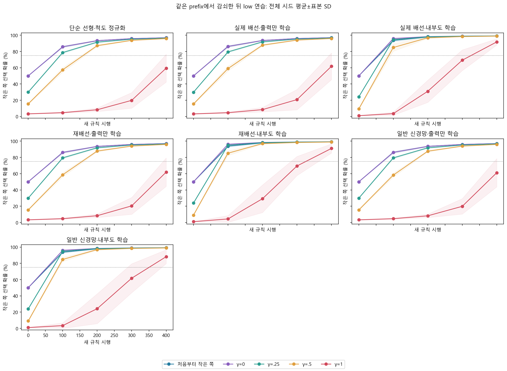
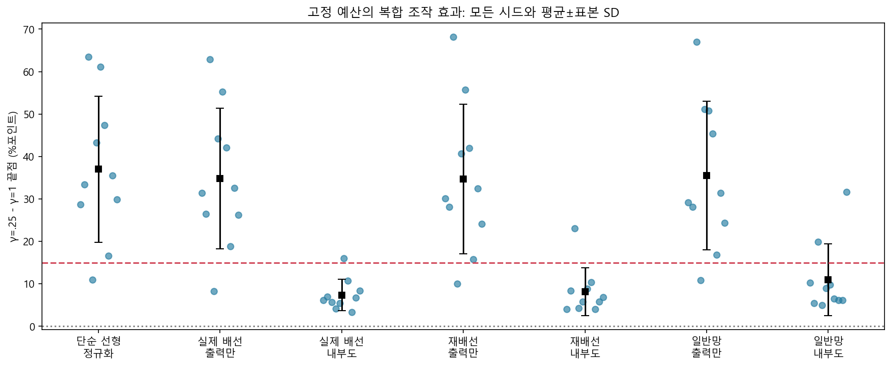
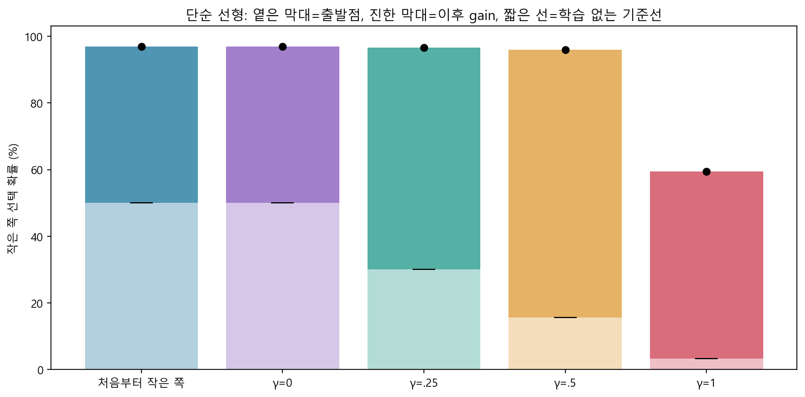
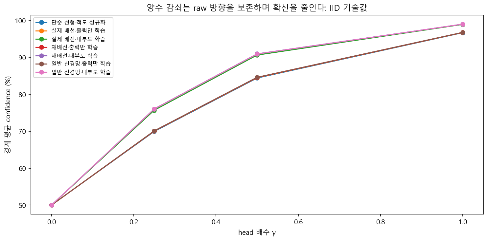
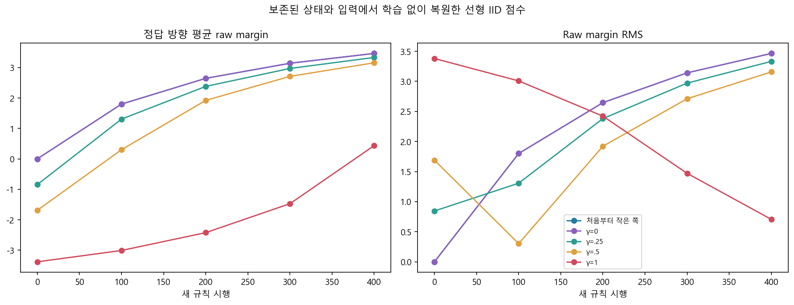
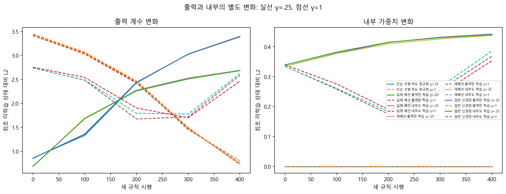
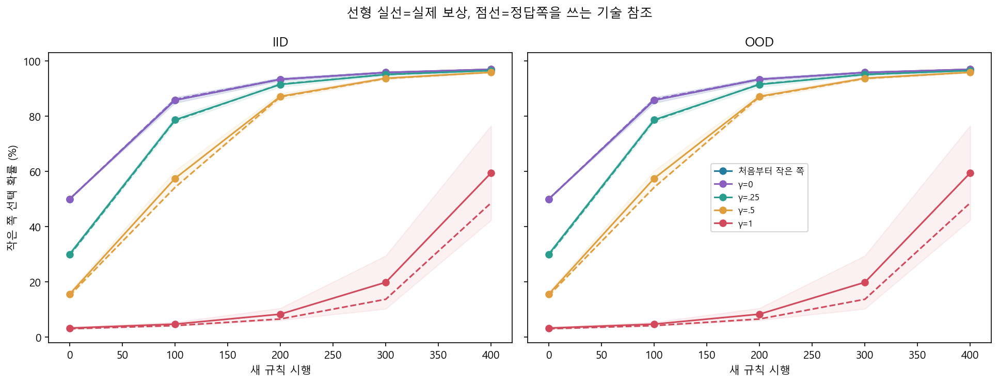
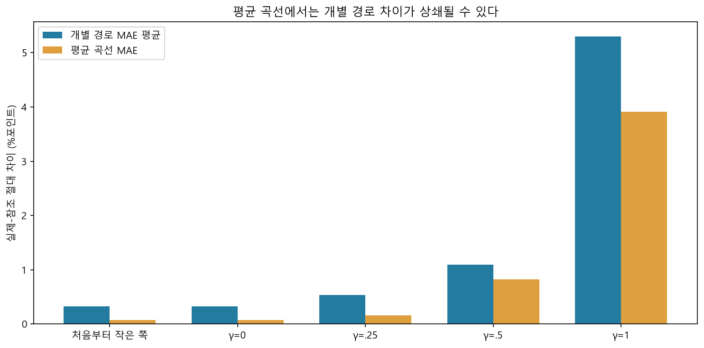

# 배운 출력 계수의 부분 감쇠 — 결과

같은 high 학습 상태에서 출력 계수만 0/.25/.5/1배로 바꾼 네 경로와 fresh low를 같은 새 규칙 400시행으로 비교했다. 양수 γ는 경계 raw 선택 방향을 유지한다. 입력이 이미 수량 순서를 제공하므로 실제 그림에서 수량을 알아내거나 인간의 수학 이해를 시험한 결과가 아니다.

## 주 H-A

**단순 선형 H-A: 통과.** γ=.25−γ=1의 전체 시드 끝점 차이는 평균 37.025±17.191%포인트, 양수 10/10, 공유 high 습득 10/10다. 주 과학 기준은 평균15%포인트 이상, 양수8/10 이상, high습득(최종75%와gain15%포인트)8/10 이상을 모두 요구한다. 습득 미달 시드를 평균에서 제외하지 않았다. fixture는 작은 예산의 구현 확인이고10시드 연구 판정을 대신하지 않는다.

| 모델 | γ=.25−γ=1 끝점 평균±SD (%포인트) | 양수 시드 | high 습득 | 판정 |
|---|---:|---:|---:|---|
| 단순 선형·척도 정규화 | 37.025±17.191 | 10/10 | 10/10 | 통과 |
| 실제 배선·출력만 학습 | 34.835±16.547 | 10/10 | 10/10 | 통과 |
| 실제 배선·내부도 학습 | 7.361±3.682 | 10/10 | 10/10 | 미달 |
| 재배선·출력만 학습 | 34.715±17.628 | 10/10 | 10/10 | 통과 |
| 재배선·내부도 학습 | 8.142±5.664 | 10/10 | 10/10 | 미달 |
| 일반 신경망·출력만 학습 | 35.504±17.528 | 10/10 | 10/10 | 통과 |
| 일반 신경망·내부도 학습 | 10.982±8.465 | 10/10 | 10/10 | 미달 |

다른 여섯 family는 보조 판정이다. γ=.5·0, 단조성·기울기·OOD·fresh 습득·AUC와 참조는 주 결과의 대체가 아니다. 유의성 검정, 실제 배선 우수성이나 같은 전체 학습 자원도 주장하지 않는다.

## 즉시 변화와 이후 연습의 변화

선형 γ=.25−γ=1의 **경계 직후 advantage는 26.742%포인트**, 이후 gain 차이는 10.283%포인트다. 두 값의 합이 끝점 benefit이다. 출력 감쇠만으로 잘못된 선택의 확신이 줄고 새 정답 확률이 올라갈 수 있으므로 끝점 차이 모두를 학습 개선으로 해석하지 않는다.

| 선형 경로 | 경계 시작 확률 | 이후 gain | 끝점 | raw AUC | 출발점 조정 AUC |
|---|---:|---:|---:|---:|---:|
| 처음부터 작은 쪽 | 50.000% | 46.955%p | 96.955% | 87.118% | 37.118%p |
| γ=0 | 50.000% | 46.955%p | 96.955% | 87.118% | 37.118%p |
| γ=.25 | 30.051% | 66.487%p | 96.539% | 82.143% | 52.092%p |
| γ=.5 | 15.590% | 80.319%p | 95.909% | 73.544% | 57.954%p |
| γ=1 | 3.309% | 56.204%p | 59.514% | 16.100% | 12.791%p |

학습 없는 기준선은 각 경로의 phase2 trial0 확률을 전 예산에서 그대로 유지한다. 상태를 바꾸거나 보상 갱신을 실행한 새 학습자가 아니며 실제 보상 호출은0이다. [기준선 CSV](frozen_boundary_baseline.csv)와 [시드별 차이](paired_attenuation_contrasts.csv)에 시작·회복·끝점·조정 AUC를 분리했다. 출발점 조정이나 gain 차이도 intrinsic 학습 속도를 단독으로 식별하지 않는다. 최초 목표 도달은 저장 checkpoint의 관측값으로 정확한 최초 시행이나 지속 성공이 아니다. 성적은 정답 선택 확률의 사례 평균이며 실측 행동 정답률·greedy 성적과 구분한다.

## 조작과 상태 변화

경계 raw margin은 보존된 전체 IID/OOD 입력·encoder·topology·내부 가중치·head·고정 척도로 학습 없이 복원했으며 primary 사례 확률과 일치를 검사했다. γ>0의 raw 부호/순위 보존과 사례별 confidence 비증가를 확인한다. clipping40에서 양쪽이 포화되면 엄격 감소가 없을 수 있어 strict감소 사례 수와 평균을 [경계 CSV](boundary_confidence.csv)에 남겼다. 확률 동률 허용오차와 raw 부호는 별개다.

head-only 조작이지만 가소성의 이후 old_head gradient와 internal_weight×head 유효 점수 배선도 달라진다. confidence-only 인과 효과나 p(1−p) 하나가 전체 원인이라는 결론을 내리지 않는다. 출력 계수·내부 가중치·활성 변화는 별도 기록이다. 아래 변화는 최초 미학습 상태와 비교하며 감쇠 뒤 상태만을 기준으로 한 변화가 아니다. 단순 선형에는 KC·MBON이 없고 빈 배열의 활성변화0을 그 회로의 측정값으로 부르지 않는다.

선형·내부 고정 조건의 γ0=fresh는 같은 척도·입력·uniform 아래 상태·선택·보상·확률의 정확한 일치여야 한다. 상속한 prefix 때문에 누적 counter는 다르다. 이는 구현 무결성 검사이며 과학적 성공이 아니다. 가소성 γ0−fresh 차이는 바뀐 내부와 새 head의 상호작용이고 생물학적 기억 저장의 증거가 아니다.

## 별도 행동 평균 참조

선형 참조는 자기 현재 상태에서 (2y−1)p(1−p)를 적용한다. 정답쪽을 직접 받는 기술 계산으로 실제 보상 학습자와 같은 정보의 대조가 아니다. 비선형성 때문에 stochastic 학습의 정확한 전체 기대값도 아니고10시드는 동일 입력의 행동 ensemble도 아니다. 참조에 별도 성공·실패 flags를 붙이지 않는다. 개별 경로 MAE와 평균 곡선 MAE 및 최대 개별 차이는 [분석 JSON](analysis_summary.json), IID/OOD 모든 저장점 차이는 [참조 CSV](reference_comparison.csv)에 따로 보존했다.

## 미달과 재현

실제 경로의 자격을 확인한 수정/습득 미달은 33건, 공유 high습득 미달은 0건, fresh습득 미달은 0건이다. 겹치는 종류를 합쳐 독립 실패 수로 부풀리지 않는다. 참조는 이 집계에 포함하지 않는다.

| 모델 | 경로 | 시드 | high 습득 | 마지막 확률 |
|---|---|---:|---|---:|
| 단순 선형·척도 정규화 | γ=1 | 8001 | True | 68.2425% |
| 단순 선형·척도 정규화 | γ=1 | 8002 | True | 62.6199% |
| 단순 선형·척도 정규화 | γ=1 | 8003 | True | 33.3575% |
| 단순 선형·척도 정규화 | γ=1 | 8005 | True | 53.3353% |
| 단순 선형·척도 정규화 | γ=1 | 8006 | True | 35.4747% |
| 단순 선형·척도 정규화 | γ=1 | 8007 | True | 48.7876% |
| 단순 선형·척도 정규화 | γ=1 | 8009 | True | 61.4678% |
| 단순 선형·척도 정규화 | γ=1 | 8010 | True | 66.5320% |
| 실제 배선·출력만 학습 | γ=1 | 8001 | True | 65.5849% |
| 실제 배선·출력만 학습 | γ=1 | 8002 | True | 69.6071% |
| 실제 배선·출력만 학습 | γ=1 | 8003 | True | 34.0044% |
| 실제 배선·출력만 학습 | γ=1 | 8005 | True | 52.4034% |
| 실제 배선·출력만 학습 | γ=1 | 8006 | True | 41.6368% |
| 실제 배선·출력만 학습 | γ=1 | 8007 | True | 54.1594% |
| 실제 배선·출력만 학습 | γ=1 | 8009 | True | 64.5217% |
| 실제 배선·출력만 학습 | γ=1 | 8010 | True | 70.2153% |
| 재배선·출력만 학습 | γ=1 | 8001 | True | 66.7916% |
| 재배선·출력만 학습 | γ=1 | 8002 | True | 67.9182% |
| 재배선·출력만 학습 | γ=1 | 8003 | True | 28.8028% |
| 재배선·출력만 학습 | γ=1 | 8005 | True | 55.9011% |
| 재배선·출력만 학습 | γ=1 | 8006 | True | 41.1563% |
| 재배선·출력만 학습 | γ=1 | 8007 | True | 54.3361% |
| 재배선·출력만 학습 | γ=1 | 8009 | True | 64.5649% |
| 재배선·출력만 학습 | γ=1 | 8010 | True | 72.2572% |
| 일반 신경망·출력만 학습 | γ=1 | 8001 | True | 67.8641% |
| 일반 신경망·출력만 학습 | γ=1 | 8002 | True | 68.0497% |
| 일반 신경망·출력만 학습 | γ=1 | 8003 | True | 29.9103% |
| 일반 신경망·출력만 학습 | γ=1 | 8005 | True | 45.6554% |
| 일반 신경망·출력만 학습 | γ=1 | 8006 | True | 45.9724% |
| 일반 신경망·출력만 학습 | γ=1 | 8007 | True | 50.9149% |
| 일반 신경망·출력만 학습 | γ=1 | 8009 | True | 65.5566% |
| 일반 신경망·출력만 학습 | γ=1 | 8010 | True | 72.2551% |
| 일반 신경망·내부도 학습 | γ=1 | 8010 | True | 67.2583% |

물리적 실제 reward-update 호출은 168,000, 별도 참조 갱신은 24,000회다. 공유 high prefix는 seed·family당 실제1회만 실행했으며 네 사본의 상속 counter를 네 번의 호출로 세지 않는다. branch의 이력은 high+low, fresh의 이력은 low뿐이어서 총 경험까지 같지 않다. 평가·복제·감쇠·전처리·학습 없는 기준선은 보상 호출에 더하지 않았다. 모든 errorbar와band는 계산 시드 표본SD이며 신뢰구간이나 생물학적 개체 변동이 아니다.

[사전 프로토콜](../../docs/head-attenuation-protocol.md) · [계산적 배경](../../docs/head-attenuation-background.md) · [모든 원값](summary.json) · [실행 정보](metadata.json) · [동결](registration.json) · [독립 검산](verification.json)

현재 결과 범위는 인공 입력의 경험 의존 변화 Level2다. 새 수량 일반화, 실제 초파리 수량 인지·자연 망각·기억 삭제·수학교육 효과를 시험하지 않았다. 인간의 기초 수량·수학 학습과 연결할 장기 목표는 유지하되 출발 편향·고정 예산 수정 비용·회복량·오류 방향과 대응 인간 시행별 선택/피드백 원자료가 필요하다. 전후 요약 자료만으로 정량적 인간 유사성 Level4나 같은 신경 기작 Level5를 주장하지 않는다.

재현은 study-head-attenuation-v1 별도 checkout과 잠금 환경에서 존재하지 않는 새 결과 경로로 한다. 이전 연구의 실패·등록·source set을 최신 코드에 맞춰 고치지 않는다.
