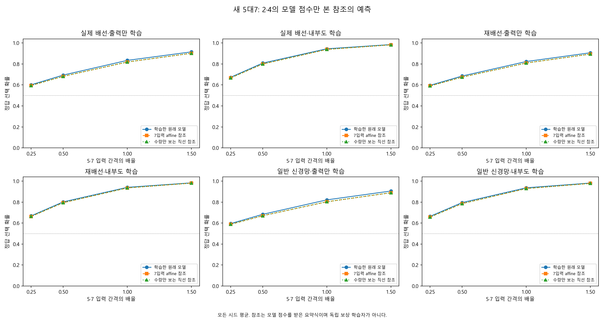
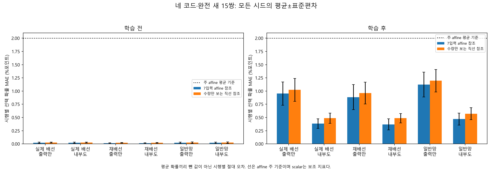
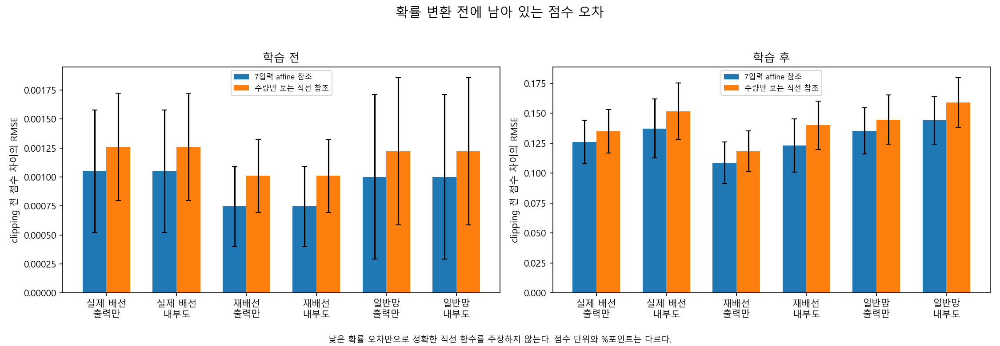
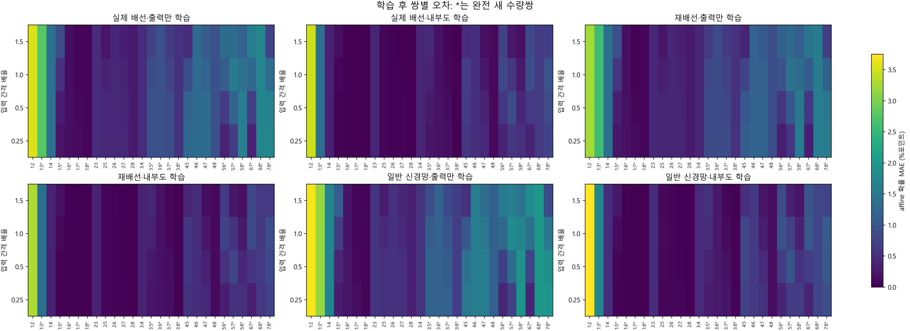
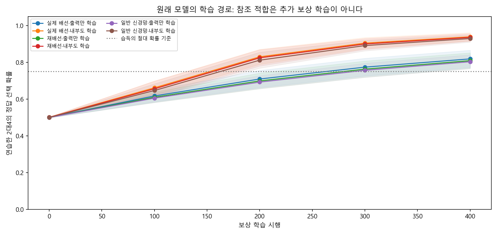
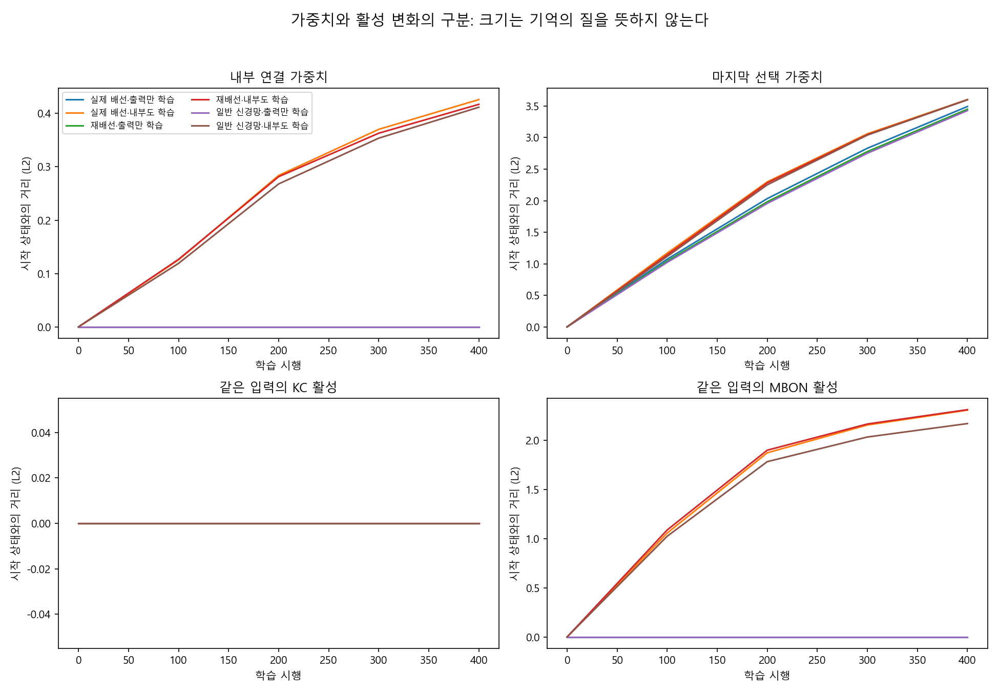

# 단순 참조 함수의 설명 범위

## 먼저 쉬운 설명

복잡한 배선 모델은 2개와 4개 중 큰 쪽을 고르는 연습을 400번 했다. 별도로 준비한 2·4 입력에서 모델이 내는 점수만 읽어, 7입력을 더하는 affine 식과 수량만 보는 직선 식을 맞췄다. 이 참조들은 새 수량의 점수나 정답을 보고 다시 맞추지 않았다. 새 문제에서 원래 모델과 얼마나 비슷한 선택 확률을 내는지 검사했다.

**참조는 모델 점수를 제공받은 요약식이며 독립 보상 학습자가 아니다.** 낮은 오차는 이 모델의 반응을 간단한 계산으로 설명할 수 있다는 뜻이다. 참조가 같은 경험으로 더 빨리 배웠다거나 실제 초파리·인간이 같은 식을 사용한다는 뜻은 아니다. 원래 모델의 정답 성적과 참조의 설명 오차도 서로 다른 지표다.

## 미리 정한 오차 기준

주 지표는 네 입력 코드·완전 미학습 15수량쌍에서 원래 모델과 affine 참조의 **시행별 오른쪽 선택 확률 차이의 절댓값**을 평균한 MAE다. 평균 확률끼리 뺀 값은 서로 다른 시행의 오차가 상쇄될 수 있으므로 주 MAE로 사용하지 않았다. 아래 오차는 %포인트 단위이며 ±는 계산 시드의 표본 표준편차다.

연구 설계의 H-L은 전체 10시드 평균 MAE≤2%포인트 및 같은 개별 기준을 통과한 시드≥8/10을 모두 요구한다. 현재 실행의 시드 수는 10이며 모든 시드를 포함해 설정된 평균·시드 비율 기준을 적용한 결과 6/6조건이 통과했다. scalar는 사전 보조 참조이며 주 판정을 대신하지 않는다. 작은 fixture라면 이 판정은 구현 확인으로만 읽는다.

| 원래 모델 조건 | 학습 전 affine MAE | 학습 후 affine MAE | 학습 후 scalar MAE | 개별 오차 통과 | 주 H-L | 연습 습득 | 습득 및 오차 통과 |
|---|---:|---:|---:|---:|---|---:|---:|
| 실제 배선·출력만 학습 | 0.022±0.011 | 0.952±0.221 | 1.023±0.215 | 10/10 | 통과 | 9/10 | 9/10 |
| 실제 배선·내부도 학습 | 0.022±0.011 | 0.386±0.091 | 0.487±0.096 | 10/10 | 통과 | 10/10 | 10/10 |
| 재배선·출력만 학습 | 0.015±0.008 | 0.885±0.236 | 0.962±0.205 | 10/10 | 통과 | 9/10 | 9/10 |
| 재배선·내부도 학습 | 0.015±0.008 | 0.369±0.106 | 0.488±0.089 | 10/10 | 통과 | 10/10 | 10/10 |
| 일반 신경망·출력만 학습 | 0.021±0.015 | 1.122±0.235 | 1.196±0.212 | 10/10 | 통과 | 9/10 | 9/10 |
| 일반 신경망·내부도 학습 | 0.021±0.015 | 0.470±0.115 | 0.571±0.113 | 10/10 | 통과 | 10/10 | 10/10 |

‘연습 습득’은 최종 2대4 IID 정답 확률≥75%와 시작 대비≥15%포인트 향상을 함께 요구한다. 마지막 열은 습득과 개별 affine 오차 기준을 모두 통과한 시드 수이며, 전체 H-L의 판정을 대체하지 않는다. 습득 미달은 일반 신경망·출력만 학습 시드 5003 (74.9057%, 향상 25.1479%포인트); 실제 배선·출력만 학습 시드 5007 (72.7394%, 향상 22.6604%포인트); 재배선·출력만 학습 시드 5007 (74.9463%, 향상 24.8083%포인트)다. 이 시드도 주 평균에 포함했다. 실패 시드 삭제·교체나 추가 학습은 하지 않았다.

학습 전 오차도 보존했다. 시작 상태의 거의 무작위인 반응이 이미 직선으로 잘 근사될 수 있으므로, 학습 후의 낮은 오차만으로 새로운 선형 규칙을 발견했다고 말하지 않는다. H-L 미달이면 이번 두 anchor 자료와 사전 오차 범위로는 충분히 설명되지 않았다고 기록한다. 미달을 수량 또는 수학 학습 자체의 불가능성으로 확대하지 않는다.

## 확률 압축 전에 남는 차이

모델은 오른쪽−왼쪽 점수 차이를 clipping한 뒤 sigmoid로 선택 확률로 바꾼다. 큰 점수 차이끼리는 서로 달라도 둘 다 거의 100% 확률이 될 수 있다. 그래서 작은 확률 MAE가 정확한 직선 점수 함수를 증명하지 않는다. 아래는 **clipping 전 원시 점수 차이**의 RMSE, 시드 평균±표본 SD다. 점수 단위이며 %포인트와 다르다. 이 보조 지표에는 사후 성공 기준을 붙이지 않았다.

| 원래 모델 조건 | 학습 전 affine RMSE | 학습 후 affine RMSE | 학습 후 scalar RMSE |
|---|---:|---:|---:|
| 실제 배선·출력만 학습 | 0.00105±0.00053 | 0.12601±0.01825 | 0.13489±0.01804 |
| 실제 배선·내부도 학습 | 0.00105±0.00053 | 0.13730±0.02473 | 0.15172±0.02341 |
| 재배선·출력만 학습 | 0.00075±0.00035 | 0.10857±0.01736 | 0.11818±0.01712 |
| 재배선·내부도 학습 | 0.00075±0.00035 | 0.12305±0.02236 | 0.14008±0.02016 |
| 일반 신경망·출력만 학습 | 0.00100±0.00071 | 0.13529±0.01914 | 0.14474±0.02064 |
| 일반 신경망·내부도 학습 | 0.00100±0.00071 | 0.14426±0.01998 | 0.15903±0.02069 |

원시 점수 차이 MAE, 후보 점수 RMSE와 greedy 선택 불일치도 [분석 원자료](analysis_summary.json)에 있다. greedy 불일치는 같은 방향이면 0, 반대 방향이면 1, 한쪽만 동률이면 0.5다. 동률은 `|p_right−0.5|<1e−12`다. 정답 방향이 모두 같아도 선택 확률이나 점수 오차는 남을 수 있다.

## 새 5대7의 확률 곡선

아래는 모든 시드의 학습 후 정답 선택 확률 평균이다. 네 코드 모두 수량의 순서와 연습한 2·4 입력을 유지한다. 5·7의 중간 입력값은 0.75로 같고, 사이의 간격만 기존의 1/4·1/2·1·1.5배로 바뀐다. 두 수량은 훈련 입력 구간 밖이다. 이 곡선의 평균값끼리 가까운 것만으로 시행별 주 오차가 작다고 판단하지 않는다.

| 원래 모델 조건 | 반응 함수 | 1/4 간격 | 1/2 간격 | 기존 간격 | 1.5배 간격 |
|---|---|---:|---:|---:|---:|
| 실제 배선·출력만 학습 | 원래 학습 모델 | 60.16% | 69.43% | 83.45% | 91.56% |
| 실제 배선·출력만 학습 | 7입력 affine 참조 | 59.49% | 68.24% | 81.89% | 90.24% |
| 실제 배선·출력만 학습 | 수량만 보는 직선 참조 | 59.49% | 68.25% | 81.90% | 90.25% |
| 실제 배선·내부도 학습 | 원래 학습 모델 | 67.32% | 80.83% | 94.50% | 98.54% |
| 실제 배선·내부도 학습 | 7입력 affine 참조 | 66.71% | 79.97% | 93.91% | 98.28% |
| 실제 배선·내부도 학습 | 수량만 보는 직선 참조 | 66.72% | 79.99% | 93.92% | 98.29% |
| 재배선·출력만 학습 | 원래 학습 모델 | 59.64% | 68.53% | 82.34% | 90.71% |
| 재배선·출력만 학습 | 7입력 affine 참조 | 59.06% | 67.49% | 80.92% | 89.46% |
| 재배선·출력만 학습 | 수량만 보는 직선 참조 | 59.06% | 67.50% | 80.93% | 89.47% |
| 재배선·내부도 학습 | 원래 학습 모델 | 66.90% | 80.26% | 94.14% | 98.40% |
| 재배선·내부도 학습 | 7입력 affine 참조 | 66.36% | 79.47% | 93.57% | 98.16% |
| 재배선·내부도 학습 | 수량만 보는 직선 참조 | 66.37% | 79.49% | 93.58% | 98.16% |
| 일반 신경망·출력만 학습 | 원래 학습 모델 | 59.54% | 68.36% | 82.16% | 90.61% |
| 일반 신경망·출력만 학습 | 7입력 affine 참조 | 58.80% | 67.04% | 80.35% | 89.00% |
| 일반 신경망·출력만 학습 | 수량만 보는 직선 참조 | 58.81% | 67.05% | 80.36% | 89.01% |
| 일반 신경망·내부도 학습 | 원래 학습 모델 | 66.43% | 79.58% | 93.69% | 98.22% |
| 일반 신경망·내부도 학습 | 7입력 affine 참조 | 65.76% | 78.61% | 92.96% | 97.89% |
| 일반 신경망·내부도 학습 | 수량만 보는 직선 참조 | 65.78% | 78.63% | 92.98% | 97.90% |

[쌍별 표](pair_summary.csv)는 네 코드·15 완전 미학습쌍·12 anchor 포함쌍을 나눠 원래 모델 성적, 두 참조의 성적과 오차를 남긴다. `probability_mae_mean`은 시행별 절대 오차를 시드마다 먼저 평균한 뒤 시드 평균을 낸 값이다. `signed_mean_p_correct_difference`는 별도의 부호 있는 평균 정답 확률 차이로 주 MAE가 아니다. 5대7 외의 쌍에서는 입력 간격과 중간값이 함께 바뀔 수 있어 간격 하나의 인과 효과로 확대하지 않는다.

## 무엇을 검증했는가

각 시드·모델 조건은 한 번만 보상 학습했고 네 코드 평가가 그 상태를 공유했다. 실제 보상 학습은 총 24,000시행이다. 참조는 학습 전·후 각각 같은 별도 calibration 입력의 모델 점수로 맞췄다. calibration은 2·4만 포함하며 train·IID·OOD·새 수량 평가와 fingerprint가 겹치지 않는다. affine 설계 행렬은 8계수 full rank를 요구하며 rank·특이값·계수·calibration 점수 RMSE를 보존했다. 학습 전후 참조를 따로 맞춘 것은 같은 참조가 독립 학습한 궤적이 아니다.

현재 원래 모델의 점수는 고정 KC ReLU 특징의 가중 합으로 입력 구간마다 affine인 함수다. 전체 구간이 한 직선이라는 보장은 없으며 이번에는 그 근사 범위를 측정했다. 참조와 원래 모델의 정답 성적이 비슷하다고 생물학적 시냅스 법칙·LC11·DAN·물체 세기·수학 의미를 재현했다고 말하지 않는다. 내부 학습 조건은 추가 1,474가중치를 학습하므로 출력 전용 조건과 같은 자원이라는 주장도 하지 않는다.

[사전 프로토콜](../../docs/linearity-protocol.md) · [수학적 설계 확인](../../docs/linearity-background.md) · [실행 정보](metadata.json) · [모든 시드 판정](summary.json) · [독립 검산 기록](verification.json)

독립 검산의 통과 여부는 연결된 검산 기록에서 별도로 확인한다. 모든 시행·선택 난수·보상·배선·checkpoint·calibration 점수·참조 계수·새 수량 점수·확률을 보존해 재계산할 수 있도록 했다. 기존 연구 결과와 실패는 변경하지 않았다. 원래 모델의 경험 의존 변화는 Level 2, 습득을 확인한 뒤 인공 표현에서의 미학습 입력 반응은 제한된 Level 3다. **참조의 높은 설명 정확도 자체가 독립 학습이나 수학 규칙 발견의 증거는 아니다.** 인간과의 정량적 유사성(Level 4)과 관련 신경 기작(Level 5)은 검증하지 않았다. 인간 학습 비교는 장기 목표로 유지하며 입력 정보·선택 지표·학습 전후 변화의 비교 가능성을 먼저 확인한다.

