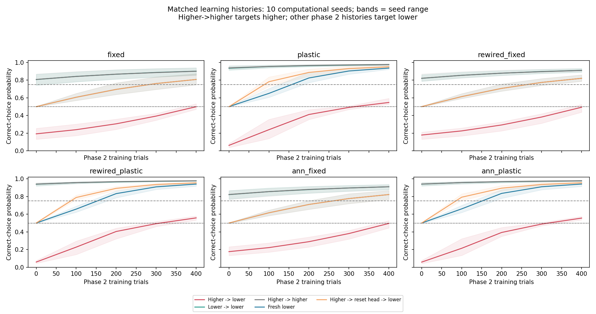
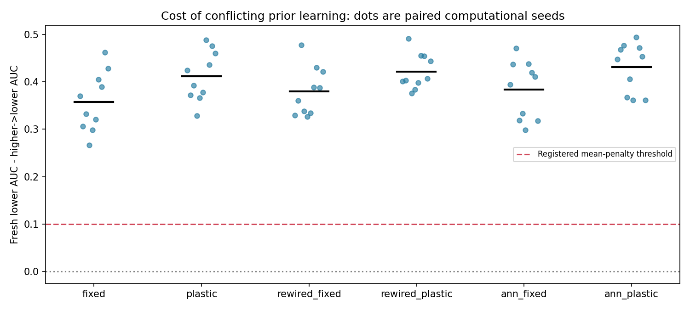
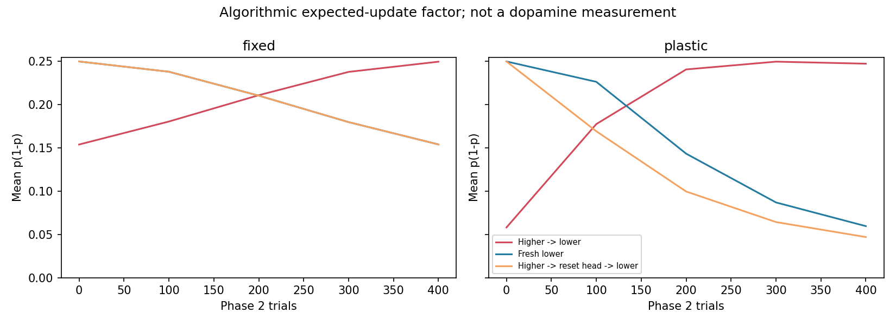

# 반전 실패를 이해하기 위한 대조 실험

## 먼저 쉬운 설명

모델에게 2와4 중 큰 쪽을 고르면 보상을 주다가 작은 쪽에 보상을 주면, 이전 답을 바꾸기 어려울 수 있습니다. 하지만 지난 실패만으로 그 원인은 알 수 없습니다. 이번에는 **처음부터 작은 쪽을 배우는 모델**과 **큰 쪽을 배운 다음 작은 쪽으로 바꾸는 모델**을 같은 문제와 같은 400번의 새 학습 기회로 비교했습니다. 또 마지막 선택을 정하는 가중치만 초기화하는 실험으로, 이전 선택 습관의 영향을 시험했습니다. 내부 연결은 이 초기화에서 그대로 남깁니다.

이때 ‘선택 습관’은 계산 모델의 가중치를 이해하기 위한 비유입니다. 살아 있는 초파리나 사람의 심리 상태를 측정한 것은 아닙니다. 수량 n/8은 미리 제공되므로 물체 개수를 알아내는 능력을 배우는 실험도 아닙니다.

## 무엇을 바꾸고 무엇을 맞췄나

- 큰 쪽→작은 쪽: 400번 큰 쪽 학습 후 400번 반전.
- 작은 쪽→작은 쪽: 같은 총 학습량에서 익숙한 규칙 유지.
- 큰 쪽→큰 쪽: 같은 총 학습량에서 초기 학습 유지 확인. 마지막 성적의 정답은 큰 쪽.
- 처음부터 작은 쪽: 사전 학습 없이 작은 쪽 400번. 의도적으로 사전 업데이트가 없습니다.
- 큰 쪽→선택부분 초기화→작은 쪽: 내부 가중치는 보존하고 출력 가중치만 초기값으로 돌려 재학습.

뉴런·입력 표현·학습률·평가 문제·두 번째 단계의 난수 추첨을 조건별로 맞췄습니다. 초기화는 학습 업데이트와 따로 기록했습니다. 각 모델은 10개의 다른 초기 난수 조건으로 반복했습니다. 이 숫자는 초파리 개체 수가 아닙니다. 기존 실험보다 더 오래 돌려 성공을 찾은 것이 아니라, 같은 예산에 원인을 구분할 대조군을 추가한 새 실험입니다.

## 결과를 읽는 법

성적은 정답을 고를 확률의 평균입니다. 50%는 동전 던지기 수준입니다. ‘과정 점수’는 중간 평가를 이어 계산한 AUC를0–100으로 바꾼 값으로, 마지막 성적이 같더라도 얼마나 빨리 배웠는지 반영합니다. **이전학습 비용**은 처음부터 작은 쪽을 배운 모델의 과정 점수에서 반전 모델 점수를 뺀 값입니다. 양수면 이번 조건에서는 과거의 반대 학습을 가진 쪽이 과정 전체에서 불리했습니다.

| 모델 | 처음부터 작은 쪽: 마지막 성적 | 큰 쪽→작은 쪽 | 선택부분 초기화 후 | 과정 점수의 이전학습 비용 | 습득 후 반전 기준 통과 |
|---|---:|---:|---:|---:|---:|
| 실제 배선·출력만 학습 | 80.7% | 49.9% | 80.7% | +35.8점 | 0/10 |
| 실제 배선·내부도 학습 | 93.6% | 54.7% | 95.0% | +41.2점 | 0/10 |
| 재배선·출력만 학습 | 82.0% | 49.3% | 82.0% | +37.9점 | 0/10 |
| 재배선·내부도 학습 | 94.1% | 55.9% | 95.5% | +42.1점 | 0/10 |
| 일반 신경망·출력만 학습 | 82.3% | 49.6% | 82.3% | +38.4점 | 0/10 |
| 일반 신경망·내부도 학습 | 94.1% | 55.6% | 95.5% | +43.1점 | 0/10 |

사전 기준은 평균 과정 비용 ≥10점 및 양의 차이를 보인 시드 비율 ≥80%였습니다. **6/6모델이 이 기준을 충족**했습니다. 모든 시드를 포함한 판정이며, 과거 규칙을 충분히 습득한 시드만의 결과는 이차 분석으로 따로 저장했습니다. 마지막 반전 성적 기준은75%이며 습득 실패를 숨기지 않습니다.

## 어디까지 설명할 수 있나

출력만 학습하는 모델에서 선택부분 초기화와 처음부터 작은 쪽 학습이 같아지는 것은 구조상 예상되는 검증 항목입니다. 내부 상태가 바뀌지 않기 때문입니다. 이를 새로운 생물학적 발견으로 세지 않습니다. 내부도 바뀐 모델에서 초기화 이후 차이가 남거나 좋아지더라도 내부 표현·활성 크기·갱신 경로·clipping 등이 함께 작용하므로 한 종류의 기억 장소를 특정할 수 없습니다.

선택이 매우 한쪽으로 치우치면 이 학습식의 평균 갱신 계수 p(1−p)는 작아집니다. 이는 현 구현에서 직접 도출한 수학적 성질이며 인간의 고집이나 실제 DAN 반응을 발견한 것이 아닙니다. 따라서 이번 결과는 추상 입력을 쓰는 알고리즘의 학습 이력과 초기화 효과에 대한 진단입니다. 커넥톰 특이성·시각 수량 인지·인간과 동일한 기작·교육 효과는 별도 증거가 필요합니다.

## 기록과 재현

[프로토콜](../../docs/reversal-protocol.md) · [실행 정보](metadata.json) · [사전 동결](registration.json) · [모든 시드 판정](summary.json) · [별도 검증](verification.json)

각 seed 디렉터리의 trials.csv, evaluation_cases.csv와 NPZ에 모든 시행·입력·가중치·활동·초기화 경계를 보존했습니다. 그림 band는 시드 최솟값–최댓값이며 신뢰구간이 아닙니다. 평가 건수는 독립 참가자 수가 아닙니다.

