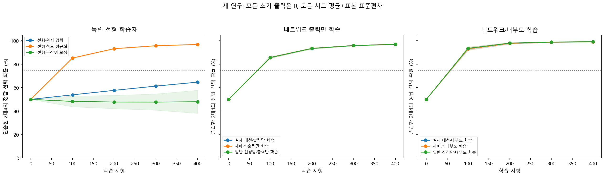
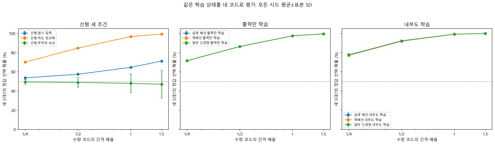
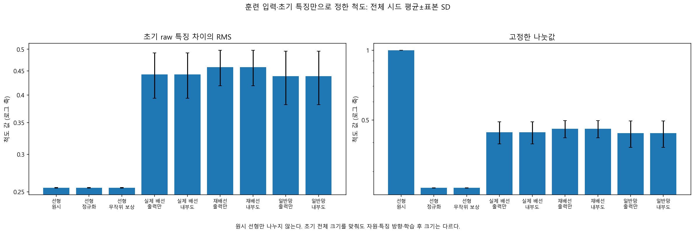
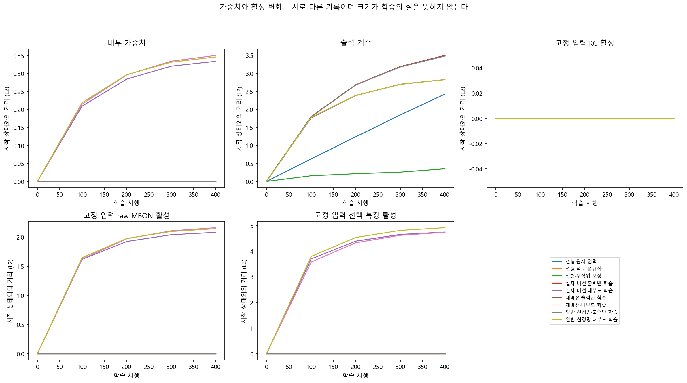

# 독립 보상 선형 학습 — 결과

단순한 모델을 아무 계수도 배우지 않은 상태에서 시작하고, 2개와 4개 중 고른 선택의 보상으로 400번 학습했다. 이전 모델의 점수나 가중치는 제공하지 않았다. 학습하지 않은 수량에서의 반응은 별도로 평가했다. 수량의 숫자 순서는 이미 입력에 있으며 실제 물체를 세는 실험은 아니다.

## 주 판정

**H-R: 통과.** 정규화 선형의 습득은 10/10시드다. 같은 시드의 최종2대4 확률에서 정답 선택 보상−무작위 보상 차이는 전체 평균 48.866%포인트, 양의 차이는 10/10시드다. 사전 H-R은 습득8/10 이상, 전체 쌍 차이 평균15%포인트 이상, 양의 차이8/10 이상을 모두 요구한다.

**H-G: 통과.** 정규화 선형의 습득과 identity 완전 새15쌍 정답 선택 확률75% 이상을 동시에 충족한 수는 10/10다. 사전 기준은8/10 이상이다. 습득 미달의 높은 새 입력 성적을 습득 후 일반화로 세지 않았다. 현재 fixture의 시드 수가 작으면 분율 gate는 구현 확인이며 연구용8/10 판단을 대신하지 않는다.

## 모든 시드의 성적

아래는 전체 시드 평균±표본 표준편차다. 확률 80%는 주어진 사례에서 정답을 고를 평균 확률이며, 확률이 큰 쪽만 고르는 greedy 정확도와 다르다. 마지막 두 열은 평균 막대 기준이 아니라 각 시드의 사전 gate 통과 수다. 계산 시드는 초파리 개체나 인간 참가자가 아니다.

| 조건 | 최종2대4 | identity 완전 새15쌍 | 습득 gate | 습득+새15쌍 gate |
|---|---:|---:|---:|---:|
| 선형·원시 입력 | 64.71±0.13% | 71.16±0.15% | 0/10 | 0/10 |
| 선형·척도 정규화 | 96.85±0.29% | 96.01±0.22% | 10/10 | 10/10 |
| 선형·무작위 보상 | 47.98±9.84% | 47.07±14.42% | 0/10 | 0/10 |
| 실제 배선·출력만 학습 | 96.97±0.26% | 96.43±0.21% | 10/10 | 10/10 |
| 실제 배선·내부도 학습 | 99.08±0.20% | 98.14±0.24% | 10/10 | 10/10 |
| 재배선·출력만 학습 | 96.97±0.27% | 96.42±0.22% | 10/10 | 10/10 |
| 재배선·내부도 학습 | 99.12±0.23% | 98.18±0.29% | 10/10 | 10/10 |
| 일반 신경망·출력만 학습 | 96.94±0.27% | 96.41±0.22% | 10/10 | 10/10 |
| 일반 신경망·내부도 학습 | 99.17±0.21% | 98.25±0.26% | 10/10 | 10/10 |

모든 초기 head는0이고 학습 전 정답 확률은0.5다. 습득 gate는 최종2대4 확률75% 이상과 초기 대비15%포인트 이상 향상을 모두 요구한다. 새15쌍 gate는 습득도 함께 요구한다. [쌍별 기록](pair_summary.csv)에 15완전 미학습쌍·12anchor 포함쌍, 네 코드, 학습 전후 확률과 greedy 방향을 남겼다. 조건을 다시 고르거나 성공 기준을 바꾸지 않았다.

## 보상과 척도의 구분

정답과 무관한 보상을 주는 `linear_random_reward`는 같은 입력과 초기 척도를 쓰는 대조다. 같은 행동 uniform을 사용해도 정책의 확률이 변하면 선택은 달라질 수 있다. 유한한 무작위 보상 표본에서 우연 편향이 생길 수 있으므로 결과를 자동으로50%라고 만들지 않았다.

두 선택에서 결정적인0/1 보상을 받으면 선택과 보상으로 정답쪽을 복원할 수 있다. optimizer에는 정답 라벨을 전달하지 않지만 보상 정보량이 라벨과 동등하다. 드문·지연 보상에서 스스로 수량 개념을 발견한 결과로 확대하지 않는다.

초기 전체 훈련입력의 후보 특징 차이 RMS를 무보상으로 계산해 고정했다. raw 선형만 나누지 않았다. 사후 성능을 보고 척도를 고르거나 학습 중 다시 맞추지 않았다. 이는 훈련입력 전체를 사전 관찰하는 batch 전처리이며 미래 입력을 전혀 모르는 pure-online 설정이 아니다. 아래 수치는 시드 평균이며 파라미터 수 목록은 조건 내 모든 시드의 값이다.

| 조건 | 출력 계수 수 | 학습 내부 연결 수 | 초기 gap RMS 평균 | 고정 나눗값 평균 |
|---|---:|---:|---:|---:|
| 선형·원시 입력 | [7] | [0] | 0.254895 | 1.000000 |
| 선형·척도 정규화 | [7] | [0] | 0.254895 | 0.254895 |
| 선형·무작위 보상 | [7] | [0] | 0.254895 | 0.254895 |
| 실제 배선·출력만 학습 | [48] | [0] | 0.442560 | 0.442560 |
| 실제 배선·내부도 학습 | [48] | [1474] | 0.442560 | 0.442560 |
| 재배선·출력만 학습 | [48] | [0] | 0.458116 | 0.458116 |
| 재배선·내부도 학습 | [48] | [1474] | 0.458116 | 0.458116 |
| 일반 신경망·출력만 학습 | [48] | [0] | 0.438643 | 0.438643 |
| 일반 신경망·내부도 학습 | [48] | [1474] | 0.438643 | 0.438643 |

같은 400시행·출력 학습률·초기 gap RMS는 파라미터 수, 각 특징 방향, 내부 가소성 자원까지 같게 만들지 않는다. 이번 네트워크는 초기 head와 정규화가 이전 연구와 다르다. 이전 성적을 같은 실험의 개선값으로 직접 비교하지 않는다. [분석 원자료](analysis_summary.json)에 정규화−원시 선형과 정답 보상−무작위 보상의 시드별 쌍 차이, 전체 평균·SD, 최초 관측 습득 checkpoint와 일곱 선형 계수를 보존했다.

## 새5대7의 입력 간격

5·7은 둘 다 학습하지 않은 수량이다. 네 코드 모두 훈련2·4와 순서를 유지하며5·7의 중간값은 같고 코드 간격만 달라진다. 주 H-G에는 identity 간격만 사용했다. 아래 네 간격 결과는 보조이고 새로운 규칙 전이 또는 실제 수량 비율 효과가 아니다.

| 조건 | 1/4 간격 | 1/2 간격 | 기존 간격 | 1.5배 간격 |
|---|---:|---:|---:|---:|
| 선형·원시 입력 | 53.78±0.04% | 57.52±0.07% | 64.71±0.13% | 71.29±0.17% |
| 선형·척도 정규화 | 70.21±0.51% | 84.74±0.63% | 96.85±0.29% | 99.41±0.08% |
| 선형·무작위 보상 | 49.48±2.52% | 48.97±5.01% | 47.98±9.84% | 47.07±14.33% |
| 실제 배선·출력만 학습 | 71.66±0.57% | 86.47±0.66% | 97.61±0.26% | 99.62±0.06% |
| 실제 배선·내부도 학습 | 77.21±1.09% | 91.97±0.89% | 99.23±0.17% | 99.93±0.02% |
| 재배선·출력만 학습 | 71.60±0.60% | 86.40±0.70% | 97.57±0.28% | 99.61±0.07% |
| 재배선·내부도 학습 | 77.40±1.37% | 92.10±1.10% | 99.26±0.21% | 99.93±0.03% |
| 일반 신경망·출력만 학습 | 71.57±0.61% | 86.36±0.70% | 97.56±0.28% | 99.60±0.07% |
| 일반 신경망·내부도 학습 | 77.72±1.33% | 92.37±1.04% | 99.31±0.19% | 99.94±0.02% |

## 습득 실패의 보존

| 습득 미달 조건 | 시드 | 최종2대4 | 초기 대비 향상 |
|---|---:|---:|---:|
| 선형·원시 입력 | 6001 | 64.7658% | 14.7658%포인트 |
| 선형·무작위 보상 | 6001 | 49.0745% | -0.9255%포인트 |
| 선형·원시 입력 | 6002 | 64.7462% | 14.7462%포인트 |
| 선형·무작위 보상 | 6002 | 64.4998% | 14.4998%포인트 |
| 선형·원시 입력 | 6003 | 64.9440% | 14.9440%포인트 |
| 선형·무작위 보상 | 6003 | 34.5726% | -15.4274%포인트 |
| 선형·원시 입력 | 6004 | 64.6402% | 14.6402%포인트 |
| 선형·무작위 보상 | 6004 | 40.0858% | -9.9142%포인트 |
| 선형·원시 입력 | 6005 | 64.5192% | 14.5192%포인트 |
| 선형·무작위 보상 | 6005 | 48.4247% | -1.5753%포인트 |
| 선형·원시 입력 | 6006 | 64.6525% | 14.6525%포인트 |
| 선형·무작위 보상 | 6006 | 57.2888% | 7.2888%포인트 |
| 선형·원시 입력 | 6007 | 64.7535% | 14.7535%포인트 |
| 선형·무작위 보상 | 6007 | 35.2802% | -14.7198%포인트 |
| 선형·원시 입력 | 6008 | 64.5311% | 14.5311%포인트 |
| 선형·무작위 보상 | 6008 | 45.0232% | -4.9768%포인트 |
| 선형·원시 입력 | 6009 | 64.8176% | 14.8176%포인트 |
| 선형·무작위 보상 | 6009 | 57.8952% | 7.8952%포인트 |
| 선형·원시 입력 | 6010 | 64.7020% | 14.7020%포인트 |
| 선형·무작위 보상 | 6010 | 47.6907% | -2.3093%포인트 |

이 실패도 전체 평균·주 보상 쌍 비교에서 삭제하지 않았다. 새 자료에 맞춰 계수를 다시 적합하거나 시행을 늘리지 않았다. 습득+identity 전이 미달 전체 목록은 [분석 원자료](analysis_summary.json)에 있다. 실패는 이 입력·척도·갱신·예산 범위의 결과이며 모든 선형 학습의 불가능성 또는 실제 배선의 필요성을 뜻하지 않는다.

## 검증 범위와 연구 목표

총 실제 갱신 호출은 36,000번이며 네 코드 평가가 한 학습 상태를 공유한다. [사전 프로토콜](../../docs/reward-linear-protocol.md) · [계산적 배경과 문헌](../../docs/reward-linear-background.md) · [모든 시드·gate](summary.json) · [실행 정보](metadata.json) · [독립 검산](verification.json)을 함께 보존한다. 검산의 통과 여부는 별도 기록에서 확인한다. 이 보고서는 저장된 판정을 시각화한 파생 산출물이며 원자료 해시 목록을 고치지 않는다.

선형 계수와 네트워크 출력 계수의 변화, 내부 가중치 변화, 고정 입력의 raw 활성과 정규화 특징 활성은 각각 기록한다. 내부 학습은 단순화한 계산 규칙이며 실제DAN 신호, LC11 입력 경로, 재귀 회로와 물체 그림을 구현하지 않았다. 경험 의존 변화는Level2, 습득 이후 이 순서 제공 표현에서 확인된 새 입력 반응은 제한된Level3다. 인간·실제 초파리와 정량 비교한Level4 또는 관련 신경 기작Level5는 검증하지 않았다.

인간 기초 수량 학습과 비교할 장기 목표는 유지한다. 현재 공개 인간 자료는 참가자별 전후 요약이며 동일한 입력 코드·시행별 보상 기록이 없다. 이번 보상·척도·자원 차이를 구분한 결과는 후속 비교 가설의 재료이며 인간의 수학 이해나 교육 효과의 결론이 아니다.

