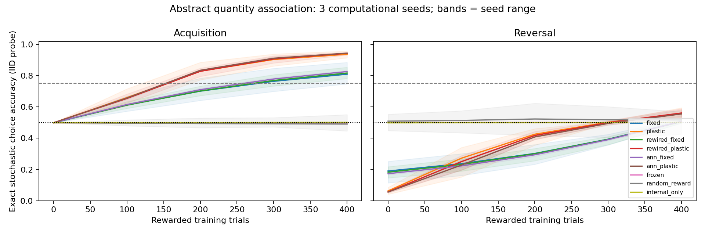
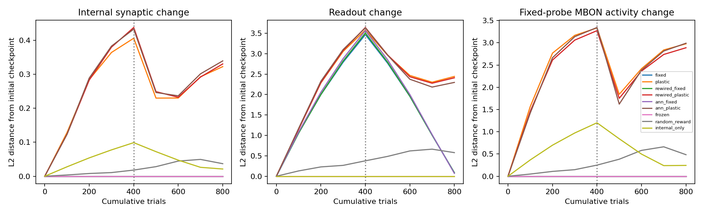
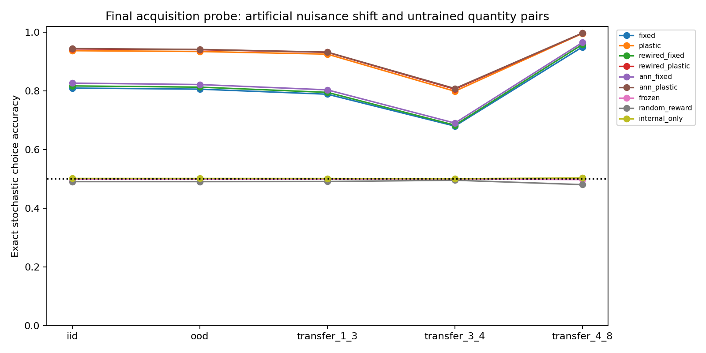

# DrosoLearn 초기 실행 보고서

범위: **smoke**, 3개 계산 시드. 정확도는 stochastic policy의 정답 선택 확률 평균이며 표의 값은 시드 평균이다. 결정론적 greedy 정확도는 별도 원자료에 보존했다. 이 결과를 살아 있는 초파리, 시각 수량 인지 또는 인간 학습 결과로 해석하지 않는다.

## 설계와 사전 기준

2 대 4에서 큰 수량에 보상하는 400시행 후 같은 모델에서 적은 수량에 보상하는 400시행을 수행했다. 평가 데이터는 학습하지 않는다. 습득은 마지막 IID probe의 확률 정확도 ≥0.75 및 초기 대비 ≥0.15 향상, 인공 nuisance OOD 일반화는 습득 통과와 OOD ≥0.7, 반전은 습득 통과와 반전 후 IID ≥0.75다. 모든 시드와 실패를 포함했다. smoke는 확증 연구가 아니다. confirmatory 실행은 기준 통과 시드 비율 ≥0.8을 추가 판정하며 analysis_summary.json에 보존한다.

| 조건 | 전 | 습득 후 | 변화 | OOD | 반전 후 | 습득/일반화/반전 기준 시드 |
|---|---:|---:|---:|---:|---:|---|
| fixed | 0.499 | 0.810 | +0.311 | 0.806 | 0.508 | 2/3 · 2/3 · 0/3 |
| plastic | 0.499 | 0.937 | +0.438 | 0.934 | 0.556 | 3/3 · 3/3 · 0/3 |
| rewired_fixed | 0.499 | 0.817 | +0.318 | 0.813 | 0.506 | 3/3 · 3/3 · 0/3 |
| rewired_plastic | 0.499 | 0.943 | +0.444 | 0.941 | 0.561 | 3/3 · 3/3 · 0/3 |
| ann_fixed | 0.499 | 0.826 | +0.327 | 0.822 | 0.508 | 3/3 · 3/3 · 0/3 |
| ann_plastic | 0.499 | 0.944 | +0.445 | 0.941 | 0.555 | 3/3 · 3/3 · 0/3 |
| frozen | 0.499 | 0.499 | +0.000 | 0.499 | 0.501 | 0/3 · 0/3 · 0/3 |
| random_reward | 0.499 | 0.491 | -0.008 | 0.491 | 0.517 | 0/3 · 0/3 · 0/3 |
| internal_only | 0.499 | 0.501 | +0.003 | 0.501 | 0.502 | 0/3 · 0/3 · 0/3 |

## 해석

명시적 n/8 입력이 이미 수량과 순서를 제공한다. 성공은 이 표현에 대한 보상 연합과 선택 교정을 보여주며, 개수를 시각적으로 추출했거나 수학 규칙을 발견했다는 증거가 아니다. OOD는 실제 물체 배치가 아닌 인공 descriptor 범위 변화다. 새 수량쌍 probe는 입력 표현이 제공한 순서의 사용 가능성을 보는 이차 진단이다. 원자료의 습득 gate를 통과하지 못한 조건의 전이를 일반화 성공으로 해석하지 않는다.

실제 구조는 512 KC·48 MBON 중 489 KC→29 MBON의 1,474쌍을 사용한다. 19 MBON에는 보존된 KC 입력이 없다. DAN/APL/반복 회로는 실행하지 않는다. 고정 조건은 출력 48파라미터만, 가소성 조건은 추가 내부 1,474파라미터를 갱신한다. 동일 입력·시행·출력 자원을 맞추었지만 고정 대 가소성의 총 학습 자원은 같지 않다. 내부만 학습하는 진단과 무학습·무정보 보상 대조도 함께 보존한다.

실제 배선의 우수성은 연구 전제가 아니며 작은 시드 평균 차이로 주장하지 않는다. 내부 가중치 변화만으로 생물학적 가소성을 주장하지 않는다. 학습/반전 중 활동 변화, 내부 변화와 readout 변화는 따로 기록했다. 초기 모델에는 시간 감쇠가 없어 휴지 시간의 생물학적 망각을 평가하지 않는다. 인간 공개 자료 비교와 Level 4/5 검증은 수행하지 않았다.

## 재현·검증·그림

- [실행 메타데이터](metadata.json), [사전 동결 기록](registration.json), [모든 시드 판정](summary.json)
- [시행별 기록](trials.csv), [평가 시행](evaluation_cases.csv), [학습 곡선](learning_curves.csv)
- [독립 검증](verification.json): 별도 코드로 저장된 활동·확률·판정을 재계산한 검증 범위를 확인할 것.
- 각 seed 디렉터리에 입력, 재배선과 전 checkpoint 가중치/encoder/probe 활동이 있다.

그림의 band는 시드 최솟값–최댓값이며 신뢰구간이 아니다. 재현 명령은 metadata.json의 reproduce에 있다. 원본 디렉터리에 재실행하면 거부되므로 새 출력 경로를 사용한다.
