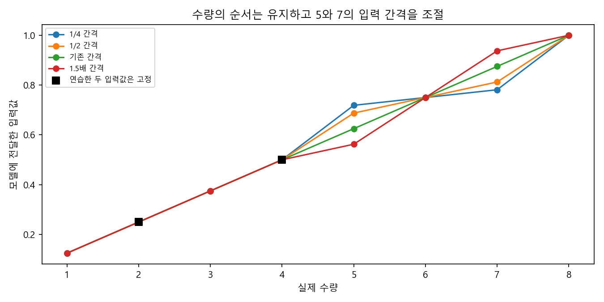
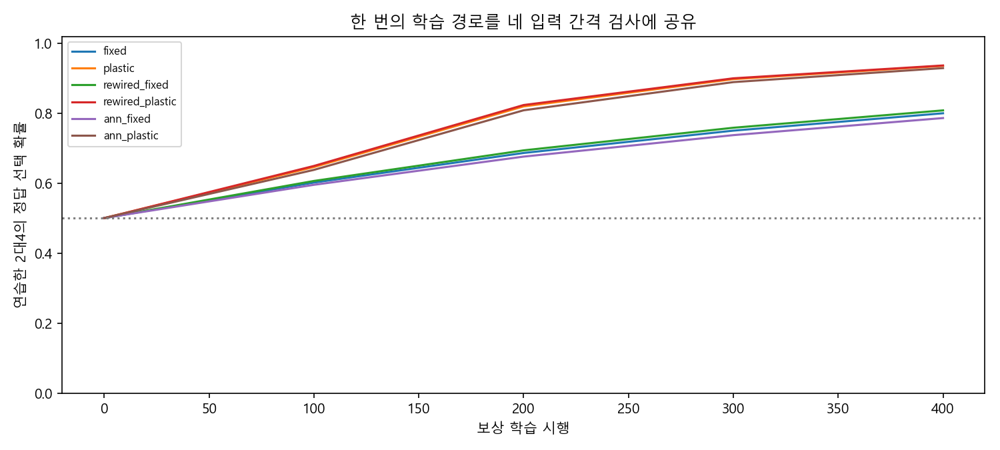
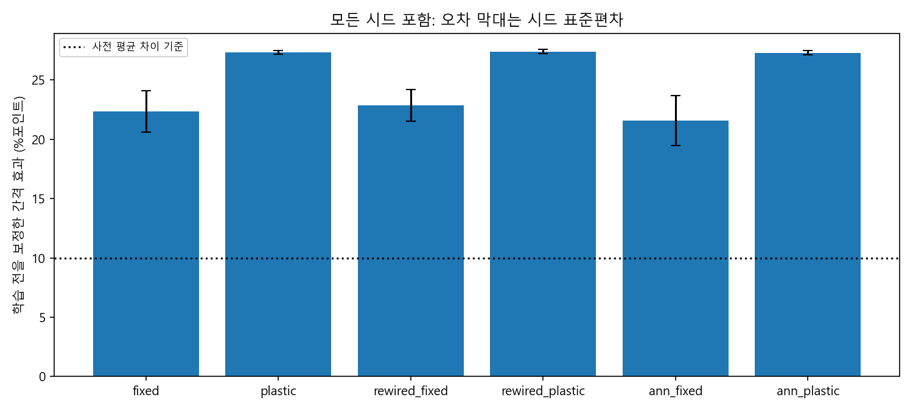
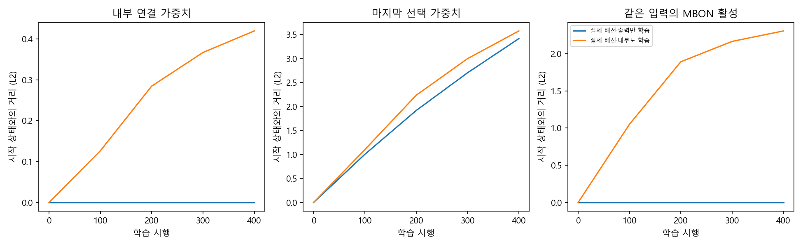

# 순서를 유지한 입력 간격 진단

## 먼저 쉬운 설명

연습은 2대4에서 큰 쪽을 고르는 400시행이다. 배운 모델은 그대로 두고, 새 5대7 문제를 전달하는 숫자 간격만 줄이거나 늘렸다. 모든 코드에서 5보다 7의 입력값이 크고 두 값의 중간 지점은 같다. 실제 개수와 비율·자료·모델·보상 경험을 유지한다. 물체 그림을 보거나 수량 의미를 스스로 발견하는 과제는 아니다.

이번에는 정답 선택 **확률**과, 확률이 높은 쪽만 고르는 **결정적 선택 성적**을 나눠 본다. 확률은 줄어도 결정적 선택은 유지될 수 있다. 인간의 주관적인 확신을 측정한 값은 아니다.

## 같은5대7의 정답 선택 확률

아래는10개 계산 시드 모두의 학습 후 평균이다. 간격은 기존 입력값 사이 거리에 대한 배율이다. 훈련 수량2·4, 전체 범위·끝점, 새5·7의 중간값은 고정했다. 5·7은 훈련 입력 구간 밖이다.

| 모델 | 1/4 간격 | 1/2 간격 | 기존 간격 | 1.5배 간격 |
|---|---:|---:|---:|---:|
| 실제 배선·출력만 학습 | 59.3% | 68.0% | 81.7% | 90.3% |
| 실제 배선·내부도 학습 | 66.8% | 80.1% | 94.2% | 98.5% |
| 재배선·출력만 학습 | 59.6% | 68.6% | 82.5% | 91.0% |
| 재배선·내부도 학습 | 66.9% | 80.3% | 94.3% | 98.5% |
| 일반 신경망·출력만 학습 | 58.9% | 67.1% | 80.5% | 89.1% |
| 일반 신경망·내부도 학습 | 66.3% | 79.4% | 93.6% | 98.2% |

## 확률이 높은 쪽만 고른 경우

| 모델 | 1/4 간격 | 1/2 간격 | 기존 간격 | 1.5배 간격 | 습득 후 네 간격 모두90% |
|---|---:|---:|---:|---:|---:|
| 실제 배선·출력만 학습 | 100.0% | 100.0% | 100.0% | 100.0% | 9/10 |
| 실제 배선·내부도 학습 | 100.0% | 100.0% | 100.0% | 100.0% | 10/10 |
| 재배선·출력만 학습 | 100.0% | 100.0% | 100.0% | 100.0% | 10/10 |
| 재배선·내부도 학습 | 100.0% | 100.0% | 100.0% | 100.0% | 10/10 |
| 일반 신경망·출력만 학습 | 100.0% | 100.0% | 100.0% | 100.0% | 9/10 |
| 일반 신경망·내부도 학습 | 100.0% | 100.0% | 100.0% | 100.0% | 10/10 |

마지막 열은 연습 습득을 통과하고, 네 간격 모두에서 사전 greedy90% 기준을 만족한 시드 수다. 그 개수에 사후 가족 성공 기준을 추가하지 않았다. 동률은0.5로 처리했다.

## 미리 정한 판정

주 효과는 `(학습후 기존간격 확률−학습후1/4간격 확률)−(학습전 같은 차이)`다. 시작 상태에서도 있던 간격 차이를 보정했다. 전체 시드 평균≥10%포인트와 양수 시드≥80%라는 사전 H-S 기준은6/6모델이 통과했다. 다음 표의 평균에는 습득 실패 시드도 포함했다. 습득 통과 시드만의 보조 평균은 [원자료 판정](summary.json)에 별도로 있다.

| 모델 | 습득 | 주 효과 평균±SD (%포인트) | 양수 시드 | H-S | 5대7 절대 전이 통과 수(네 간격 순) |
|---|---:|---:|---:|---|---:|
| 실제 배선·출력만 학습 | 9/10 | 22.35±1.74 | 10/10 | 통과 | 0 / 0 / 9 / 9 |
| 실제 배선·내부도 학습 | 10/10 | 27.33±0.17 | 10/10 | 통과 | 0 / 10 / 10 / 10 |
| 재배선·출력만 학습 | 10/10 | 22.86±1.32 | 10/10 | 통과 | 0 / 0 / 10 / 10 |
| 재배선·내부도 학습 | 10/10 | 27.38±0.18 | 10/10 | 통과 | 0 / 10 / 10 / 10 |
| 일반 신경망·출력만 학습 | 9/10 | 21.57±2.09 | 10/10 | 통과 | 0 / 0 / 9 / 9 |
| 일반 신경망·내부도 학습 | 10/10 | 27.27±0.18 | 10/10 | 통과 | 0 / 10 / 10 / 10 |

연습 습득은 최종 정답 확률≥75% 및 시작 대비≥15%포인트다. 각 코드의 절대 전이는 습득 통과 및5대7 정답 확률≥75%를 모두 요구한다. 전체15개 완전 새 수량쌍의 macro 전이 기준은 별도 보조 지표이며 위5대7 기준과 섞지 않았다. ±는 시드 표본 표준편차로 생물학적 표본의 신뢰구간이나 유의성 검정이 아니다.

## 무엇을 설명할 수 있는가

같은5대7과 같은 비율5/7에서 코드 간격에 따라 선택 반응이 달라지는지를 측정한다. 현재 신경망 점수는 인공 입력에 대해 구간별 선형이며, 점수 차이를sigmoid 선택 확률로 바꾼다. **단순 선형 점수와 같은 선택 함수만으로도 확률 변화와 선택 방향 보존이 함께 나타날 수 있다.** 따라서 결과가 그런 방향이어도 새로운 수량 계산 원리나 Weber 법칙을 발견했다고 주장하지 않는다. 확률 지표가 입력 기하와 선택 함수에 얼마나 의존하는지 좁힌 결과다.

단순히 큰 코드를 고르는 분석적 기준은 모든 네 코드·27새 쌍에서100%다. 이100%는 신경망 결과가 아니다. 비수량 단서만으로는 교차 설계상50%다. 신경망에는5대7의 대응표나 평가 정답을 전달하지 않았다. 다른26쌍에서는 간격과 중간값이 함께 바뀔 수 있으므로 [쌍별 성적](pair_summary.csv)을 기술적으로 보고하며 간격만의 인과 효과라고 말하지 않는다.

## 실행·검산·한계

실제 학습은 24,000시행이다. 네 코드는 같은 학습 경로의 고정 평가이며 4배의 추가 학습이나 독립 초파리 개체가 아니다. 같은 시드·모델 조건의 네 코드 평가는 배선·초기값·학습 경험을 공유했다. 내부 학습 모델은 내부 가중치 1,474개를 추가 갱신하므로 출력 전용 모델과 같은 학습 자원이라고 주장하지 않는다.

[사전 프로토콜](../../docs/spacing-protocol.md) · [설계의 수학적 확인](../../docs/spacing-background.md) · [실행 정보](metadata.json) · [모든 시드 판정](summary.json) · [독립 검산](verification.json)

각 seed에 모든 시행·입력·선택 난수·보상·배선·checkpoint가 있다. 내부·출력·활성의 변화량을 구분해 기록했다. 후보별cache와 네코드×27쌍×평가행 확률을 보존하며 독립 산술로 검산한다. 기존 실패와 옛 프로토콜을 바꾸지 않는다. 인간 공개자료와 이번 곡선의 직접 비교, 실제LC11/DAN, 수학 기호 의미, Level4/5는 검증하지 않았다.

